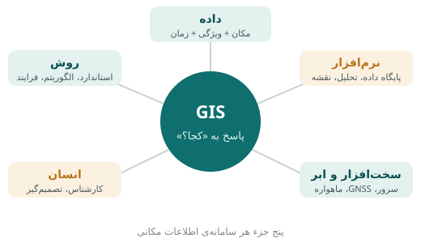
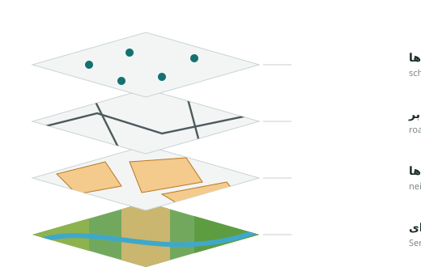
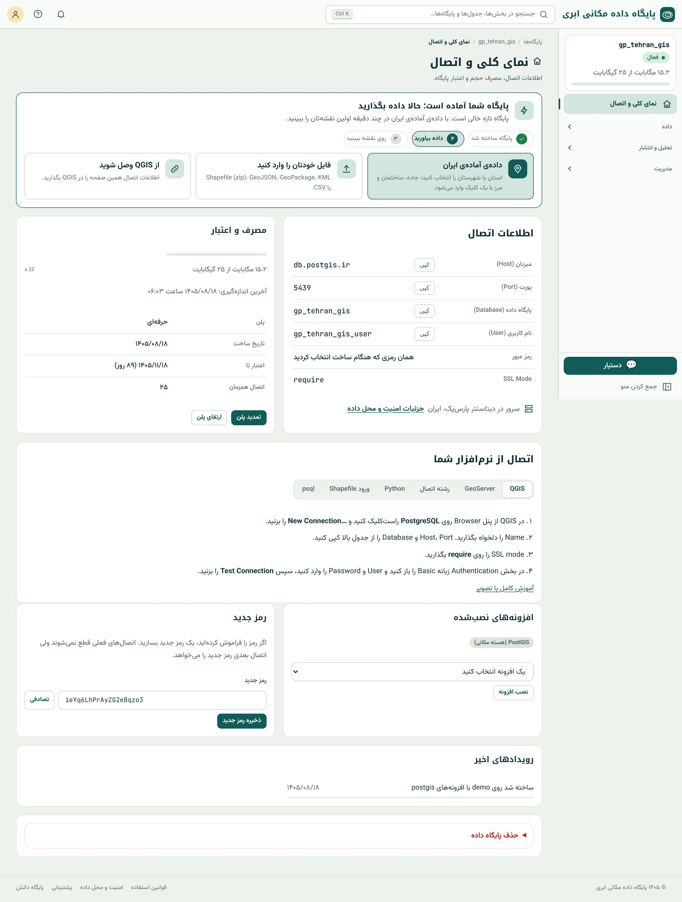

## مکان در همه‌چیز هست

در تابستان ۱۸۵۴ وبا در محله‌ی سوهوی لندن ظرف ده روز بیش از پانصد نفر را کشت. نظریه‌ی رایج آن زمان این بود که بیماری
از «هوای بد» منتقل می‌شود. پزشکی به نام جان اسنو کار ساده‌ای کرد: محل خانه‌ی هر قربانی را با یک خط کوتاه روی نقشه‌ی محله
علامت زد و محل تلمبه‌های آب عمومی را هم روی همان نقشه گذاشت. الگو بلافاصله پیدا شد: مرگ‌ها دور یک تلمبه در خیابان برود
جمع شده بودند. دسته‌ی تلمبه را برداشتند و همه‌گیری فروکش کرد.

اسنو رایانه نداشت، اما همان کاری را کرد که امروز هر سامانه‌ی اطلاعات مکانی انجام می‌دهد: **داده‌ای را که مکان دارد روی
هم گذاشت تا الگویی دیده شود که در جدول دیده نمی‌شد.** در فهرست نام و نشانی قربانیان هیچ چیز غیرعادی نبود؛ روی نقشه، پاسخ
فریاد می‌زد.

تخمین زده می‌شود بخش بزرگی از داده‌هایی که سازمان‌ها نگه می‌دارند به نوعی مؤلفه‌ی مکانی دارند: نشانی مشتری، محل پروژه،
مسیر ناوگان، مرز ملک، محل تیر برق، مزرعه‌ی تحت پوشش بیمه. هر جا این مؤلفه وجود دارد، پرسش «کجا؟» هم وجود دارد.

::: know
**قانون اول جغرافیا.** والدو تابلر، جغرافی‌دان آمریکایی، در سال ۱۹۷۰ جمله‌ای نوشت که به «قانون اول جغرافیا» مشهور شد:
«همه چیز به همه چیز مربوط است، اما چیزهای نزدیک بیشتر از چیزهای دور به هم مربوط‌اند.» قیمت خانه‌های یک محله به هم
نزدیک است، آلودگی هوای دو ایستگاه مجاور شبیه است و بیماری واگیر از نزدیک‌ترین‌ها پخش می‌شود. بسیاری از روش‌های این کتاب،
از نزدیک‌ترین همسایه تا درون‌یابی و آمار فضایی، روی همین قانون بنا شده‌اند.
:::

## تعریف سامانه‌ی اطلاعات مکانی

**سامانه‌ی اطلاعات مکانی** (Geographic Information System یا به اختصار **GIS**) مجموعه‌ای از داده، نرم‌افزار، سخت‌افزار،
روش و انسان است که برای **گردآوری، ذخیره، مدیریت، تحلیل و نمایش** داده‌هایی به کار می‌رود که به موقعیتی روی زمین وابسته‌اند.

در این تعریف دو نکته مهم است. اول اینکه GIS فقط «نرم‌افزار نقشه» نیست؛ نقشه یکی از خروجی‌های آن است. قلب GIS **تحلیل**
است: پیدا کردن رابطه‌ها و الگوهایی که بدون در نظر گرفتن مکان دیده نمی‌شوند. دوم اینکه GIS یک «سامانه» است و فقط وقتی
کار می‌کند که همه‌ی اجزایش حاضر باشند.

**داده** مهم‌ترین و گران‌ترین جزء است. داده‌ی مکانی سه بُعد دارد: **مکان** (کجاست؟)، **ویژگی** (چیست و چه مشخصاتی
دارد؟) و **زمان** (کی؟). یک مدرسه مکانی دارد (طول و عرض جغرافیایی)، ویژگی‌هایی دارد (نام، مقطع، تعداد دانش‌آموز) و
در زمانی ثبت شده است.

**نرم‌افزار** امکان ذخیره، پرسش، تحلیل و نمایش را فراهم می‌کند. در این کتاب نرم‌افزار اصلی ما پایگاه داده مکانی ابری است
که روی PostgreSQL و PostGIS ساخته شده است، و در کنارش از QGIS (نرم‌افزار رومیزی متن‌باز) هم استفاده می‌کنیم.

**سخت‌افزار** از سرورهایی که داده را نگه می‌دارند تا گیرنده‌ی GNSS نقشه‌بردار و ماهواره‌ای که از زمین عکس می‌گیرد. در
رایانش ابری، بخش بزرگی از این جزء از دوش شما برداشته شده است.

**روش** مجموعه‌ی استانداردها، الگوریتم‌ها و فرایندهای کاری است: کدام سیستم مختصات؟ کدام روش طبقه‌بندی؟ داده چگونه
کنترل کیفیت شود؟

**انسان** هم کارشناسی است که سامانه را می‌سازد و هم مدیری که با خروجی آن تصمیم می‌گیرد. بهترین داده و نرم‌افزار، بدون
کسی که پرسش درست را بپرسد، بی‌فایده است.

## پنج پرسشی که GIS به آن‌ها پاسخ می‌دهد

بیشتر کارهای GIS را می‌توان در پنج دسته پرسش جا داد. شناختن این دسته‌ها کمک می‌کند پرسش مدیر یا کارفرما را به یک
تحلیل مشخص تبدیل کنید.

| نوع پرسش | شکل کلی | مثال | ابزار در این کتاب |
|---|---|---|---|
| **مکان** | فلان چیز کجاست؟ | نزدیک‌ترین بیمارستان به این تصادف کجاست؟ | یافتن عارضه، نزدیک‌ترین (فصل‌های ۸ و ۱۹) |
| **وضعیت** | در این مکان چه چیزی هست؟ | این قطعه زمین در کدام محله و چه کاربری است؟ | روابط مکانی (فصل ۱۷) |
| **روند** | از فلان زمان چه چیزی تغییر کرده؟ | پوشش گیاهی این دشت در پنج سال چه تغییری کرده؟ | سری زمانی ماهواره‌ای، تغییر بین دو نسخه (فصل‌های ۲۷ و ۳۷) |
| **الگو** | چه الگوی مکانی وجود دارد؟ | تصادف‌ها در کجا متمرکزند؟ | تراکم شش‌ضلعی، خوشه‌بندی (فصل‌های ۲۱ و ۲۶) |
| **مدل‌سازی** | اگر …، چه می‌شود؟ | اگر ایستگاه آتش‌نشانی تازه اینجا ساخته شود، چند خانه زیر پوشش پنج‌دقیقه‌ای می‌رود؟ | حوزه‌ی دسترسی، پوشش مراکز (فصل ۲۸) |

::: real
**مکان‌یابی شعبه.** بانکی می‌خواهد شعبه‌ی تازه باز کند. پرسش «کجا شعبه بزنیم؟» در GIS به چند پرسش جزئی شکسته می‌شود:
جمعیت هر محله چقدر است (وضعیت)؟ شعبه‌های فعلی ما و رقبا کجا هستند (مکان)؟ کدام محله‌ها بیشتر از ۱۵۰۰ متر از نزدیک‌ترین
شعبه فاصله دارند (الگو)؟ اگر شعبه را در نقطه‌ی الف بزنیم چند نفر در فاصله‌ی ده دقیقه پیاده‌روی آن قرار می‌گیرند (مدل‌سازی)؟
همه‌ی این پرسش‌ها را تا پایان بخش پنجم این کتاب می‌توانید پاسخ دهید.
:::

## نگاهی کوتاه به تاریخ

- **۱۸۵۴:** نقشه‌ی وبای جان اسنو، نمونه‌ی کلاسیک تحلیل مکانی.
- **دهه‌ی ۱۹۶۰:** راجر تاملینسون در کانادا نخستین سامانه‌ی رایانه‌ای GIS را برای سیاهه‌ی اراضی کشور ساخت. اصطلاح
  «سامانه‌ی اطلاعات جغرافیایی» از همین پروژه آمد.
- **۱۹۷۲:** پرتاب نخستین ماهواره‌ی Landsat و آغاز سنجش از دور غیرنظامی.
- **دهه‌ی ۱۹۸۰ و ۱۹۹۰:** نرم‌افزارهای تجاری رومیزی و همه‌گیر شدن GIS در سازمان‌ها؛ تشکیل کنسرسیوم مکانی باز (OGC) و
  استانداردهایی که امروز همه از آن‌ها استفاده می‌کنند.
- **۲۰۰۱:** نخستین نسخه‌ی PostGIS؛ داده‌ی مکانی به پایگاه داده‌ی رابطه‌ای متن‌باز آمد.
- **۲۰۰۲ تا ۲۰۰۴:** آغاز QGIS و OpenStreetMap، نقشه‌ی آزاد جهان که با مشارکت داوطلبان ساخته می‌شود.
- **۲۰۰۸:** آرشیو Landsat رایگان شد.
- **۲۰۱۵:** پرتاب Sentinel-2A اروپا؛ تصویر رایگان با تفکیک ده متر و تکرار چندروزه.
- **دهه‌ی ۲۰۲۰:** GIS ابری؛ پایگاه داده، تحلیل و تصویر ماهواره‌ای همه در مرورگر.

## مفهوم لایه

نقشه‌ی کاغذی همه چیز را با هم نشان می‌دهد. GIS داده را در **لایه‌ها** نگه می‌دارد: هر لایه یک نوع پدیده است و همه‌ی لایه‌ها
روی یک سیستم مختصات مشترک قرار می‌گیرند تا بتوان آن‌ها را روی هم گذاشت. لایه‌ی مدرسه‌ها، لایه‌ی معابر، لایه‌ی محله‌ها و
لایه‌ی تصویر ماهواره‌ای جدا از هم ذخیره می‌شوند، اما چون همه می‌دانند «کجا» هستند، می‌توانیم بپرسیم «کدام مدرسه‌ها در
محله‌ی ونک‌اند» یا «پوشش گیاهی در حریم ۵۰۰ متری رودخانه چقدر است».

در پایگاه داده‌ی مکانی، **هر لایه یک جدول است.** هر سطر جدول یک **عارضه** (feature) است، مثلاً یک مدرسه، و هر ستون یک
ویژگی. یکی از ستون‌ها، که معمولاً `geom` نام دارد، شکل و مکان عارضه را نگه می‌دارد. این ایده‌ی ساده، یعنی «لایه = جدول»،
پایه‌ی همه‌ی فصل‌های بعدی است و در فصل ۴ مفصل به آن برمی‌گردیم.

## کاربردهای GIS

| حوزه | نمونه‌ی کاربرد |
|---|---|
| شهرسازی و مدیریت شهری | طرح تفصیلی، کاربری زمین، مکان‌یابی خدمات، عوارض نوسازی، مدیریت پسماند |
| کشاورزی | پایش سلامت مزرعه با NDVI، برآورد سطح زیر کشت، بیمه‌ی محصول، کشاورزی دقیق |
| آب و محیط زیست | حوضه‌ی آبریز، پایش دریاچه و تالاب، خشکسالی، آلودگی، مناطق حفاظت‌شده |
| منابع طبیعی | پایش جنگل و مرتع، آتش‌سوزی و برآورد سطح سوخته، فرسایش |
| بهداشت و درمان | دسترسی به مراکز درمانی، پایش همه‌گیری، مکان‌یابی پایگاه اورژانس |
| امداد و بحران | سیل، زلزله، مسیر امدادرسانی، برآورد خسارت با تصویر ماهواره‌ای |
| حمل‌ونقل و لجستیک | مسیریابی ناوگان، حوزه‌ی توزیع، تحلیل تصادف |
| زیرساخت و تأسیسات | شبکه‌ی برق، آب، گاز و مخابرات؛ مدیریت دارایی؛ پوشش آنتن |
| املاک، بانک و بیمه | ارزش‌گذاری ملک، مکان‌یابی شعبه، ریسک بیمه |
| نقشه‌برداری و عمران | برداشت میدانی، محاسبه‌ی حجم خاک‌برداری، پیاده‌کردن نقشه |

## GIS ابری و پایگاه داده مکانی ابری

در شیوه‌ی سنتی، هر کارشناس داده را در چند فایل روی رایانه‌ی خودش نگه می‌داشت: یک Shapefile برای مدرسه‌ها، یک فایل اکسل
برای جمعیت و پوشه‌ای از تصویرهای ماهواره‌ای. همکار دیگر نسخه‌ی دیگری از همان فایل‌ها داشت و هیچ‌کس نمی‌دانست کدام نسخه
تازه‌تر است. برای ساختن یک سرور پایگاه داده‌ی مکانی هم باید سرور تهیه، سیستم‌عامل و PostgreSQL نصب، PostGIS پیکربندی،
امنیت تنظیم و بکاپ‌گیری راه‌اندازی می‌شد؛ کاری که از عهده‌ی بیشتر کارشناسان GIS خارج است.

**پایگاه داده مکانی ابری** این زنجیره را ساده می‌کند. ثبت‌نام می‌کنید، نامی برای پایگاه داده انتخاب می‌کنید و چند ثانیه بعد
یک پایگاه داده‌ی PostgreSQL با PostGIS در اختیار دارید که:

- از هر جایی با مرورگر در دسترس است و نیازی به نصب ندارد؛
- از QGIS، ArcGIS Pro، GeoServer، پایتون و هر نرم‌افزار دیگری که PostgreSQL را می‌شناسد هم قابل اتصال است؛
- بکاپ خودکار، کاربران و نقش‌ها، و پایش مصرف دارد؛
- ابزارهای تحلیل، تصویر ماهواره‌ای، نقشه‌سازی، انتشار وب و برداشت میدانی را کنار داده‌ی شما گذاشته است.

{.shot}

منوی کناری هر پایگاه داده چهار گروه دارد که ساختار این کتاب هم تا حد زیادی از آن پیروی می‌کند:

| گروه منو | بخش‌ها | فصل‌های کتاب |
|---|---|---|
| نمای کلی و اتصال | اطلاعات اتصال، مصرف، اعتبار | ۵ و ۶ |
| داده | جدول‌ها، یافتن عارضه، اجرای SQL، ورود فایل، داده‌ی آماده‌ی ایران، تصویر ماهواره‌ای، سلامت داده | ۷ تا ۲۴، ۳۰ تا ۴۰ |
| تحلیل و انتشار | ابزارهای تحلیل، نقشه‌های چندلایه، انتشار لایه، WMS/WFS، برداشت میدانی | ۲۵ تا ۲۹، ۴۱ تا ۴۹ |
| مدیریت | تیم، بکاپ، مصرف و کارایی، افزونه‌ها، امکانات سازمانی | ۵۰ تا ۵۲ |

::: note
**آیا GIS ابری جای نرم‌افزار رومیزی را می‌گیرد؟** نه کاملاً، و لازم هم نیست. پایگاه داده مکانی ابری «منبع واحد حقیقت» است:
داده یک جا نگه داشته می‌شود و همه به همان وصل می‌شوند. هر کسی می‌تواند با ابزار دلخواهش، از مرورگر تا QGIS، روی همان
داده کار کند. در این کتاب هر جا QGIS کاری را بهتر انجام دهد، آن را هم آموزش می‌دهیم.
:::

## جریان کار GIS در این کتاب

تقریباً هر پروژه‌ی GIS این مراحل را طی می‌کند و هر مرحله در یک بخش از کتاب آمده است:

::: steps
1. **پرسش:** مسئله را به پرسش مکانی تبدیل کنید (همین فصل).
2. **داده:** داده را گردآوری کنید: از فایل، از داده‌ی آماده، از برداشت میدانی یا از تصویر ماهواره‌ای (بخش‌های ۲، ۵، ۶ و ۸).
3. **ذخیره و آماده‌سازی:** داده را در پایگاه داده وارد، سیستم مختصات را یکدست و هندسه‌ها را اصلاح کنید (بخش ۲ و فصل ۲۲).
4. **تحلیل:** با SQL مکانی یا ابزارهای آماده به پرسش پاسخ دهید (بخش‌های ۳ تا ۶).
5. **نمایش و انتشار:** نتیجه را به نقشه، نمودار، گزارش یا سرویس وب تبدیل کنید (بخش ۷).
6. **نگه‌داری:** داده را به‌روز، امن و پشتیبان‌دار نگه دارید (بخش ۹).
:::

::: summary
- GIS سامانه‌ای از داده، نرم‌افزار، سخت‌افزار، روش و انسان برای پاسخ به پرسش «کجا؟» است؛ نقشه یکی از خروجی‌های آن است، نه
  همه‌ی آن.
- داده‌ی مکانی سه بُعد دارد: مکان، ویژگی و زمان.
- پنج نوع پرسش GIS: مکان، وضعیت، روند، الگو و مدل‌سازی.
- داده در لایه‌ها نگه داشته می‌شود و در پایگاه داده‌ی مکانی هر لایه یک جدول و هر عارضه یک سطر است.
- پایگاه داده مکانی ابری یک PostgreSQL/PostGIS آماده است که داده، تحلیل، تصویر ماهواره‌ای و انتشار را یک‌جا جمع کرده است.
:::

::: teach
**زمان پیشنهادی:** یک جلسه‌ی ۹۰ دقیقه‌ای. داستان جان اسنو را با نقشه‌ی اصلی او شروع کنید و از دانشجوها بخواهید پیش از
دیدن نقشه حدس بزنند علت چیست. در نیمه‌ی دوم، هر گروه سه‌نفره یک مسئله از رشته‌ی خودش را به پنج نوع پرسش GIS بشکند.
تمرین ۴ را به‌عنوان تکلیف بدهید تا جلسه‌ی بعد هر دانشجو حساب کاربری داشته باشد.
:::

::: exercises
### تمرین‌ها

1. [سطح ۱]{.badge .b1} پنج جزء GIS را نام ببرید و برای هر کدام یک مثال از محیط کار یا تحصیل خودتان بزنید.
2. [سطح ۱]{.badge .b1} سه داده‌ی روزمره (مثلاً قبض برق) نام ببرید که مؤلفه‌ی مکانی دارند. مؤلفه‌ی مکانی هر کدام چیست؟
3. [سطح ۱]{.badge .b1} برای هر یک از پنج نوع پرسش GIS یک پرسش در شهر خودتان بنویسید.
4. [سطح ۱]{.badge .b1} در پایگاه داده مکانی ابری حساب کاربری بسازید (فصل ۵) و منوی کناری را مرور کنید. کدام بخش‌ها
   برای رشته‌ی شما مفیدترند؟
5. [سطح ۲]{.badge .b2} قانون اول جغرافیا را با یک مثال توضیح دهید. آیا موردی می‌شناسید که این قانون در آن صدق نکند؟
6. [سطح ۲]{.badge .b2} مسئله‌ی «جای مناسب برای یک داروخانه‌ی تازه در محله‌ی شما» را به مراحل جریان کار GIS بشکنید: چه
   داده‌هایی لازم است و از کجا؟ چه تحلیلی؟ خروجی چه باشد؟
7. [سطح ۳]{.badge .b3} درباره‌ی یکی از رویدادهای تاریخ GIS که در این فصل آمد تحقیق کنید و در یک صفحه بنویسید چه
   مسئله‌ای را حل کرد و چه تأثیری بر امروز گذاشت.
:::
