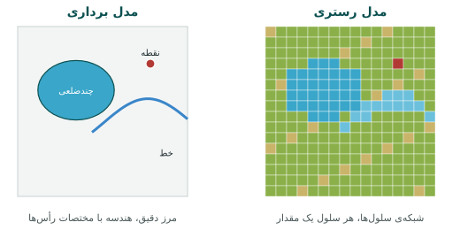
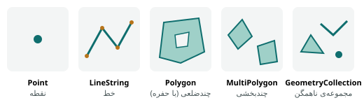

## جهان واقعی و مدل آن

جهان واقعی پیوسته و بی‌نهایت پیچیده است. خیابان عرض دارد، لبه‌ی جدول دارد، درخت‌های کنارش هر روز رشد می‌کنند. هیچ
رایانه‌ای نمی‌تواند همه‌ی این جزئیات را ذخیره کند؛ پس هر GIS جهان را **ساده می‌کند** و به یک **مدل داده** تبدیل می‌کند.
اینکه خیابان را یک خط ببینیم یا یک چندضلعی با عرض واقعی، به هدف ما بستگی دارد: برای مسیریابی خط کافی است، برای محاسبه‌ی
مساحت آسفالت چندضلعی لازم است.

دو مدل اصلی برای نمایش جهان در GIS وجود دارد:

- **مدل برداری** (vector): جهان از **اشیای گسسته** ساخته شده است که مرز مشخص دارند؛ مثل چاه، جاده یا قطعه‌ی زمین.
- **مدل رستری** (raster): جهان یک **میدان پیوسته** است که در یک شبکه‌ی منظم از سلول‌ها نمونه‌برداری شده است؛ مثل
  ارتفاع، دما یا بازتاب نور در تصویر ماهواره‌ای.



## مدل برداری

در مدل برداری هر پدیده یک **عارضه** (feature) است. عارضه دو بخش دارد:

1. **هندسه** (geometry): شکل و مکان، که با مختصات یک یا چند نقطه بیان می‌شود.
2. **ویژگی‌ها** (attributes): اطلاعات توصیفی مثل نام، نوع، تاریخ یا جمعیت.

در پایگاه داده‌ی مکانی، عارضه یک سطر جدول است؛ هندسه در یک ستون از نوع `geometry` و هر ویژگی در یک ستون معمولی ذخیره
می‌شود. مثلاً سه سطر اول جدول مدرسه‌ها در داده‌ی نمونه این است:

```{.sql .run rows=3}
SELECT school_id, name, level, students, ST_AsText(geom) AS geom
FROM schools
ORDER BY school_id
LIMIT 3;
```

ستون آخر هندسه را به صورت متن نشان می‌دهد: `POINT(طول عرض)`. فعلاً نگران کد بالا نباشید؛ در بخش سوم SQL را از صفر یاد
می‌گیرید. نکته‌ی مهم این است که **هندسه هم یک ستون جدول است**، کنار نام و تعداد دانش‌آموز.

### انواع هندسه

استاندارد «ویژگی‌های ساده» (Simple Features) که کنسرسیوم مکانی باز (OGC) و سازمان استاندارد ISO تدوین کرده‌اند، هفت نوع
هندسه‌ی پایه تعریف می‌کند که PostGIS و تقریباً همه‌ی نرم‌افزارهای GIS از آن پیروی می‌کنند:



| نوع | تعریف | نمونه‌ی پدیده | نمایش متنی (WKT) |
|---|---|---|---|
| `POINT` | یک جفت مختصات | چاه، مدرسه، تیر برق | `POINT(51.39 35.70)` |
| `LINESTRING` | دنباله‌ای از دست‌کم دو نقطه | جاده، رود، لوله | `LINESTRING(0 0, 1 1, 2 1)` |
| `POLYGON` | یک حلقه‌ی بیرونی بسته و صفر یا چند حفره | قطعه‌ی زمین، دریاچه، محله | `POLYGON((0 0, 4 0, 4 4, 0 4, 0 0))` |
| `MULTIPOINT` | چند نقطه در یک عارضه | شعبه‌های یک بانک | `MULTIPOINT((0 0), (1 2))` |
| `MULTILINESTRING` | چند خط در یک عارضه | بزرگراهی با دو باند جدا | `MULTILINESTRING((0 0, 1 1), (2 2, 3 3))` |
| `MULTIPOLYGON` | چند چندضلعی در یک عارضه | کشوری با جزیره، مثل ایران و جزیره‌های خلیج فارس | `MULTIPOLYGON(((…)), ((…)))` |
| `GEOMETRYCOLLECTION` | مجموعه‌ای ناهمگن | نتیجه‌ی بعضی عملیات هندسی | `GEOMETRYCOLLECTION(POINT(…), LINESTRING(…))` |

چند قاعده‌ی مهم دارد که در عمل زیاد به آن برمی‌خوریم:

- حلقه‌ی چندضلعی باید **بسته** باشد: نقطه‌ی آخر دقیقاً همان نقطه‌ی اول است.
- حلقه‌ی چندضلعی نباید **خودش را قطع کند**؛ چندضلعی «پاپیونی» نامعتبر است و بسیاری از محاسبات را خراب می‌کند. فصل ۲۲
  روش یافتن و اصلاح هندسه‌ی نامعتبر را آموزش می‌دهد.
- در WKT ابتدا **طول** (x، شرقی‌غربی) و سپس **عرض** (y، شمالی‌جنوبی) می‌آید. این ترتیب برعکس عادت روزمره است که
  «عرض، طول» می‌گوییم و یکی از رایج‌ترین منشأهای خطاست.

::: warn
**ترتیب طول و عرض.** تهران در حدود طول ۵۱٫۴ و عرض ۳۵٫۷ درجه است. اگر نقطه‌ای با `POINT(35.7 51.4)` بسازید، آن را در
شمال روسیه می‌گذارید! هر وقت لایه‌ای «در جای عجیبی» نمایش داده شد، اول ترتیب مختصات را بررسی کنید.
:::

### هندسه با ارتفاع و اندازه

هر رأس هندسه می‌تواند علاوه بر x و y، مختصات **Z** (ارتفاع) و مقدار **M** (اندازه، مثلاً فاصله‌ی پیموده‌شده روی خط) هم
داشته باشد: `POINT Z (51.39 35.70 1210)`. نقطه‌های برداشت میدانی با گیرنده‌ی GNSS معمولاً Z دارند و فصل ۴۹ از همین Z برای
ساختن سطح و منحنی میزان استفاده می‌کند.

### توپولوژی؛ رابطه‌ها، نه فقط شکل‌ها

دو قطعه‌ی زمین مجاور یک مرز مشترک دارند. اگر هر قطعه جداگانه رقومی شود، احتمال دارد مرز مشترک دو بار و با اندکی اختلاف
کشیده شود و بین دو قطعه شکاف یا همپوشانی باریکی (sliver) ایجاد شود. **توپولوژی** مجموعه‌ی قواعدی است که رابطه‌ی
هندسه‌ها را تضمین می‌کند: قطعه‌ها روی هم نیفتند، بین‌شان شکاف نباشد، خط‌های شبکه در گره‌ها به هم برسند. مدل «ویژگی‌های
ساده» که بیشتر نرم‌افزارها به کار می‌برند هر عارضه را مستقل نگه می‌دارد و توپولوژی را ذخیره نمی‌کند؛ اما می‌توان قواعد آن
را با SQL بررسی کرد یا از افزونه‌ی `postgis_topology` استفاده کرد (فصل ۲۲).

## مدل رستری

در مدل رستری، محدوده‌ی مطالعه با یک **شبکه‌ی منظم** از سلول‌های هم‌اندازه پوشانده می‌شود. هر سلول، که در تصویر
**پیکسل** نامیده می‌شود، یک مقدار عددی دارد: ارتفاع زمین، دمای سطح، نوع کاربری یا میزان بازتاب نور.

مفاهیم کلیدی رستر:

- **تفکیک مکانی** (resolution): اندازه‌ی ضلع هر سلول روی زمین. تصویر Sentinel-2 در باندهای مرئی تفکیک ده متر دارد،
  یعنی هر پیکسل مربعی ۱۰ × ۱۰ متر از زمین است. مدل ارتفاعی Copernicus تفکیک حدود ۳۰ متر دارد.
- **باند** (band): رستر می‌تواند چند لایه‌ی هم‌شبکه داشته باشد. تصویر رنگی سه باند دارد (قرمز، سبز، آبی) و تصویر Sentinel-2
  سیزده باند طیفی.
- **نوع داده‌ی پیکسل:** عدد صحیح ۸ بیتی (۰ تا ۲۵۵) برای تصویر نمایشی، عدد صحیح ۱۶ بیتی برای بازتاب، عدد اعشاری برای
  شاخص‌هایی مثل NDVI که بین منفی یک و یک‌اند.
- **مقدار بی‌داده** (NoData): مقداری قراردادی برای سلول‌هایی که داده ندارند، مثلاً بیرون از مرز برش یا زیر ابر. فراموش کردن
  NoData میانگین‌ها را خراب می‌کند.
- **مرجع مکانی:** مختصات گوشه‌ی رستر، اندازه‌ی سلول و سیستم مختصات. بدون این‌ها رستر فقط یک عکس است و نمی‌داند کجای زمین است.

رستر دو نوع اصلی دارد: **پیوسته** که مقدارش به تدریج تغییر می‌کند (ارتفاع، دما، بازتاب) و **گسسته یا طبقه‌ای** که هر
مقدار یک کلاس است (۱ = آب، ۲ = جنگل، ۳ = شهر). نقشه‌ی کاربری اراضی حاصل طبقه‌بندی تصویر ماهواره‌ای یک رستر گسسته است.

::: know
**اندازه‌ی رستر به سرعت بزرگ می‌شود.** محدوده‌ای ۱۰۰ × ۱۰۰ کیلومتری با تفکیک ۱۰ متر، ۱۰٬۰۰۰ × ۱۰٬۰۰۰ یعنی صد میلیون
پیکسل در هر باند دارد. با ۱۳ باند و دو بایت برای هر پیکسل، حدود ۲٫۶ گیگابایت می‌شود. به همین دلیل سامانه تصویر ماهواره‌ای
را فقط برای محدوده‌ی مورد نیاز شما برش می‌دهد و در قالب COG (فصل ۳۴) ذخیره می‌کند.
:::

## کدام مدل، برای کدام مسئله

| معیار | برداری | رستری |
|---|---|---|
| مناسب برای | اشیای گسسته با مرز مشخص | پدیده‌های پیوسته و تصویر |
| دقت مرز | بالا؛ به اندازه‌ی دقت مختصات | محدود به اندازه‌ی سلول |
| حجم داده برای محدوده‌ی بزرگ | کم | زیاد |
| ویژگی‌های متعدد برای هر عارضه | آسان (ستون‌های جدول) | دشوار (هر ویژگی یک باند) |
| تحلیل شبکه و مسیریابی | بسیار مناسب | نامناسب |
| تحلیل همپوشانی و جبر نقشه | ممکن، گاهی کند | سریع و ساده |
| نمونه | قطعه‌ی ثبتی، شبکه‌ی آب، مدرسه | تصویر ماهواره‌ای، DEM، نقشه‌ی دما |

در عمل بیشتر پروژه‌ها از هر دو استفاده می‌کنند و تبدیل بین آن‌ها هم رایج است. فصل ۳۶ نمونه‌ی مهمی را نشان می‌دهد: محاسبه‌ی
میانگین NDVI (رستر) برای هر قطعه‌ی کشاورزی (برداری)، که به آن **آمار ناحیه‌ای** می‌گویند.

## ویژگی‌ها و سطح اندازه‌گیری

ستون‌های توصیفی هم نوع دارند و نوع آن‌ها تعیین می‌کند چه محاسبه‌ای مجاز و چه نمادی روی نقشه مناسب است. روان‌شناسی به نام
استنلی استیونس در ۱۹۴۶ چهار **سطح اندازه‌گیری** تعریف کرد که در کارتوگرافی و آمار مکانی پایه است:

| سطح | ویژگی | مثال | محاسبه‌ی مجاز | نماد مناسب روی نقشه |
|---|---|---|---|---|
| **اسمی** | فقط نام یا دسته؛ ترتیب ندارد | کاربری زمین، نوع مرکز درمانی، خط مترو | شمارش، مُد | رنگ‌های متفاوت (فام)، شکل نماد |
| **ترتیبی** | ترتیب دارد ولی فاصله‌ها معنا ندارند | مقطع تحصیلی، درجه‌ی جاده، کم/متوسط/زیاد | میانه، رتبه | روشنی رنگ، ضخامت خط |
| **فاصله‌ای** | فاصله معنا دارد، صفر قراردادی است | دما به سلسیوس، سال | میانگین، تفاضل | طیف رنگی پیوسته |
| **نسبی** | صفر واقعی دارد، نسبت معنا دارد | جمعیت، مساحت، تعداد دانش‌آموز، بارش | همه‌ی محاسبات | اندازه‌ی نماد، طیف رنگی |

::: warn
**میانگینِ کد معنا ندارد.** اگر کاربری‌ها با عدد کدگذاری شده باشند (۱ = مسکونی، ۲ = تجاری)، میانگین ۱٫۵ هیچ معنایی ندارد.
همین‌طور نمایش «جمعیت» (یک مقدار مطلق) با طیف رنگی روی محله‌هایی با مساحت متفاوت گمراه‌کننده است؛ باید آن را به **تراکم**
(جمعیت بر کیلومتر مربع) تبدیل کرد. فصل ۴۱ این قواعد را مفصل‌تر بررسی می‌کند.
:::

## قالب‌های فایل مکانی

داده‌ی مکانی پیش از ورود به پایگاه داده معمولاً در یکی از این قالب‌هاست. سامانه بیشتر آن‌ها را مستقیم می‌پذیرد (فصل ۷):

| قالب | نوع | توضیح |
|---|---|---|
| **Shapefile** (`.shp` و فایل‌های همراه) | برداری | قدیمی‌ترین و رایج‌ترین؛ دست‌کم سه فایل (`.shp`، `.shx`، `.dbf`) و معمولاً `.prj`. محدودیت ده‌حرفی نام ستون، حداکثر دو گیگابایت و مشکل رایج کدگذاری متن فارسی. برای ورود باید همه‌ی فایل‌ها را zip کنید. |
| **GeoPackage** (`.gpkg`) | برداری و رستری | جانشین مدرن Shapefile؛ یک فایل واحد که در واقع یک پایگاه داده‌ی SQLite است؛ چند لایه، نام ستون بلند و UTF-8. |
| **GeoJSON** (`.geojson`) | برداری | متنی و خوانا، استاندارد وب؛ همیشه در WGS84. برای حجم‌های بزرگ کند است. |
| **KML / KMZ** | برداری | قالب Google Earth؛ همراه سبک نمایش. |
| **CSV** با ستون طول و عرض یا WKT | برداری (نقطه) | ساده‌ترین راه برای داده‌ی نقطه‌ای از اکسل. |
| **DXF / DWG** | برداری | قالب نقشه‌کشی (CAD)؛ رایج در نقشه‌برداری و عمران. |
| **GeoTIFF / COG** | رستری | تصویر TIFF با مرجع مکانی؛ COG نسخه‌ی بهینه‌شده برای خواندن تکه‌ای از اینترنت است. |
| **پایگاه داده‌ی PostGIS** | برداری و رستری | جایی که داده‌ها پس از ورود زندگی می‌کنند: چندکاربره، پرسش‌پذیر با SQL و امن. |

## مقیاس، دقت و صحت

«مقیاس» در نقشه‌ی کاغذی نسبت فاصله روی نقشه به فاصله روی زمین است: در مقیاس ۱:۲۵٬۰۰۰، یک سانتی‌متر نقشه ۲۵۰ متر زمین
است. داده‌ی رقومی مقیاس ثابت ندارد و می‌توان آن را تا هر اندازه بزرگ کرد، اما **دقت آن ثابت می‌ماند.** داده‌ای که از
نقشه‌ی ۱:۲۵۰٬۰۰۰ رقومی شده، با بزرگ‌نمایی دقیق‌تر نمی‌شود؛ فقط خطایش بیشتر دیده می‌شود.

دو مفهوم را نباید با هم اشتباه گرفت:

- **دقت** (precision): میزان جزئیات یا تکرارپذیری؛ مثلاً تعداد رقم اعشار مختصات.
- **صحت** (accuracy): نزدیکی به مقدار واقعی.

مختصاتی با هشت رقم اعشار (دقت میلی‌متری) که از GPS گوشی با خطای پنج متری آمده، دقیق است اما صحیح نیست. فصل ۴۷ منابع خطای
موقعیت‌یابی و راه کاهش آن با RTK را توضیح می‌دهد.

::: pro
**رقم اعشار چه دقتی دارد؟** در عرض‌های جغرافیایی ایران، یک درجه‌ی عرض حدود ۱۱۱ کیلومتر است. پس رقم پنجم اعشار در
مختصات درجه‌ای حدود یک متر و رقم ششم حدود ده سانتی‌متر است. ذخیره‌ی پانزده رقم اعشار برای داده‌ای با صحت چند متری فقط
حجم را زیاد می‌کند. تابع `ST_ReducePrecision` در فصل ۱۸ برای همین کار است.
:::

## کیفیت داده و فراداده

داده‌ی بدون شناسنامه داده‌ی خطرناکی است. **فراداده** (metadata) «داده درباره‌ی داده» است: چه کسی، کی، با چه روشی و در
چه سیستم مختصاتی آن را تهیه کرده، صحتش چقدر است و با چه مجوزی می‌توان از آن استفاده کرد. استاندارد ISO 19115 عناصر
فراداده را تعریف می‌کند و استاندارد ISO 19157 کیفیت داده را در پنج بُعد می‌سنجد:

1. **کامل بودن:** آیا همه‌ی عارضه‌ها هستند؟ عارضه‌ی اضافه نداریم؟
2. **سازگاری منطقی:** قواعد رعایت شده‌اند؟ (هندسه معتبر، توپولوژی، دامنه‌ی مقادیر)
3. **صحت مکانی:** موقعیت‌ها چقدر به واقعیت نزدیک‌اند؟
4. **صحت زمانی:** داده چقدر به‌روز است؟
5. **صحت موضوعی:** ویژگی‌ها و دسته‌بندی‌ها درست‌اند؟

بخش «سلامت داده»ی سامانه (فصل ۷) بخشی از این بررسی‌ها، مثل هندسه‌ی نامعتبر، نبود شاخص مکانی و نبود سیستم مختصات را
خودکار انجام می‌دهد. در پایگاه داده هم می‌توانید روی هر جدول و ستون **توضیح** (comment) بگذارید که در عمل همان فراداده‌ی
ساده است (فصل ۱۴).

::: try
در داده‌ی نمونه، جدول `schools` را در نظر بگیرید. ستون‌های `name`، `level` و `students` هر کدام در کدام سطح اندازه‌گیری‌اند؟
برای نمایش هر کدام روی نقشه چه نمادی مناسب است؟ پاسخ را با جدول «سطح اندازه‌گیری» مقایسه کنید.
:::

::: summary
- GIS جهان را در قالب مدل داده ساده می‌کند: **برداری** برای اشیای گسسته و **رستری** برای میدان‌های پیوسته و تصویر.
- عارضه‌ی برداری = هندسه + ویژگی‌ها؛ در پایگاه داده یک سطر با یک ستون هندسه.
- هفت نوع هندسه‌ی استاندارد: نقطه، خط، چندضلعی، سه نوع چندبخشی و مجموعه. در WKT اول طول (x) و بعد عرض (y) می‌آید.
- رستر با تفکیک مکانی، باند، نوع داده‌ی پیکسل، مقدار بی‌داده و مرجع مکانی تعریف می‌شود.
- سطح اندازه‌گیری (اسمی، ترتیبی، فاصله‌ای، نسبی) محاسبه‌ی مجاز و نماد مناسب را تعیین می‌کند.
- دقت با صحت فرق دارد، و داده بدون فراداده قابل اعتماد نیست.
:::

::: teach
**زمان پیشنهادی:** دو جلسه‌ی ۹۰ دقیقه‌ای. در جلسه‌ی اول، یک عکس هوایی از محله‌ی دانشگاه نشان دهید و از دانشجوها بخواهید
روی کاغذ شفاف آن را به نقطه، خط و چندضلعی تبدیل کنند؛ بعد همان را روی کاغذ شطرنجی رستری کنند و درباره‌ی از دست رفتن
جزئیات بحث کنید. در جلسه‌ی دوم، تمرین ۶ را در کلاس انجام دهید.
:::

::: exercises
### تمرین‌ها

1. [سطح ۱]{.badge .b1} برای هر پدیده مدل مناسب (برداری یا رستری) و در صورت برداری، نوع هندسه را تعیین کنید: ایستگاه هواشناسی،
   دمای سطح زمین، مرز استان، خط لوله‌ی گاز، بارش سالانه، ساختمان، جزیره‌های یک کشور.
2. [سطح ۱]{.badge .b1} WKT یک چندضلعی مربعی با رأس‌های (۰، ۰) و (۱۰، ۱۰) بنویسید. چرا باید پنج جفت مختصات داشته باشد؟
3. [سطح ۱]{.badge .b1} تفاوت دقت و صحت را با یک مثال از زندگی روزمره توضیح دهید.
4. [سطح ۲]{.badge .b2} تصویری با تفکیک ۳۰ متر یک محدوده‌ی ۶۰ × ۹۰ کیلومتری را پوشش می‌دهد. چند پیکسل دارد؟ اگر هفت باند
   ۱۶ بیتی داشته باشد، حجم خام آن چند مگابایت است؟
5. [سطح ۲]{.badge .b2} چرا نمایش «تعداد جمعیت» محله‌ها با طیف رنگی گمراه‌کننده است؟ چه چیزی باید نمایش داده شود؟
6. [سطح ۲]{.badge .b2} یک فایل Shapefile با نام ستون‌های فارسی و متن به‌هم‌ریخته به شما داده‌اند. دو علت محتمل و راه حل
   هر کدام را بنویسید (راهنمایی: فصل ۷).
7. [سطح ۳]{.badge .b3} برای یک لایه‌ی واقعی که با آن کار می‌کنید یک فراداده‌ی یک‌صفحه‌ای بر اساس پنج بُعد کیفیت ISO 19157
   بنویسید.
:::
