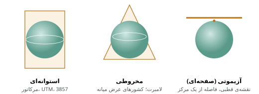
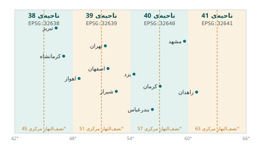

## چرا این فصل مهم‌ترین فصل مبانی است

بیشترین خطاهایی که کارشناسان GIS در عمل با آن روبه‌رو می‌شوند به سیستم مختصات برمی‌گردد: لایه‌ای که وسط اقیانوس اطلس
نمایش داده می‌شود، دو لایه که چند صد متر از هم فاصله دارند در حالی که باید روی هم بیفتند، مساحتی که به «درجه‌ی مربع»
محاسبه شده و فاصله‌ای که دو برابر مقدار واقعی است. همه‌ی این‌ها با فهم چند مفهوم ساده که در این فصل می‌آید قابل پیشگیری‌اند.

پرسش اصلی این فصل این است: **مکان یک نقطه روی زمین را چگونه با عدد بیان کنیم؟** پاسخ سه لایه دارد: شکل زمین را چگونه
مدل کنیم (بیضوی و داده‌نما)، نقطه را روی آن مدل چگونه نام‌گذاری کنیم (مختصات جغرافیایی)، و سطح خمیده را چگونه روی صفحه‌ی
تخت بیاوریم (تصویر نقشه).

## شکل زمین: ژئوئید و بیضوی

زمین کره‌ی کامل نیست. چرخش زمین آن را در استوا اندکی پهن کرده است: شعاع استوایی حدود ۶۳۷۸ کیلومتر و شعاع قطبی حدود
۶۳۵۷ کیلومتر است، یعنی حدود ۲۱ کیلومتر اختلاف. علاوه بر این، توزیع ناهمگون جرم در درون زمین باعث می‌شود میدان گرانش در
همه‌جا یکسان نباشد.

- **ژئوئید** (geoid) سطحی است که سطح متوسط آب دریاها اگر زیر خشکی‌ها هم ادامه پیدا می‌کرد تشکیل می‌داد. ژئوئید سطح هم‌پتانسیل
  گرانش است و شکلی ناهموار و «سیب‌زمینی‌مانند» دارد. ارتفاع‌هایی که روی نقشه می‌بینیم (ارتفاع از سطح دریا) نسبت به ژئوئید است.
- **بیضوی** (ellipsoid) شکل ریاضی ساده‌ای است که ژئوئید را تقریب می‌زند: یک بیضی که حول محور کوتاهش چرخیده است. بیضوی با
  دو عدد تعریف می‌شود: نیم‌قطر بزرگ $a$ و پهن‌شدگی $f$.

$$f = \frac{a - b}{a}$$

بیضوی WGS84 که GPS از آن استفاده می‌کند نیم‌قطر بزرگ ۶٬۳۷۸٬۱۳۷ متر و پهن‌شدگی حدود ۱ به ۲۹۸٫۲۶ دارد. بیضوی GRS80 تقریباً
همان است (اختلاف آن‌ها کسری از میلی‌متر است).

::: know
**ارتفاع ارتومتریک و ارتفاع بیضوی.** گیرنده‌ی GNSS ارتفاع را نسبت به بیضوی می‌دهد (ارتفاع بیضوی، $h$)، اما ارتفاع روی
نقشه‌ها نسبت به ژئوئید است (ارتفاع ارتومتریک، $H$). اختلاف این دو، **ارتفاع ژئوئید** ($N$) نام دارد: $H = h - N$. در ایران
$N$ بسته به منطقه چند ده متر است؛ برای همین ارتفاع خام GPS با ارتفاع نقشه‌ی توپوگرافی یکی نیست. فصل ۴۷ این موضوع را در
کار نقشه‌برداری دنبال می‌کند.
:::

## داده‌نما (Datum)

بیضوی فقط یک شکل است؛ باید مشخص کنیم این شکل **کجا و چگونه** روی زمین واقعی قرار گرفته است: مرکزش کجاست و محورهایش به
کدام سمت‌اند. **داده‌نمای افقی** (datum) همین را تعریف می‌کند: یک بیضوی به‌علاوه‌ی جهت و موقعیتش نسبت به زمین.

دو نوع داده‌نما داریم:

- **داده‌نمای محلی** که بیضوی را طوری می‌گذارد که در یک منطقه‌ی خاص بهترین تطابق را با ژئوئید داشته باشد. داده‌نمای
  اروپایی ۱۹۵۰ (ED50) نمونه‌ای از آن است که در بسیاری از نقشه‌های قدیمی ایران به کار رفته است.
- **داده‌نمای زمین‌مرکز** که مرکز بیضوی را بر مرکز جرم زمین منطبق می‌کند و برای همه‌ی جهان مناسب است؛ مثل WGS84 و ITRF.
  داده‌های امروزی، GPS و نقشه‌های وب همه زمین‌مرکزند.

یک نقطه‌ی ثابت روی زمین در دو داده‌نمای مختلف مختصات متفاوتی دارد. اختلاف ED50 و WGS84 در ایران از مرتبه‌ی صد تا دویست
متر است. پس اگر لایه‌ای در ED50 باشد و آن را بدون تبدیل کنار لایه‌ای در WGS84 بگذارید، دو لایه روی هم نمی‌افتند؛ هیچ
خطایی هم نمی‌بینید، فقط نتیجه غلط است.

::: warn
**داده‌نما را حدس نزنید.** وقتی داده‌ای از سازمانی دیگر می‌گیرید، همیشه سیستم مختصات و داده‌نمای آن را بپرسید. فایل
`.prj` همراه Shapefile معمولاً این اطلاعات را دارد؛ اگر نبود، از تهیه‌کننده بپرسید. مختصاتی که «تقریباً درست» به نظر
می‌رسد ممکن است دویست متر خطا داشته باشد.
:::

## مختصات جغرافیایی

روی بیضوی، هر نقطه با دو زاویه مشخص می‌شود:

- **عرض جغرافیایی** (latitude، $\varphi$): زاویه‌ی شمال یا جنوب استوا، از ۹۰- (قطب جنوب) تا ۹۰+ (قطب شمال). خط‌های هم‌عرض
  را **مدار** می‌گویند.
- **طول جغرافیایی** (longitude، $\lambda$): زاویه‌ی شرق یا غرب نصف‌النهار مبدأ (گرینویچ)، از ۱۸۰- تا ۱۸۰+. خط‌های هم‌طول را
  **نصف‌النهار** می‌گویند.

ایران تقریباً بین عرض ۲۵ تا ۴۰ درجه‌ی شمالی و طول ۴۴ تا ۶۳٫۵ درجه‌ی شرقی قرار دارد. میدان آزادی تهران حدود عرض ۳۵٫۶۹۹ و
طول ۵۱٫۳۳۸ است.

مختصات به دو شکل نوشته می‌شود: **درجه، دقیقه، ثانیه** (DMS) مثل `51° 20′ 17″ E` و **درجه‌ی اعشاری** (DD) مثل `51.338`.
پایگاه داده و نرم‌افزارها با درجه‌ی اعشاری کار می‌کنند. تبدیل ساده است:

$$DD = D + \frac{M}{60} + \frac{S}{3600}$$

```{.sql .run}
SELECT round(51 + 20/60.0 + 17/3600.0, 6) AS lon_dd,
       round(35 + 41/60.0 + 56/3600.0, 6) AS lat_dd;
```

::: note
**طول یک درجه چقدر است؟** یک درجه‌ی عرض همه‌جا حدود ۱۱۱ کیلومتر است. اما یک درجه‌ی طول با نزدیک شدن به قطب کوتاه‌تر می‌شود:
در استوا ۱۱۱ کیلومتر، در عرض تهران (حدود ۳۵٫۷ درجه) حدود ۹۰ کیلومتر و در قطب صفر. به همین دلیل **درجه واحد مناسبی برای
اندازه‌گیری فاصله و مساحت نیست** و «درجه‌ی مربع» هیچ مساحت ثابتی ندارد.
:::

همین را با SQL می‌بینیم. تابع `ST_Distance` روی هندسه‌ای در سیستم درجه‌ای، فاصله را به درجه می‌دهد که عدد بی‌معنایی است؛
اما اگر هندسه را به نوع `geography` تبدیل کنیم، فاصله را روی بیضوی و به متر حساب می‌کند:

```{.sql .run}
SELECT ST_Distance(a.geom, b.geom)                       AS dist_degree,
       ST_Distance(a.geom::geography, b.geom::geography) AS dist_meter
FROM metro_stations a, metro_stations b
WHERE a.station_id = 1 AND b.station_id = 2;
```

## تصویر نقشه

نقشه و صفحه‌ی نمایش تخت‌اند و زمین خمیده. **تصویر نقشه** (map projection) قاعده‌ای ریاضی است که هر نقطه‌ی بیضوی
$(\varphi, \lambda)$ را به یک نقطه روی صفحه $(x, y)$ می‌برد. قضیه‌ای از گاوس (قضیه‌ی شگفت‌انگیز، ۱۸۲۷) نشان می‌دهد که
تخت کردن کره **بدون اعوجاج ممکن نیست.** هر تصویری دست‌کم یکی از این ویژگی‌ها را خراب می‌کند:

| ویژگی که حفظ می‌شود | نام | کاربرد |
|---|---|---|
| زاویه و شکل محلی | **همدیس** (conformal) | ناوبری، نقشه‌برداری، نقشه‌ی بزرگ‌مقیاس؛ UTM، مرکاتور، لامبرت همدیس |
| مساحت | **هم‌مساحت** (equal-area) | نقشه‌ی موضوعی تراکم، آمار مساحت؛ آلبرز، لامبرت هم‌مساحت |
| فاصله از یک یا دو نقطه | **هم‌فاصله** (equidistant) | فاصله از یک مرکز؛ آزیموتی هم‌فاصله |
| هیچ‌کدام دقیق؛ سازش | **سازشی** | نقشه‌ی جهان‌نما؛ رابینسون، وینکل |

تصویرها بر اساس سطحی که کره روی آن «تابانده» می‌شود هم دسته‌بندی می‌شوند:



### Web Mercator، تصویر نقشه‌های وب

تقریباً همه‌ی نقشه‌های وب (OpenStreetMap و نقشه‌های تجاری) از تصویر **Web Mercator** با کد `3857` استفاده می‌کنند. این
تصویر همدیس است و برای نمایش کاشی‌کاشی نقشه بسیار مناسب است، اما مساحت را به شدت بزرگ نشان می‌دهد: در عرض تهران مساحت‌ها
حدود ۱٫۵ برابر و در عرض‌های بالا چند برابر بزرگ‌تر از واقعیت دیده می‌شوند (به همین دلیل گرینلند روی نقشه‌ی وب هم‌اندازه‌ی
آفریقا به نظر می‌رسد، در حالی که حدود چهارده برابر کوچک‌تر است).

::: warn
**هرگز در 3857 مساحت یا فاصله حساب نکنید.** این سیستم فقط برای نمایش است. مساحت قطعه‌ای در تهران که در 3857 محاسبه شود
حدود ۵۰ درصد بیشتر از مقدار واقعی است.
:::

## سیستم UTM

**ترانسورس مرکاتور جهانی** (Universal Transverse Mercator یا **UTM**) پرکاربردترین سیستم تصویر برای نقشه‌برداری و
تحلیل در مقیاس شهری و استانی است. ایده‌ی آن ساده است: زمین را به ۶۰ **ناحیه**ی شش‌درجه‌ای تقسیم می‌کنیم و هر ناحیه را
جداگانه با یک تصویر ترانسورس مرکاتور (استوانه‌ی افقی که در امتداد نصف‌النهار مرکزی ناحیه بر زمین مماس است) تصویر می‌کنیم.
چون هر ناحیه باریک است، اعوجاج در آن ناچیز است.

مشخصات UTM:

- ناحیه‌ی ۱ از طول ۱۸۰- تا ۱۷۴- است و شماره‌ها به سمت شرق زیاد می‌شوند. ناحیه‌ی هر طول: $\lfloor (\lambda + 180)/6 \rfloor + 1$.
- مختصات به **متر** است: x را «شرقی» (Easting) و y را «شمالی» (Northing) می‌نامند.
- برای اینکه x هیچ‌وقت منفی نشود، به نصف‌النهار مرکزی مقدار ۵۰۰٬۰۰۰ متر (شرقی کاذب) داده می‌شود. در نیمکره‌ی شمالی، y
  فاصله از استواست.
- ضریب مقیاس روی نصف‌النهار مرکزی ۰٫۹۹۹۶ است تا اعوجاج در کل ناحیه متعادل شود.

ایران در چهار ناحیه‌ی UTM قرار می‌گیرد:



در پایگاه داده‌ی مکانی، تبدیل از مختصات جغرافیایی به UTM یک تابع است:

```{.sql .run rows=3}
SELECT name,
       ST_AsText(geom)                      AS wgs84_degree,
       ST_AsText(ST_Transform(geom, 32639)) AS utm39_meter
FROM schools
ORDER BY school_id
LIMIT 3;
```

مختصات UTM مدرسه‌ها حدود ۵۴۰٬۰۰۰ شرقی و ۳٬۹۵۰٬۰۰۰ شمالی است، یعنی حدود ۴۰ کیلومتر شرق نصف‌النهار مرکزی ۵۱ درجه و
۳۹۵۰ کیلومتر شمال استوا.

::: pro
**لایه‌ای که دو ناحیه را می‌پوشاند.** برای کار در مقیاس کشور، UTM مناسب نیست چون ایران چهار ناحیه دارد و انتقال داده به
ناحیه‌ای دور از محدوده‌اش اعوجاج زیادی ایجاد می‌کند. برای محاسبه‌ی مساحت در سطح کشور یا از نوع `geography` استفاده کنید که
روی خود بیضوی حساب می‌کند (فصل ۱۶)، یا از یک تصویر مخروطی هم‌مساحت آلبرز یا لامبرت که مدارهای استاندارد آن داخل ایران
تعریف شده‌اند. فصل ۱۶ این دو راه را با هم مقایسه می‌کند.
:::

## SRID و EPSG: شناسنامه‌ی سیستم مختصات

برای اینکه نرم‌افزارها بدانند هر عدد در کدام سیستم مختصات است، هر سیستم یک کد دارد. سازمانی که فهرست جهانی این کدها را
نگه می‌دارد **EPSG** است (در اصل گروه نقشه‌برداری نفتی اروپا). در PostGIS به این کد **SRID** (شناسه‌ی سیستم مرجع مکانی)
می‌گویند و هر هندسه SRID خودش را همراه دارد.

| SRID | نام | واحد | کاربرد |
|---|---|---|---|
| `4326` | WGS 84 جغرافیایی | درجه | ذخیره‌ی عمومی، GPS، GeoJSON، تبادل داده |
| `3857` | WGS 84 / Pseudo-Mercator | متر (اعوجاج‌دار) | فقط نمایش روی نقشه‌ی وب |
| `32638` | WGS 84 / UTM 38N | متر | غرب ایران؛ تبریز، کرمانشاه |
| `32639` | WGS 84 / UTM 39N | متر | مرکز ایران؛ تهران، اصفهان، شیراز |
| `32640` | WGS 84 / UTM 40N | متر | شرق ایران؛ مشهد، کرمان |
| `32641` | WGS 84 / UTM 41N | متر | منتهی‌الیه شرق؛ زاهدان |
| `23038` تا `23040` | ED50 / UTM 38 تا 40 | متر | نقشه‌های قدیمی؛ پیش از هر تحلیل به WGS84 تبدیل شود |

فهرست همه‌ی سیستم‌هایی که PostGIS می‌شناسد در جدول `spatial_ref_sys` هر پایگاه داده‌ی مکانی هست:

```{.sql .run}
SELECT srid, auth_name, auth_srid, split_part(srtext, '"', 2) AS name
FROM spatial_ref_sys
WHERE srid IN (4326, 3857, 32639, 23039)
ORDER BY srid;
```

و برای دیدن SRID یک لایه، یا SRID یک هندسه:

```{.sql .run}
SELECT Find_SRID('public', 'schools', 'geom') AS layer_srid,
       (SELECT ST_SRID(geom) FROM parks LIMIT 1) AS one_park_srid;
```

## دو تابعی که نباید با هم اشتباه شوند

تفاوت این دو تابع را باید از بر باشید، چون اشتباه گرفتن آن‌ها رایج‌ترین خطای کار با مختصات است:

- **`ST_Transform(geom, srid)`** مختصات را واقعاً **تبدیل** می‌کند: عددها عوض می‌شوند تا همان نقطه‌ی روی زمین را در سیستم
  دیگر بیان کنند. از درجه به متر، یا از ED50 به WGS84.
- **`ST_SetSRID(geom, srid)`** فقط **برچسب** را عوض می‌کند و به عددها دست نمی‌زند. فقط وقتی به کار می‌رود که عددها از اول در
  آن سیستم بوده‌اند ولی برچسب نداشته‌اند (SRID صفر) یا برچسب اشتباه خورده‌اند.

```{.sql .run}
SELECT ST_AsText(ST_SetSRID(ST_MakePoint(51.3890, 35.6892), 4326))                      AS labeled,
       ST_AsText(ST_Transform(ST_SetSRID(ST_MakePoint(51.3890, 35.6892), 4326), 32639)) AS transformed;
```

::: real
**لایه‌ی وسط اقیانوس.** کارشناسی فایل CSV نقطه‌های برداشت را با ستون‌های x و y وارد می‌کند و SRID را ۴۳۲۶ می‌گذارد. نقطه‌ها
روی نقشه دیده نمی‌شوند و بعد از جست‌وجو، گوشه‌ی نقشه‌ی جهان و بیرون از محدوده‌ی مجاز پیدا می‌شوند. علت: مختصات به UTM
(مثلاً x = ۵۳۸۲۱۰، y = ۳۹۴۹۸۰۰) بوده و نرم‌افزار آن را درجه خوانده است. راه درست: `ST_SetSRID(geom, 32639)` تا برچسب درست
شود و سپس اگر لازم است `ST_Transform(…, 4326)`. قاعده‌ی سرانگشتی: عدد بین ۴۴ تا ۶۴ و ۲۵ تا ۴۰ یعنی درجه در ایران؛ عددهای
صدها هزار و میلیونی یعنی متر.
:::

## قاعده‌ی طلایی کار با مختصات

::: steps
1. **ذخیره:** داده را با SRID اصلی و درستش ذخیره کنید؛ برای داده‌ی تازه، `4326` انتخاب پیش‌فرض خوبی است.
2. **محاسبه:** برای فاصله، طول و مساحت، یا هندسه را به UTM همان ناحیه ببرید، یا با `::geography` روی بیضوی حساب کنید.
3. **نمایش:** برای وب به `4326` یا `3857` (سامانه این را خودکار انجام می‌دهد).
4. **یکدستی:** پیش از هر تحلیل دولایه‌ای مطمئن شوید هر دو لایه یک SRID دارند. PostGIS اگر SRID دو هندسه فرق کند خطا می‌دهد؛
   این خطا دوست شماست، نه دشمن.
:::

در فصل ۷ می‌بینید که سامانه هنگام ورود فایل، سیستم مختصات را از فایل `.prj` می‌خواند و اگر نبود، از شما می‌پرسد. بخش «سلامت
داده» هم لایه‌های بدون SRID را پیدا می‌کند و امکان تعیین آن را می‌دهد.

::: summary
- ژئوئید سطح واقعی گرانشی و بیضوی تقریب ریاضی آن است؛ داده‌نما جای بیضوی را نسبت به زمین تعیین می‌کند.
- یک نقطه در دو داده‌نمای مختلف مختصات متفاوتی دارد (ED50 و WGS84 در ایران صد تا دویست متر).
- مختصات جغرافیایی (طول و عرض) به درجه است و برای اندازه‌گیری مناسب نیست.
- هر تصویر نقشه چیزی را خراب می‌کند: همدیس زاویه را حفظ می‌کند، هم‌مساحت مساحت را. Web Mercator فقط برای نمایش است.
- UTM ناحیه‌های شش‌درجه‌ای متری دارد؛ ایران در ناحیه‌های ۳۸ تا ۴۱ (SRID ۳۲۶۳۸ تا ۳۲۶۴۱) است.
- `ST_Transform` مختصات را تبدیل می‌کند و `ST_SetSRID` فقط برچسب را عوض می‌کند.
:::

::: teach
**زمان پیشنهادی:** دو جلسه. یک پرتقال و چاقو به کلاس ببرید: پوست پرتقال را بکنید و سعی کنید آن را بدون پاره شدن روی میز
تخت کنید؛ بهترین توضیح قضیه‌ی گاوس است. در جلسه‌ی دوم، تمرین ۵ و ۶ را در کنسول SQL انجام دهید. خطای «لایه‌ی وسط اقیانوس»
را عمداً بسازید (CSV با مختصات UTM و SRID ۴۳۲۶) و از دانشجوها بخواهید علت را پیدا کنند.
:::

::: exercises
### تمرین‌ها

1. [سطح ۱]{.badge .b1} مختصات `۳۲° ۳۹′ ۲۴″ N` و `۵۱° ۴۰′ ۱۲″ E` را به درجه‌ی اعشاری تبدیل کنید. این نقطه در کدام شهر است؟
2. [سطح ۱]{.badge .b1} شهرهای رشت (طول ۴۹٫۶)، یزد (۵۴٫۴)، بیرجند (۵۹٫۲) و سنندج (۴۷٫۰) در کدام ناحیه‌ی UTM‌اند؟ SRID هر کدام چیست؟
3. [سطح ۱]{.badge .b1} چرا مساحت را نباید در SRID ۴۳۲۶ یا ۳۸۵۷ حساب کرد؟
4. [سطح ۲]{.badge .b2} تفاوت `ST_Transform` و `ST_SetSRID` را با یک مثال توضیح دهید. در چه موقعیتی هر کدام درست است؟
5. [سطح ۲]{.badge .b2} در کنسول SQL، مختصات میدان آزادی (`POINT(51.338 35.699)`) را به UTM ناحیه‌ی ۳۹ و ۴۰ تبدیل کنید. کدام
   شرقی‌اش به ۵۰۰٬۰۰۰ نزدیک‌تر است و چرا؟
6. [سطح ۲]{.badge .b2} فاصله‌ی دو ایستگاه مترو را یک بار با `::geography` و یک بار پس از تبدیل به ۳۲۶۳۹ حساب کنید. اختلاف
   چقدر است؟
7. [سطح ۳]{.badge .b3} با فرمول ناحیه‌ی UTM، تابعی SQL بنویسید که برای هر نقطه‌ی WGS84 در نیمکره‌ی شمالی، SRID ناحیه‌ی UTM آن
   (۳۲۶۰۰ + شماره‌ی ناحیه) را برگرداند و آن را روی جدول `schools` آزمایش کنید.
:::
