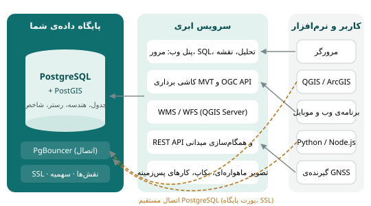

## از فایل تا پایگاه داده

تصور کنید شهرداری یک شهر متوسط داده‌های مکانی‌اش را در فایل نگه می‌دارد. کارشناس طرح تفصیلی یک Shapefile از کاربری زمین
دارد، کارشناس درآمد نسخه‌ای دیگر از همان فایل که ستون عوارض به آن اضافه کرده، و کارشناس ترافیک نسخه‌ی سومی که شش ماه پیش از
کارشناس طرح تفصیلی گرفته است. روزی مدیر می‌پرسد: «مساحت کاربری تجاری در منطقه‌ی ۳ چقدر است؟» و سه کارشناس سه عدد متفاوت
می‌دهند. این ماجرا آشناست، چون مشکلات کار با فایل ذاتی‌اند:

| مشکل کار با فایل | پایگاه داده‌ی مکانی چگونه حل می‌کند |
|---|---|
| نسخه‌های متعدد و ناهماهنگ | یک منبع واحد؛ همه به همان وصل می‌شوند |
| یک نفر در هر لحظه می‌تواند ویرایش کند | ویرایش هم‌زمان چندکاربره با کنترل تعارض |
| ویرایش نیمه‌کاره فایل را خراب می‌کند | **تراکنش**: یا همه‌ی تغییر ذخیره می‌شود یا هیچ‌کدام |
| هر کس فایل را دارد همه چیز را می‌بیند | **نقش و مجوز**: چه کسی چه جدولی را ببیند یا ویرایش کند |
| قواعد داده رعایت نمی‌شود | **قید**: نوع ستون، مقدار مجاز، کلید یکتا، هندسه‌ی معتبر |
| پرسش‌ها فقط با نرم‌افزار خاص | **SQL** استاندارد از هر نرم‌افزار و زبان برنامه‌نویسی |
| حجم زیاد کند می‌شود | **شاخص**؛ میلیون‌ها عارضه در کسری از ثانیه |
| بکاپ دستی و فراموش‌شدنی | بکاپ خودکار شبانه و بازگردانی با یک کلیک |

به همین دلیل از حدود دو دهه پیش، روند حرفه‌ای در GIS این است که داده‌ی اصلی در پایگاه داده‌ی مکانی نگه داشته شود و فایل‌ها
فقط برای تبادل به کار روند.

## پایگاه داده‌ی رابطه‌ای در یک نگاه

**پایگاه داده‌ی رابطه‌ای** داده را در **جدول**‌ها نگه می‌دارد. هر جدول تعدادی **ستون** با نام و نوع مشخص دارد و هر **سطر** یک
رکورد است. هر جدول معمولاً یک **کلید اصلی** دارد، ستونی که هر سطر را یکتا مشخص می‌کند. جدول‌ها از طریق ستون‌های مشترک به هم
**رابطه** دارند، و زبان **SQL** برای ساختن، پر کردن و پرسیدن از این جدول‌ها به کار می‌رود.

**پایگاه داده‌ی مکانی** همان پایگاه داده‌ی رابطه‌ای است که سه چیز به آن اضافه شده است:

1. **نوع داده‌ی مکانی:** ستونی که هندسه یا رستر نگه می‌دارد.
2. **توابع مکانی:** محاسبه‌ی فاصله، مساحت، تقاطع، بافر و صدها عمل دیگر داخل SQL.
3. **شاخص مکانی:** ساختاری که پرسش‌های مکانی روی داده‌ی حجیم را سریع می‌کند.

بخش سوم کتاب (فصل‌های ۱۰ تا ۱۴) پایگاه داده‌ی رابطه‌ای و SQL را از صفر آموزش می‌دهد. اینجا فقط می‌خواهیم تصویر کلی داشته
باشیم.

## PostgreSQL و PostGIS

**PostgreSQL** پایگاه داده‌ی رابطه‌ای متن‌باز و رایگانی است که ریشه‌ی آن به پروژه‌ای در دانشگاه برکلی در دهه‌ی ۱۹۸۰ برمی‌گردد.
پایداری، پایبندی دقیق به استاندارد SQL و امکان افزودن نوع و تابع تازه آن را محبوب‌ترین پایگاه داده‌ی متن‌باز در کارهای
حرفه‌ای کرده است.

**PostGIS** افزونه‌ای (extension) برای PostgreSQL است که آن را به پایگاه داده‌ی مکانی تبدیل می‌کند. PostGIS از سال ۲۰۰۱
توسعه می‌یابد و امروز مرجع عملی SQL مکانی در جهان است؛ بسیاری از نرم‌افزارها و سرویس‌های مکانی، از QGIS و GeoServer تا
سرویس‌های نقشه‌ی بزرگ، روی آن ساخته شده‌اند. آنچه PostGIS اضافه می‌کند:

- **انواع داده:** `geometry` (هندسه روی صفحه‌ی مختصات)، `geography` (هندسه روی بیضوی زمین، با محاسبه به متر)، و `raster`
  (با افزونه‌ی `postgis_raster`).
- **توابع:** صدها تابع با پیشوند `ST_` (مخفف Spatial Type) مثل `ST_Distance`، `ST_Intersects`، `ST_Buffer` و `ST_Area`.
  نام و رفتار بیشتر آن‌ها از استاندارد OGC Simple Features و ISO SQL/MM آمده است، پس در پایگاه‌های داده‌ی مکانی دیگر هم
  آشناست.
- **شاخص مکانی** از نوع GiST بر پایه‌ی درخت R (فصل ۲۰).
- **جدول‌های فراداده:** `spatial_ref_sys` (فهرست سیستم‌های مختصات) و نمای `geometry_columns` (فهرست ستون‌های هندسه‌ی هر
  جدول با نوع و SRID).

نسخه‌ی PostGIS و کتابخانه‌هایی که با آن کار می‌کند (GEOS برای هندسه، PROJ برای تبدیل مختصات) را این‌طور می‌بینید:

```{.sql .run}
SELECT postgis_lib_version() AS postgis,
       postgis_geos_version() AS geos,
       postgis_proj_version() AS proj;
```

و فهرست لایه‌های مکانی پایگاه داده، با نوع هندسه و SRID، در یک پرسش:

```{.sql .run}
SELECT f_table_name AS layer, f_geometry_column AS column_name, type, srid
FROM geometry_columns
ORDER BY f_table_name;
```

::: know
**تعداد توابع.** پایگاه داده‌ی مکانی واقعاً صدها تابع مکانی دارد. شمردنش با SQL ساده است:
`SELECT count(DISTINCT proname) FROM pg_proc WHERE proname ILIKE 'st\_%';`. لازم نیست همه را حفظ کنید؛ حدود سی تابع کار
روزمره‌ی بیشتر کارشناسان را پوشش می‌دهد و پیوست «مرجع توابع پرکاربرد» آن‌ها را در یک جا جمع کرده است.
:::

## افزونه‌ها

PostgreSQL با **افزونه**‌ها گسترش می‌یابد. در پایگاه داده مکانی ابری، PostGIS همیشه نصب است و بقیه را هنگام ساخت پایگاه یا بعداً
از صفحه‌ی «نمای کلی» با یک کلیک نصب می‌کنید (فصل ۵):

| افزونه | چه می‌کند | فصل |
|---|---|---|
| `postgis` | هندسه، geography، توابع `ST_`، شاخص مکانی | ۱۵ تا ۲۲ |
| `postgis_raster` | ذخیره و تحلیل رستر داخل پایگاه داده | ۲۳ |
| `postgis_topology` | توپولوژی: مرز مشترک، همسایگی، کاداستر | ۲۲ |
| `postgis_sfcgal` | عملیات سه‌بعدی و هندسه‌ی دقیق | ۲۲ |
| `pgrouting` | تحلیل شبکه: کوتاه‌ترین مسیر، حوزه‌ی دسترسی | ۲۴ |
| `h3` | شبکه‌ی شش‌ضلعی سلسله‌مراتبی جهانی | ۲۱ |
| `pg_trgm` | جست‌وجوی سریع و تشابه متنی (برای نام مکان‌ها) | ۱۱ |
| `fuzzystrmatch` | شباهت آوایی و فاصله‌ی ویرایشی کلمات | ۱۱ |
| `hstore` | ذخیره‌ی ویژگی‌های کلید-مقدار متغیر (مثل داده‌ی OSM) | ۳۰ |

::: note
افزونه‌ای را نصب کنید که واقعاً لازم دارید. هر افزونه جدول‌ها و توابع تازه‌ای به پایگاه اضافه می‌کند؛ مثلاً `postgis_raster`
اگر رستر بزرگ در آن ذخیره کنید، حجم زیادی از سهمیه‌ی پایگاه را می‌گیرد.
:::

## معماری یک سامانه‌ی WebGIS

**WebGIS** یعنی سامانه‌ی GIS که از طریق وب در دسترس است. یک سامانه‌ی WebGIS معمولاً سه لایه دارد:

1. **لایه‌ی داده:** پایگاه داده‌ی مکانی که داده‌ی اصلی را نگه می‌دارد.
2. **لایه‌ی سرویس:** نرم‌افزارهایی که داده را به شکل استاندارد به بیرون می‌دهند: نقشه‌ی تصویری (WMS)، عارضه (WFS، OGC API
   Features)، کاشی برداری (MVT)، API برنامه‌نویسی.
3. **لایه‌ی کاربر:** مرورگر با یک کتابخانه‌ی نقشه (Leaflet، OpenLayers، MapLibre)، نرم‌افزار رومیزی (QGIS) یا برنامه‌ی موبایل.



در شیوه‌ی سنتی، سازمان باید هر سه لایه را خودش بسازد و نگه دارد: سرور، PostgreSQL، PostGIS، GeoServer، وب‌سرور، گواهی SSL،
بکاپ و پایش. در پایگاه داده مکانی ابری، لایه‌ی داده و لایه‌ی سرویس آماده است و شما فقط داده و پرسش‌تان را می‌آورید.

### استانداردهای OGC

**کنسرسیوم مکانی باز** (Open Geospatial Consortium یا OGC) سازمانی بین‌المللی است که استانداردهای تبادل داده‌ی مکانی را
تدوین می‌کند. به لطف این استانداردها، لایه‌ای که در یک سامانه منتشر می‌شود در هر نرم‌افزار دیگری قابل استفاده است.

| استاندارد | چه چیزی می‌دهد | مثال استفاده |
|---|---|---|
| **WMS** (Web Map Service) | تصویر نقشه (PNG/JPEG) برای یک محدوده | لایه‌ی زمینه در QGIS؛ نقشه‌ی ثابت در وب‌سایت |
| **WFS** (Web Feature Service) | خود عارضه‌ها با هندسه و ویژگی (GML/GeoJSON) | دریافت داده برای تحلیل در QGIS |
| **OGC API – Features** | نسل جدید WFS؛ RESTful با JSON | برنامه‌های وب مدرن |
| **WMTS / کاشی برداری (MVT)** | نقشه در کاشی‌های پیش‌برش‌خورده | نقشه‌های سریع وب با هزاران عارضه |
| **GeoPackage، GeoTIFF، KML** | قالب‌های فایل استاندارد | تبادل داده |
| **Simple Features، SQL/MM** | مدل هندسه و توابع SQL | همان توابع `ST_` در PostGIS |

بخش هفتم کتاب انتشار داده با هر یک از این استانداردها را گام‌به‌گام نشان می‌دهد.

## پایگاه داده مکانی ابری چه کاری برای شما می‌کند

| کار | در شیوه‌ی سنتی | در پایگاه داده مکانی ابری |
|---|---|---|
| ساخت پایگاه داده با PostGIS | نصب و پیکربندی سرور (ساعت‌ها تا روزها) | یک فرم و چند ثانیه |
| امنیت اتصال | تهیه‌ی گواهی و تنظیم SSL | SSL پیش‌فرض و اجباری |
| کاربران و دسترسی | دستورهای `GRANT` | صفحه‌ی «تیم» با نقش‌های آماده |
| اتصال‌های زیاد از برنامه‌ی وب | راه‌اندازی PgBouncer | اتصال PgBouncer آماده |
| بکاپ | اسکریپت و زمان‌بندی دستی | بکاپ خودکار روزانه و بازگردانی با یک کلیک |
| پایش حجم و کارایی | ابزارهای جانبی | صفحه‌ی «مصرف و کارایی» |
| مرور و ویرایش داده | نرم‌افزار رومیزی | در مرورگر، با پیش‌نویس و تأیید |
| تحلیل مکانی | نوشتن SQL یا نرم‌افزار رومیزی | SQL در مرورگر، ابزارهای آماده، پرسش فارسی |
| تصویر ماهواره‌ای | جست‌وجو، دانلود چندگیگابایتی، برش | انتخاب محدوده و تاریخ؛ تحویل برش‌خورده |
| انتشار نقشه و سرویس | GeoServer و وب‌سرور | چند کلیک؛ کاشی، OGC API، WMS/WFS |

::: warn
**ابری بودن به معنای بی‌مسئولیتی نیست.** سرویس ابری زیرساخت را نگه می‌دارد، اما **طراحی داده، کیفیت آن، مجوز دسترسی کاربران
و درستی تحلیل** همچنان با شماست. رمز پایگاه داده را مثل رمز بانک نگه دارید، دسترسی ویرایش را فقط به کسانی بدهید که لازم
دارند، و پیش از تغییرهای بزرگ بکاپ دستی بگیرید (فصل ۵۱).
:::

### امنیت در یک نگاه

چند اصل امنیتی که پایگاه داده مکانی ابری رعایت می‌کند و دانستنش برای شما مفید است:

- **جداسازی:** هر پایگاه داده نقش (کاربر) جداگانه دارد و هیچ کاربری به پایگاه داده‌ی دیگران دسترسی ندارد. نقش شما
  «ابرکاربر» (superuser) نیست.
- **مرورگر هیچ‌وقت مستقیم به پایگاه داده وصل نمی‌شود.** صفحه‌های وب سامانه با یک نقش محدود جداگانه به پایگاه وصل می‌شوند
  و کنسول SQL به‌طور پیش‌فرض فقط‌خواندنی است؛ حداکثر ۵۰۰ سطر نمایش می‌دهد و هر پرسش حداکثر ۲۰ ثانیه وقت دارد.
- **رمز فقط یک بار نمایش داده می‌شود** و سامانه آن را به صورت خوانا نگه نمی‌دارد. اگر فراموش شد، رمز تازه می‌سازید (فصل ۵).
- **کلید API** برای لایه‌های منتشرشده‌ی خصوصی جدا از رمز پایگاه داده است و هر وقت لازم شد باطل می‌شود (فصل ۴۵).

## مسیر داده در این کتاب

حالا که تصویر کلی را دارید، بخش بعد کار عملی را شروع می‌کند: پایگاه داده‌ی خودتان را می‌سازید (فصل ۵)، از QGIS به آن وصل
می‌شوید (فصل ۶)، داده‌ی نمونه را وارد می‌کنید (فصل ۷)، آن را مرور و جست‌وجو می‌کنید (فصل ۸) و جدول تازه می‌سازید و ویرایش
می‌کنید (فصل ۹). از بخش سوم به بعد، همین پایگاه داده آزمایشگاه شما برای یادگیری SQL و تحلیل مکانی است.

::: summary
- نگه‌داری داده در فایل به نسخه‌های ناهماهنگ، ویرایش تک‌کاربره و نبود قید و امنیت می‌انجامد؛ پایگاه داده این‌ها را حل می‌کند.
- پایگاه داده‌ی مکانی = پایگاه داده‌ی رابطه‌ای + نوع داده‌ی مکانی + توابع مکانی + شاخص مکانی.
- PostGIS افزونه‌ی مکانی PostgreSQL است: `geometry`، `geography`، `raster`، توابع `ST_` و شاخص GiST.
- WebGIS سه لایه دارد: داده، سرویس و کاربر؛ استانداردهای OGC (WMS، WFS، OGC API، کاشی) پیوند آن‌ها را ممکن می‌کنند.
- پایگاه داده مکانی ابری زیرساخت، امنیت اتصال، بکاپ و سرویس‌ها را آماده می‌کند؛ طراحی و کیفیت داده با شماست.
:::

::: teach
**زمان پیشنهادی:** یک جلسه. داستان «سه کارشناس، سه عدد» را به صورت نمایش کوتاه در کلاس اجرا کنید: سه گروه یک فایل اکسل
مشترک را جداگانه ویرایش کنند و بعد سعی کنند نسخه‌ها را یکی کنند. سپس همان کار را در یک جدول مشترک در پایگاه داده انجام دهید.
تمرین ۵ برای جمع‌بندی مناسب است.
:::

::: exercises
### تمرین‌ها

1. [سطح ۱]{.badge .b1} سه مشکل نگه‌داری داده‌ی مکانی در فایل و راه حل پایگاه داده برای هر کدام را بنویسید.
2. [سطح ۱]{.badge .b1} سه چیزی که PostGIS به PostgreSQL اضافه می‌کند کدام‌اند؟
3. [سطح ۱]{.badge .b1} تفاوت WMS و WFS چیست؟ برای هر کدام یک مورد استفاده بنویسید.
4. [سطح ۲]{.badge .b2} برای یک پروژه‌ی مسیریابی آمبولانس با نام خیابان‌های فارسی، کدام افزونه‌ها را نصب می‌کنید و چرا؟
5. [سطح ۲]{.badge .b2} معماری WebGIS سازمان خودتان (یا یک سازمان فرضی) را ترسیم کنید: داده کجاست، با چه سرویسی منتشر می‌شود و
   چه کسانی با چه نرم‌افزاری از آن استفاده می‌کنند؟
6. [سطح ۳]{.badge .b3} پس از ساختن پایگاه داده در فصل ۵، پرسش شمارش توابع `ST_` را اجرا کنید. سپس فهرست ده تابعی را که
   نامشان را می‌فهمید بنویسید و حدس بزنید هر کدام چه می‌کند؛ حدس‌تان را با پیوست کتاب مقایسه کنید.
:::
