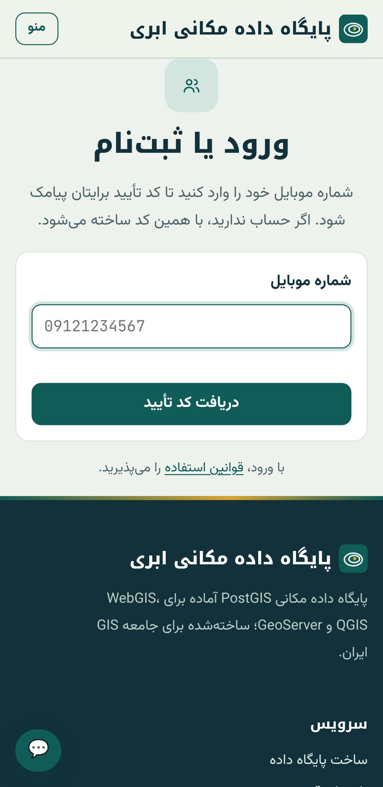
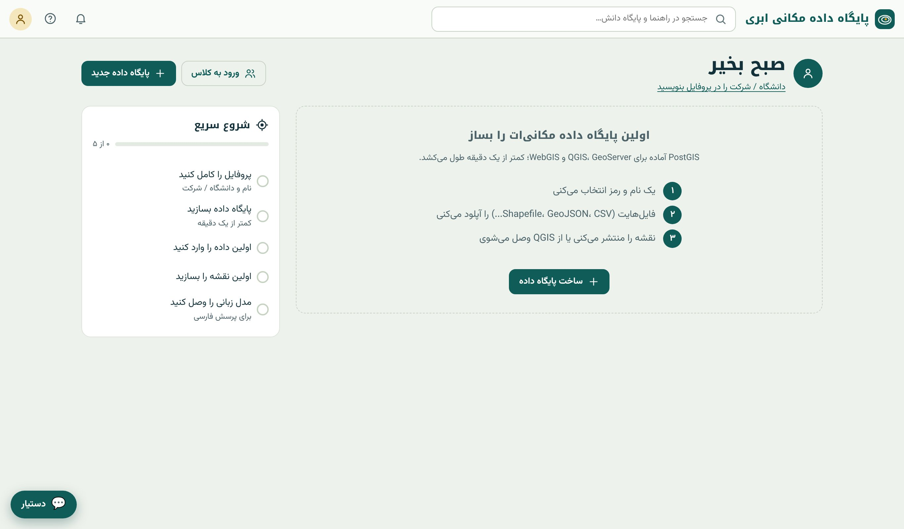
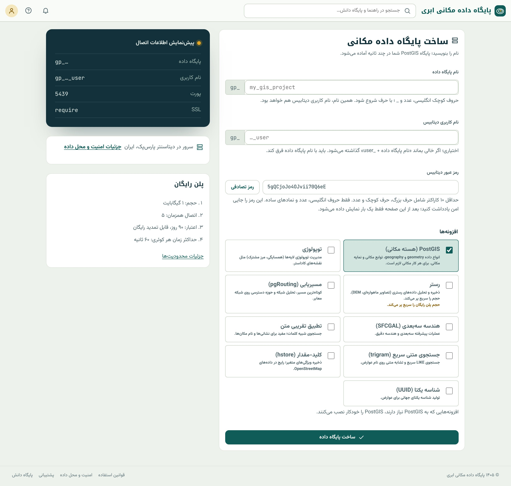
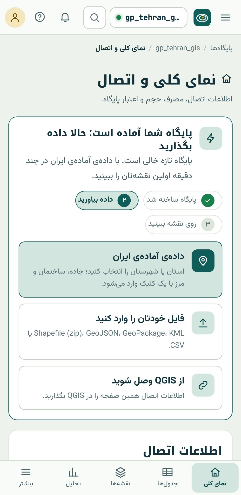

## ورود به سامانه

ورود به پایگاه داده مکانی ابری **رمز عبور ندارد.** شماره‌ی موبایل خود را وارد می‌کنید، یک کد یک‌بارمصرف پیامک می‌شود و با
وارد کردن آن وارد می‌شوید. ثبت‌نام و ورود یک صفحه است: اگر بار اول باشد حساب ساخته می‌شود، وگرنه وارد حساب قبلی می‌شوید.

{.shot .phone}

::: note
**دو رمز متفاوت.** ورود به *سایت* رمز ندارد و با کد پیامکی است. اما هر *پایگاه داده* رمز جداگانه‌ای دارد که هنگام ساختنش
تعیین می‌کنید و QGIS و نرم‌افزارهای دیگر با آن به پایگاه وصل می‌شوند. این دو را با هم اشتباه نگیرید.
:::

هر شخص یک حساب رایگان دارد. اگر بعداً شماره‌ی موبایل‌تان عوض شد، از بخش «پشتیبانی» درخواست تغییر بدهید.

## پایگاه‌های داده‌ی من

پس از ورود، صفحه‌ی «پایگاه‌های داده» را می‌بینید. بار اول این صفحه خالی است و یک دکمه‌ی اصلی دارد: «ساخت پایگاه داده».

{.shot}

## ساخت پایگاه داده

فرم ساخت پایگاه داده چهار بخش دارد و در سمت چپ پیش‌نمایش زنده‌ی اطلاعات اتصال را نشان می‌دهد.

{.shot .wide}

::: steps
1. **نام پایگاه داده:** با حرف کوچک انگلیسی شروع شود و فقط حروف کوچک انگلیسی، عدد و زیرخط داشته باشد (۳ تا ۴۱ نویسه).
   پیشوند `gp_` خودکار اضافه می‌شود. برای داده‌ی نمونه‌ی این کتاب نام `tehran_gis` را بنویسید تا پایگاه `gp_tehran_gis` ساخته شود.
2. **نام کاربری پایگاه داده:** اختیاری است؛ اگر خالی بماند `<نام پایگاه>_user` گذاشته می‌شود. نام کاربری باید با نام پایگاه فرق کند.
3. **رمز:** دست‌کم ده نویسه شامل حرف بزرگ، حرف کوچک و عدد. دکمه‌ی «رمز تصادفی» یک رمز قوی می‌سازد.
4. **افزونه‌ها:** PostGIS همیشه تیک خورده است. برای این کتاب `pgRouting` (فصل ۲۴) و `جستجوی متنی سریع (trigram)` را هم تیک
   بزنید. «رستر» را فقط اگر قصد دارید رستر را *داخل* پایگاه ذخیره کنید انتخاب کنید (فصل ۲۳)؛ برای تصویر ماهواره‌ای سامانه لازم نیست.
5. «ساخت پایگاه داده» را بزنید. کمتر از یک دقیقه بعد پایگاه آماده است.
:::

::: warn
**رمز فقط یک بار نمایش داده می‌شود.** بلافاصله پس از ساخت، رمز را در یک مدیر رمز یا جای امن ذخیره کنید. سامانه رمز را به شکل
خوانا نگه نمی‌دارد و نمی‌تواند آن را دوباره به شما نشان دهد. اگر گم شد، رمز تازه بسازید (پایین‌تر در همین فصل)؛ داده‌ها از
بین نمی‌روند. نام پایگاه داده را هم بعداً نمی‌توان عوض کرد.
:::

::: know
**پشت صحنه‌ی ساخت پایگاه.** وقتی «ساخت» را می‌زنید سامانه روی یک سرور PostgreSQL این کارها را می‌کند: یک **نقش** (کاربر)
با نام کاربری شما می‌سازد، یک **پایگاه داده** با مالکیت همان نقش می‌سازد، افزونه‌های انتخابی را نصب می‌کند، **سقف حجم و
تعداد اتصال** پلن را اعمال می‌کند و دسترسی دیگران را می‌بندد. معادل SQL این کارها تقریباً این است (فقط برای فهم؛ لازم نیست
اجرا کنید):

```sql
CREATE ROLE gp_tehran_gis_user LOGIN PASSWORD '…' CONNECTION LIMIT 5;
CREATE DATABASE gp_tehran_gis OWNER gp_tehran_gis_user;
\c gp_tehran_gis
CREATE EXTENSION postgis;
CREATE EXTENSION pgrouting;
REVOKE ALL ON DATABASE gp_tehran_gis FROM PUBLIC;
```
:::

## صفحه‌ی «نمای کلی و اتصال»

هر پایگاه داده یک صفحه‌ی اصلی دارد که در فصل ۱ تصویرش را دیدید. بالای صفحه، برای پایگاه تازه، کارت «حالا داده بگذارید» سه
راه شروع را پیشنهاد می‌کند: داده‌ی آماده‌ی ایران، ورود فایل خودتان، یا اتصال از QGIS. زیر آن دو کارت اصلی است:

**اطلاعات اتصال.** پنج مقداری که هر نرم‌افزاری برای اتصال لازم دارد، هر کدام با دکمه‌ی «کپی»:

| مقدار | معنا | نکته |
|---|---|---|
| میزبان (Host) | نشانی سرور پایگاه داده | نام دامنه‌ی سرور |
| پورت (Port) | درگاه شبکه‌ی سرور | پورت سامانه ۵۴۳۲ (پیش‌فرض PostgreSQL) نیست؛ همان را که نشان داده می‌شود بنویسید |
| پایگاه داده (Database) | نام پایگاه | با پیشوند `gp_` |
| نام کاربری (User) | نقش شما | با پسوند `_user` (اگر عوضش نکرده باشید) |
| رمز | همان رمز هنگام ساخت | نمایش داده نمی‌شود |
| SSL Mode | رمزنگاری اتصال | همیشه `require`؛ بدون SSL اتصال پذیرفته نمی‌شود |

**مصرف و اعتبار.** حجم مصرفی از سهمیه، تاریخ ساخت و پایان اعتبار، تعداد اتصال هم‌زمان مجاز و دکمه‌های تمدید و ارتقای پلن.

پایین‌تر، کارت **«اتصال از نرم‌افزار شما»** برای هر نرم‌افزار (QGIS، GeoServer، رشته‌ی اتصال، Python، ورود Shapefile، psql)
راهنمای کوتاه با همان مقادیر پایگاه شما دارد، و کارت‌های **«افزونه‌های نصب‌شده»**، **«رمز جدید»** و **«رویدادهای اخیر»**
(تاریخچه‌ی کارهای مهم روی پایگاه) قرار دارند.

::: pro
**محدودیت‌های پلن در سطح پایگاه داده.** «اتصال هم‌زمان» یعنی حداکثر چند نشست هم‌زمان می‌تواند با نقش شما باز باشد؛ هر پنجره‌ی
QGIS، هر برنامه و هر اسکریپت پایتون حداقل یک اتصال می‌گیرد. «حداکثر زمان هر کوئری» (statement timeout) پرسش‌هایی را که بیش از
حد طول بکشند متوقف می‌کند. هر دو را در SQL هم می‌توانید ببینید: `SHOW statement_timeout;` و
`SELECT rolconnlimit FROM pg_roles WHERE rolname = current_user;`. فصل ۵۱ مدیریت اتصال با PgBouncer را توضیح می‌دهد.
:::

## اولین پرسش

پیش از ورود داده، مطمئن شویم پایگاه کار می‌کند. در منوی کناری ← داده ← «اجرای SQL» را باز کنید، این دستور را بنویسید و «اجرا»
را بزنید:

```{.sql .run}
SELECT current_database() AS database,
       postgis_lib_version() AS postgis,
       now()::date AS today;
```

اگر نام پایگاه و نسخه‌ی PostGIS را دیدید، پایگاه آماده است. فصل ۱۰ کنسول SQL را کامل معرفی می‌کند.

## فضای کار

رابط سامانه یک **نوار بالا** و یک **ریل کناری** دارد و جز این دو، منوی دیگری نیست:

- **نوار بالا:** نام سامانه (بازگشت به فهرست پایگاه‌ها)، **جستجوی سراسری**، راهنما، اعلان‌ها و منوی حساب.
- **ریل کناری** (سمت راست): نام و وضعیت پایگاه، نوار مصرف حجم و چهار گروه منو: «نمای کلی و اتصال»، «داده»، «تحلیل و انتشار» و
  «مدیریت». با «جمع کردن منو» پایین ریل، فضای کار بزرگ‌تر می‌شود.

**جستجوی سراسری** (کلید میانبر `Ctrl+K`) بخش‌های سامانه، جدول‌های پایگاه‌ها و مقاله‌های راهنما را با هم جست‌وجو می‌کند. نوشتن
«بکاپ» شما را به صفحه‌ی بکاپ می‌برد و نوشتن `schools` به جدول مدرسه‌ها.

**اعلان‌ها** (زنگوله) کارهای پس‌زمینه را خبر می‌دهند: ورود فایل بزرگ تمام شد، تحلیل آماده است، تصویر ماهواره‌ای رسید، پایش
ماهواره‌ای هشدار داد یا اعتبار پایگاه رو به پایان است.

{.shot .phone}

::: note
**دستیار هوشمند.** دکمه‌ی «دستیار» پایین ریل، پرسش فارسی شما درباره‌ی کار با سامانه را از روی پایگاه دانش پاسخ می‌دهد و منبع
پاسخ را هم نشان می‌دهد. دستیار به داده‌ها و رمزهای شما دسترسی ندارد؛ برای پرسش از *داده‌ها*، «پرسش فارسی» در کنسول SQL را به
کار ببرید (فصل ۲۹).
:::

## رمز تازه و افزونه‌ی تازه

**رمز تازه:** در صفحه‌ی «نمای کلی»، کارت «رمز جدید» یک رمز تصادفی پیشنهاد می‌کند یا رمز دلخواه شما را می‌گیرد. با «ذخیره‌ی رمز
جدید»، اتصال‌های فعلی قطع نمی‌شوند ولی اتصال بعدی رمز تازه را می‌خواهد؛ پس رمز ذخیره‌شده در QGIS و برنامه‌ها را هم عوض کنید.

**افزونه‌ی تازه:** در کارت «افزونه‌های نصب‌شده»، افزونه را از فهرست انتخاب کنید و «نصب افزونه» را بزنید. حذف افزونه از رابط
ممکن نیست، چون ممکن است جدول‌هایی به آن وابسته باشند.

::: try
یک پایگاه داده با نام `tehran_gis` و افزونه‌های PostGIS، pgRouting و trigram بسازید. رمز را ذخیره کنید، پرسش «اولین پرسش» را
اجرا کنید و سپس از کارت «اتصال از نرم‌افزار شما» زبانه‌ی «رشته اتصال» را ببینید. این رشته را در فصل ۶ لازم دارید.
:::

## چرخه‌ی عمر پایگاه داده

هر پایگاه داده اعتبار زمانی دارد که در کارت «مصرف و اعتبار» نمایش داده می‌شود. چند روز پیش از پایان اعتبار با پیامک و اعلان
خبر داده می‌شود. اگر تمدید نشود، **ورود به پایگاه غیرفعال می‌شود ولی داده می‌ماند** و چند روز فرصت تمدید دارید؛ پس از آن
پایگاه و داده‌هایش حذف می‌شوند. پس بکاپ مهم را همیشه روی رایانه‌ی خودتان هم نگه دارید (فصل ۵۱).

سهمیه‌ی **حجم** جداگانه پایش می‌شود: در ۸۰ درصد هشدار می‌گیرید و اگر به سقف برسد، پایگاه **فقط‌خواندنی** می‌شود؛ خواندن و
دانلود ممکن است ولی نوشتن نه. با پاک کردن داده‌ی اضافه تا زیر ۹۵ درصد سقف یا ارتقای پلن، پایگاه دوباره فعال می‌شود.

::: summary
- ورود به سایت با موبایل و کد پیامکی است؛ هر پایگاه داده رمز جداگانه‌ی خودش را دارد.
- نام پایگاه داده (با پیشوند `gp_`) قابل تغییر نیست؛ رمز فقط یک بار نمایش داده می‌شود ولی می‌توان رمز تازه ساخت.
- اطلاعات اتصال پنج مقدار به‌علاوه‌ی `sslmode=require` است؛ پورت سامانه پیش‌فرض نیست.
- فضای کار یک نوار بالا (جستجوی `Ctrl+K`، اعلان‌ها) و یک ریل کناری با چهار گروه منو دارد.
- پر شدن حجم پایگاه را فقط‌خواندنی می‌کند؛ پایان اعتبار ورود را می‌بندد و پس از مهلت تمدید، داده حذف می‌شود.
:::

::: teach
**زمان پیشنهادی:** ۳۰ دقیقه در آغاز جلسه‌ی سوم. از دانشجوها بخواهید پیش از کلاس حساب بسازند تا وقت کلاس صرف پیامک نشود. اگر
از بخش «کلاس» استفاده می‌کنید (فصل ۵۴)، پایگاه داده‌ی دانشجوها خودکار ساخته و داده‌ی نمونه در آن گذاشته می‌شود.
:::

::: exercises
### تمرین‌ها

1. [سطح ۱]{.badge .b1} کدام نام‌ها برای پایگاه داده مجازند و چرا؟ `Tehran`، `2024_data`، `my-project`، `farm_ndvi_1405`، `ab`.
2. [سطح ۱]{.badge .b1} پنج مقدار اتصال پایگاه خود را بنویسید (به جز رمز). کدام‌یک با پیش‌فرض PostgreSQL فرق دارد؟
3. [سطح ۱]{.badge .b1} با جستجوی سراسری، صفحه‌ی «سلامت داده» و مقاله‌ی راهنمای «SRID» را پیدا کنید.
4. [سطح ۲]{.badge .b2} رمز پایگاه را عوض کنید و بلافاصله پرسش «اولین پرسش» را در کنسول SQL اجرا کنید. آیا کنسول هنوز کار می‌کند؟
   چرا؟ (راهنمایی: فصل ۴، بخش امنیت)
5. [سطح ۲]{.badge .b2} با دو پرسش SQL بخش «سطح حرفه‌ای»، سقف اتصال و حداکثر زمان پرسش پایگاه خود را بخوانید.
:::
