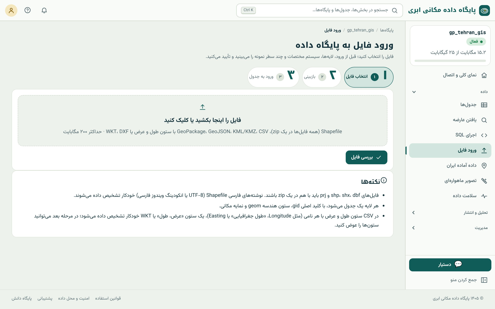
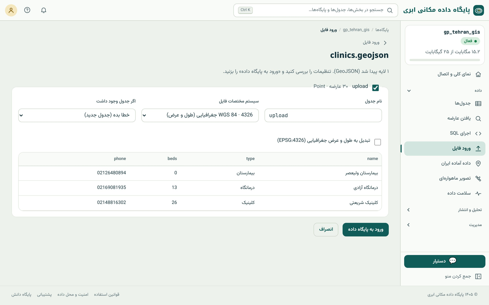
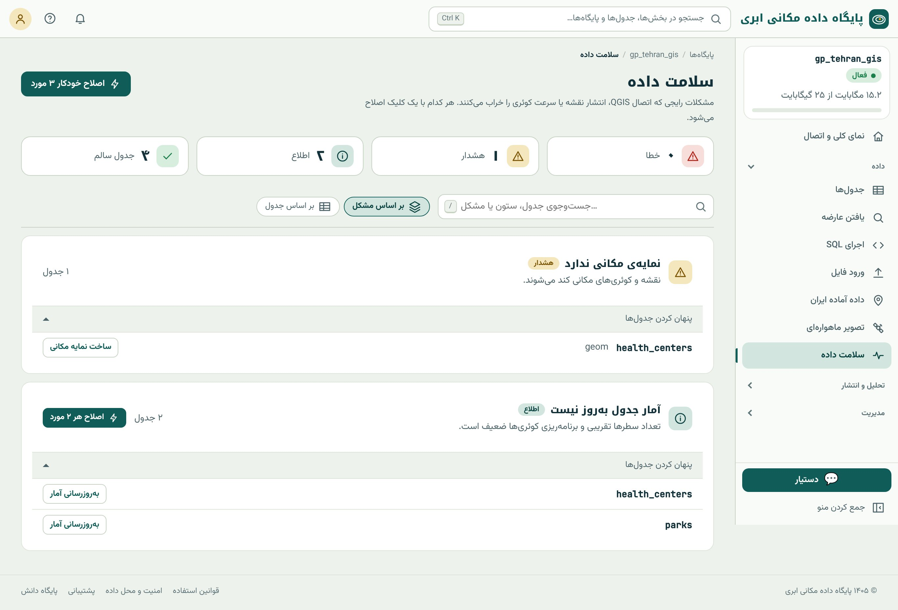

## داده از کجا می‌آید

پیش از تحلیل باید داده داشته باشید. چهار راه اصلی برای آوردن داده به پایگاه داده مکانی ابری هست و هر کدام در یک فصل آمده است:

| راه | مناسب برای | فصل |
|---|---|---|
| **ورود فایل** در مرورگر | فایل‌های موجود تا ۲۰۰ مگابایت | همین فصل |
| ابزارهای رومیزی (QGIS، ogr2ogr) | فایل‌های بزرگ و کار خودکار | همین فصل |
| **داده‌ی آماده‌ی ایران** | معابر، ساختمان‌ها، کاربری‌ها و مرزها از OpenStreetMap | ۳۰ |
| **تصویر ماهواره‌ای** | Sentinel-2، Landsat و DEM | ۳۴ |
| **برداشت میدانی** | نقطه‌های GNSS و فرم میدانی | ۴۸ |
| ساخت جدول و ویرایش دستی | داده‌ی کم یا تازه | ۹ |

## ورود فایل در سه گام

منوی کناری ← داده ← «ورود فایل». این صفحه یک فرایند سه‌مرحله‌ای است: **انتخاب فایل**، **بازبینی** و **ورود به جدول**.

{.shot}

### قالب‌های پذیرفته‌شده

- **Shapefile:** همه‌ی فایل‌های همراه (`.shp`، `.shx`، `.dbf`، `.prj` و در صورت وجود `.cpg`) را کنار هم در **یک فایل zip**
  بگذارید و zip را بفرستید. نبودن `.prj` یعنی سیستم مختصات تشخیص داده نمی‌شود.
- **GeoPackage** (`.gpkg`): همه‌ی لایه‌های داخلش فهرست می‌شوند.
- **GeoJSON**، **KML/KMZ**: مستقیم.
- **CSV:** با ستون طول و عرض یا با یک ستون WKT (فصل ۲).
- **DXF:** نقشه‌های CAD؛ لایه‌های DXF جدا می‌شوند.

حداکثر حجم هر فایل ۲۰۰ مگابایت است و حجم نهایی جدول‌ها باید در سهمیه‌ی پلن جا شود.

### بازبینی پیش از ورود

پس از «بررسی فایل»، سامانه فایل را باز می‌کند و برای هر لایه‌ی داخلش این‌ها را نشان می‌دهد: تعداد عارضه، نوع هندسه، سیستم
مختصات تشخیص‌داده‌شده و چند سطر نمونه. اینجا جایی است که بیشترین خطاها را می‌توان پیش از ورود گرفت.

{.shot .wide}

::: steps
1. **نام جدول:** با حروف کوچک انگلیسی، عدد و زیرخط. نام‌های پیش‌فرض (مثل `upload`) را به نام معنادار عوض کنید: `health_clinics`.
2. **سیستم مختصات فایل:** اگر از `.prj` خوانده شده، بررسی کنید منطقی باشد؛ اگر نه، سیستم درست را انتخاب کنید. یادتان باشد که این
   گزینه سیستم *فایل* را می‌گوید، نه سیستم مقصد (فصل ۳).
3. **«تبدیل به طول و عرض جغرافیایی (EPSG:4326)»:** اگر داده‌ی شما UTM است و می‌خواهید در ۴۳۲۶ ذخیره شود، این تیک را بزنید.
4. **اگر جدول وجود داشت:** «خطا بده» (پیش‌فرض و امن)، «جایگزین کن» یا «به انتهایش اضافه کن».
5. **کدگذاری نوشته‌ها:** اگر متن فارسی در نمونه‌ها به‌هم‌ریخته است (مثل `ÇíÑÇä`)، کدگذاری را روی «ویندوز فارسی/عربی (CP1256)»
   بگذارید. Shapefileهای قدیمی معمولاً همین کدگذاری را دارند.
6. «ورود به پایگاه داده» را بزنید. فایل‌های بزرگ در پس‌زمینه وارد می‌شوند و پایان کار با اعلان خبر داده می‌شود.
:::

::: warn
**«جایگزین کن» برگشت‌پذیر نیست.** این گزینه جدول قبلی را حذف و جدول تازه را جایش می‌سازد. اگر جدول مهم است، پیش از جایگزینی
یک بکاپ دستی بگیرید (فصل ۵۱).
:::

### CSV نقطه‌ای

برای فایل CSV، سامانه ستون‌های طول و عرض را از روی نام (مثل `lon`، `Longitude`، `X`، «طول جغرافیایی»، `Easting`) یا از روی
مقدارها تشخیص می‌دهد. اگر درست تشخیص داده نشد، در صفحه‌ی بازبینی ستون طول و عرض را خودتان انتخاب کنید. دو خطای رایج:

- **جابه‌جایی طول و عرض:** نقطه‌ها در جای آینه‌ای و دور می‌افتند. ستون‌ها را جابه‌جا انتخاب کنید.
- **مختصات متری با SRID درجه‌ای:** اگر مقدارها صدها هزار و میلیونی‌اند، سیستم را UTM ناحیه‌ی درست بگذارید (فصل ۳).

### پشت صحنه‌ی ورود

ورود فایل در سامانه با کتابخانه‌ی **GDAL** انجام می‌شود که استاندارد جهانی خواندن قالب‌های مکانی است. برای هر لایه:

- یک جدول با ستون کلید اصلی `gid` (عدد صحیح خودافزا) و ستون هندسه با نام `geom` ساخته می‌شود؛
- نام ستون‌ها به حروف کوچک برگردانده می‌شود؛
- **شاخص مکانی** روی `geom` ساخته می‌شود؛
- سطرها در یک تراکنش نوشته می‌شوند: اگر وسط کار خطایی رخ دهد، هیچ سطری نوشته نمی‌شود.

## افزودن فایل به جدول موجود

گاهی جدول را از قبل دارید و فقط داده‌ی تازه، مثلاً برداشت این ماه، باید به آن اضافه شود. در صفحه‌ی همان جدول (فصل ۸) دکمه‌ی
«ورود فایل به این جدول» را بزنید. پس از انتخاب فایل:

- هر ستون جدول را به یک ستون فایل **نگاشت** می‌کنید (ستون‌های هم‌نام خودکار وصل می‌شوند)؛
- «افزودن» یا «جایگزینی کل داده‌ها» را انتخاب می‌کنید؛
- هندسه خودکار به SRID جدول تبدیل می‌شود؛
- ورود **همه‌یاهیچ** است: اگر یک سطر با قیدهای جدول (مثلاً نوع ستون یا کلید یکتا) جور نباشد، هیچ سطری اضافه نمی‌شود و سطر
  مشکل‌دار گزارش می‌شود.

## فایل‌های بزرگ: QGIS، ogr2ogr و shp2pgsql

برای فایل‌های بزرگ‌تر از ۲۰۰ مگابایت، یا وقتی ورود باید خودکار و تکراری باشد، از رایانه‌ی خودتان مستقیم به پایگاه وصل شوید.

**QGIS DB Manager:** لایه را در QGIS باز کنید، **Database ← DB Manager**، اتصال را انتخاب و **Import Layer/File** را بزنید. نام
جدول را بنویسید و تیک‌های **Create spatial index** و **Convert field names to lowercase** را بزنید. اگر می‌خواهید SRID عوض شود،
**Target SRID** را تعیین کنید.

**ogr2ogr** ابزار خط فرمان GDAL است و سریع‌ترین و انعطاف‌پذیرترین راه:

```bash
ogr2ogr -f PostgreSQL \
  PG:"host=db.example.com port=5439 dbname=gp_tehran_gis user=gp_tehran_gis_user sslmode=require" \
  roads.gpkg -nln roads \
  -nlt PROMOTE_TO_MULTI \
  -lco GEOMETRY_NAME=geom -lco FID=gid \
  -t_srs EPSG:4326 \
  -progress
```

| گزینه | معنا |
|---|---|
| `-nln roads` | نام جدول مقصد |
| `-nlt PROMOTE_TO_MULTI` | همه‌ی هندسه‌ها چندبخشی شوند تا لایه‌ای که هم Polygon و هم MultiPolygon دارد خطا ندهد |
| `-lco GEOMETRY_NAME=geom` | نام ستون هندسه |
| `-lco FID=gid` | نام ستون کلید اصلی |
| `-t_srs EPSG:4326` | سیستم مختصات مقصد (تبدیل در حین ورود) |
| `-s_srs EPSG:32639` | سیستم مختصات مبدأ، اگر فایل `.prj` ندارد |
| `-append` یا `-overwrite` | افزودن به جدول موجود یا جایگزینی آن |
| `--config SHAPE_ENCODING CP1256` | کدگذاری Shapefile فارسی قدیمی |

**shp2pgsql** ابزار همراه PostGIS است که Shapefile را به دستورهای SQL تبدیل می‌کند و خروجی‌اش را به psql می‌دهیم:

```bash
shp2pgsql -s 32639:4326 -I -W CP1256 parcels.shp parcels | psql "host=… sslmode=require"
```

`-s 32639:4326` یعنی فایل در UTM ۳۹ است و در ۴۳۲۶ ذخیره شود، `-I` شاخص مکانی می‌سازد و `-W` کدگذاری را تعیین می‌کند.

## سلامت داده

داده‌ای که وارد می‌شود همیشه سالم نیست. منوی کناری ← داده ← «سلامت داده» همه‌ی جدول‌ها را بررسی و مشکلات را بر اساس شدت دسته‌بندی
می‌کند: **خطا**، **هشدار** و **اطلاع**. کنار هر مشکل دکمه‌ی رفع آن هست و «اصلاح خودکار» همه‌ی موارد قابل رفع را یک‌جا اصلاح می‌کند.

{.shot}

هر بررسی «سلامت داده» یک پرسش SQL پشت صحنه است و دانستن آن کمک می‌کند در هر پایگاه داده‌ای همین بررسی‌ها را انجام دهید:

### ۱. جدول بدون کلید اصلی

بدون کلید اصلی، QGIS و مرورگر سامانه نمی‌توانند سطرها را ویرایش کنند و انتشار لایه هم مشکل پیدا می‌کند.

```{.sql .run}
SELECT c.relname AS table_without_pk
FROM pg_class c JOIN pg_namespace n ON n.oid = c.relnamespace
WHERE c.relkind = 'r' AND n.nspname = 'public' AND c.relname <> 'spatial_ref_sys'
  AND NOT EXISTS (SELECT 1 FROM pg_constraint WHERE conrelid = c.oid AND contype = 'p');
```

نتیجه‌ی خالی یعنی همه‌ی جدول‌ها کلید اصلی دارند. رفع: `ALTER TABLE t ADD COLUMN gid serial PRIMARY KEY;`

### ۲. ستون هندسه بدون شاخص مکانی

بدون شاخص مکانی، هر پرسش مکانی همه‌ی سطرها را یکی‌یکی بررسی می‌کند و نقشه کند بارگذاری می‌شود (فصل ۲۰).

```{.sql .run}
SELECT g.f_table_name AS layer
FROM geometry_columns g
WHERE NOT EXISTS (
  SELECT 1 FROM pg_indexes i
  WHERE i.tablename = g.f_table_name AND i.indexdef ILIKE '%gist%' || g.f_geometry_column || '%');
```

رفع:

```sql
CREATE INDEX ON health_centers USING gist (geom);
```

### ۳. هندسه‌ی نامعتبر

چندضلعی‌های خودتقاطع یا حلقه‌های باز باعث می‌شوند توابعی مثل `ST_Intersection` و `ST_Union` خطا بدهند یا نتیجه‌ی غلط برگردانند.

```{.sql .run}
SELECT 'parks' AS layer, count(*) FILTER (WHERE NOT ST_IsValid(geom)) AS invalid, count(*) AS total
FROM parks
UNION ALL
SELECT 'neighborhoods', count(*) FILTER (WHERE NOT ST_IsValid(geom)), count(*)
FROM neighborhoods;
```

رفع: `UPDATE parks SET geom = ST_MakeValid(geom) WHERE NOT ST_IsValid(geom);` (فصل ۲۲ جزئیات و احتیاط‌های آن را می‌گوید).

### ۴. SRID تعریف‌نشده

هندسه‌ای با SRID صفر نمی‌داند کجای زمین است؛ نه روی نقشه درست می‌نشیند و نه با لایه‌های دیگر قابل تحلیل است.

```{.sql .run}
SELECT f_table_name, srid FROM geometry_columns WHERE srid = 0;
```

رفع (اگر می‌دانید داده در ۴۳۲۶ است): `SELECT UpdateGeometrySRID('mytable', 'geom', 4326);`

### ۵. آمار قدیمی

PostgreSQL برای انتخاب بهترین روش اجرای هر پرسش از **آمار** جدول (تعداد سطر، توزیع مقادیر) استفاده می‌کند. پس از ورود یا تغییر
حجم زیادی داده، آمار کهنه می‌شود. رفع: `ANALYZE health_centers;`

::: pro
**قید برای پیشگیری.** به جای اینکه هر بار سلامت داده را بررسی کنید، می‌توانید با **قید** (constraint) جلوی ورود داده‌ی بد را
بگیرید: `ALTER TABLE parks ADD CONSTRAINT parks_valid CHECK (ST_IsValid(geom));` از این پس هر درج یا ویرایشی که هندسه‌ی نامعتبر
بسازد رد می‌شود. ستون هندسه را هم با نوع و SRID مشخص تعریف کنید، مثلاً `geometry(MultiPolygon, 4326)`، تا هندسه‌ی نوع دیگر یا
SRID دیگر پذیرفته نشود (فصل ۱۴).
:::

::: try
داده‌ی نمونه‌ی کتاب را وارد پایگاه خود کنید. سه فایل `schools.geojson`، `metro_stations.geojson` و `parks.geojson` همراه کتاب
است. هر کدام را با همان نام جدول وارد کنید. سپس به «سلامت داده» بروید و همه‌ی مشکلات را با «اصلاح خودکار» رفع کنید. جدول‌های
`neighborhoods`، `health_centers` و `parcels` را در فصل ۱۴ با SQL خودتان می‌سازید.
:::

::: summary
- ورود فایل سه گام دارد: انتخاب، بازبینی (نام، سیستم مختصات، حالت، کدگذاری) و ورود؛ حداکثر ۲۰۰ مگابایت.
- Shapefile را با همه‌ی فایل‌های همراهش zip کنید؛ متن فارسی به‌هم‌ریخته یعنی کدگذاری CP1256.
- «جایگزین کن» جدول قبلی را حذف می‌کند؛ پیش از آن بکاپ بگیرید.
- فایل‌های بزرگ را با QGIS DB Manager، ogr2ogr یا shp2pgsql مستقیم وارد کنید.
- «سلامت داده» نبود کلید اصلی، نبود شاخص مکانی، هندسه‌ی نامعتبر، SRID صفر و آمار کهنه را پیدا و رفع می‌کند.
:::

::: teach
**زمان پیشنهادی:** ۷۵ دقیقه. یک Shapefile فارسی قدیمی (با کدگذاری CP1256) و یک CSV با مختصات UTM آماده کنید و بگذارید
دانشجوها خودشان به خطا بخورند و با بخش «بازبینی» رفعش کنند. این دو خطا رایج‌ترین مشکلات دنیای واقعی‌اند.
:::

::: exercises
### تمرین‌ها

1. [سطح ۱]{.badge .b1} داده‌ی نمونه را وارد کنید و تعداد عارضه‌ی هر جدول را با جدول «داده‌ی نمونه» در راهنمای کتاب مقایسه کنید.
2. [سطح ۱]{.badge .b1} یک فایل CSV با سه ستون `name`، `lat` و `lon` و پنج مکان شهر خودتان در اکسل بسازید و وارد کنید.
3. [سطح ۲]{.badge .b2} همان CSV را با طول و عرض جابه‌جا وارد کنید. نقطه‌ها کجا افتادند؟ چرا؟
4. [سطح ۲]{.badge .b2} پرسش «هندسه‌ی نامعتبر» را برای جدول `parcels` بنویسید و اجرا کنید.
5. [سطح ۳]{.badge .b3} یک دستور ogr2ogr بنویسید که فایل GeoPackage با لایه‌ای در UTM ناحیه‌ی ۴۰ را به جدول `buildings` در ۴۳۲۶
   وارد و به جدول موجود اضافه کند.
:::
