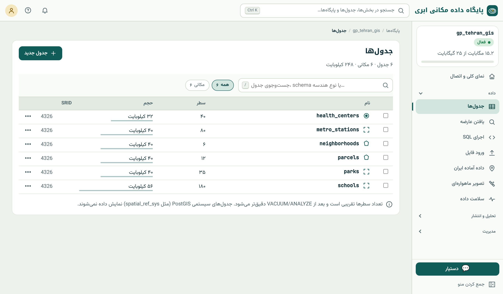
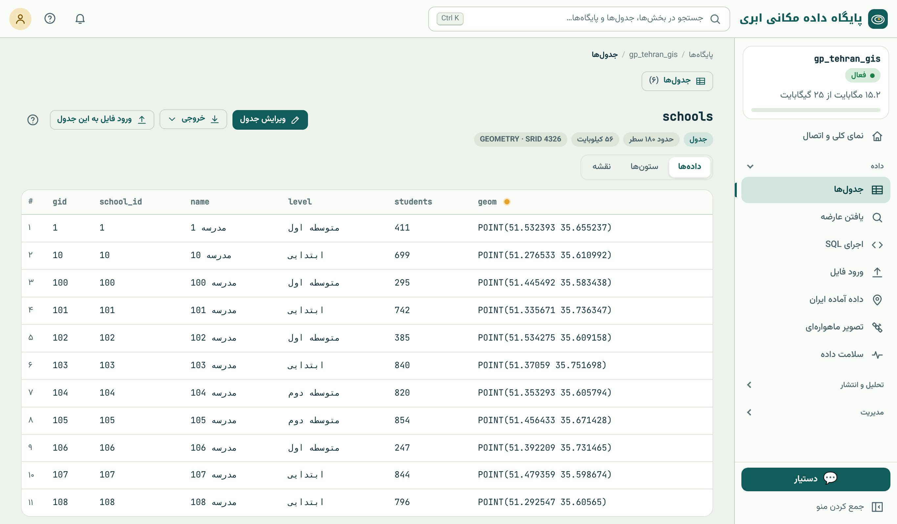
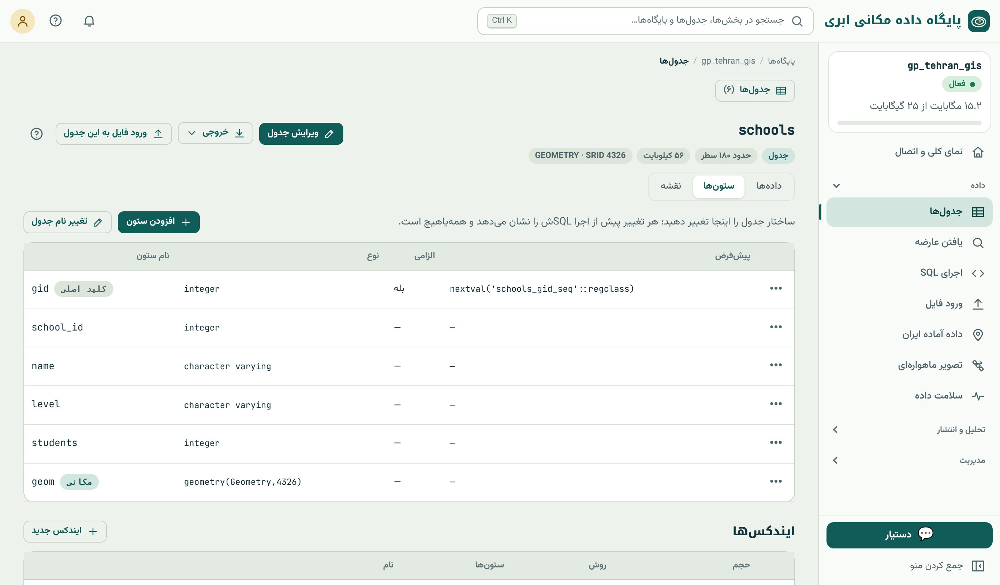
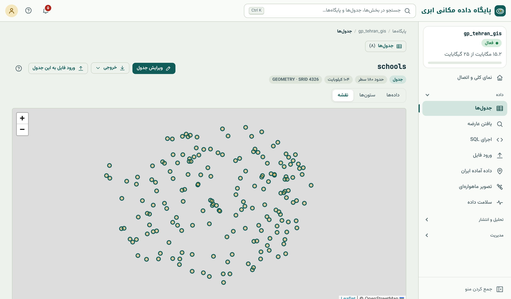
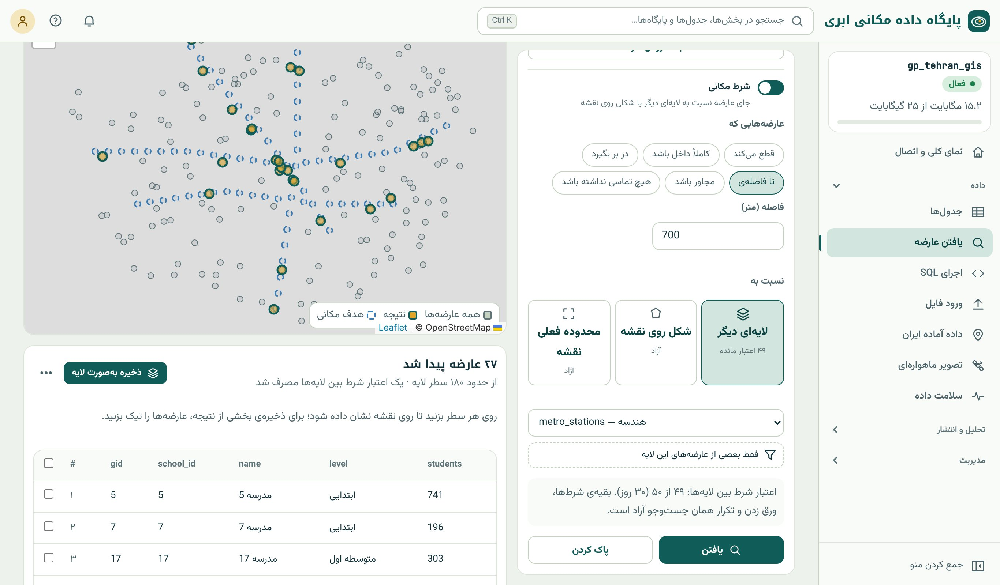

## مرورگر داده

بخش «جدول‌ها» در گروه «داده» همان کاری را می‌کند که پنل Browser و جدول ویژگی‌ها در QGIS، اما در مرورگر و بدون نصب هیچ
نرم‌افزاری. اینجا جای اولی است که بعد از ورود داده به آن سر می‌زنید.

{.shot}

در این صفحه:

- **جست‌وجو** بر اساس نام جدول، schema یا نوع هندسه؛
- **چیپ‌های فیلتر:** همه، مکانی، غیرمکانی، نما؛
- **مرتب‌سازی** با کلیک روی سربرگ ستون‌ها (مثلاً بزرگ‌ترین جدول‌ها)؛
- **تیک چند جدول** و «نمایش با هم روی نقشه» برای دیدن چند لایه کنار هم، هر کدام با رنگ جدا؛
- **منوی ⋯** هر جدول: خروجی، افزودن به نقشه‌ی چندلایه، انتشار، حذف؛
- دکمه‌ی اصلی «جدول جدید» (فصل ۹).

::: know
**تعداد سطر تقریبی است.** ستون «سطر» از آمار PostgreSQL خوانده می‌شود تا صفحه حتی برای جدول‌های میلیونی فوری باز شود. پس از
`ANALYZE` (یا رفع «آمار به‌روز نیست» در «سلامت داده») دقیق می‌شود. تعداد دقیق را همیشه با `SELECT count(*) FROM schools;`
می‌گیرید.
:::

## صفحه‌ی هر جدول

با کلیک روی نام جدول، صفحه‌ی آن باز می‌شود. سربرگ صفحه نوع (جدول یا نما)، تعداد تقریبی سطر، حجم و نوع هندسه با SRID را نشان
می‌دهد و سه زبانه دارد: **داده‌ها**، **ستون‌ها** و **نقشه**. دکمه‌های «ویرایش جدول»، «خروجی» و «ورود فایل به این جدول» بالای
صفحه‌اند.

{.shot}

**داده‌ها** سطرها را در صفحه‌های ۵۰ سطری نشان می‌دهد؛ هندسه‌ها به صورت WKT کوتاه‌شده نمایش داده می‌شوند. با کلیک روی سربرگ هر
ستون، مرتب‌سازی عوض می‌شود.

**ستون‌ها** ساختار جدول را نشان می‌دهد: نام، نوع داده، الزامی بودن و مقدار پیش‌فرض هر ستون، کلید اصلی و ستون مکانی، و
فهرست شاخص‌ها. تغییر ساختار (افزودن ستون، تغییر نوع، ساخت شاخص) هم از همین‌جاست (فصل ۹).

{.shot}

**نقشه** عارضه‌های جدول را روی نقشه‌ی پایه نشان می‌دهد. با کلیک روی هر عارضه، ویژگی‌هایش در پنجره‌ی کوچکی می‌آید. داده‌ی هر
SRIDی خودکار به ۴۳۲۶ تبدیل می‌شود تا روی نقشه‌ی وب بنشیند.

{.shot}

::: note
**سقف ۲۰۰۰ عارضه روی نقشه.** برای سریع ماندن مرورگر، زبانه‌ی نقشه حداکثر ۲۰۰۰ عارضه را نشان می‌دهد؛ جدول شما کامل است. برای
دیدن همه‌ی عارضه‌های یک جدول بزرگ، آن را در QGIS باز کنید یا در یک نقشه‌ی چندلایه بگذارید که با کاشی برداری کار می‌کند و
محدودیت تعداد ندارد (فصل ۴۲).
:::

## یافتن عارضه

پرسش «کدام عارضه‌ها چنین شرطی دارند؟» رایج‌ترین پرسش GIS است. بخش «یافتن عارضه» آن را بدون نوشتن SQL پاسخ می‌دهد و ترکیبی
از **شرط ویژگی** و **شرط مکانی** را می‌پذیرد.

::: steps
1. منوی کناری ← داده ← «یافتن عارضه». در «کدام لایه؟» جدول را انتخاب کنید؛ مثلاً `schools`.
2. **شرط ویژگی** (اختیاری): «افزودن شرط»، ستون، عملگر و مقدار؛ مثلاً `students` بزرگ‌تر از `500`. چند شرط را می‌توان با «و» یا
   «یا» ترکیب کرد. برای ستون‌های متنی، مقدارهای موجود پیشنهاد می‌شوند.
3. **شرط مکانی** (اختیاری): کلید «شرط مکانی» را روشن کنید و رابطه را انتخاب کنید: قطع می‌کند، کاملاً داخل باشد، در بر بگیرد،
   تا فاصله‌ی…، مجاور باشد، هیچ تماسی نداشته باشد.
4. هدف شرط مکانی را تعیین کنید: **لایه‌ای دیگر** (مثلاً ایستگاه‌های مترو، با امکان فیلتر روی آن لایه)، **شکلی که روی نقشه
   می‌کشید**، یا **محدوده‌ی فعلی نقشه**.
5. «یافتن» را بزنید. نتیجه روی نقشه برجسته و زیر آن فهرست می‌شود.
6. برای نگه داشتن نتیجه، «ذخیره به‌صورت لایه» آن را به جدول تازه‌ای در همان پایگاه تبدیل می‌کند. می‌توانید فقط سطرهای تیک‌خورده
   را ذخیره کنید.
:::

{.shot .wide}

::: note
**اعتبار شرط بین لایه‌ای.** شرط مکانی با «لایه‌ای دیگر» سنگین‌تر از بقیه است و هر پلن تعداد مشخصی از آن را در یک دوره‌ی زمانی
دارد که روی کاشی مربوط نمایش داده می‌شود. بقیه‌ی شرط‌ها، ورق زدن و تکرار همان جست‌وجو آزاد است. اگر این نوع پرسش را زیاد لازم
دارید، معادل SQL آن را یاد بگیرید (پایین همین بخش و فصل ۱۷)؛ کنسول SQL چنین محدودیتی ندارد.
:::

### زیر کاپوت: همان پرسش با SQL

«یافتن عارضه» در واقع یک پرسش SQL می‌سازد. همان جست‌وجوی شکل بالا، یعنی «مدرسه‌هایی که تا ۷۰۰ متری دست‌کم یک ایستگاه
مترو هستند»، به SQL این است:

```{.sql .run rows=4}
SELECT s.gid, s.name, s.level, s.students
FROM schools s
WHERE EXISTS (
  SELECT 1 FROM metro_stations m
  WHERE ST_DWithin(s.geom::geography, m.geom::geography, 700)
)
ORDER BY s.gid;
```

شمار سطرها همان ۲۷ است. تابع `ST_DWithin(a, b, d)` می‌پرسد آیا فاصله‌ی دو هندسه حداکثر `d` است، و تبدیل به `geography` باعث
می‌شود فاصله به متر حساب شود (فصل ۳). در فصل ۱۷ همه‌ی رابطه‌های مکانی را با جزئیات یاد می‌گیرید؛ اینجا کافی است بدانید که
**هر چیزی که در رابط ساخته می‌شود یک معادل SQL دارد**، و نسخه‌ی SQL هیچ سقف و محدودیتی جز سقف زمان پرسش ندارد.

## خروجی گرفتن

دکمه‌ی «خروجی» در صفحه‌ی هر جدول (یا منوی ⋯ در فهرست جدول‌ها) جدول را در یکی از این قالب‌ها دانلود می‌کند:

| قالب | مناسب برای | نکته |
|---|---|---|
| **GeoPackage** | تبادل کامل با QGIS و ArcGIS | بهترین انتخاب عمومی؛ نام ستون بلند و متن فارسی سالم |
| **GeoJSON** | وب، برنامه‌نویسی | همیشه در ۴۳۲۶ |
| **Shapefile** (zip) | نرم‌افزارهای قدیمی | نام ستون‌ها به ده نویسه کوتاه می‌شود |
| **CSV** | اکسل، گزارش | هندسه به صورت WKT در یک ستون |
| **KML** | Google Earth | همراه نام عارضه |

هر خروجی حداکثر ۱۰۰٬۰۰۰ سطر دارد. برای جدول‌های بزرگ‌تر، از QGIS (راست‌کلیک روی لایه ← Export) یا ogr2ogr استفاده کنید:

```bash
ogr2ogr -f GPKG schools.gpkg PG:"host=… sslmode=require" -sql "SELECT * FROM schools WHERE students > 500"
```

نمونه‌ی بالا یک نکته‌ی مهم را هم نشان می‌دهد: با `-sql` می‌توانید **نتیجه‌ی هر پرسشی** را خروجی بگیرید، نه فقط یک جدول کامل.

::: try
با «یافتن عارضه» مدرسه‌های ابتدایی با بیش از ۶۰۰ دانش‌آموز را پیدا کنید که *بیش از* یک کیلومتر از نزدیک‌ترین مرکز درمانی
فاصله دارند (راهنمایی: رابطه‌ی «تا فاصله‌ی…» را با «هیچ تماسی نداشته باشد» مقایسه کنید؛ کدام برای «بیش از» مناسب است؟). نتیجه
را با نام `far_primary_schools` ذخیره کنید و از آن خروجی GeoPackage بگیرید.
:::

::: summary
- «جدول‌ها» فهرست جدول‌ها را با تعداد سطر (تقریبی)، حجم و SRID نشان می‌دهد؛ چند جدول را می‌توان با هم روی نقشه دید.
- صفحه‌ی هر جدول سه زبانه دارد: داده‌ها (۵۰ سطری)، ستون‌ها (ساختار و شاخص) و نقشه (تا ۲۰۰۰ عارضه).
- «یافتن عارضه» شرط ویژگی و شرط مکانی (نسبت به لایه، شکل یا محدوده‌ی نقشه) را ترکیب می‌کند و نتیجه را لایه می‌کند.
- هر جست‌وجو یک معادل SQL دارد؛ `ST_DWithin` روی `geography` یعنی «تا فاصله‌ی چند متر».
- خروجی تا ۱۰۰٬۰۰۰ سطر در GeoPackage، GeoJSON، Shapefile، CSV و KML؛ برای بیشتر، QGIS یا ogr2ogr.
:::

::: teach
**زمان پیشنهادی:** ۴۵ دقیقه. پرسش‌های «یافتن عارضه» را به صورت مسابقه‌ی گروهی طرح کنید: هر گروه پرسشی از گروه دیگر بپرسد و
جواب را با شمار نتیجه بسنجید. این فصل پل خوبی به SQL است: برای هر جست‌وجو از دانشجوها بخواهید حدس بزنند SQL آن چه شکلی است.
:::

::: exercises
### تمرین‌ها

1. [سطح ۱]{.badge .b1} بزرگ‌ترین جدول پایگاه نمونه از نظر حجم کدام است؟ از نظر تعداد سطر؟
2. [سطح ۱]{.badge .b1} جدول‌های `parks`، `schools` و `metro_stations` را با «نمایش با هم روی نقشه» کنار هم ببینید.
3. [سطح ۱]{.badge .b1} با «یافتن عارضه» مراکز درمانی از نوع «بیمارستان» را پیدا کنید. چند مورد است؟
4. [سطح ۲]{.badge .b2} مدرسه‌هایی را پیدا کنید که داخل یک پارک‌اند. چرا ممکن است نتیجه خالی باشد؟ رابطه‌ی «تا فاصله‌ی ۲۰۰ متر»
   را امتحان کنید.
5. [سطح ۲]{.badge .b2} روی نقشه یک چندضلعی دور شمال شهر بکشید و مدرسه‌های داخل آن را پیدا کنید.
6. [سطح ۳]{.badge .b3} پرسش SQL «زیر کاپوت» را طوری تغییر دهید که فقط مدرسه‌های ابتدایی را برگرداند و فاصله را ۱۰۰۰ متر کنید.
   حاصل را با «یافتن عارضه» مقایسه کنید.
:::
