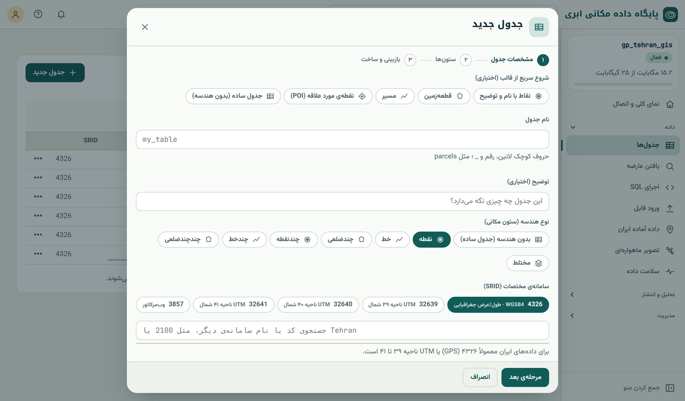
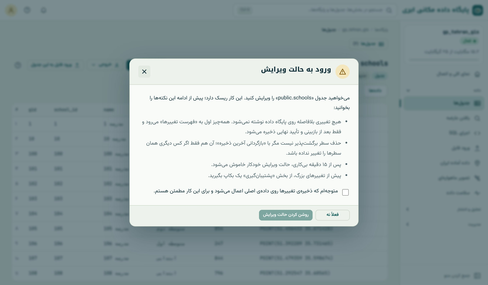
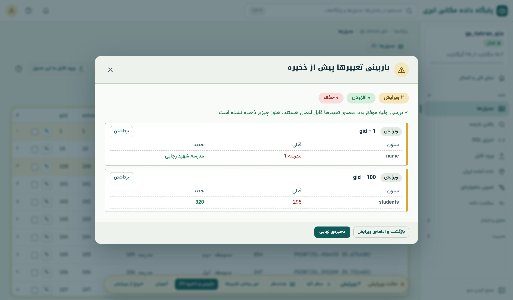
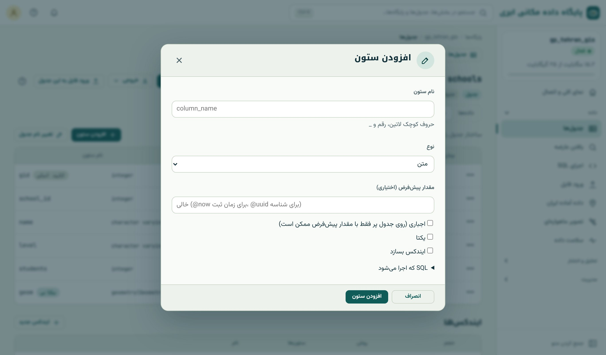

## ساخت جدول تازه

گاهی داده از جای دیگری نمی‌آید و باید آن را از صفر بسازید: فهرست چاه‌های یک دشت، محل دوربین‌های ترافیکی یا محدوده‌ی پروژه‌های
یک شرکت. دکمه‌ی «جدول جدید» در صفحه‌ی «جدول‌ها» یک مودال سه‌مرحله‌ای باز می‌کند: **مشخصات جدول**، **ستون‌ها** و
**بازبینی و ساخت**.

{.shot .wide}

::: steps
1. **شروع سریع از قالب** (اختیاری): «نقاط با نام و توضیح»، «قطعه‌زمین»، «مسیر»، «نقطه‌ی مورد علاقه (POI)» یا «جدول ساده».
   هر قالب ستون‌های معمول آن نوع داده را آماده می‌کند.
2. **نام جدول** با حروف کوچک انگلیسی و زیرخط، مثلاً `wells`، و یک **توضیح** کوتاه که به‌عنوان فراداده روی جدول می‌نشیند.
3. **نوع هندسه:** بدون هندسه، نقطه، خط، چندضلعی، چندنقطه، چندخط، چندچندضلعی یا مختلط. نوع درست را انتخاب کنید؛ پایگاه
   هندسه‌ی نوع دیگر را رد می‌کند و این خودش یک کنترل کیفیت است.
4. **سیستم مختصات:** ۴۳۲۶ برای داده‌ی GPS و عمومی؛ UTM ناحیه‌ی مربوط (۳۲۶۳۸ تا ۳۲۶۴۱) اگر داده‌تان متری است؛ هر کد دیگری با
   جست‌وجو.
5. **ستون‌ها:** برای هر ستون نام، نوع (متن، عدد صحیح، عدد اعشاری، تاریخ، بله/خیر و …)، الزامی بودن و مقدار پیش‌فرض.
6. **بازبینی و ساخت:** دستور SQL‌ای که اجرا خواهد شد نمایش داده می‌شود. «ساخت» را بزنید.
:::

### زیر کاپوت

جدولی که مودال می‌سازد با این SQL معادل است. کد زیر روی پایگاه نمونه اجرا شده، اما چون کتاب هیچ چیزی را در پایگاه نمونه
نگه نمی‌دارد، در پایان برگردانده شده است:

```{.sql .run}
CREATE TABLE wells (
  gid        serial PRIMARY KEY,
  name       text NOT NULL,
  depth_m    numeric(6,1),
  drilled_on date,
  active     boolean DEFAULT true,
  geom       geometry(Point, 4326)
);
CREATE INDEX ON wells USING gist (geom);
COMMENT ON TABLE wells IS 'چاه‌های بهره‌برداری دشت نمونه';

INSERT INTO wells (name, depth_m, drilled_on, geom)
VALUES ('چاه ۱', 120.5, '2019-05-01', ST_SetSRID(ST_MakePoint(51.30, 35.62), 4326));

SELECT gid, name, depth_m, active, ST_AsText(geom) FROM wells;
```

چند نکته در این کد هست که در فصل ۱۴ مفصل یاد می‌گیرید: `serial PRIMARY KEY` کلید اصلی خودافزا می‌سازد؛ `NOT NULL` ستون را الزامی
می‌کند؛ `geometry(Point, 4326)` ستون هندسه را به نوع نقطه و SRID ۴۳۲۶ محدود می‌کند؛ و شاخص GiST برای سرعت پرسش‌های مکانی است.

## ویرایش داده با پیش‌نویس

ویرایش مستقیم پایگاه داده‌ای که چند نفر روی آن کار می‌کنند پرخطر است: یک کلیک اشتباه می‌تواند صدها سطر را عوض کند. ویرایشگر
سامانه برای همین با چند لایه‌ی ایمنی طراحی شده است:

1. **حالت ویرایش همیشه خاموش شروع می‌شود** و روشن کردنش تأیید می‌خواهد.
2. **هر تغییر اول پیش‌نویس است** و در «فهرست تغییرها» جمع می‌شود؛ هیچ چیز فوری در پایگاه نوشته نمی‌شود.
3. **پیش از ذخیره، بازبینی** مقدار قبلی و جدید هر تغییر را نشان می‌دهد؛ حذف سطر تأیید جداگانه می‌خواهد.
4. **ذخیره همه‌یاهیچ است:** همه‌ی تغییرها در یک تراکنش نوشته می‌شوند؛ اگر یکی رد شود، هیچ‌کدام نوشته نمی‌شود.
5. **تعارض با همکار** تشخیص داده می‌شود: اگر کسی در این فاصله همان سطر را عوض کرده باشد، ذخیره متوقف می‌شود تا کار او از
   بین نرود.
6. **آخرین ذخیره قابل بازگردانی است.**
7. پس از ۱۵ دقیقه بی‌کاری، حالت ویرایش خودکار خاموش می‌شود.

{.shot}

::: steps
1. در صفحه‌ی جدول «ویرایش جدول» را بزنید، نکته‌ها را بخوانید، کادر تأیید را تیک بزنید و «روشن کردن حالت ویرایش» را بزنید. نوار
   «حالت ویرایش» پایین صفحه ظاهر می‌شود.
2. در زبانه‌ی «داده‌ها»، کنار هر سطر آیکون ویرایش آمده است. آن را بزنید، مقدار تازه را بنویسید و «ثبت در فهرست تغییرها» را بزنید.
   کلید اصلی قابل ویرایش نیست.
3. برای سطر تازه «افزودن سطر» و برای حذف، آیکون حذف کنار سطر را بزنید.
4. در زبانه‌ی «نقشه» با ابزارهای کنار نقشه شکل تازه بکشید، گره‌های یک شکل را جابه‌جا کنید یا عارضه را حذف کنید. تغییرهای نقشه
   هم در همان فهرست جمع می‌شوند و با عوض کردن زبانه از بین نمی‌روند.
5. «بازبینی و ذخیره» را بزنید. هر تغییر با مقدار قبلی (خط‌خورده) و جدید نشان داده می‌شود. اگر همه درست است «ذخیره‌ی نهایی».
6. اگر پس از ذخیره پشیمان شدید، «بازگردانی آخرین ذخیره» آن را برمی‌گرداند (به شرطی که کسی سطرها را بعد از شما عوض نکرده باشد).
:::

{.shot}

::: warn
**ویرایش فقط برای جدول دارای کلید اصلی.** ویرایشگر برای شناختن هر سطر به کلید اصلی نیاز دارد. اگر جدولی کلید اصلی ندارد، اول
از «سلامت داده» آن را اضافه کنید (فصل ۷). ویرایشگر هندسه را هم پیش از ذخیره بررسی می‌کند و هندسه‌ی نامعتبر را نمی‌پذیرد.
:::

::: know
**تشخیص تعارض چگونه کار می‌کند؟** وقتی سطری را برای ویرایش باز می‌کنید، ویرایشگر «اثر انگشت» (چکیده‌ی md5) محتوای آن سطر را
نگه می‌دارد. هنگام ذخیره، دوباره اثر انگشت سطر را در پایگاه حساب می‌کند. اگر فرق کرده باشد یعنی کس دیگری در این فاصله سطر را
عوض کرده است، و ذخیره متوقف می‌شود. به این روش **قفل خوش‌بینانه** (optimistic locking) می‌گویند؛ در مقابلِ قفل بدبینانه که
سطر را هنگام باز شدن برای دیگران قفل می‌کند.
:::

## تغییر ساختار جدول

زبانه‌ی «ستون‌ها» علاوه بر نمایش ساختار، امکان تغییر آن را هم دارد. منوی ⋯ کنار هر ستون و دکمه‌های بالای جدول این کارها را
انجام می‌دهند:

| کار | توضیح | معادل SQL |
|---|---|---|
| افزودن ستون | نام، نوع، پیش‌فرض، اجباری، یکتا، شاخص | `ALTER TABLE … ADD COLUMN …` |
| تغییر نام ستون | | `ALTER TABLE … RENAME COLUMN … TO …` |
| تغییر نوع | مثلاً متن به عدد؛ مقدارهای ناسازگار گزارش می‌شوند | `ALTER TABLE … ALTER COLUMN … TYPE … USING …` |
| مقدار پیش‌فرض | | `ALTER TABLE … ALTER COLUMN … SET DEFAULT …` |
| حذف ستون | تأیید تایپ‌شده می‌خواهد | `ALTER TABLE … DROP COLUMN …` |
| تغییر نام جدول | | `ALTER TABLE … RENAME TO …` |
| ساخت شاخص | روی یک یا چند ستون؛ GiST برای هندسه | `CREATE INDEX …` |
| تغییر SRID یا نوع هندسه | با تبدیل واقعی مختصات | `ALTER TABLE … ALTER COLUMN geom TYPE geometry(…, srid) USING ST_Transform(…)` |

{.shot}

هر تغییر پیش از اجرا SQL خودش را نشان می‌دهد، همه‌یاهیچ است، و کارهای پرخطر مثل حذف ستون **تأیید تایپ‌شده** می‌خواهند: باید
نام ستون را دوباره بنویسید. این بهترین فرصت برای یاد گرفتن SQL است؛ هر بار پیش از زدن دکمه، SQL را بخوانید.

مثلاً افزودن ستون «مساحت به هکتار» به پارک‌ها و پر کردن آن از روی هندسه:

```{.sql .run rows=3}
ALTER TABLE parks ADD COLUMN area_calc_ha numeric(10,2);
UPDATE parks SET area_calc_ha = ST_Area(geom::geography) / 10000;
SELECT name, area_ha, area_calc_ha FROM parks ORDER BY park_id LIMIT 3;
```

ستون `area_ha` از فایل اصلی آمده و `area_calc_ha` را خودمان از هندسه حساب کرده‌ایم. اختلاف این دو نمونه‌ی خوبی از مسئله‌ی
کیفیت داده است (فصل ۲): کدام درست است؟ فصل ۱۶ اندازه‌گیری دقیق مساحت را آموزش می‌دهد.

## حذف جدول

حذف جدول از رابط عمداً سخت است: باید دستور `DROP TABLE` را در کنسول SQL با تیک «اجازه تغییر داده» اجرا کنید، یا از منوی ⋯ جدول
با تأیید تایپ‌شده. **حذف جدول برگشت‌پذیر نیست** مگر از بکاپ؛ پس پیش از آن یک بکاپ دستی بگیرید (فصل ۵۱). حذف جدول فضای سهمیه را
آزاد می‌کند و لایه‌هایی که از آن در نقشه‌ها ساخته شده بودند هم برداشته می‌شوند.

::: try
جدول `wells` را با مودال «جدول جدید» بسازید (نقطه، ۴۳۲۶، ستون‌های `name`، `depth_m`، `drilled_on`). در حالت ویرایش، روی نقشه
سه چاه در غرب تهران بکشید، نام و عمق بدهید و ذخیره کنید. سپس در کنسول SQL اجرا کنید: `SELECT name, ST_AsText(geom) FROM wells;`
:::

::: summary
- «جدول جدید» در سه گام (مشخصات، ستون‌ها، بازبینی) جدول مکانی می‌سازد و SQL آن را نشان می‌دهد.
- نوع هندسه و SRID ستون را محدود کنید تا پایگاه داده‌ی ناسازگار را نپذیرد.
- ویرایش: حالت خاموش، پیش‌نویس، بازبینی، ذخیره‌ی همه‌یاهیچ، تشخیص تعارض (قفل خوش‌بینانه) و بازگردانی.
- زبانه‌ی «ستون‌ها» ساختار را تغییر می‌دهد؛ هر تغییر پیش از اجرا SQL خودش را نشان می‌دهد.
- حذف جدول برگشت‌ناپذیر است؛ پیش از آن بکاپ بگیرید.
:::

::: teach
**زمان پیشنهادی:** ۶۰ دقیقه. دو دانشجو را هم‌زمان روی یک سطر به ویرایش وادارید تا تشخیص تعارض را ببینند؛ تجربه‌ی بهتری از
هر توضیحی درباره‌ی هم‌زمانی است. تمرین ۵ مقدمه‌ی خوبی برای بخش SQL است.
:::

::: exercises
### تمرین‌ها

1. [سطح ۱]{.badge .b1} جدولی برای ثبت ایستگاه‌های اتوبوس طراحی کنید: چه ستون‌هایی، با چه نوعی، و چه نوع هندسه‌ای؟
2. [سطح ۱]{.badge .b1} در حالت ویرایش، نام سه مدرسه را عوض کنید ولی پیش از ذخیره «بازبینی» را ببینید و یکی را برگردانید.
3. [سطح ۲]{.badge .b2} یک ستون `capacity` از نوع عدد صحیح با پیش‌فرض صفر به `metro_stations` اضافه کنید. SQL نمایش‌داده‌شده را
   یادداشت کنید.
4. [سطح ۲]{.badge .b2} تفاوت قفل خوش‌بینانه و بدبینانه را بنویسید. کدام برای ویرایش وب مناسب‌تر است و چرا؟
5. [سطح ۳]{.badge .b3} کد «زیر کاپوت» را تغییر دهید تا جدول `cameras` با هندسه‌ی نقطه در SRID ۳۲۶۳۹ و ستون `installed_on` از نوع
   تاریخ بسازد و یک دوربین با مختصات UTM درج کند.
:::
