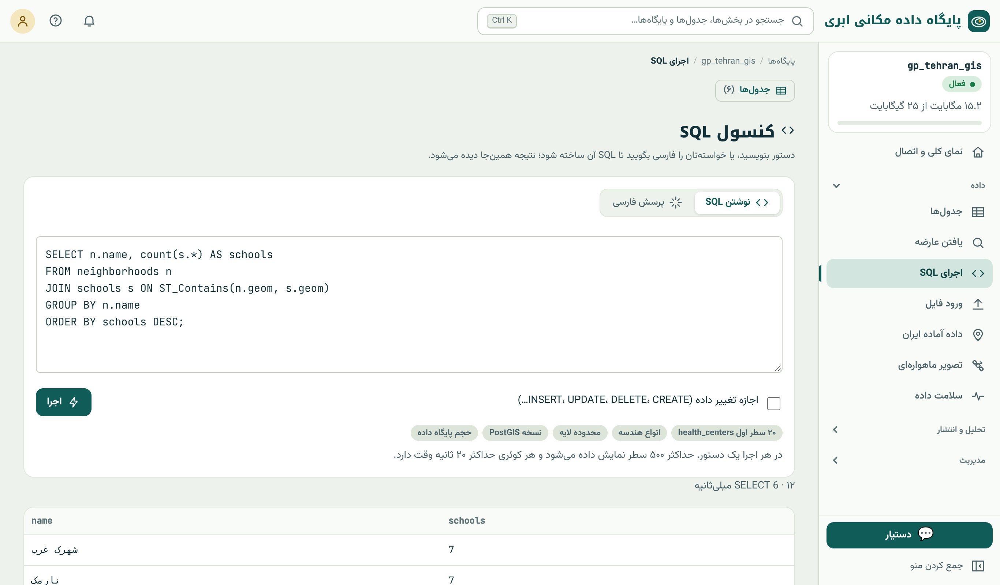

## چرا SQL

**SQL** (زبان پرسش ساخت‌یافته، Structured Query Language) زبانی است که تقریباً همه‌ی پایگاه‌های داده‌ی رابطه‌ای جهان با آن
کار می‌کنند. SQL در دهه‌ی ۱۹۷۰ در شرکت IBM بر پایه‌ی مدل رابطه‌ای ادگار کاد طراحی شد و از ۱۹۸۶ استاندارد ANSI و ISO است.
پنجاه سال بعد، SQL هنوز زبان اصلی داده است؛ نه چون کسی چیز بهتری نساخته، بلکه چون ایده‌ی آن بسیار قدرتمند است:

> در SQL می‌گویید **چه** می‌خواهید، نه **چگونه** آن را پیدا کنید.

وقتی می‌نویسید «مدرسه‌هایی را بده که بیش از ۵۰۰ دانش‌آموز دارند»، نمی‌گویید جدول را از کجا بخوان، به چه ترتیبی، با کدام شاخص.
پایگاه داده خودش بهترین روش را انتخاب می‌کند. به این زبان‌ها **اعلانی** (declarative) می‌گویند، در مقابلِ زبان‌های
**دستوری** (imperative) مثل پایتون که گام‌به‌گام می‌گویید چه کنی.

برای متخصص GIS، SQL سه مزیت دارد: **یک بار یاد می‌گیرید و همه‌جا استفاده می‌کنید** (PostGIS، QGIS، GeoServer، BigQuery،
Snowflake، DuckDB، SpatiaLite و…)؛ **تکرارپذیر است** (یک پرسش را ذخیره می‌کنید و ماه بعد روی داده‌ی تازه دوباره اجرا می‌کنید)؛
و **روی داده‌ی بزرگ سریع است**، چون کار در خود پایگاه داده انجام می‌شود، نه در رایانه‌ی شما.

## مدل رابطه‌ای

در مدل رابطه‌ای، داده در **رابطه**‌ها یا همان **جدول**‌ها نگه داشته می‌شود.

| اصطلاح | معنا | مثال در داده‌ی نمونه |
|---|---|---|
| **جدول** (table، relation) | مجموعه‌ای از سطرها با ساختار یکسان؛ یک نوع موجودیت | `schools` |
| **ستون** (column، attribute) | یک ویژگی با نام و نوع مشخص | `students` از نوع عدد صحیح |
| **سطر** (row، tuple، record) | یک نمونه از موجودیت | مدرسه‌ی ۱ |
| **کلید اصلی** (primary key) | ستونی که هر سطر را یکتا مشخص می‌کند؛ تکراری و خالی نمی‌شود | `gid` |
| **کلید خارجی** (foreign key) | ستونی که به کلید اصلی جدول دیگر اشاره می‌کند | `neighborhood_id` در جدول مدرسه‌ها |
| **schema** | پوشه‌ای برای دسته‌بندی جدول‌ها داخل پایگاه | `public` |

دو نکته‌ی مهم درباره‌ی مدل رابطه‌ای: **ترتیب سطرها معنا ندارد** (جدول یک مجموعه است، نه یک فهرست؛ اگر ترتیب می‌خواهید باید صریحاً
بخواهید) و **هر خانه یک مقدار دارد** (نه فهرستی از مقدارها).

### NULL: مقدار ناموجود

`NULL` یعنی «مقدار نامعلوم یا ناموجود». NULL با صفر یا متن خالی فرق دارد: مدرسه‌ای که تعداد دانش‌آموزش NULL است یعنی تعدادش را
نمی‌دانیم، نه اینکه دانش‌آموز ندارد. NULL رفتار خاصی دارد که منشأ خطاهای رایج است:

```{.sql .run}
SELECT NULL = NULL      AS null_equals_null,
       NULL + 5         AS null_plus_5,
       NULL IS NULL     AS is_null,
       coalesce(NULL, 0) AS coalesce_zero;
```

هر محاسبه یا مقایسه با NULL نتیجه‌ی NULL (نامعلوم) دارد، حتی `NULL = NULL`! برای آزمودن NULL باید `IS NULL` یا `IS NOT NULL`
بنویسید، و تابع `coalesce` اولین مقدار غیر NULL را برمی‌گرداند که برای جایگزینی مقدار پیش‌فرض به کار می‌رود.

## انواع داده

هر ستون یک **نوع داده** دارد که تعیین می‌کند چه مقدارهایی مجازند و چه عملیاتی روی آن‌ها ممکن است.

| دسته | نوع | کاربرد | مثال |
|---|---|---|---|
| عدد صحیح | `integer` (`int`)، `bigint`، `smallint` | شمارش، شناسه | ۴۱۱ |
| عدد اعشاری دقیق | `numeric(p,s)` | پول، مقادیری که گرد کردن نمی‌پذیرند | ۱۲۰٫۵ |
| عدد اعشاری تقریبی | `double precision`، `real` | اندازه‌گیری، محاسبات علمی | ۳۵٫۶۹۹۲ |
| متن | `text`، `varchar(n)` | نام، توضیح | «مدرسه ۱» |
| منطقی | `boolean` | بله/خیر | `true` |
| تاریخ و زمان | `date`، `timestamp`، `timestamptz` | تاریخ برداشت، زمان رویداد | `2026-11-09` |
| شناسه‌ی یکتا | `uuid` | شناسه‌ی جهانی | |
| ساخت‌یافته | `jsonb`، `hstore` | ویژگی‌های متغیر | `{"lanes": 2}` |
| آرایه | `integer[]`، `text[]` | فهرست مقدار (با احتیاط) | |
| **مکانی** | `geometry`، `geography`، `raster` | شکل و مکان | `POINT(51.4 35.7)` |

::: note
**در PostgreSQL، `text` کافی است.** برخلاف بعضی پایگاه‌های داده، در PostgreSQL نوع `text` هیچ کندی یا حجم اضافه‌ای نسبت به
`varchar(n)` ندارد. فقط وقتی `varchar(n)` بگذارید که واقعاً محدودیت طول یک قاعده‌ی کسب‌وکار است.
:::

::: warn
**تاریخ را متن نگذارید.** اگر تاریخ را به صورت متن (`'1405/08/18'`) ذخیره کنید، مرتب‌سازی، مقایسه و محاسبه‌ی فاصله‌ی زمانی
ممکن نیست. تاریخ را در ستون `date` (میلادی) ذخیره کنید و هنگام نمایش به شمسی تبدیل کنید؛ سامانه در نمودارها و چاپ نقشه همین
کار را خودکار انجام می‌دهد.
:::

## دسته‌های دستورهای SQL

دستورهای SQL در پنج دسته جا می‌گیرند. در این کتاب همه را یاد می‌گیرید:

| دسته | نام کامل | دستورها | کاربرد | فصل |
|---|---|---|---|---|
| **DQL** | زبان پرسش داده | `SELECT` | خواندن داده | ۱۱ تا ۱۳ |
| **DML** | زبان دست‌کاری داده | `INSERT`، `UPDATE`، `DELETE` | افزودن، تغییر و حذف سطر | ۱۴ |
| **DDL** | زبان تعریف داده | `CREATE`، `ALTER`، `DROP` | ساخت و تغییر ساختار | ۱۴ |
| **TCL** | زبان کنترل تراکنش | `BEGIN`، `COMMIT`، `ROLLBACK` | همه‌یاهیچ | ۱۴ |
| **DCL** | زبان کنترل دسترسی | `GRANT`، `REVOKE` | مجوز کاربران | ۵۰ |

## کنسول SQL

منوی کناری ← داده ← «اجرای SQL» کنسول SQL سامانه را باز می‌کند. این کنسول آزمایشگاه شما در سراسر بخش‌های سوم و چهارم است.

{.shot .wide}

قاعده‌های کنسول:

- در هر اجرا **یک دستور** اجرا می‌شود (برای چند دستور، هر کدام را جدا اجرا کنید یا از QGIS و psql استفاده کنید).
- به‌طور پیش‌فرض **فقط‌خواندنی** است: `INSERT`، `UPDATE`، `DELETE`، `CREATE` و `DROP` فقط با تیک «اجازه تغییر داده» اجرا می‌شوند.
  این تیک را فقط وقتی بزنید که واقعاً می‌خواهید چیزی را عوض کنید.
- حداکثر **۵۰۰ سطر** نتیجه نمایش داده می‌شود و هر پرسش حداکثر **۲۰ ثانیه** وقت دارد.
- **چیپ‌های آماده** زیر کادر، پرسش‌های پرکاربرد را می‌نویسند: «۲۰ سطر اول»، «انواع هندسه»، «محدوده‌ی لایه»، «نسخه‌ی PostGIS» و
  «حجم پایگاه داده».
- زبانه‌ی **«پرسش فارسی»** پرسش شما را به فارسی می‌گیرد و SQL آن را می‌سازد تا پیش از اجرا ببینید (فصل ۲۹). بهترین راه برای
  یاد گرفتن SQL این است که SQL ساخته‌شده را بخوانید و بفهمید.

### اولین پرسش‌ها

ساده‌ترین پرسش، همه‌ی ستون‌های چند سطر اول یک جدول است. علامت `*` یعنی «همه‌ی ستون‌ها» و `LIMIT` تعداد سطر را محدود می‌کند:

```{.sql .run rows=3}
SELECT * FROM metro_stations LIMIT 3;
```

SQL به بزرگی و کوچکی کلیدواژه‌ها حساس نیست (`select` و `SELECT` یکی‌اند)، ولی متن داخل گیومه‌ی تکی حساس است. فاصله و رفتن به
خط تازه هم اهمیتی ندارد؛ پرسش‌های بلند را برای خوانایی در چند خط بنویسید. هر دستور با `;` تمام می‌شود.

**توضیح** (comment) در SQL با دو خط تیره شروع می‌شود و تا پایان خط ادامه دارد. از توضیح زیاد استفاده کنید؛ شش ماه بعد خودتان
از آن تشکر می‌کنید:

```{.sql .run}
-- شمار سطرهای هر جدول نمونه
SELECT 'schools' AS layer, count(*) FROM schools
UNION ALL SELECT 'metro_stations', count(*) FROM metro_stations
UNION ALL SELECT 'parks', count(*) FROM parks;
```

### SQL به‌عنوان ماشین حساب

`SELECT` بدون `FROM` هم کار می‌کند و برای آزمودن توابع بسیار مفید است:

```{.sql .run}
SELECT 2 + 3 * 4             AS arithmetic,
       round(22 / 7.0, 3)    AS pi_approx,
       upper('postgis')      AS upper_text,
       length('پایگاه داده') AS persian_length,
       current_date          AS today;
```

::: know
**تقسیم عدد صحیح.** `SELECT 7 / 2;` نتیجه‌ی `3` می‌دهد، نه `3.5`! وقتی هر دو طرف تقسیم عدد صحیح باشند، نتیجه هم عدد صحیح است. برای
تقسیم اعشاری دست‌کم یکی را اعشاری کنید: `7 / 2.0` یا `7::numeric / 2`. این خطا در محاسبه‌ی درصد و نسبت بسیار رایج است.
:::

علامت `::` در `7::numeric` **تبدیل نوع** (cast) است و در PostgreSQL و این کتاب زیاد می‌بینیدش؛ از جمله `geom::geography` که
در فصل ۳ دیدید. شکل استاندارد آن `CAST(7 AS numeric)` است.

## طراحی جدول: نرمال‌سازی در یک نگاه

فرض کنید جدول مدرسه‌ها ستون‌های «نام محله» و «جمعیت محله» هم داشته باشد. جمعیت ونک برای همه‌ی مدرسه‌های ونک تکرار می‌شود و
اگر جمعیت را به‌روز کنید، باید همه‌ی آن سطرها را عوض کنید؛ کافی است یکی جا بماند تا داده ناسازگار شود. **نرمال‌سازی** یعنی
طراحی جدول‌ها طوری که هر واقعیت فقط یک جا ذخیره شود. سه قاعده‌ی عملی:

1. **هر خانه یک مقدار.** به جای ستون «تلفن‌ها» با مقدار «۰۲۱۱، ۰۲۱۲»، یا چند ستون جدا یا جدول جداگانه‌ی تلفن.
2. **هر جدول یک موضوع.** ویژگی‌های محله در جدول محله، ویژگی‌های مدرسه در جدول مدرسه.
3. **رابطه با کلید، نه با تکرار.** مدرسه فقط شناسه‌ی محله را نگه می‌دارد (کلید خارجی) و بقیه‌ی اطلاعات محله با **پیوند**
   (JOIN، فصل ۱۳) خوانده می‌شود.

در داده‌ی مکانی یک ترفند دیگر هم داریم: لازم نیست شناسه‌ی محله را در جدول مدرسه نگه داریم، چون **هندسه خودش کلید پیوند است**.
«مدرسه در کدام محله است؟» با رابطه‌ی مکانی `ST_Contains` پاسخ داده می‌شود؛ همان پرسشی که روی جلد پشت کتاب آمده است. این
**پیوند مکانی** قدرتمندترین ابزار SQL مکانی است و فصل ۱۷ به آن اختصاص دارد.

::: try
در کنسول SQL، چیپ «انواع هندسه» را بزنید و پرسش ساخته‌شده را بخوانید. سپس پرسش‌های این فصل را یکی‌یکی اجرا کنید و نتیجه را
با جدول‌های کتاب مقایسه کنید. یک پرسش هم خودتان بنویسید که شمار سطرهای `health_centers` و `neighborhoods` را بدهد.
:::

::: summary
- SQL زبان اعلانی است: «چه» می‌خواهید، نه «چگونه».
- جدول مجموعه‌ای از سطرهاست؛ ترتیب سطر معنا ندارد. کلید اصلی سطر را یکتا می‌کند و کلید خارجی به جدول دیگر اشاره می‌کند.
- NULL یعنی نامعلوم؛ با `IS NULL` آزموده می‌شود و `coalesce` جایگزینش می‌کند.
- نوع داده را درست انتخاب کنید: تاریخ در `date`، پول در `numeric`، هندسه در `geometry`.
- پنج دسته‌ی دستور: DQL، DML، DDL، TCL و DCL.
- کنسول سامانه یک دستور در هر اجرا، پیش‌فرض فقط‌خواندنی، ۵۰۰ سطر و ۲۰ ثانیه دارد.
- نرمال‌سازی: هر واقعیت یک جا؛ در داده‌ی مکانی، هندسه هم کلید پیوند است.
:::

::: teach
**زمان پیشنهادی:** یک جلسه. برای دانشجوهای غیرفنی، پیش از کنسول یک «جدول کاغذی» روی تخته بکشید و پرسش‌ها را با دست اجرا کنید
(«کدام سطرها شرط را دارند؟ خط بکشید»). رفتار NULL را حتماً با مثال واقعی نشان دهید؛ منشأ نیمی از خطاهای بعدی است.
:::

::: exercises
### تمرین‌ها

1. [سطح ۱]{.badge .b1} برای هر ستون نوع داده‌ی مناسب پیشنهاد کنید: کد ملی، مساحت قطعه به متر مربع، تاریخ تولد، فعال بودن کاربر،
   نام خیابان، مبلغ عوارض به ریال، محل چاه.
2. [سطح ۱]{.badge .b1} نتیجه‌ی این‌ها چیست؟ `10 / 4`، `10 / 4.0`، `NULL * 0`، `coalesce(NULL, NULL, 'x')`. با کنسول بیازمایید.
3. [سطح ۱]{.badge .b1} پنج سطر اول جدول `parks` را ببینید. کدام ستون کلید اصلی است؟
4. [سطح ۲]{.badge .b2} جدول «پروانه‌های ساختمانی» با ستون‌های شماره‌ی پروانه، نام مالک، تلفن مالک، نشانی ملک، منطقه‌ی شهرداری،
   نام شهردار منطقه و هندسه‌ی ملک را نرمال کنید. چند جدول لازم است؟
5. [سطح ۲]{.badge .b2} چرا `WHERE students = NULL` هیچ سطری برنمی‌گرداند، حتی اگر سطرهایی با تعداد نامعلوم وجود داشته باشد؟
6. [سطح ۳]{.badge .b3} با پرسش روی `information_schema.columns` نام و نوع همه‌ی ستون‌های جدول `schools` را فهرست کنید.
:::
