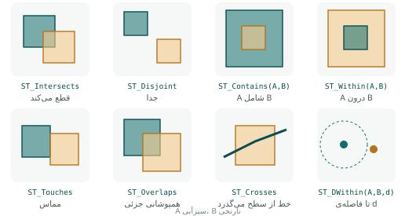

## گزاره‌ی مکانی

**گزاره‌ی مکانی** (spatial predicate) تابعی است که دو هندسه می‌گیرد و **درست یا نادرست** برمی‌گرداند: «آیا این مدرسه داخل این محله
است؟»، «آیا این جاده از این رود می‌گذرد؟». چون نتیجه درست/نادرست است، گزاره‌ها جای طبیعی‌شان در `WHERE` و در شرط `JOIN … ON` است.



| گزاره | درست است وقتی… | نمونه‌ی پرسش |
|---|---|---|
| `ST_Intersects(a, b)` | هر نقطه‌ی مشترکی داشته باشند (نقیض Disjoint) | کدام قطعه‌ها با محدوده‌ی طرح برخورد دارند؟ |
| `ST_Disjoint(a, b)` | هیچ نقطه‌ی مشترکی نداشته باشند | |
| `ST_Contains(a, b)` | b کاملاً داخل a باشد و دست‌کم یک نقطه از درون b داخل درون a | مدرسه‌های داخل محله |
| `ST_Within(a, b)` | a کاملاً داخل b باشد (= `ST_Contains(b, a)`) | |
| `ST_Covers(a, b)` | هیچ نقطه‌ای از b بیرون a نباشد (مرز هم قبول) | مثل Contains، امن برای عارضه‌ی روی مرز |
| `ST_CoveredBy(a, b)` | عکس Covers | |
| `ST_Touches(a, b)` | فقط مرزهایشان تماس داشته باشد، درونشان نه | قطعه‌های هم‌مرز |
| `ST_Crosses(a, b)` | از هم بگذرند و بعد اشتراک کمتر از بعد بزرگ‌تر باشد | جاده‌هایی که از رود می‌گذرند |
| `ST_Overlaps(a, b)` | هم‌بعد باشند، بخشی را مشترک داشته باشند ولی هیچ‌کدام شامل دیگری نباشد | دو محدوده‌ی طرح که بخشی روی هم افتاده‌اند |
| `ST_Equals(a, b)` | از نظر مکانی یکسان باشند (ترتیب رأس مهم نیست) | یافتن عارضه‌ی تکراری |
| `ST_DWithin(a, b, d)` | فاصله‌شان حداکثر d باشد | تا ۵۰۰ متری ایستگاه |

## مدل DE-9IM

همه‌ی این گزاره‌ها از یک مدل ریاضی واحد می‌آیند: **مدل نُه‌تقاطعی ابعادی‌شده** (Dimensionally Extended 9-Intersection Model). هر هندسه
سه بخش دارد: **درون** (I)، **مرز** (B) و **بیرون** (E). برای دو هندسه، اشتراک هر بخش از اولی با هر بخش از دومی را بررسی می‌کنیم؛ نُه
خانه. در هر خانه، **بعد** اشتراک نوشته می‌شود: `F` (اشتراکی نیست)، `0` (نقطه)، `1` (خط) یا `2` (سطح).

|  | درونِ B | مرزِ B | بیرونِ B |
|---|---|---|---|
| **درونِ A** | I∩I | I∩B | I∩E |
| **مرزِ A** | B∩I | B∩B | B∩E |
| **بیرونِ A** | E∩I | E∩B | E∩E |

`ST_Relate(a, b)` این ماتریس را به صورت رشته‌ای نُه‌حرفی برمی‌گرداند (سطر به سطر):

```{.sql .run}
SELECT ST_Relate(n.geom, s.geom) AS matrix_neighborhood_school,
       ST_Relate(a.geom, b.geom) AS matrix_two_neighborhoods
FROM neighborhoods n, schools s, neighborhoods a, neighborhoods b
WHERE ST_Contains(n.geom, s.geom) AND a.name = 'ونک' AND b.name = 'شهرک غرب'
LIMIT 1;
```

رشته‌ی اول، `0F2FF1FF2`، یعنی درون محله با درون مدرسه اشتراک صفربعدی (نقطه) دارد و مدرسه هیچ بخشی بیرون محله ندارد؛ یعنی «محله شامل
مدرسه است». رشته‌ی دوم، `212101212`، پیام مهمی دارد: خانه‌ی اول `2` است، یعنی **درون دو محله اشتراک دوبعدی دارد؛ دو محله روی هم
افتاده‌اند!** هر گزاره در واقع یک **الگو** روی این ماتریس است. مثلاً `ST_Within` یعنی الگوی `T*F**F***` (`T` = هر اشتراکی، `*` = مهم
نیست)، و با `ST_Relate(a, b, 'الگو')` می‌توانید رابطه‌ای بسازید که هیچ تابع آماده‌ای ندارد.

### یک کشف کیفیت داده

محله‌های یک شهر نباید روی هم بیفتند. بیایید همه‌ی همپوشانی‌ها را پیدا کنیم:

```{.sql .run}
SELECT a.name AS neighborhood_a, b.name AS neighborhood_b,
       ST_Relate(a.geom, b.geom) AS matrix,
       round((ST_Area(ST_Intersection(a.geom, b.geom)::geography) / 10000)::numeric, 1) AS overlap_ha
FROM neighborhoods a
JOIN neighborhoods b ON a.gid < b.gid AND ST_Overlaps(a.geom, b.geom)
ORDER BY overlap_ha DESC;
```

سه جفت محله همپوشانی دارند. محله‌های داده‌ی نمونه مربع‌های ساده‌ای‌اند که دور یک نقطه کشیده شده‌اند و این همپوشانی‌ها عمداً اصلاح
نشده‌اند تا نشان دهند چنین خطایی در داده‌ی واقعی چقدر بی‌صدا می‌ماند: هیچ نرم‌افزاری خطا نمی‌دهد، فقط آمارها غلط می‌شوند. مثلاً
مدرسه‌ای که در بخش همپوشان است در **دو** محله شمرده می‌شود:

```{.sql .run}
SELECT count(*) AS join_rows, count(DISTINCT s.gid) AS distinct_schools
FROM schools s JOIN neighborhoods n ON ST_Contains(n.geom, s.geom);
```

۲۸ جفت برای ۲۶ مدرسه: دو مدرسه دو بار شمرده شده‌اند. در لایه‌ی تقسیمات درست، این دو عدد باید برابر باشند و همسایه‌ها فقط در یک **خط**
مرز مشترک داشته باشند؛ الگوی DE-9IM آن `FF*F1****` است (درون‌ها اشتراک ندارند، مرزها در یک خط مشترک‌اند). فصل ۲۲ ابزار اصلاح
چنین لایه‌ای را آموزش می‌دهد.

## Contains یا Covers؟

تفاوت ظریف ولی مهم: نقطه‌ای که **دقیقاً روی مرز** چندضلعی است، طبق تعریف DE-9IM «درون» آن نیست. پس `ST_Contains` آن را **نادرست**
می‌داند، ولی `ST_Covers` درست:

```{.sql .run}
WITH sq AS (SELECT ST_MakeEnvelope(0, 0, 10, 10) AS g)
SELECT ST_Contains(g, ST_Point(5, 5))    AS contains_center,
       ST_Contains(g, ST_Point(10, 5))   AS contains_on_edge,
       ST_Covers(g, ST_Point(10, 5))     AS covers_on_edge,
       ST_Intersects(g, ST_Point(10, 5)) AS intersects_on_edge
FROM sq;
```

در داده‌ی واقعی، عارضه‌هایی که روی مرز افتاده‌اند (چون با همان لایه‌ی مرز رقومی شده‌اند) کم نیستند. اگر می‌خواهید آن‌ها هم شمرده
شوند، `ST_Covers` یا `ST_Intersects` به کار ببرید؛ اما مراقب باشید که نقطه‌ی روی مرز مشترک دو محله در **هر دو** شمرده می‌شود (پایین‌تر).

## الگوهای پیوند مکانی

### ۱. شمارش و جمع در چندضلعی

رایج‌ترین تحلیل GIS: «چند نقطه در هر چندضلعی؟». از LEFT JOIN استفاده کنید تا چندضلعی‌های خالی هم بیایند:

```{.sql .run}
SELECT n.name,
       count(h.gid)                AS centers,
       coalesce(sum(h.beds), 0)    AS beds,
       round(n.population::numeric / nullif(sum(h.beds), 0)) AS people_per_bed
FROM neighborhoods n
LEFT JOIN health_centers h ON ST_Contains(n.geom, h.geom)
GROUP BY n.gid, n.name, n.population
ORDER BY centers DESC;
```

### ۲. انتقال ویژگی (Join by location)

در فصل ۱۴ با `UPDATE … FROM` نام محله را در جدول مدرسه‌ها نوشتیم. اگر نمی‌خواهید جدول را تغییر دهید، همان را در یک پرسش یا نما بیاورید:

```{.sql .run rows=4}
SELECT s.name, s.students, n.name AS neighborhood
FROM schools s
LEFT JOIN neighborhoods n ON ST_Within(s.geom, n.geom)
ORDER BY n.name NULLS LAST, s.gid
LIMIT 4;
```

### ۳. یک‌به‌چند و شمارش مضاعف

وقتی شرط پیوند یک سطر را به **چند** سطر جفت می‌کند، نتیجه بیشتر از جدول اول سطر دارد. این در تحلیل فاصله‌ای رایج است:

```{.sql .run}
SELECT count(*)                  AS join_rows,
       count(DISTINCT s.gid)     AS distinct_schools
FROM schools s
JOIN metro_stations m ON ST_DWithin(s.geom::geography, m.geom::geography, 700);
```

۲۷ مدرسه در فاصله‌ی ۷۰۰ متری دست‌کم یک ایستگاه‌اند (همان عدد فصل ۸)، ولی پیوند سطرهای بیشتری داد چون بعضی مدرسه‌ها نزدیک چند ایستگاه‌اند.
اگر روی نتیجه‌ی این پیوند `sum(students)` بگیرید، دانش‌آموزان آن مدرسه‌ها **چند بار** شمرده می‌شوند. سه راه درست:

- برای پرسش «آیا دارد؟» از `EXISTS` استفاده کنید (فصل ۸ و ۱۳)؛
- `count(DISTINCT …)`؛
- اول یکتا کنید، بعد جمع بزنید (با زیرپرسش یا CTE).

::: warn
**نقطه‌ی روی مرز مشترک.** در لایه‌ی محله‌هایی که مرز مشترک دارند، نقطه‌ای که دقیقاً روی مرز است با `ST_Intersects` یا `ST_Covers`
در دو محله شمرده می‌شود و مجموع شمارش محله‌ها از کل نقطه‌ها بیشتر می‌شود. اگر مجموع باید با کل برابر باشد، از `ST_Contains` استفاده
کنید و نقطه‌های روی مرز را جداگانه بررسی کنید، یا هر نقطه را با `DISTINCT ON` فقط به یک محله بدهید.
:::

### ۴. همپوشانی دو لایه‌ی چندضلعی

«کدام پارک‌ها با کدام محله‌ها برخورد دارند و چه مقدار؟» با `ST_Intersects` در پیوند و `ST_Intersection` برای ساختن بخش مشترک (فصل ۱۸):

```{.sql .run}
SELECT n.name AS neighborhood, p.name AS park,
       round((ST_Area(ST_Intersection(n.geom, p.geom)::geography) / 10000)::numeric, 2) AS shared_ha
FROM neighborhoods n
JOIN parks p ON ST_Intersects(n.geom, p.geom)
ORDER BY shared_ha DESC;
```

## سرعت پرسش‌های مکانی

گزاره‌های مکانی روی هندسه‌های پیچیده سنگین‌اند. PostGIS برای سرعت، هر گزاره را در **دو مرحله** اجرا می‌کند:

1. **فیلتر اولیه با شاخص:** با عملگر `&&` (آیا مستطیل‌های محدوده‌ی دو هندسه هم‌پوشانی دارند؟) و شاخص GiST، بیشتر جفت‌های ناممکن را
   فوری کنار می‌گذارد. این مرحله خیلی سریع ولی تقریبی است.
2. **بررسی دقیق:** فقط برای جفت‌های باقی‌مانده، گزاره‌ی واقعی روی هندسه‌ی کامل اجرا می‌شود.

توابع `ST_Intersects`، `ST_Contains`، `ST_Within`، `ST_Covers`، `ST_DWithin` و بیشتر گزاره‌ها مرحله‌ی اول را **خودکار** دارند، به شرطی
که ستون شاخص داشته باشد. فصل ۲۰ این سازوکار را با `EXPLAIN` نشان می‌دهد.

::: warn
**ST_DWithin، نه ST_Distance < d.** دو پرسش زیر نتیجه‌ی یکسان دارند ولی سرعتشان صدها برابر فرق می‌کند:

```sql
-- کند: فاصله‌ی همه‌ی جفت‌ها حساب می‌شود؛ شاخص استفاده نمی‌شود
SELECT … WHERE ST_Distance(a.geom::geography, b.geom::geography) < 700;
-- سریع: شاخص جفت‌های دور را از اول کنار می‌گذارد
SELECT … WHERE ST_DWithin(a.geom::geography, b.geom::geography, 700);
```

همین قاعده برای «نزدیک‌ترین» هم هست: `ORDER BY ST_Distance(…) LIMIT 1` کند است و `ORDER BY a.geom <-> b.geom LIMIT 1` سریع (فصل ۱۹).
:::

::: pro
**ST_Intersects روی geography.** گزاره‌های geography کمترند: `ST_Intersects`، `ST_Covers`، `ST_CoveredBy` و `ST_DWithin`. برای
`ST_Contains` و بقیه باید با geometry کار کنید. چون گزاره‌ها (برخلاف اندازه‌گیری) به تصویر نقشه حساس نیستند (نقطه‌ای که داخل محله
است، در هر SRIDی داخل است)، استفاده از geometry در ۴۳۲۶ برای گزاره‌ها کاملاً درست است. فقط ST_DWithin است که چون «فاصله» دارد به
واحد حساس است.
:::

::: try
گزارشی بنویسید که برای هر محله نشان دهد: تعداد مدرسه، تعداد ایستگاه مترو، مساحت پارک داخل محله به هکتار، و اینکه آیا دست‌کم یک
بیمارستان تا یک کیلومتری مرز محله هست یا نه. (راهنمایی: CTE برای هر بخش، `EXISTS` برای بیمارستان.)
:::

::: summary
- گزاره‌ی مکانی درست/نادرست برمی‌گرداند و در `WHERE` و `JOIN … ON` می‌نشیند.
- همه‌ی گزاره‌ها از DE-9IM (درون، مرز، بیرون؛ نُه خانه) می‌آیند؛ `ST_Relate` ماتریس و الگوی دلخواه را می‌دهد و خطاهایی مثل همپوشانی محله‌ها را آشکار می‌کند.
- نقطه‌ی روی مرز در Contains نیست ولی در Covers و Intersects هست.
- پیوند مکانی: شمارش در چندضلعی با LEFT JOIN، انتقال ویژگی، همپوشانی با ST_Intersection.
- پیوند یک‌به‌چند شمارش مضاعف می‌سازد؛ EXISTS یا DISTINCT.
- شاخص + `&&` مرحله‌ی اول هر گزاره است؛ `ST_DWithin` به‌جای `ST_Distance < d`.
:::

::: teach
**زمان پیشنهادی:** دو جلسه. با دو برگه‌ی کاغذ شفاف رنگی روی پروژکتور، هر گزاره را فیزیکی نشان دهید. مسئله‌ی «نقطه روی مرز» را با یک
نقطه‌ی ماژیکی دقیقاً روی خط مرز مطرح کنید و بپرسید «این مدرسه مال کدام محله است؟»؛ بحث جالبی درباره‌ی تفاوت داده و واقعیت درمی‌گیرد.
:::

::: exercises
### تمرین‌ها

1. [سطح ۱]{.badge .b1} تعداد مدرسه‌ی هر مقطع در هر محله را بدهید (دو ستون گروه‌بندی).
2. [سطح ۱]{.badge .b1} کدام ایستگاه‌های مترو داخل یک پارک‌اند؟ کدام تا ۲۰۰ متری یک پارک؟
3. [سطح ۲]{.badge .b2} تعداد مدرسه‌های داخل محله‌ها را با `ST_Contains`، `ST_Covers` و `ST_Intersects` بشمارید. آیا فرقی هست؟ چرا؟
4. [سطح ۲]{.badge .b2} مجموع دانش‌آموزان مدرسه‌هایی که تا ۷۰۰ متری مترو هستند را یک بار با JOIN ساده و یک بار درست حساب کنید.
5. [سطح ۲]{.badge .b2} بخش همپوشان محله‌های «جمهوری» و «هفت‌تیر» را با `ST_Intersection` بسازید و ببینید کدام مدرسه‌ها در آن‌اند.
6. [سطح ۲]{.badge .b2} الگوی DE-9IM برای «چندضلعی A کاملاً داخل B بدون تماس با مرز آن» چیست؟ با `ST_Relate` بیازمایید.
7. [سطح ۳]{.badge .b3} با `EXPLAIN ANALYZE` (فصل ۲۰)، زمان دو پرسش ST_Distance و ST_DWithin در کادر هشدار را برای پیوند مدرسه‌ها و
   مراکز درمانی مقایسه کنید.
:::
