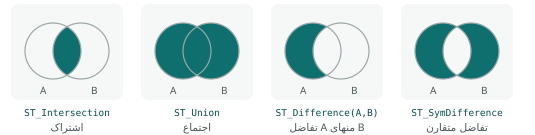

## هندسه‌ی تازه از هندسه

توابع این فصل هندسه می‌گیرند و **هندسه‌ی تازه** برمی‌گردانند. این‌ها همان ابزارهای «Geoprocessing» نرم‌افزارهای رومیزی‌اند، اما
داخل SQL؛ پس می‌توان آن‌ها را با فیلتر، پیوند و تجمیع ترکیب کرد و نتیجه را با `CREATE TABLE AS` ذخیره کرد.

## حریم (بافر)

**حریم** (buffer) همه‌ی نقطه‌هایی است که تا فاصله‌ی معینی از یک هندسه قرار دارند: حریم ۵۰۰ متری ایستگاه، حریم ۵۰ متری رودخانه، حریم
۱۵ متری خط لوله.

```{.sql .run rows=3}
SELECT name,
       GeometryType(ST_Buffer(geom::geography, 500)::geometry)                   AS type,
       round(ST_Area(ST_Buffer(geom::geography, 500)))                           AS area_m2,
       round(pi() * 500 ^ 2)                                                      AS ideal_circle_m2
FROM metro_stations
ORDER BY gid
LIMIT 3;
```

نکته‌های حریم:

- **واحد فاصله:** روی geography به متر؛ روی geometry به واحد SRID. `ST_Buffer(geom, 500)` روی ۴۳۲۶ یعنی ۵۰۰ **درجه**! یا به
  geography تبدیل کنید (مثل بالا) یا به UTM: `ST_Transform(ST_Buffer(ST_Transform(geom, 32639), 500), 4326)`.
- **دایره‌ی چندضلعی:** حریم نقطه یک چندضلعی منتظم است که دایره را تقریب می‌زند (پیش‌فرض ۸ پاره‌خط در هر ربع، یعنی ۳۲ ضلع)؛ برای
  همین مساحتش اندکی از دایره‌ی ایده‌آل کمتر است. با `'quad_segs=16'` دقیق‌تر می‌شود.
- **شکل انتهای خط:** برای حریم خط، `'endcap=round|flat|square'` و برای گوشه‌ها `'join=round|mitre|bevel'`.
- **حریم یک‌طرفه:** `'side=left'` یا `'side=right'`؛ مثلاً فقط سمت راست جاده.
- **حریم منفی:** روی چندضلعی، فاصله‌ی منفی آن را **کوچک** می‌کند (عقب‌نشینی ۱۰ متری از مرز قطعه برای ساخت‌وساز).

```{.sql .run}
SELECT round(ST_Area(ST_Buffer(geom, 0.001))::numeric * 1e6, 2)                AS deg_area_x1e6,
       round(ST_Area(ST_Transform(ST_Buffer(ST_Transform(geom, 32639), 100), 32639))) AS utm_buffer_100m_m2,
       round(ST_Area(ST_Transform(ST_Buffer(ST_Transform(geom, 32639), -100), 32639))) AS utm_shrink_100m_m2,
       round(ST_Area(ST_Transform(geom, 32639)))                              AS original_m2
FROM parks WHERE park_id = 1;
```

### ادغام حریم‌ها

حریم ایستگاه‌های نزدیک روی هم می‌افتند. برای «کل محدوده‌ای که تا ۵۰۰ متری **یک** ایستگاه است» حریم‌ها را **ادغام** می‌کنیم:

```{.sql .run}
SELECT count(*)                                                                 AS buffers,
       round((sum(ST_Area(ST_Buffer(geom::geography, 500))) / 1e6)::numeric, 2)            AS sum_of_areas_km2,
       round((ST_Area(ST_Union(ST_Buffer(geom::geography, 500)::geometry)::geography) / 1e6)::numeric, 2) AS union_area_km2
FROM metro_stations;
```

جمع مساحت حریم‌ها از مساحت ادغام‌شده بیشتر است، چون بخش‌های همپوشان چند بار شمرده شده‌اند. پرسش «چند درصد شهر در پوشش مترو
است؟» فقط با نسخه‌ی ادغام‌شده درست جواب داده می‌شود.

## ادغام (Union / Dissolve)

`ST_Union` به‌عنوان **تابع تجمیعی** همه‌ی هندسه‌های یک گروه را یکی و مرزهای داخلی را حذف می‌کند؛ این همان «Dissolve» در نرم‌افزارهای
رومیزی است. با `GROUP BY` بر اساس ویژگی ادغام می‌کنید:

```{.sql .run}
SELECT line,
       GeometryType(ST_Union(ST_Buffer(geom::geography, 400)::geometry))      AS type,
       ST_NumGeometries(ST_Union(ST_Buffer(geom::geography, 400)::geometry))  AS parts
FROM metro_stations
GROUP BY line
ORDER BY line;
```

اگر نتیجه چند بخش جدا داشته باشد، MultiPolygon است و `ST_NumGeometries` تعداد بخش‌ها را می‌دهد. برای ادغام **دو** هندسه
`ST_Union(a, b)` هم هست.

::: pro
**ادغام سریع برای داده‌ی حجیم.** `ST_Union` روی ده‌ها هزار چندضلعی کند است. دو ترفند: اگر هندسه‌ها هم‌پوشانی ندارند و فقط
می‌خواهید آن‌ها را یک عارضه کنید، `ST_Collect` (بدون حذف مرز) هزاران برابر سریع‌تر است؛ و برای ادغام واقعی داده‌ی بزرگ، اول با
`ST_Subdivide` چندضلعی‌های غول‌پیکر را خرد کنید.
:::

## عملیات همپوشانی



| تابع | نتیجه | معادل در نرم‌افزارهای رومیزی |
|---|---|---|
| `ST_Intersection(a, b)` | بخش مشترک | Intersect / Clip |
| `ST_Union(a, b)` | همه‌ی بخش‌ها، یکپارچه | Union / Merge |
| `ST_Difference(a, b)` | a منهای بخشی که زیر b است | Erase / Difference |
| `ST_SymDifference(a, b)` | بخش‌های غیرمشترک هر دو | Symmetrical Difference |

### برش با مرز (Clip)

«پارک‌های داخل محله‌ی ونک، فقط بخشی که داخل محله است»:

```{.sql .run}
SELECT p.name,
       round((ST_Area(p.geom::geography) / 10000)::numeric, 2)                        AS park_ha,
       round((ST_Area(ST_Intersection(p.geom, n.geom)::geography) / 10000)::numeric, 2) AS inside_ha
FROM parks p JOIN neighborhoods n ON ST_Intersects(p.geom, n.geom)
WHERE n.name = 'ونک';
```

### حذف ناحیه (Erase)

«بخش‌هایی از محله‌ی ونک که پارک نیست» یعنی محله منهای ادغام پارک‌ها:

```{.sql .run}
SELECT round((ST_Area(n.geom::geography) / 1e6)::numeric, 3)                                          AS neighborhood_km2,
       round((ST_Area(ST_Difference(n.geom, ST_Union(p.geom))::geography) / 1e6)::numeric, 3)        AS without_parks_km2
FROM neighborhoods n
JOIN parks p ON ST_Intersects(n.geom, p.geom)
WHERE n.name = 'ونک'
GROUP BY n.geom;
```

### اصلاح همپوشانی محله‌ها

در فصل ۱۷ کشف کردیم که محله‌های نمونه همپوشانی دارند. یک راه ساده‌ی اصلاح: از هر محله، بخش‌هایی را که زیر محله‌هایی با شناسه‌ی
کوچک‌تر است کم کنیم؛ یعنی محله‌ی زودتر ثبت‌شده «برنده»ی بخش همپوشان است:

```{.sql .run}
WITH fixed AS (
  SELECT a.gid, a.name,
         coalesce(ST_Difference(a.geom, (SELECT ST_Union(b.geom) FROM neighborhoods b
                                         WHERE b.gid < a.gid AND ST_Intersects(a.geom, b.geom))), a.geom) AS geom
  FROM neighborhoods a
)
SELECT count(*) AS overlapping_pairs_after_fix
FROM fixed a JOIN fixed b ON a.gid < b.gid AND ST_Overlaps(a.geom, b.geom);
```

صفر جفت همپوشان. قاعده‌ی «برنده» به تصمیم کارشناسی وابسته است؛ SQL فقط اجرایش را ممکن می‌کند. `coalesce` برای محله‌ای لازم بود که
هیچ همپوشانی با قبلی‌ها نداشت و زیرپرسش برایش NULL برمی‌گرداند.

::: warn
**بعد نتیجه را بررسی کنید.** `ST_Intersection` دو چندضلعی ممکن است فقط یک **خط** یا **نقطه** برگرداند (اگر فقط در مرز تماس داشته
باشند) یا یک GeometryCollection مختلط. اگر نتیجه را در ستونی از نوع `MultiPolygon` می‌ریزید، با
`ST_CollectionExtract(geom, 3)` فقط بخش‌های چندضلعی را نگه دارید (۱ نقطه، ۲ خط، ۳ چندضلعی) و سطرهای خالی را با
`WHERE NOT ST_IsEmpty(…)` حذف کنید.
:::

## ساده‌سازی، گرد کردن و چسباندن

داده‌ای که از نقشه‌ی بزرگ‌مقیاس آمده برای نمایش در مقیاس کوچک یا انتشار وب بیش از حد پرجزئیات است. **ساده‌سازی** رأس‌های اضافه را
حذف می‌کند:

| تابع | روش | نکته |
|---|---|---|
| `ST_Simplify(g, tol)` | داگلاس-پوکر | سریع؛ ممکن است هندسه‌ی نامعتبر بسازد |
| `ST_SimplifyPreserveTopology(g, tol)` | داگلاس-پوکر با حفظ اعتبار | امن‌تر برای چندضلعی |
| `ST_SimplifyVW(g, area)` | ویسوالینگام-وایات | شکل طبیعی‌تر برای کارتوگرافی |
| `ST_ChaikinSmoothing(g)` | هموارسازی | گوشه‌های تیز را گرد می‌کند |
| `ST_SnapToGrid(g, size)` | گرد کردن مختصات به شبکه | کاهش دقت ظاهری و حجم |
| `ST_ReducePrecision(g, size)` | گرد کردن با حفظ اعتبار | (PostGIS ۳٫۱+) |
| `ST_Snap(a, b, tol)` | چسباندن رأس‌های a به b | بستن شکاف‌های باریک بین لایه‌ها |

```{.sql .run}
WITH c AS (SELECT ST_Buffer('SRID=4326;POINT(51.4 35.7)'::geography, 1000, 'quad_segs=32')::geometry AS g)
SELECT ST_NPoints(g)                                        AS original_vertices,
       ST_NPoints(ST_SimplifyPreserveTopology(g, 0.0005))   AS simplified_vertices,
       round((100 * (1 - ST_Area(ST_SimplifyPreserveTopology(g, 0.0005)::geography) / ST_Area(g::geography)))::numeric, 2) AS area_loss_pct
FROM c;
```

تلورانس (`0.0005`) به واحد SRID است؛ در ۴۳۲۶ حدود ۵۰ متر. رأس‌ها از ۱۲۹ به ده‌ها کاهش یافت و مساحت چند درصد کم شد؛ بسته به مقیاس
نمایش، این تبادل حجم و دقت را باید آگاهانه انتخاب کنید. کاشی‌های برداری سامانه (فصل ۴۵) در هر سطح زوم خودکار ساده‌سازی می‌کنند.

## پوسته و تقسیم فضا

```{.sql .run}
SELECT round((ST_Area(ST_ConvexHull(ST_Collect(geom))::geography) / 1e6)::numeric, 1)       AS convex_hull_km2,
       round((ST_Area(ST_ConcaveHull(ST_Collect(geom), 0.3)::geography) / 1e6)::numeric, 1) AS concave_hull_km2,
       round((ST_Area(ST_Envelope(ST_Collect(geom))::geography) / 1e6)::numeric, 1)       AS envelope_km2
FROM schools;
```

- **پوسته‌ی محدب** (`ST_ConvexHull`): کوچک‌ترین چندضلعی محدبی که همه را بپوشاند؛ مثل کش دور میخ‌ها.
- **پوسته‌ی مقعر** (`ST_ConcaveHull(g, ratio)`): پوسته‌ی تنگ‌تر که فرورفتگی دارد؛ ratio بین ۰ (تنگ‌ترین) و ۱ (محدب). برای «محدوده‌ی
  واقعی پراکنش» نقطه‌ها.
- **مستطیل محدوده** (`ST_Envelope`): ساده‌ترین تقریب.

**دیاگرام ورونوی** (`ST_VoronoiPolygons`) صفحه را طوری تقسیم می‌کند که هر بخش به نزدیک‌ترین نقطه‌اش تعلق داشته باشد؛ همان «حوزه‌ی
نفوذ» یا «چندضلعی تیسن» که در اقلیم‌شناسی (بارش ایستگاه‌ها) و برنامه‌ریزی خدمات (حوزه‌ی هر مرکز) کاربرد دارد. ابزار «حوزه‌ی نفوذ
(تیسن)» سامانه همین را می‌سازد (فصل ۲۶):

```{.sql .run rows=4}
WITH v AS (
  SELECT (ST_Dump(ST_VoronoiPolygons(ST_Collect(geom)))).geom AS cell FROM health_centers WHERE type = 'بیمارستان'
)
SELECT h.name, round((ST_Area(v.cell::geography) / 1e6)::numeric, 2) AS service_area_km2
FROM v JOIN health_centers h ON h.type = 'بیمارستان' AND ST_Contains(v.cell, h.geom)
ORDER BY service_area_km2 DESC
LIMIT 4;
```

مساحت سلول‌های لبه بسیار بزرگ است، چون ورونوی تا محدوده‌ای وسیع‌تر از خود نقطه‌ها امتداد می‌یابد. در عمل سلول‌ها را با مرز
شهر یا محدوده‌ی مطالعه برش می‌دهید (`ST_Intersection`؛ تمرین ۴). این نکته در تفسیر «حوزه‌ی خدمات» مهم است.

`ST_DelaunayTriangles` مثلث‌بندی دلونی (پایه‌ی سطح TIN در فصل ۴۹) و `ST_GeneratePoints(polygon, n)` نقطه‌های تصادفی داخل چندضلعی
(برای نمونه‌برداری میدانی) می‌سازد.

## خرد کردن

`ST_Subdivide(g, max_vertices)` یک چندضلعی پیچیده را به قطعه‌های کوچک با حداکثر رأس معین می‌شکند. این عجیب به نظر می‌رسد، اما
**یکی از مؤثرترین بهینه‌سازی‌های کارایی** است: پرسش «کدام نقطه داخل مرز ایران است؟» روی یک چندضلعی با ۵۰ هزار رأس بسیار کندتر از
همان پرسش روی ۵۰۰ قطعه‌ی ۱۰۰ رأسی با شاخص مکانی است (فصل ۲۰).

`ST_Split(g, blade)` هندسه را با یک خط (یا نقطه) می‌بُرد؛ مثلاً تقسیم قطعه‌ی زمین با خط تفکیک.

## ارجاع خطی

**ارجاع خطی** (linear referencing) مکان را با «فاصله در امتداد یک خط» بیان می‌کند: «کیلومتر ۳۲ جاده‌ی تهران-قم»، «۲۰۰ متر بعد از
شیر شماره‌ی ۵ خط لوله». توابع آن با کسری از طول خط (۰ تا ۱) کار می‌کنند:

| تابع | کار |
|---|---|
| `ST_LineInterpolatePoint(line, f)` | نقطه در کسر f طول خط |
| `ST_LineLocatePoint(line, pt)` | کسر طول نزدیک‌ترین نقطه‌ی خط به pt |
| `ST_LineSubstring(line, f1, f2)` | بخشی از خط بین دو کسر |
| `ST_ClosestPoint(line, pt)` | نزدیک‌ترین نقطه روی خط |

```{.sql .run}
WITH route AS (SELECT ST_MakeLine(geom ORDER BY station_id) AS g FROM metro_stations WHERE line = 'خط ۱')
SELECT round((ST_Length(g::geography) / 1000)::numeric, 2)               AS line_km,
       ST_AsText(ST_LineInterpolatePoint(g, 0.5))                       AS midpoint,
       round(ST_LineLocatePoint(g, (SELECT geom FROM schools WHERE school_id = 1))::numeric, 3) AS school1_fraction,
       round((ST_Length(ST_LineSubstring(g, 0.25, 0.75)::geography) / 1000)::numeric, 2) AS middle_half_km
FROM route;
```

::: real
**نقطه‌ی حادثه روی جاده.** پلیس راه حادثه‌ها را با «کیلومتر جاده» ثبت می‌کند، نه با مختصات. با جدول جاده‌ها و ستون کیلومتر، مختصات هر
حادثه با `ST_LineInterpolatePoint(road.geom, km * 1000 / ST_Length(road.geom::geography))` ساخته می‌شود و می‌توان نقاط حادثه‌خیز را
روی نقشه دید. برعکس، برای ثبت یک برداشت GPS به کیلومتر جاده، `ST_LineLocatePoint` به کار می‌رود.
:::

## تبدیل‌های کمکی

`ST_Multi` (تبدیل به چندبخشی)، `ST_Force2D` (حذف Z)، `ST_Boundary` (مرز چندضلعی به صورت خط)، `ST_Polygonize` (چندضلعی از خط‌های بسته)،
`ST_Translate`، `ST_Rotate` و `ST_Scale` (جابه‌جایی، چرخش و مقیاس؛ برای تصحیح جابه‌جایی ثابت یک لایه) و `ST_FlipCoordinates` (جابه‌جایی
x و y؛ درمان قطعی خطای «طول و عرض جابه‌جا»).

::: try
محدوده‌ای را بسازید که «تا ۶۰۰ متری یک ایستگاه مترو» باشد ولی «تا ۲۰۰ متری هیچ بیمارستانی» نباشد. مساحتش را به کیلومتر مربع بدهید
و نتیجه را با `CREATE TABLE AS` ذخیره و روی نقشه ببینید. (راهنمایی: ادغام حریم‌ها، سپس `ST_Difference`.)
:::

::: summary
- `ST_Buffer` روی geography به متر؛ روی ۴۳۲۶ درجه! گزینه‌ها: quad_segs، endcap، join، side؛ فاصله‌ی منفی چندضلعی را کوچک می‌کند.
- `ST_Union` تجمیعی همان Dissolve است؛ جمع مساحت حریم‌های همپوشان با مساحت ادغام‌شده فرق دارد.
- همپوشانی: `ST_Intersection`، `ST_Difference`، `ST_SymDifference`؛ نوع نتیجه را با `ST_CollectionExtract` کنترل کنید.
- ساده‌سازی (`ST_SimplifyPreserveTopology`، `ST_SimplifyVW`)، گرد کردن (`ST_SnapToGrid`، `ST_ReducePrecision`)، چسباندن (`ST_Snap`).
- پوسته‌ی محدب و مقعر، ورونوی (حوزه‌ی نفوذ)، دلونی، نقطه‌ی تصادفی.
- `ST_Subdivide` برای کارایی؛ ارجاع خطی با `ST_LineInterpolatePoint` و `ST_LineLocatePoint`.
:::

::: teach
**زمان پیشنهادی:** دو جلسه. هر تابع را با یک «پرسش برنامه‌ریز» معرفی کنید و خروجی را در QGIS (DB Manager ← Load as new layer) نشان
دهید؛ دیدن حریم‌ها و ورونوی روی نقشه بسیار گویاتر از عدد است. تمرین «خودتان امتحان کنید» یک مسئله‌ی کامل مکان‌یابی کوچک است.
:::

::: exercises
### تمرین‌ها

1. [سطح ۱]{.badge .b1} حریم ۳۰۰ متری همه‌ی مدرسه‌های ابتدایی را بسازید و ادغام کنید. مساحت کل چقدر است؟
2. [سطح ۱]{.badge .b1} مساحت هر پارک را که داخل هر محله است (اشتراک) بدهید.
3. [سطح ۲]{.badge .b2} پوسته‌ی مقعر ایستگاه‌های هر خط مترو را بسازید و مساحتش را مقایسه کنید.
4. [سطح ۲]{.badge .b2} دیاگرام ورونوی همه‌ی مراکز درمانی را بسازید و به محدوده‌ی پوسته‌ی محدب مدرسه‌ها برش دهید (`ST_Intersection`).
5. [سطح ۲]{.badge .b2} نقطه‌ی هر ۲ کیلومتر روی خط ۲ مترو را با `ST_LineInterpolatePoint` و `generate_series` بسازید.
6. [سطح ۳]{.badge .b3} یک پارک را با `ST_SimplifyPreserveTopology` در سه تلورانس ساده کنید و جدولی از تعداد رأس و درصد تغییر مساحت بسازید.
   کدام تلورانس برای نقشه‌ی کل شهر مناسب است؟
:::
