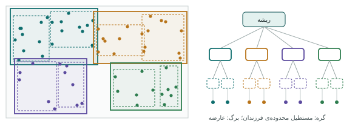

## چرا شاخص

پرسش «کدام نقطه‌ها داخل این چندضلعی‌اند؟» بدون شاخص یعنی بررسی **تک‌تک** نقطه‌ها. برای ۱۸۰ مدرسه فوری است؛ برای ۲۰ میلیون نقطه‌ی ردیابی
خودرو، دقیقه‌ها طول می‌کشد. **شاخص** (index) ساختاری کمکی است که مثل فهرست الفبایی پایان یک کتاب، اجازه می‌دهد بدون خواندن همه‌ی
صفحه‌ها به بخش مورد نظر برسیم.

شاخص معمولی پایگاه داده (B-tree) برای مقدارهای **مرتب‌شدنی** مثل عدد و متن ساخته شده است. اما هندسه ترتیب طبیعی ندارد: کدام نقطه
«بزرگ‌تر» است؟ پس PostGIS از نوع دیگری استفاده می‌کند: **GiST** (درخت جست‌وجوی تعمیم‌یافته) که روی آن **درخت R** پیاده شده است.

## درخت R

ایده‌ی درخت R ساده است: هر هندسه با **مستطیل محدوده**اش (bounding box) جایگزین می‌شود. مستطیل‌های نزدیک به هم در یک گروه قرار
می‌گیرند و هر گروه مستطیل محدوده‌ی خودش را دارد؛ گروه‌ها دوباره گروه می‌شوند تا به یک ریشه برسیم.



برای یافتن عارضه‌هایی که با یک محدوده برخورد دارند، الگوریتم از ریشه شروع می‌کند و فقط وارد گره‌هایی می‌شود که مستطیلشان با محدوده‌ی
پرسش برخورد دارد. بیشتر درخت هرگز دیده نمی‌شود. به همین دلیل پرسش مکانی روی جدول بزرگ با شاخص، به جای خطی (n)، تقریباً لگاریتمی
(log n) رشد می‌کند.

ساختن شاخص یک خط است و همیشه، برای هر ستون هندسه‌ای که در پرسش‌ها به کار می‌رود، لازم است:

```sql
CREATE INDEX schools_geom_idx ON schools USING gist (geom);
```

## فیلتر دو مرحله‌ای

چون شاخص فقط مستطیل‌ها را می‌شناسد، پاسخش **تقریبی** است: «این‌ها *شاید* برخورد دارند». پس هر گزاره‌ی مکانی دو مرحله دارد (فصل ۱۷):

1. **فیلتر اولیه** با عملگر `&&` (برخورد مستطیل‌ها) روی شاخص؛ سریع، تقریبی، بیشتر نامزدها را حذف می‌کند.
2. **بررسی دقیق** با هندسه‌ی کامل، فقط روی نامزدهای باقی‌مانده.

توابعی مثل `ST_Intersects`، `ST_Contains`، `ST_Within`، `ST_Covers` و `ST_DWithin` مرحله‌ی اول را در خودشان دارند. یعنی پرسش
`WHERE ST_Intersects(a.geom, b.geom)` به طور خودکار به `WHERE a.geom && b.geom AND _ST_Intersects(a.geom, b.geom)` تبدیل می‌شود.

## آزمایش: با شاخص و بی‌شاخص

برای دیدن اثر شاخص به جدول بزرگ‌تری از داده‌ی نمونه نیاز داریم. یک جدول ۲۰۰ هزار نقطه‌ای تصادفی در محدوده‌ی تهران می‌سازیم و زمان یک
پرسش «نقطه در محله» را پیش و پس از شاخص می‌سنجیم. **`EXPLAIN ANALYZE`** پرسش را اجرا و **برنامه‌ی اجرا** (query plan) و زمان واقعی
هر مرحله را گزارش می‌کند:

```{.sql .run rows=20}
CREATE TABLE pts AS
SELECT g AS id, ST_SetSRID(ST_MakePoint(51.2 + random() * 0.4, 35.55 + random() * 0.3), 4326) AS geom
FROM generate_series(1, 200000) g;
ANALYZE pts;

EXPLAIN ANALYZE
SELECT count(*) FROM pts p JOIN neighborhoods n ON ST_Contains(n.geom, p.geom) WHERE n.name = 'ونک';
```

برنامه را از پایین به بالا بخوانید. **Parallel Seq Scan on pts** یعنی همه‌ی ۲۰۰ هزار سطر (با دو پردازه‌ی موازی) یکی‌یکی خوانده و با
`ST_Contains` بررسی شده‌اند؛ «Rows Removed by Join Filter» نشان می‌دهد تقریباً همه‌ی آن‌ها بیهوده بررسی شده‌اند. حالا شاخص می‌سازیم و همان
پرسش را تکرار می‌کنیم:

```{.sql .run rows=20}
CREATE TABLE pts AS
SELECT g AS id, ST_SetSRID(ST_MakePoint(51.2 + random() * 0.4, 35.55 + random() * 0.3), 4326) AS geom
FROM generate_series(1, 200000) g;
CREATE INDEX ON pts USING gist (geom);
ANALYZE pts;

EXPLAIN ANALYZE
SELECT count(*) FROM pts p JOIN neighborhoods n ON ST_Contains(n.geom, p.geom) WHERE n.name = 'ونک';
```

این بار **Bitmap Index Scan** روی شاخص `pts_geom_idx` دیده می‌شود و شرط مستطیلی در «Index Cond» آمده است (برای `ST_Contains` عملگر
`@` یعنی «مستطیل داخل مستطیل»؛ برای `ST_Intersects` همان `&&`). فقط سطرهای نامزد خوانده شدند و «Rows Removed by Filter» تقریباً صفر است. زمان کل
(«Execution Time» در سطر آخر) را در دو برنامه مقایسه کنید: در اجرای کتاب بیش از ۷۰ برابر سریع‌تر (حدود ۲۳۰ در برابر ۳ میلی‌ثانیه). روی جدول‌های میلیونی، اختلاف از چند
ثانیه به چند میلی‌ثانیه می‌رسد. (چون نقطه‌ها تصادفی‌اند، عددهای شما کمی فرق می‌کند.)

### واژه‌نامه‌ی برنامه‌ی اجرا

| گره | معنا |
|---|---|
| `Seq Scan` | خواندن کل جدول؛ برای جدول کوچک یا وقتی بیشتر سطرها لازم‌اند طبیعی است |
| `Index Scan` | پیمایش شاخص و خواندن سطرهای منطبق |
| `Bitmap Index Scan` + `Bitmap Heap Scan` | ابتدا فهرست صفحه‌های نامزد از شاخص، سپس خواندن آن صفحه‌ها؛ برای تعداد متوسط سطر |
| `Index Cond` | شرطی که روی شاخص بررسی شد (مرحله‌ی اول) |
| `Filter` / `Rows Removed by Filter` | شرط دقیق پس از خواندن (مرحله‌ی دوم) و تعداد سطرهای رد شده |
| `Nested Loop` | برای هر سطر بیرونی، جست‌وجو در جدول درونی؛ با شاخص درونی سریع است |
| `Hash Join`، `Merge Join` | روش‌های پیوند برای برابری؛ در پیوند مکانی کمتر |
| `cost=… rows=…` | تخمین برنامه‌ریز (بدون ANALYZE) |
| `actual time=… rows=…` | مقدار واقعی (با ANALYZE) |

::: note
**EXPLAIN بدون ANALYZE** پرسش را اجرا نمی‌کند و فقط برنامه‌ی تخمینی را نشان می‌دهد؛ برای پرسش‌های سنگین یا تغییردهنده (`DELETE`) امن‌تر
است. سامانه در کنسول SQL، برای پرسش‌هایی که کند اجرا می‌شوند، دکمه‌ی «چرا کند است؟» را نشان می‌دهد که برنامه را خوانا توضیح می‌دهد.
:::

## خطاهایی که شاخص را بی‌اثر می‌کنند

**۱. تابع روی ستون شاخص‌دار.** شاخص روی `geom` ساخته شده، نه روی `ST_Transform(geom, 32639)`. این پرسش شاخص را **استفاده نمی‌کند**:

```sql
-- کند: برای هر سطر تبدیل انجام و شاخص کنار گذاشته می‌شود
WHERE ST_DWithin(ST_Transform(geom, 32639), ST_Transform(:pt, 32639), 500)
```

دو راه درست: یا **ثابت** را تبدیل کنید و ستون را دست نزنید، یا روی عبارت شاخص بسازید:

```sql
-- راه ۱: geography با شاخص روی عبارت
CREATE INDEX ON schools USING gist ((geom::geography));
WHERE ST_DWithin(geom::geography, :pt::geography, 500)

-- راه ۲: ستون ذخیره‌شده در UTM (اگر همه‌ی کارها متری است)
ALTER TABLE schools ADD COLUMN geom_utm geometry(Point, 32639)
  GENERATED ALWAYS AS (ST_Transform(geom, 32639)) STORED;
CREATE INDEX ON schools USING gist (geom_utm);
```

**۲. `ST_Distance(…) < d` به جای `ST_DWithin`.** `ST_Distance` شاخص ندارد (فصل ۱۷).

**۳. `ORDER BY ST_Distance(…)` به جای `<->`** برای نزدیک‌ترین (فصل ۱۹).

**۴. SRID ناهمسان.** اگر ستون ۴۳۲۶ است و ثابت پرسش ۳۲۶۳۹، یکی باید تبدیل شود؛ آن یکی ثابت باشد، نه ستون.

**۵. آمار کهنه.** برنامه‌ریز بر اساس آمار تصمیم می‌گیرد. پس از ورود حجم زیادی داده، `ANALYZE جدول;` را فراموش نکنید (یا «سلامت داده»).

## انواع دیگر شاخص

| نوع | کجا |
|---|---|
| **GiST** روی هندسه | پیش‌فرض و همه‌کاره؛ همیشه بسازید |
| **SP-GiST** روی هندسه | گاهی برای نقطه‌های بسیار زیاد و بی‌همپوشانی سریع‌تر |
| **BRIN** روی هندسه | جدول‌های عظیم افزایشی که داده با ترتیب مکانی یا زمانی وارد می‌شود (ردپای GPS)؛ بسیار کم‌حجم |
| **B-tree** روی ستون ویژگی | فیلتر روی `level`، `type`، تاریخ |
| **GIN** با `gin_trgm_ops` | جست‌وجوی متنی تقریبی (فصل ۱۱) |
| **شاخص روی عبارت** | `((geom::geography))`، `(lower(name))` |
| **شاخص جزئی** | `CREATE INDEX … WHERE status = 'active'`؛ فقط سطرهای پرکاربرد |
| **شاخص چندستونی** | `(type, created_at)` برای فیلتر ترکیبی |

## هندسه‌های بزرگ: ST_Subdivide

شاخص فقط مستطیل محدوده را می‌شناسد. مستطیل محدوده‌ی مرز یک استان پهناور، بخش بزرگی از خارج استان را هم می‌پوشاند؛ پس فیلتر اولیه
تقریباً هیچ نقطه‌ای را حذف نمی‌کند و بار سنگین روی بررسی دقیق با چندضلعی هزاران‌رأسی می‌افتد. راه حل، خرد کردن هندسه است:

```sql
CREATE TABLE provinces_sub AS
SELECT province_id, ST_Subdivide(geom, 256) AS geom FROM provinces;
CREATE INDEX ON provinces_sub USING gist (geom);
-- پرسش نقطه-در-استان حالا روی قطعه‌های کوچک با مستطیل‌های تنگ اجرا می‌شود
```

این ترفند در عمل پرسش‌های «کدام استان/شهرستان؟» روی میلیون‌ها نقطه را ده‌ها برابر سریع‌تر می‌کند.

## نگه‌داری

- **`ANALYZE`**: به‌روزرسانی آمار؛ پس از ورود یا حذف انبوه.
- **`VACUUM`**: بازیافت فضای سطرهای حذف یا به‌روزشده؛ PostgreSQL آن را خودکار (autovacuum) انجام می‌دهد، ولی پس از `DELETE` یا
  `UPDATE` بزرگ یک `VACUUM ANALYZE جدول;` دستی کمک می‌کند. `VACUUM` فضا را به سیستم‌عامل برنمی‌گرداند؛ برای کاهش حجم واقعی جدول
  `VACUUM FULL` لازم است که جدول را قفل می‌کند.
- **`CLUSTER جدول USING شاخص_مکانی;`**: سطرها را روی دیسک به ترتیب مکانی می‌چیند تا عارضه‌های نزدیک در صفحه‌های نزدیک باشند؛ برای جدول‌های
  بزرگی که بیشتر خوانده می‌شوند تا نوشته.

## فهرست کنترل کارایی

::: steps
1. هر ستون هندسه شاخص GiST دارد؟ («سلامت داده» بررسی می‌کند.)
2. پرسش‌های فاصله با `ST_DWithin`، نزدیک‌ترین با `<->`؟
3. تابعی روی ستون شاخص‌دار در `WHERE` نیست؟ اگر هست، شاخص روی عبارت یا ستون محاسباتی.
4. فقط ستون‌های لازم در `SELECT`؟ (`SELECT *` با هندسه‌ی سنگین، داده‌ی زیادی جابه‌جا می‌کند.)
5. هندسه‌های بسیار پیچیده خرد (`ST_Subdivide`) یا برای نمایش ساده شده‌اند؟
6. آمار به‌روز است؟ (`ANALYZE`)
7. برنامه را با `EXPLAIN ANALYZE` دیده‌اید؟
:::

::: real
**ردپای ناوگان.** شرکتی پخش هر روز ۵ میلیون نقطه‌ی GPS از خودروهایش ذخیره می‌کند و گزارش «توقف‌های بیش از ده دقیقه در هر منطقه» ۴۰ ثانیه
طول می‌کشید و از سقف زمان پرسش عبور می‌کرد. سه تغییر آن را به زیر یک ثانیه رساند: شاخص BRIN روی زمان ثبت (داده به ترتیب زمان وارد
می‌شود)، شاخص GiST روی هندسه، و `ST_Subdivide` روی مرز منطقه‌ها. هیچ سخت‌افزار تازه‌ای لازم نشد.
:::

::: summary
- شاخص GiST درخت R از مستطیل‌های محدوده می‌سازد و پرسش مکانی را از خطی به تقریباً لگاریتمی می‌رساند.
- گزاره‌ها دو مرحله دارند: `&&` روی شاخص (تقریبی)، سپس بررسی دقیق.
- `EXPLAIN ANALYZE` برنامه و زمان واقعی را نشان می‌دهد: Seq Scan در برابر Index/Bitmap Scan.
- تابع روی ستون، `ST_Distance < d`، `ORDER BY ST_Distance` و آمار کهنه شاخص را بی‌اثر می‌کنند.
- شاخص روی عبارت، ستون محاسباتی، شاخص جزئی، BRIN و GIN هر کدام جای خود را دارند.
- `ST_Subdivide` برای هندسه‌های بزرگ؛ `ANALYZE`، `VACUUM` و `CLUSTER` برای نگه‌داری.
:::

::: teach
**زمان پیشنهادی:** یک جلسه. آزمایش «با شاخص و بی‌شاخص» را با یک میلیون نقطه زنده اجرا کنید و زمان را روی تخته بنویسید. سپس هر خطای
بخش «خطاهایی که شاخص را بی‌اثر می‌کنند» را عمداً بسازید و برنامه‌ی اجرا را با دانشجوها بخوانید.
:::

::: exercises
### تمرین‌ها

1. [سطح ۲]{.badge .b2} برنامه‌ی اجرای پرسش «مدرسه‌های داخل محله‌ی ونک» را با `EXPLAIN` ببینید. از شاخص استفاده شد؟ چرا شاید نه؟
   (راهنمایی: اندازه‌ی جدول)
2. [سطح ۲]{.badge .b2} شاخص مکانی `health_centers` را (که «سلامت داده» نبودش را گزارش کرد) بسازید و برنامه‌ی یک پرسش KNN را پیش و پس
   از آن مقایسه کنید.
3. [سطح ۳]{.badge .b3} با جدول ۲۰۰ هزار نقطه‌ای این فصل، زمان `ST_DWithin` روی geography را با و بی شاخص روی `(geom::geography)` بسنجید.
4. [سطح ۳]{.badge .b3} ستون محاسباتی `geom_utm` را به جدول نقطه‌ها اضافه کنید و حریم ۲۰۰ متری را با آن و با geography مقایسه کنید (زمان و نتیجه).
5. [سطح ۳]{.badge .b3} یک چندضلعی بزرگ با `ST_Buffer` یک نقطه به شعاع ۲۰ کیلومتر و `quad_segs=256` بسازید و پرسش نقطه-در-چندضلعی را روی
   نسخه‌ی کامل و خردشده (`ST_Subdivide`) مقایسه کنید.
:::
