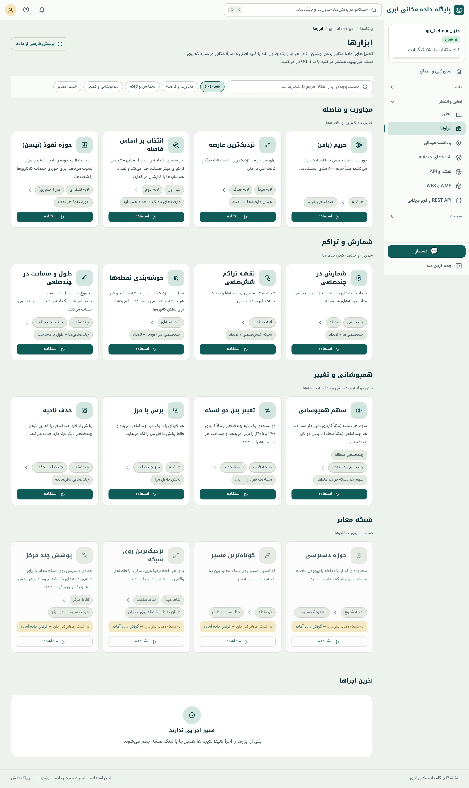
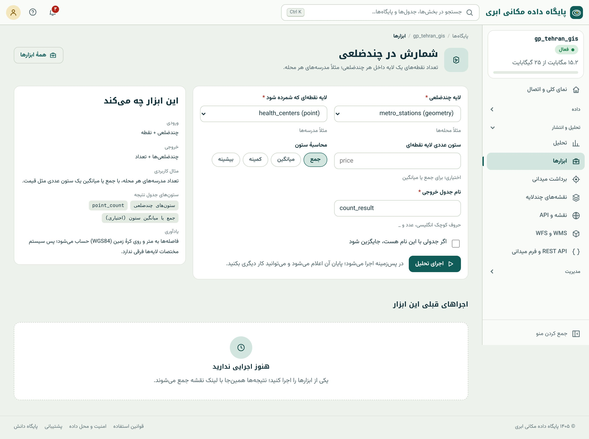
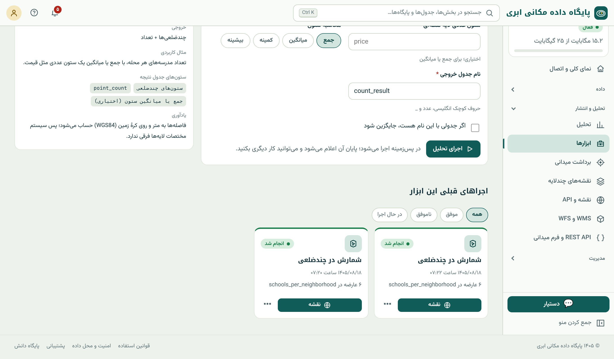
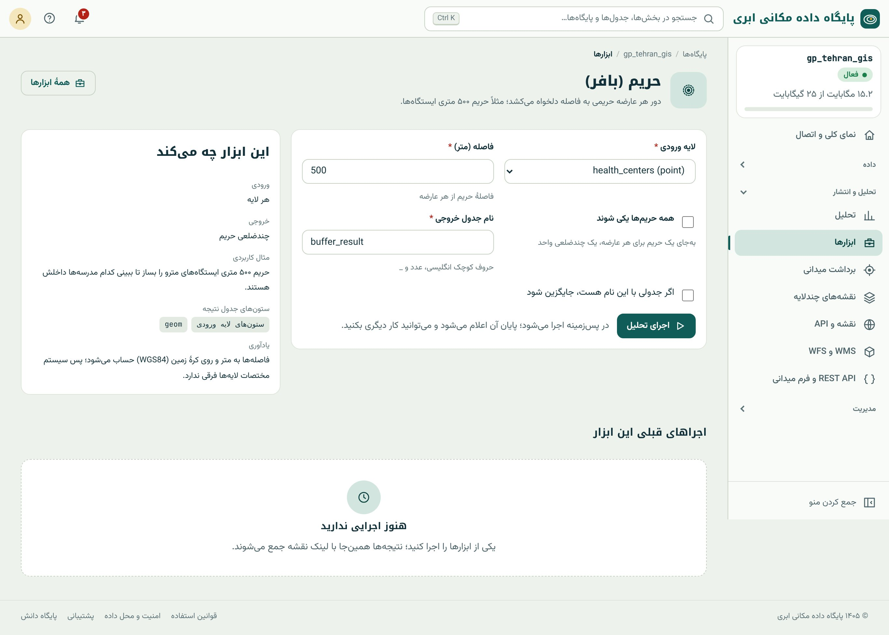

## ابزارها: SQL مکانی پشت یک فرم

بخش‌های سوم و چهارم کتاب SQL مکانی را آموزش داد. اما همه‌ی کاربران SQL نمی‌نویسند و همه‌ی تحلیل‌ها هم ارزش نوشتن پرسش از صفر را ندارند. منوی کناری ← تحلیل
و انتشار ← **«ابزارها»** شانزده تحلیل پرکاربرد را پشت فرم‌های ساده گذاشته است. هر ابزار یک **جدول تازه** با کلید اصلی و شاخص مکانی در پایگاه شما می‌سازد که
روی نقشه دیده می‌شود، منتشر می‌شود، در QGIS باز می‌شود و ورودی تحلیل بعدی است.

{.shot .wide}

| گروه | ابزارها | فصل |
|---|---|---|
| مجاورت و فاصله | حریم، نزدیک‌ترین عارضه، انتخاب بر اساس فاصله، حوزه‌ی نفوذ (تیسن) | همین فصل |
| شمارش و تراکم | شمارش در چندضلعی، نقشه‌ی تراکم شش‌ضلعی، خوشه‌بندی نقطه‌ها، طول و مساحت در چندضلعی | ۲۶ |
| همپوشانی و تغییر | سهم همپوشانی، تغییر بین دو نسخه، برش با مرز، حذف ناحیه | ۲۷ |
| شبکه‌ی معابر | حوزه‌ی دسترسی، کوتاه‌ترین مسیر، نزدیک‌ترین روی شبکه، پوشش چند مرکز | ۲۸ |

## چرخه‌ی کار با هر ابزار

{.shot}

::: steps
1. روی کارت ابزار «استفاده» را بزنید.
2. **لایه‌های ورودی** را انتخاب کنید. فهرست فقط لایه‌هایی را نشان می‌دهد که نوع هندسه‌شان به کار ابزار می‌آید (مثلاً فقط چندضلعی برای «لایه‌ی مناطق»).
3. **پارامترها** را تنظیم کنید: فاصله به متر، ستون نام، نوع محاسبه (جمع، میانگین، …) با چیپ‌ها.
4. **نام جدول خروجی** را با حروف کوچک انگلیسی، عدد و زیرخط بنویسید. اگر جدولی با این نام هست، «جایگزین شود» را تیک بزنید یا نام دیگری بدهید.
5. «اجرای تحلیل». تحلیل در **پس‌زمینه** اجرا می‌شود؛ پایان کار با اعلان خبر داده می‌شود و می‌توانید در این فاصله کار دیگری بکنید.
6. نتیجه در «اجراهای قبلی» همان ابزار و در «آخرین اجراها»ی صفحه‌ی ابزارها می‌آید؛ دکمه‌ی **«نقشه»** آن را روی نقشه باز می‌کند و منوی ⋯ کارهای دیگر را دارد.
:::

{.shot}

ستون‌های جدول نتیجه را کارت «این ابزار چه می‌کند» پیش از اجرا می‌گوید. مثلاً خروجی همین تحلیل ستون‌های محله را دارد به‌علاوه‌ی `point_count` و
`avg_students`؛ با همان عددهایی که در فصل ۱۳ با پیوند مکانی به دست آوردیم (نارمک ۷، شهرک غرب ۷، ونک ۶، …). حالا می‌دانید ابزار و SQL به یک جواب می‌رسند.

::: note
**همه‌ی فاصله‌ها به متر و روی کره‌ی زمین.** ابزارها فاصله را با `geography` (فصل‌های ۳ و ۱۶) حساب می‌کنند؛ پس سیستم مختصات لایه‌ها مهم نیست و لازم نیست چیزی
را به UTM ببرید. اگر لایه‌ها SRID متفاوت دارند، ابزار خودش تبدیل را انجام می‌دهد. خروجی همیشه در ۴۳۲۶ ذخیره می‌شود.
:::

## حریم (بافر)

**پرسش:** «محدوده‌ی ۵۰۰ متری ایستگاه‌های مترو کجاست؟»

**ورودی:** هر لایه (نقطه، خط یا چندضلعی). **پارامترها:** فاصله به متر و «همه‌ی حریم‌ها یکی شوند».

**خروجی:** برای هر عارضه یک چندضلعی حریم با ستون‌های عارضه‌ی اصلی؛ یا اگر «یکی شوند» تیک بخورد، یک چندضلعی واحد (MultiPolygon) که همپوشانی‌ها در آن
ادغام شده‌اند.

{.shot}

**زیر کاپوت** (فصل ۱۸):

```sql
-- حریم جداگانه
SELECT <ستون‌ها>, ST_Buffer(geom::geography, 500)::geometry(Polygon, 4326) AS geom FROM metro_stations;
-- حریم یکپارچه
SELECT ST_Multi(ST_Union(ST_Buffer(geom::geography, 500)::geometry))::geometry(MultiPolygon, 4326) AS geom FROM metro_stations;
```

چه وقت «یکی شوند»؟ وقتی پرسش درباره‌ی **مساحت پوشش** است («چند درصد شهر تا ۵۰۰ متری مترو است؟»): بدون ادغام، بخش‌های همپوشان چند بار شمرده می‌شوند (فصل ۱۸).
وقتی پرسش درباره‌ی **هر عارضه** است («حریم کدام ایستگاه با کدام مدرسه برخورد دارد؟»)، حریم جداگانه.

## نزدیک‌ترین عارضه

**پرسش:** «برای هر مدرسه، نزدیک‌ترین پارک و فاصله‌اش چقدر است؟»

**ورودی:** لایه‌ی مبدأ و لایه‌ی هدف. **پارامتر:** ستون نام در لایه‌ی هدف (اختیاری).

**خروجی:** همان عارضه‌های مبدأ، به‌علاوه‌ی `distance_m` (فاصله به متر) و نام نزدیک‌ترین عارضه‌ی هدف.

**زیر کاپوت:** الگوی `LATERAL` با `<->` (فصل ۱۹)، با فاصله‌ی دقیق روی geography:

```sql
SELECT s.*, n.name AS nearest_name, round(ST_Distance(s.geom::geography, n.geom::geography)::numeric, 1) AS distance_m
FROM schools s
CROSS JOIN LATERAL (SELECT name, geom FROM parks p ORDER BY p.geom <-> s.geom LIMIT 1) n;
```

نتیجه فاصله‌ی **هوایی** است. برای فاصله‌ی واقعی روی خیابان، ابزار «نزدیک‌ترین روی شبکه» (فصل ۲۸).

## انتخاب بر اساس فاصله

**پرسش:** «کدام مدرسه‌ها تا ۷۰۰ متری یک ایستگاه مترو هستند و چند ایستگاه در این فاصله دارند؟»

**ورودی:** لایه‌ی اول (عارضه‌هایی که انتخاب می‌شوند) و لایه‌ی دوم. **پارامتر:** فاصله به متر.

**خروجی:** فقط عارضه‌هایی از لایه‌ی اول که دست‌کم یک عارضه‌ی لایه‌ی دوم در آن فاصله دارند، به‌علاوه‌ی ستون **تعداد همسایه**.

این همان پرسش «یافتن عارضه» در فصل ۸ است، با این تفاوت که نتیجه مستقیم جدول می‌شود و تعداد همسایه هم دارد. **زیر کاپوت:** `ST_DWithin` روی geography با
پیش‌فیلتر شاخص (فصل‌های ۱۷ و ۲۰):

```sql
SELECT s.*, c.neighbors
FROM schools s
CROSS JOIN LATERAL (SELECT count(*) AS neighbors FROM metro_stations m
                    WHERE ST_DWithin(s.geom::geography, m.geom::geography, 700)) c
WHERE c.neighbors > 0;
```

## حوزه‌ی نفوذ (تیسن)

**پرسش:** «حوزه‌ی خدمات هر بیمارستان، به شرط اینکه هر نقطه به نزدیک‌ترین بیمارستان مراجعه کند، کجاست؟»

**ورودی:** لایه‌ی نقطه‌ای مراکز. **پارامتر:** لایه‌ی مرز (اختیاری) برای برش حوزه‌ها.

**خروجی:** یک چندضلعی برای هر مرکز، با ستون‌های آن.

**زیر کاپوت:** `ST_VoronoiPolygons` و برش با مرز (فصل ۱۸). بدون لایه‌ی مرز، حوزه‌های لبه تا محدوده‌ای بسیار بزرگ امتداد می‌یابند؛ همیشه یک مرز (مثلاً محدوده‌ی شهر)
بدهید.

::: know
**حوزه‌ی نفوذ و فرض‌هایش.** تیسن فرض می‌کند مردم به **نزدیک‌ترین** مرکز (به خط مستقیم) می‌روند و همه‌ی مراکز یکسان‌اند. در واقعیت، شبکه‌ی خیابان، ظرفیت و کیفیت
مراکز و مرزهای اداری اثر دارند. تیسن پاسخ اولیه‌ی خوبی است؛ برای برنامه‌ریزی دقیق، «پوشش چند مرکز» روی شبکه (فصل ۲۸) و مدل‌های جاذبه را به کار ببرید.
تیسن در اقلیم‌شناسی هم کاربرد کلاسیک دارد: برآورد بارش منطقه‌ای از ایستگاه‌ها با وزن مساحت حوزه‌ی هر ایستگاه.
:::

## پس از اجرا

- **نقشه:** دکمه‌ی «نقشه» روی کارت اجرا، نتیجه را باز می‌کند.
- **کنار ورودی‌ها:** نتیجه را روی لایه‌های ورودی در «نمایش با هم» باز می‌کند تا رابطه‌شان را ببینید.
- **نقشه و نمودار:** برای ابزارهایی که خروجی‌شان آمار دارد (سهم همپوشانی، شمارش با جمع یا میانگین)، نمودار پیشنهادی را در نقشه‌ی چندلایه می‌سازد (فصل ۴۳).
- **ورودی تحلیل بعدی:** خروجی یک جدول معمولی است؛ مثلاً حریم یکپارچه‌ی مترو را ورودی «برش با مرز» کنید تا مدرسه‌های داخلش جدا شوند.
- **SQL:** می‌توانید جدول نتیجه را در کنسول SQL بپرسید یا با بقیه‌ی جدول‌ها پیوند دهید.

::: try
با ابزار «انتخاب بر اساس فاصله»، مدرسه‌های تا ۷۰۰ متری مترو را جدا کنید و نتیجه را با پرسش SQL فصل ۸ مقایسه کنید (۲۷ مدرسه). سپس با «نزدیک‌ترین عارضه» برای هر
مدرسه نزدیک‌ترین مرکز درمانی را بیابید و با کنسول SQL، میانگین `distance_m` را برای هر مقطع حساب کنید.
:::

::: summary
- «ابزارها» شانزده تحلیل را پشت فرم دارد؛ هر ابزار جدول تازه با کلید و شاخص مکانی می‌سازد.
- چرخه: لایه‌ها، پارامترها، نام خروجی، اجرا در پس‌زمینه، اعلان، نتیجه در «اجراهای قبلی» با دکمه‌ی نقشه.
- فاصله‌ها به متر روی geography؛ خروجی در ۴۳۲۶.
- حریم (جداگانه یا یکپارچه)، نزدیک‌ترین عارضه (فاصله‌ی هوایی)، انتخاب بر اساس فاصله (با تعداد همسایه)، حوزه‌ی نفوذ (با برش مرز).
- هر ابزار یک الگوی SQL فصل‌های ۱۷ تا ۱۹ است؛ نتیجه‌ی ابزار و SQL یکی است.
:::

::: teach
**زمان پیشنهادی:** یک جلسه. برای کلاس‌های غیرفنی، این فصل می‌تواند جای بخش‌های سوم و چهارم بنشیند. برای کلاس‌های فنی، بگذارید دانشجوها نتیجه‌ی هر ابزار را با SQL
خودشان بازتولید کنند؛ بهترین تمرین برای دیدن «زیر کاپوت».
:::

::: exercises
### تمرین‌ها

1. [سطح ۱]{.badge .b1} حریم ۳۰۰ متری پارک‌ها را جداگانه و یکپارچه بسازید. مساحت کل دو نتیجه را مقایسه کنید.
2. [سطح ۱]{.badge .b1} برای هر ایستگاه مترو نزدیک‌ترین مدرسه را بیابید. کدام ایستگاه دورترین مدرسه را دارد؟
3. [سطح ۲]{.badge .b2} حوزه‌ی نفوذ بیمارستان‌ها را با و بدون لایه‌ی مرز (مثلاً پوسته‌ی محدب مدرسه‌ها که با SQL ساخته‌اید) بسازید و تفاوت را توضیح دهید.
4. [سطح ۲]{.badge .b2} نتیجه‌ی «انتخاب بر اساس فاصله» را ورودی «شمارش در چندضلعی» کنید: در هر محله چند مدرسه‌ی نزدیک مترو هست؟
:::
