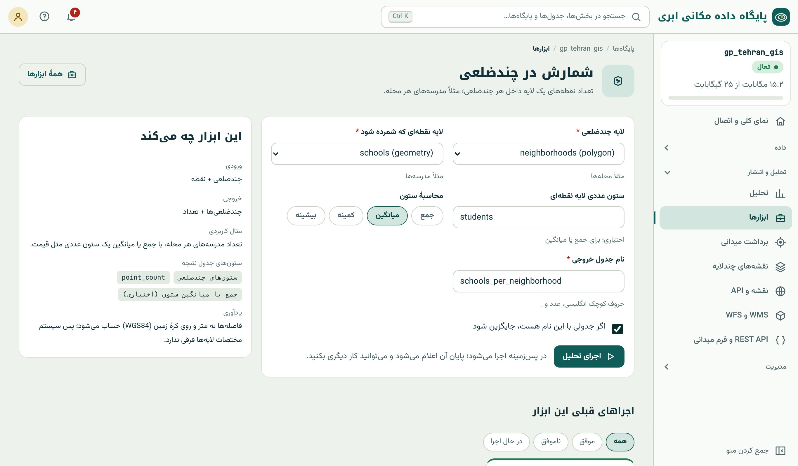

## شمارش در چندضلعی

**پرسش:** «هر محله چند مدرسه دارد و میانگین دانش‌آموز مدرسه‌هایش چقدر است؟»

**ورودی:** لایه‌ی چندضلعی (مناطق) و لایه‌ی نقطه‌ای (آنچه شمرده می‌شود). **پارامتر اختیاری:** ستون عددی لایه‌ی نقطه‌ای و نوع محاسبه (جمع، میانگین، کمینه، بیشینه).

**خروجی:** همه‌ی چندضلعی‌ها (حتی خالی‌ها با صفر) با ستون‌های خودشان، به‌علاوه‌ی `point_count` و در صورت انتخاب، ستونی مثل `avg_students`.

{.shot}

**زیر کاپوت:** زیرپرسش همبسته‌ی شمارش با `ST_Intersects` برای هر چندضلعی (فصل‌های ۱۳ و ۱۷). نقطه‌ی روی مرز مشترک دو منطقه در هر دو شمرده می‌شود (فصل ۱۷).

::: warn
**نسبت، نه عدد خام.** «محله‌ی الف ۷ مدرسه دارد و محله‌ی ب ۲» به تنهایی معنایی ندارد اگر جمعیت یا مساحتشان فرق کند. پس از اجرای ابزار، در کنسول SQL نسبت بسازید:
`SELECT name, point_count, round(population::numeric / nullif(point_count, 0)) AS people_per_school FROM نتیجه;` و برای نقشه، نسبت را نمایش دهید (فصل ۴۱).
:::

## نقشه‌ی تراکم شش‌ضلعی

**پرسش:** «تصادف‌ها یا مدرسه‌ها کجا متراکم‌ترند؟»

**ورودی:** لایه‌ی نقطه‌ای. **پارامتر:** اندازه‌ی هر خانه.

**خروجی:** شش‌ضلعی‌هایی که دست‌کم یک نقطه دارند، با ستون `count`. خانه‌های خالی در نتیجه نیستند.

**زیر کاپوت:** `ST_HexagonGrid` روی محدوده‌ی نقطه‌ها و شمارش با پیوند مکانی (فصل ۲۱). شبکه در سیستم Web Mercator (۳۸۵۷) ساخته می‌شود.

::: pro
**اندازه‌ی واقعی خانه.** چون شبکه در Web Mercator ساخته می‌شود و این سیستم در عرض‌های جغرافیایی میانه طول‌ها را بزرگ‌تر نشان می‌دهد (فصل ۱۶)، اندازه‌ای که در فرم
می‌نویسید در تهران حدود ۸۱ درصد اندازه‌ی واقعی روی زمین است (ضریب $\cos 35.7°$): خانه‌ی «۵۰۰ متری» در واقع حدود ۴۰۵ متر است. برای مقایسه‌ی دو شهر با عرض متفاوت
یا گزارش رسمی، شبکه را با SQL فصل ۲۱ در UTM بسازید تا اندازه دقیقاً متری باشد.
:::

انتخاب اندازه‌ی خانه همان مسئله‌ی MAUP است (فصل ۲۱): خانه‌ی کوچک نویز و خانه‌های خالی زیاد می‌دهد، خانه‌ی بزرگ جزئیات را محو می‌کند. قاعده‌ی سرانگشتی: اندازه‌ای که
بیشتر خانه‌های پر، بیش از چند نقطه داشته باشند؛ و همیشه دو یا سه اندازه را امتحان کنید.

## خوشه‌بندی نقطه‌ها

**پرسش:** «کانون‌های شکایت شهروندان کجاست؟»

**ورودی:** لایه‌ی نقطه‌ای. **پارامترها:** شعاع همسایگی (متر) و حداقل نقطه در هر خوشه.

**خروجی:** یک چندضلعی (پوسته‌ی محدب با حاشیه‌ی کم) برای هر خوشه، با `cluster_id` و `point_count`. نقطه‌های پراکنده در هیچ خوشه‌ای نیستند.

**زیر کاپوت:** `ST_ClusterDBSCAN` (فصل ۲۱)؛ شعاع همسایگی برای عرض جغرافیایی تصحیح می‌شود تا واقعاً متری باشد. تنظیم پارامترها:

- شعاع کم و حداقل زیاد: فقط کانون‌های بسیار فشرده.
- شعاع زیاد و حداقل کم: خوشه‌های بزرگ و پراکنده که ممکن است به هم بپیوندند.

## طول و مساحت در چندضلعی

**پرسش:** «هر محله چند کیلومتر خیابان دارد؟» یا «چند درصد هر محله پارک است؟»

**ورودی:** لایه‌ی مناطق (چندضلعی) و لایه‌ی خطی یا چندضلعی.

**خروجی:** مناطق با `length_m` و تراکم (کیلومتر در کیلومتر مربع) برای خط‌ها، یا `area_m2` و درصد پوشش برای چندضلعی‌ها.

**زیر کاپوت:** `ST_Intersection` هر عارضه با منطقه و جمع طول یا ادغام و مساحت روی geography (فصل‌های ۱۶ و ۱۸). برای چندضلعی‌ها اجتماع گرفته می‌شود تا همپوشانی‌ها
دو بار شمرده نشوند.

::: real
**سرانه‌ی فضای سبز.** معاونت شهرسازی یک شهر با «طول و مساحت در چندضلعی» (لایه‌ی محله‌ها و لایه‌ی پارک‌ها) درصد فضای سبز هر محله را گرفت و با یک پرسش SQL آن را به
سرانه‌ی متر مربع برای هر نفر تبدیل کرد. نقشه‌ی سرانه، که در استودیوی نقشه با پنج طبقه نمایش داده شد، مبنای اولویت‌بندی بودجه‌ی پارک‌سازی محله‌ای قرار گرفت.
:::

::: summary
- «شمارش در چندضلعی» تعداد و جمع/میانگین/کمینه/بیشینه‌ی ستون نقطه‌ها را برای همه‌ی مناطق می‌دهد؛ برای نقشه، نسبت بسازید.
- «نقشه‌ی تراکم شش‌ضلعی» شبکه را در Web Mercator می‌سازد؛ اندازه در تهران حدود ۸۱٪ اندازه‌ی واقعی است؛ برای دقت متری، SQL فصل ۲۱.
- «خوشه‌بندی نقطه‌ها» DBSCAN با شعاع متری و حداقل نقطه؛ پوسته‌ی هر خوشه را می‌دهد.
- «طول و مساحت در چندضلعی» طول خط و مساحت/درصد پوشش هر منطقه را می‌دهد.
:::

::: exercises
### تمرین‌ها

1. [سطح ۱]{.badge .b1} با «شمارش در چندضلعی» تعداد مراکز درمانی و مجموع تخت هر محله را بگیرید.
2. [سطح ۱]{.badge .b1} نقشه‌ی تراکم مدرسه‌ها را با اندازه‌ی ۵۰۰ و ۱۵۰۰ بسازید. کدام برای نقشه‌ی کل شهر مناسب‌تر است؟
3. [سطح ۲]{.badge .b2} مدرسه‌ها را با شعاع ۸۰۰ متر و حداقل ۴ نقطه خوشه‌بندی کنید و نتیجه را با پرسش DBSCAN فصل ۲۱ مقایسه کنید.
4. [سطح ۲]{.badge .b2} درصد پارک هر محله را بگیرید و با SQL به سرانه (متر مربع برای هر نفر) تبدیل کنید.
:::
