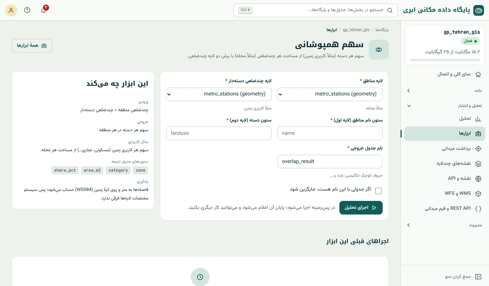
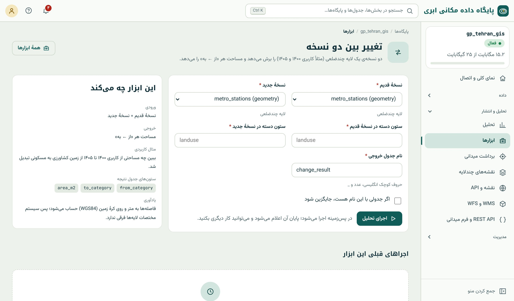

## همپوشانی دو لایه‌ی چندضلعی

بسیاری از پرسش‌های برنامه‌ریزی، پرسش **همپوشانی** دو لایه است: کاربری زمین در محله‌ها، پوشش جنگل در حوضه‌ها، طرح تفصیلی در محدوده‌ی یک پروژه. چهار ابزار این
گروه همه از اشتراک یا تفاضل هندسه‌ها (فصل ۱۸) ساخته شده‌اند و پیش از محاسبه هندسه‌ها را معتبر می‌کنند (`ST_MakeValid`، فصل ۲۲) تا داده‌ی ناقص خطا ندهد.

## سهم همپوشانی

**پرسش:** «سهم هر کاربری (مسکونی، تجاری، سبز، …) از مساحت هر محله چقدر است؟»

**ورودی:** لایه‌ی مناطق (مثلاً محله) و لایه‌ی چندضلعی دسته‌دار (مثلاً کاربری زمین با ستون نوع). **پارامترها:** ستون نام منطقه و ستون دسته.

**خروجی:** یک سطر برای هر جفت منطقه و دسته: `zone`، `category`، `area_m2`، `share_pct` و هندسه‌ی بخش مشترک.

{.shot}

**زیر کاپوت:**

```sql
WITH j AS (
  SELECT p.name AS zone, q.landuse AS category,
         ST_Area(ST_MakeValid(p.geom)::geography) AS zone_area,
         ST_CollectionExtract(ST_Intersection(ST_MakeValid(p.geom), ST_MakeValid(q.geom)), 3) AS g
  FROM neighborhoods p JOIN landuse q ON ST_Intersects(p.geom, q.geom)
)
SELECT zone, category,
       round(sum(ST_Area(g::geography))::numeric, 1)                              AS area_m2,
       round((100 * sum(ST_Area(g::geography)) / max(zone_area))::numeric, 2)     AS share_pct
FROM j GROUP BY zone, category;
```

دکمه‌ی «نقشه و نمودار» روی کارت اجرا، نمودار ستونی انباشته (۱۰۰ درصد) سهم دسته‌ها در هر منطقه را پیشنهاد می‌کند (فصل ۴۳).

## تغییر بین دو نسخه

**پرسش:** «از ۱۴۰۰ تا ۱۴۰۵ چند هکتار باغ به مسکونی تبدیل شده؟»

**ورودی:** نسخه‌ی قدیم و نسخه‌ی جدید یک لایه‌ی چندضلعی دسته‌دار (مثلاً کاربری ۱۴۰۰ و ۱۴۰۵). **پارامترها:** ستون دسته در هر نسخه.

**خروجی:** یک سطر برای هر جفت «از ← به»: `from_category`، `to_category`، `area_m2` و هندسه‌ی بخش‌هایی که این تغییر را داشته‌اند. سطرهایی که «از» و «به» یکی دارند،
بخش‌های **بدون تغییر**اند.

{.shot}

این همان **ماتریس تغییر** مقایسه‌ی پس از طبقه‌بندی است (فصل ۳۹) و نتیجه‌اش در استودیوی نقشه با نمودار **Sankey** (جریان) بهترین نمایش را دارد (فصل ۴۳). هندسه‌ی هر
جفت تغییر هم ذخیره می‌شود؛ پس می‌توانید فقط «باغ ← مسکونی» را روی نقشه نشان دهید.

::: warn
**دو نسخه باید هم‌مرز باشند.** اگر دو نسخه با دقت یا روش رقومی‌سازی متفاوت تهیه شده باشند، مرزهای یکسان کمی جابه‌جا رقومی می‌شوند و در نتیجه نوارهای باریک «تغییر
کاذب» (sliver) پدید می‌آید. پیش از گزارش، سطرهای با مساحت بسیار کم را کنار بگذارید یا نسخه‌ها را به هم بچسبانید (`ST_Snap`، فصل ۱۸).
:::

## برش با مرز

**پرسش:** «فقط بخشی از شبکه‌ی آب که داخل محدوده‌ی طرح است.»

**ورودی:** هر لایه و یک لایه‌ی مرز (چندضلعی). **خروجی:** عارضه‌ها، بریده‌شده به داخل مرز؛ برای چندضلعی‌ها با `area_m2` تازه.

**زیر کاپوت:** `ST_Intersection` با اجتماع مرزها (فصل ۱۸). عارضه‌هایی که کاملاً بیرون‌اند حذف و آن‌هایی که روی مرزند بریده می‌شوند.

## حذف ناحیه

**پرسش:** «زمین‌های محدوده‌ی طرح، منهای حریم رودخانه.»

**ورودی:** لایه‌ی چندضلعی و لایه‌ی چندضلعی حذفی. **خروجی:** چندضلعی‌های باقی‌مانده با `area_m2` تازه.

**زیر کاپوت:** `ST_Difference` با اجتماع چندضلعی‌های حذفی (فصل ۱۸).

::: real
**زمین قابل ساخت.** یک شرکت مشاور برای برآورد زمین قابل ساخت در یک شهرک، این زنجیره را با چهار ابزار اجرا کرد: «حریم» ۵۰ متری رودخانه و ۳۰ متری خط فشار قوی (یکپارچه)،
«حذف ناحیه» آن حریم‌ها از قطعه‌ها، «برش با مرز» به محدوده‌ی طرح، و «سهم همپوشانی» نتیجه با پهنه‌های کاربری طرح تفصیلی. خروجی جدول هکتار زمین قابل ساخت هر پهنه
بود؛ بدون یک خط SQL.
:::

::: summary
- «سهم همپوشانی»: سهم هر دسته از مساحت هر منطقه (`share_pct`)؛ نمودار ستونی انباشته.
- «تغییر بین دو نسخه»: ماتریس «از ← به» با مساحت و هندسه؛ نمودار Sankey؛ مراقب تغییرهای کاذب باریک.
- «برش با مرز» (اشتراک) و «حذف ناحیه» (تفاضل) لایه‌ها را به محدوده‌ی مطالعه محدود می‌کنند.
- هندسه‌ها پیش از محاسبه معتبر می‌شوند؛ مساحت‌ها روی geography به متر مربع‌اند.
:::

::: exercises
### تمرین‌ها

1. [سطح ۱]{.badge .b1} پارک‌ها را با مرز محله‌ها ببرید. مساحت کل پارک داخل محله‌ها چقدر است؟
2. [سطح ۱]{.badge .b1} محله‌ها منهای پارک‌ها: مساحت باقی‌مانده‌ی هر محله را بگیرید.
3. [سطح ۲]{.badge .b2} با SQL یک لایه‌ی «کاربری» آزمایشی بسازید (مثلاً پارک‌ها با دسته‌ی «سبز» و بقیه‌ی هر محله با دسته‌ی «شهری») و «سهم همپوشانی» را روی محله‌ها اجرا کنید.
4. [سطح ۳]{.badge .b3} دو نسخه از لایه‌ی کاربری بسازید که در یکی چند پارک به «شهری» تبدیل شده باشد و «تغییر بین دو نسخه» را اجرا کنید؛ نتیجه را با نمودار Sankey نمایش دهید.
:::
