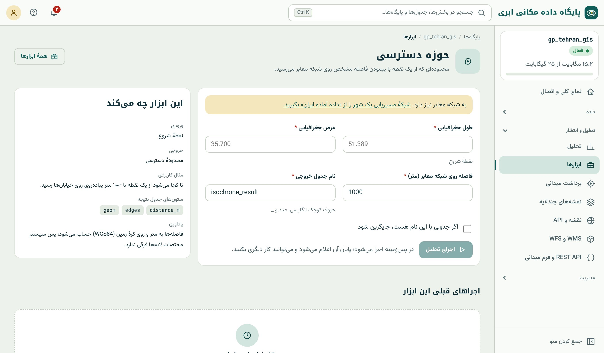

## پیش‌نیاز: شبکه‌ی مسیریابی

چهار ابزار گروه «شبکه‌ی معابر» روی **شبکه‌ی مسیریابی** واقعی خیابان‌ها کار می‌کنند. این شبکه را از بخش «داده‌ی آماده‌ی ایران» (فصل ۳۰) با گزینه‌ی «شبکه‌ی آماده‌ی
مسیریابی» برای یک شهر یا شهرستان وارد می‌کنید. نتیجه در schema‌ای به نام `routing` دو جدول است: `routing.ways` (یال‌ها با طول، جهت و هزینه) و
`routing.ways_vertices_pgr` (گره‌ها). تا این شبکه نباشد، کارت این ابزارها برچسب «به شبکه معابر نیاز دارد» و پیوند «گرفتن داده آماده» دارد.

ابزارها **طول به متر** را هزینه می‌گیرند و جهت خیابان‌های یک‌طرفه را رعایت می‌کنند؛ پس «کوتاه‌ترین» یعنی کوتاه‌ترین مسیر مجاز رانندگی از نظر طول، نه لزوماً سریع‌ترین.
برای مسیر سریع‌ترین (با سرعت مجاز هر خیابان)، SQL فصل ۲۴ را با هزینه‌ی زمانی بنویسید.

## حوزه‌ی دسترسی

**پرسش:** «از این ایستگاه آتش‌نشانی، تا ۲ کیلومتر روی خیابان‌ها کجا می‌رسیم؟»

**ورودی:** نقطه‌ی شروع (با کلیک روی نقشه) و فاصله روی شبکه به متر. **خروجی:** چندضلعی محدوده‌ی دسترسی.

{.shot}

**زیر کاپوت:** `pgr_drivingDistance` از نزدیک‌ترین گره به نقطه و پوسته‌ی مقعر گره‌های رسیده (فصل ۲۴). حوزه‌ی دسترسی شبکه‌ای معمولاً شکلی ستاره‌ای دارد که در امتداد
خیابان‌های اصلی کشیده شده است، برخلاف حریم دایره‌ای (فصل ۲۵). اختلاف این دو شکل همان اختلاف «دسترسی واقعی» و «فاصله‌ی هوایی» است.

## کوتاه‌ترین مسیر

**پرسش:** «کوتاه‌ترین مسیر از انبار تا این مشتری؟»

**ورودی:** دو نقطه روی نقشه. **خروجی:** خط مسیر با طول به متر.

**زیر کاپوت:** `pgr_dijkstra` بین نزدیک‌ترین گره‌های دو نقطه و ادغام یال‌های مسیر (فصل ۲۴).

## نزدیک‌ترین روی شبکه

**پرسش:** «برای هر مدرسه، نزدیک‌ترین درمانگاه **با رانندگی** کدام است و چند متر؟»

**ورودی:** لایه‌ی مبدأ (نقطه‌ها) و لایه‌ی مقصد (مراکز). **پارامتر:** حداکثر فاصله روی شبکه؛ مبدأهایی که دورترند بدون مقدار می‌مانند.

**خروجی:** همان نقطه‌های مبدأ با نام نزدیک‌ترین مرکز و فاصله‌ی شبکه‌ای.

**زیر کاپوت:** ماتریس هزینه‌ی چندبه‌چند (`pgr_dijkstraCost`) و انتخاب کمینه برای هر مبدأ با `DISTINCT ON` (فصل ۲۴). نتیجه را با «نزدیک‌ترین عارضه» (هوایی، فصل ۲۵)
مقایسه کنید: هر جا نزدیک‌ترین مرکز هوایی و شبکه‌ای فرق دارند، مانعی (بزرگراه، رود، بلوک بسته) در کار است.

## پوشش چند مرکز

**پرسش:** «با ۸ ایستگاه آتش‌نشانی فعلی، کدام بخش‌های شهر تا ۳ کیلومتر رانندگی پوشش داده می‌شوند و هر بخش مال کدام ایستگاه است؟»

**ورودی:** لایه‌ی نقطه‌ای مراکز. **پارامتر:** فاصله روی شبکه. **خروجی:** حوزه‌ی دسترسی هر مرکز، که بخش‌های مشترک به نزدیک‌ترین مرکز داده شده‌اند.

این ابزار پاسخ «حوزه‌ی نفوذ» (تیسن، فصل ۲۵) را روی شبکه‌ی واقعی می‌دهد. با آن می‌توان **نقطه‌های کور** (جاهایی که هیچ مرکزی پوشش نمی‌دهد) را پیدا کرد: نتیجه را با
«حذف ناحیه» (فصل ۲۷) از محدوده‌ی شهر کم کنید.

::: real
**مکان‌یابی پایگاه اورژانس.** برای انتخاب بین سه زمین پیشنهادی برای پایگاه اورژانس تازه، هر کدام یک بار به لایه‌ی پایگاه‌های فعلی اضافه و «پوشش چند مرکز» با ۴ کیلومتر
اجرا شد. سپس با «شمارش در چندضلعی»، جمعیت (نقطه‌های بلوک آماری) داخل پوشش در هر حالت شمرده شد. زمینی که بیشترین جمعیت تازه را زیر پوشش می‌برد انتخاب شد؛ سه اجرای ابزار
و یک جدول مقایسه.
:::

::: summary
- ابزارهای شبکه به `routing.ways` از «داده‌ی آماده‌ی ایران» (فقط شهر یا شهرستان) نیاز دارند.
- هزینه طول به متر است و یک‌طرفه‌ها رعایت می‌شوند؛ برای سریع‌ترین مسیر، SQL فصل ۲۴ با هزینه‌ی زمانی.
- حوزه‌ی دسترسی (`pgr_drivingDistance` + پوسته‌ی مقعر)، کوتاه‌ترین مسیر (`pgr_dijkstra`)، نزدیک‌ترین روی شبکه (ماتریس هزینه)، پوشش چند مرکز.
- تفاوت نتیجه‌ی شبکه‌ای و هوایی، موانع واقعی را آشکار می‌کند.
:::

::: exercises
### تمرین‌ها

1. [سطح ۱]{.badge .b1} برای شهر خود شبکه‌ی مسیریابی را وارد کنید (فصل ۳۰) و حوزه‌ی دسترسی ۱ کیلومتری یک مدرسه را بسازید. آن را با حریم ۱ کیلومتری مقایسه کنید.
2. [سطح ۲]{.badge .b2} برای ده مدرسه، نزدیک‌ترین بیمارستان هوایی و شبکه‌ای را بگیرید. در چند مورد فرق دارند؟ چرا؟
3. [سطح ۳]{.badge .b3} پوشش ۳ کیلومتری بیمارستان‌ها را بسازید و با «حذف ناحیه»، نقطه‌های کور شهر را پیدا کنید.
:::
