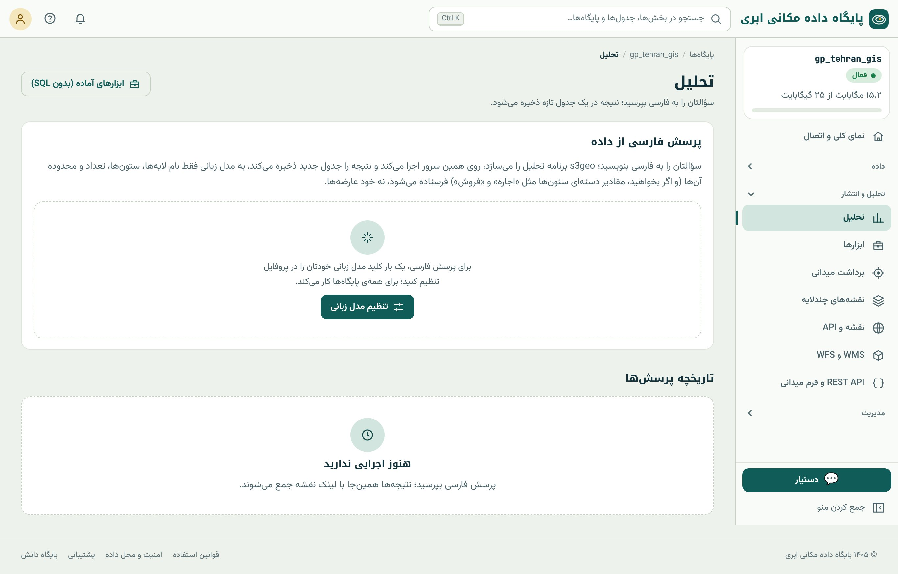

## از جمله به SQL

مدل‌های زبانی بزرگ امروز می‌توانند جمله‌ی فارسی را به SQL ترجمه کنند. پایگاه داده مکانی ابری این امکان را در دو جا دارد:

- **بخش «تحلیل»** (منوی تحلیل و انتشار): پرسش فارسی با انتخاب لایه‌ها؛ نتیجه یک **جدول تازه** در پایگاه است و در «تاریخچه‌ی پرسش‌ها» با پیوند نقشه می‌ماند.
- **زبانه‌ی «پرسش فارسی» در کنسول SQL** (فصل ۱۰): جمله را می‌نویسید و «ساخت SQL» را می‌زنید. پرسش خواندنی بی‌درنگ اجرا می‌شود؛ دستوری که جدول می‌سازد یا داده را تغییر
  می‌دهد **اول نشان داده می‌شود** تا خودتان اجرا کنید.

{.shot}

## راه‌اندازی

این قابلیت از **کلید API مدل زبانی خودتان** استفاده می‌کند (سرویس سازگار با OpenAI). کلید را یک بار در پروفایل تنظیم می‌کنید و برای همه‌ی پایگاه‌های شما کار می‌کند.
آنچه به مدل فرستاده می‌شود محدود است: **نام لایه‌ها، ستون‌ها، نوع هندسه، تعداد عارضه و محدوده**، و اگر بخواهید، چند مقدار دسته‌ای ستون‌ها (مثل «اجاره» و «فروش») تا
پرسش را دقیق‌تر بفهمد. **خود عارضه‌ها و داده‌ها فرستاده نمی‌شوند.** SQL ساخته‌شده روی همین سرور اجرا می‌شود.

## نمونه‌ی پرسش‌ها

| پرسش فارسی | SQL که باید ساخته شود (فصل) |
|---|---|
| «مدرسه‌های ابتدایی با بیش از ۶۰۰ دانش‌آموز» | `WHERE level = … AND students > 600` (۱۱) |
| «تعداد مدرسه‌های هر محله» | پیوند مکانی با `ST_Contains` و `GROUP BY` (۱۳ و ۱۷) |
| «مدرسه‌هایی که تا ۵۰۰ متری مترو هستند را در لایه‌ی جدید ذخیره کن» | `CREATE TABLE … AS` با `ST_DWithin` روی geography (۱۴ و ۱۷) |
| «نزدیک‌ترین بیمارستان به هر مدرسه و فاصله‌اش» | `LATERAL` با `<->` (۱۹) |
| «مساحت هر پارک به هکتار» | `ST_Area(geom::geography) / 10000` (۱۶) |

## SQL را بخوانید

مدل زبانی گاهی اشتباه می‌کند: ستون اشتباه انتخاب می‌کند، فاصله را به درجه حساب می‌کند، `ST_Contains` را برعکس می‌نویسد یا شرطی را جا می‌اندازد. پس همیشه پیش از تکیه
بر نتیجه، SQL را بخوانید. فهرست کنترل:

::: steps
1. **جدول‌ها و ستون‌ها** همان‌هایی‌اند که منظور شما بود؟
2. **واحد فاصله:** برای متر، `::geography` یا تبدیل به UTM دارد؟ (فصل ۱۶)
3. **ترتیب آرگومان‌ها** در گزاره‌ها درست است؟ `ST_Contains(محله, مدرسه)`، نه برعکس (فصل ۱۷).
4. **شمارش مضاعف:** پیوند یک‌به‌چند جمع را دو بار حساب نمی‌کند؟ (فصل ۱۷)
5. **تعداد سطرهای نتیجه** با انتظار شما جور است؟ یک پرسش ساده‌ی کنترلی بزنید (مثلاً `count(*)`).
:::

دکمه‌ی «چرا کند است؟» در کنسول، برای پرسش‌های کند برنامه‌ی اجرا را خوانا توضیح می‌دهد (فصل ۲۰).

::: note
**بهترین معلم SQL.** پرسش فارسی را ابزار یادگیری ببینید: پرسش را فارسی بپرسید، SQL را بخوانید و سعی کنید هر خط را با فصل‌های بخش سوم و چهارم بفهمید؛ بعد آن را
تغییر دهید (فاصله‌ی دیگر، مقطع دیگر) و دوباره اجرا کنید. چند هفته بعد خودتان SQL می‌نویسید.
:::

## تاریخچه‌ی پرسش‌ها

هر پرسش بخش «تحلیل» در «تاریخچه‌ی پرسش‌ها» با متن پرسش، SQL، جدول نتیجه و پیوند نقشه می‌ماند. دکمه‌ی **«کنار ورودی‌ها»** نتیجه را روی لایه‌های ورودی در «نمایش با هم» باز
می‌کند و **«نقشه و نمودار»** برای نتیجه‌هایی که آمار دارند، نمودار پیشنهادی می‌سازد (فصل ۴۳).

::: summary
- پرسش فارسی در «تحلیل» (نتیجه = جدول تازه) و در کنسول SQL (پرسش خواندنی فوری؛ تغییردهنده پس از نمایش).
- کلید مدل زبانی از خود کاربر است؛ فقط ساختار لایه‌ها (و در صورت تمایل چند مقدار دسته‌ای) فرستاده می‌شود، نه داده.
- SQL ساخته‌شده را با فهرست کنترل بسنجید: جدول و ستون، واحد فاصله، ترتیب آرگومان، شمارش مضاعف، تعداد سطر.
- پرسش فارسی ابزار یادگیری SQL است.
:::

::: exercises
### تمرین‌ها

1. [سطح ۱]{.badge .b1} پنج پرسش جدول بالا را بپرسید و SQL هر کدام را با پاسخ کتاب مقایسه کنید.
2. [سطح ۲]{.badge .b2} پرسشی بپرسید که مدل در آن اشتباه کند (مثلاً «مدرسه‌های نزدیک پارک») و SQL را خودتان اصلاح کنید. «نزدیک» را چگونه تعریف کردید؟
3. [سطح ۲]{.badge .b2} برای یک پرسش تحلیلی، نتیجه‌ی پرسش فارسی، ابزار آماده و SQL دستی خودتان را مقایسه کنید.
:::
