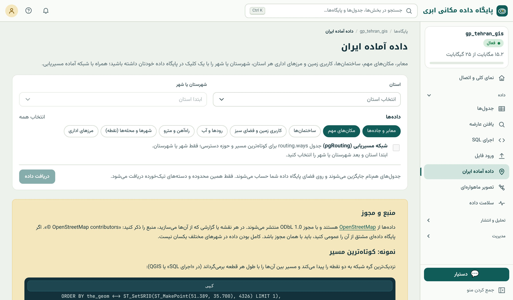

## OpenStreetMap

**OpenStreetMap** (OSM) نقشه‌ی آزاد جهان است که از ۲۰۰۴ با مشارکت میلیون‌ها داوطلب ساخته می‌شود؛ مثل ویکی‌پدیا برای نقشه. هر کسی می‌تواند خیابان، ساختمان یا مغازه‌ای را
اضافه یا اصلاح کند. در بسیاری از شهرهای ایران، OSM کامل‌ترین داده‌ی آزاد معابر و مکان‌هاست.

مدل داده‌ی OSM سه جزء دارد: **گره** (node؛ نقطه)، **راه** (way؛ دنباله‌ی گره‌ها، خط یا چندضلعی) و **رابطه** (relation؛ گروهی از اجزا، مثل مرز استان). ویژگی‌ها به صورت
**برچسب**‌های کلید=مقدار نگه داشته می‌شوند: `highway=primary`، `amenity=hospital`، `name=بیمارستان امام`. این ساختار آزاد، دلیل اینکه افزونه‌ی `hstore` (فصل ۴) در
داده‌ی OSM کاربرد دارد.

::: warn
**مجوز ODbL.** داده‌ی OSM تحت مجوز **Open Database License** است: استفاده‌ی تجاری آزاد است، اما در هر نقشه یا گزارش باید «© OpenStreetMap contributors» بیاید، و اگر
پایگاه داده‌ی **مشتق** از آن را عمومی منتشر کنید، باید با همان مجوز باشد. نقشه‌ها و تحلیل‌های شما (نه خود پایگاه داده) این شرط دوم را ندارند.
:::

## ورود با یک کلیک

منوی کناری ← داده ← **«داده‌ی آماده‌ی ایران»**:

{.shot}

::: steps
1. **محدوده** را انتخاب کنید: استان، شهرستان یا شهر. محدوده‌ی کوچک‌تر یعنی ورود سریع‌تر و حجم کمتر؛ برای کار شهری، شهر یا شهرستان.
2. **دسته‌ها** را تیک بزنید: معابر، مکان‌های مهم، ساختمان‌ها، کاربری زمین، آب‌ها، راه‌آهن، سکونتگاه‌ها و مرزهای اداری.
3. در صورت نیاز **شبکه‌ی آماده‌ی مسیریابی** را هم بخواهید (فقط برای شهر یا شهرستان؛ پیش‌نیاز ابزارهای شبکه در فصل ۲۸ و SQL فصل ۲۴).
4. «ورود» را بزنید. کار در پس‌زمینه انجام و پایانش با اعلان خبر داده می‌شود. تاریخ نسخه‌ی داده در صفحه نمایش داده می‌شود.
:::

## جدول‌ها

| جدول | هندسه | ستون‌های اصلی |
|---|---|---|
| `osm_roads` | خط | `name`، `name_en`، `highway`، `oneway`، `maxspeed`، `lanes`، `surface`، `bridge`، `tunnel` |
| `osm_pois` | نقطه | `name`، `amenity`، `shop`، `tourism`، `healthcare`، `leisure`، `office`، `historic`، `religion`، `phone`، `opening_hours` |
| `osm_buildings` | چندضلعی | `name`، `building`، `levels`، `amenity` |
| `osm_landuse` | چندضلعی | `name`، `landuse`، `leisure`، `nature` |
| `osm_water` | خط | `name`، `waterway` |
| `osm_railways` | خط | `name`، `railway` |
| `osm_places` | نقطه | `name`، `place`، `population` |
| `osm_boundaries` | چندضلعی | `name`، `admin_level` |

همه‌ی جدول‌ها `osm_id` دارند، هندسه در `geom` با SRID ۴۳۲۶ است، و `name` نام فارسی (اگر ثبت شده باشد) است. با شبکه‌ی مسیریابی، `routing.ways` و
`routing.ways_vertices_pgr` هم ساخته می‌شوند.

## پرسش از داده‌ی OSM

```sql
-- بیمارستان‌ها و داروخانه‌ها
SELECT name, amenity FROM osm_pois WHERE amenity IN ('hospital', 'pharmacy');

-- طول بزرگراه‌ها و خیابان‌های اصلی به کیلومتر
SELECT highway, round(sum(ST_Length(geom::geography)) / 1000) AS km
FROM osm_roads WHERE highway IN ('motorway', 'trunk', 'primary') GROUP BY highway;

-- داروخانه‌هایی که تا ۵۰۰ متری یک بیمارستان‌اند
SELECT p.name FROM osm_pois p
WHERE p.amenity = 'pharmacy'
  AND EXISTS (SELECT 1 FROM osm_pois h WHERE h.amenity = 'hospital'
              AND ST_DWithin(p.geom::geography, h.geom::geography, 500));

-- مساحت کاربری‌های زمین به هکتار
SELECT landuse, round(sum(ST_Area(geom::geography)) / 10000) AS ha
FROM osm_landuse WHERE landuse IS NOT NULL GROUP BY landuse ORDER BY ha DESC;
```

مقدارهای برچسب‌ها انگلیسی و استاندارد OSM‌اند (`hospital`، `school`، `residential`)؛ فهرست کامل را در ویکی OSM ببینید. برای جست‌وجوی نام فارسی، `pg_trgm` (فصل ۱۱)
و یکدست کردن «ی» و «ک» را فراموش نکنید.

## کامل بودن و تازگی

OSM داده‌ی داوطلبانه است و **کامل بودن آن در همه‌جا یکسان نیست**: معابر اصلی شهرهای بزرگ معمولاً کامل‌اند، اما ساختمان‌ها، تعداد طبقه، سرعت مجاز و تعداد خط اغلب ناقص.
پیش از تحلیل، کیفیت را بسنجید (فصل ۲):

```sql
-- چند درصد معابر سرعت مجاز و چند درصد نام دارند؟
SELECT round(100.0 * count(*) FILTER (WHERE maxspeed IS NOT NULL) / count(*), 1) AS with_speed_pct,
       round(100.0 * count(*) FILTER (WHERE name IS NOT NULL) / count(*), 1)     AS with_name_pct
FROM osm_roads;
```

برای داده‌ی تازه‌تر، ورود را دوباره درخواست کنید. اگر خطایی در OSM می‌بینید، آن را در خود OpenStreetMap اصلاح کنید؛ هم به خودتان کمک کرده‌اید و هم به همه.

::: real
**نقشه‌ی پایه‌ی فارسی.** نقشه‌ی پایه‌ی برداری فارسی که زیر نقشه‌های سامانه قرار می‌گیرد هم از OpenStreetMap ساخته شده است، با برچسب‌های فارسی و بدون وابستگی به سرویس
خارجی. یعنی همان داده‌ای که در این فصل وارد پایگاه کردید، زمینه‌ی نقشه‌های شما هم هست.
:::

::: summary
- OSM نقشه‌ی آزاد داوطلبانه است: گره، راه و رابطه با برچسب‌های کلید=مقدار؛ مجوز ODbL با ذکر «© OpenStreetMap contributors».
- «داده‌ی آماده‌ی ایران» داده‌ی یک استان، شهرستان یا شهر را در هشت جدول `osm_*` و در صورت نیاز شبکه‌ی `routing` وارد می‌کند.
- برچسب‌ها مقدار انگلیسی استاندارد دارند؛ نام فارسی در `name`.
- کامل بودن یکسان نیست؛ پیش از تحلیل، کیفیت را با SQL بسنجید.
:::

::: exercises
### تمرین‌ها

1. [سطح ۱]{.badge .b1} داده‌ی شهر خود را وارد کنید. چند بیمارستان، مدرسه و داروخانه دارد؟
2. [سطح ۱]{.badge .b1} طول معابر هر رده‌ی `highway` را به کیلومتر بدهید.
3. [سطح ۲]{.badge .b2} درصد ساختمان‌هایی که تعداد طبقه دارند را حساب کنید. برای برآورد جمعیت از ساختمان‌ها کافی است؟
4. [سطح ۲]{.badge .b2} محله‌ای از شهر را که می‌شناسید با داده‌ی OSM مقایسه کنید. چه چیزهایی کم است؟ یکی را در OSM اضافه کنید.
:::
