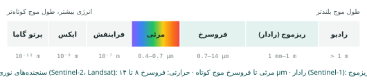
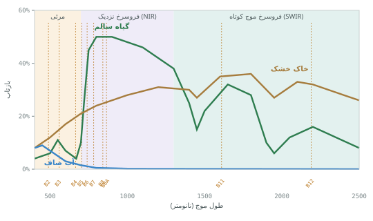

## دیدن بدون لمس

**سنجش از دور** (Remote Sensing یا **RS**) یعنی گردآوری اطلاعات درباره‌ی یک پدیده **بدون تماس فیزیکی** با آن. چشم شما هم یک سنجنده‌ی از دور
است: نوری را که از اشیا بازتاب می‌شود می‌گیرد و مغز آن را تفسیر می‌کند. سنجش از دور ماهواره‌ای همین کار را از ارتفاع صدها کیلومتری، با
سنجنده‌هایی انجام می‌دهد که نورهایی را هم «می‌بینند» که چشم ما نمی‌بیند، و هر چند روز یک بار از همه‌جای زمین تصویر برمی‌دارند.

اهمیت سنجش از دور در پاسخ به پرسش‌هایی است که با بازدید میدانی جواب دادنشان یا ممکن نیست یا بسیار گران است: سلامت گیاه در یک میلیون
هکتار مزرعه، وسعت سیل در لحظه‌ی وقوع، روند خشک شدن یک دریاچه در سی سال، گسترش شهر در یک دهه. امروز تصویرهای Sentinel-2 و Landsat رایگان‌اند
و پایگاه داده مکانی ابری آن‌ها را برای محدوده‌ی شما، بدون دانلود فریم‌های چندگیگابایتی، تحویل می‌دهد (فصل ۳۴).

### اجزای یک سامانه‌ی سنجش از دور

1. **منبع انرژی:** خورشید، یا خود سنجنده.
2. **تابش و جو:** انرژی از جو می‌گذرد و بخشی از آن پراکنده یا جذب می‌شود.
3. **برهم‌کنش با هدف:** سطح زمین بخشی از انرژی را بازتاب، بخشی را جذب و بخشی را عبور می‌دهد؛ این نسبت‌ها به جنس سطح بستگی دارد.
4. **ثبت در سنجنده:** سنجنده‌ی روی ماهواره انرژی بازگشتی را در باندهای مختلف اندازه می‌گیرد.
5. **ارسال و پردازش:** داده به ایستگاه زمینی می‌رسد و به تصویر و محصول تبدیل می‌شود.
6. **تفسیر و تحلیل:** همان کاری که در این بخش از کتاب یاد می‌گیرید.
7. **کاربرد:** تصمیم‌گیری.

**سنجش غیرفعال** (passive) از انرژی خورشید یا گرمای خود زمین استفاده می‌کند: سنجنده‌های نوری مثل Sentinel-2 و Landsat و سنجنده‌های حرارتی.
فقط در روز (برای نوری) و هوای صاف کار می‌کنند. **سنجش فعال** (active) خودش انرژی می‌فرستد و بازگشت آن را می‌گیرد: رادار (Sentinel-1) و
لیدار. شب و روز و از پشت ابر کار می‌کنند (فصل ۴۰).

## تابش الکترومغناطیس

نور یک **موج الکترومغناطیس** است و با **طول موج** ($\lambda$، فاصله‌ی دو قله) و **بسامد** ($\nu$، تعداد نوسان در ثانیه) توصیف می‌شود.
حاصل‌ضرب این دو، سرعت نور است:

$$c = \lambda \nu \qquad (c \approx 3 \times 10^8 \ \text{m/s})$$

و انرژی هر بسته‌ی نور (فوتون) با بسامد نسبت مستقیم و با طول موج نسبت عکس دارد ($E = h\nu = hc/\lambda$). یعنی طول موج‌های کوتاه پرانرژی‌ترند.
این رابطه یک نتیجه‌ی عملی دارد: انرژی‌ای که از سطح در طول موج‌های بلند (مثل فروسرخ حرارتی) می‌رسد کم است، پس سنجنده باید پیکسل‌های
بزرگ‌تری را جمع کند تا سیگنال کافی بگیرد؛ دلیل اینکه باند حرارتی Landsat تفکیک درشت‌تری دارد.

**طیف الکترومغناطیس** کل گستره‌ی طول موج‌هاست. چشم انسان فقط بخش بسیار کوچکی از آن را می‌بیند (حدود ۴۰۰ تا ۷۰۰ نانومتر):

| ناحیه | طول موج تقریبی | کاربرد در سنجش از دور |
|---|---|---|
| آبی | ۴۵۰ تا ۵۲۰ nm | عمق آب کم‌عمق، تفکیک خاک و گیاه، رنگ طبیعی |
| سبز | ۵۲۰ تا ۶۰۰ nm | قله‌ی بازتاب گیاه در مرئی، آب |
| قرمز | ۶۳۰ تا ۶۹۰ nm | جذب کلروفیل؛ تفکیک گونه‌ها |
| لبه‌ی قرمز | ۷۰۰ تا ۷۸۰ nm | حساس به مقدار کلروفیل و تنش گیاه |
| فروسرخ نزدیک (NIR) | ۷۸۰ تا ۹۰۰ nm | ساختار برگ؛ زیست‌توده؛ مرز آب و خشکی |
| فروسرخ موج کوتاه (SWIR) | ۱۵۵۰ تا ۲۳۵۰ nm | رطوبت گیاه و خاک، کانی‌ها، سوختگی |
| فروسرخ حرارتی (TIR) | ۸ تا ۱۴ µm | دمای سطح |
| ریزموج | ۱ میلی‌متر تا ۱ متر | رادار؛ زبری سطح، رطوبت، از پشت ابر |

## تابش و جو

پیش از رسیدن به سنجنده، تابش دو بار از جو می‌گذرد (رفت از خورشید و برگشت از زمین). جو دو اثر دارد:

- **پراکندگی** (scattering): ذرات و مولکول‌های جو نور را در جهت‌های مختلف پخش می‌کنند. **پراکندگی ریلی** که مولکول‌های گاز بسیار کوچک‌تر از
  طول موج ایجاد می‌کنند، با توان چهارم طول موج نسبت عکس دارد؛ پس آبی بسیار بیشتر از قرمز پراکنده می‌شود. دلیل آبی بودن آسمان همین است، و
  دلیل اینکه باند آبی تصویرها «مه‌آلودتر» از بقیه است. گرد و غبار و دود (پراکندگی مای) همه‌ی طول موج‌های مرئی را کم‌وبیش یکسان پخش و تصویر را
  کدر می‌کنند؛ پدیده‌ای آشنا در روزهای گردوغباری ایران.
- **جذب** (absorption): گازهایی مثل بخار آب، دی‌اکسید کربن و ازن بعضی طول موج‌ها را جذب می‌کنند. طول موج‌هایی که جو در آن‌ها شفاف است
  **پنجره‌های جوی** نام دارند و سنجنده‌ها باندهایشان را در همین پنجره‌ها می‌گذارند. به همین دلیل در نمودار امضای طیفی پایین، حوالی ۱۴۰۰ و
  ۱۹۰۰ نانومتر باندی نمی‌بینید: بخار آب جو تقریباً همه‌ی انرژی آن‌جا را جذب می‌کند.

حذف اثر جو از تصویر **تصحیح اتمسفری** نام دارد و فصل ۳۳ آن را توضیح می‌دهد. تصویرهایی که سامانه تحویل می‌دهد از پیش تصحیح‌شده‌اند (سطح
پردازش L2A).

## برهم‌کنش با سطح زمین

انرژی که به سطح می‌رسد سه سرنوشت دارد: **بازتاب**، **جذب** یا **عبور**. جمع این سه برابر انرژی ورودی است و نسبت آن‌ها در هر طول موج به جنس
سطح بستگی دارد. سنجنده‌ی نوری بازتاب را می‌گیرد. کسری از انرژی ورودی که بازتاب می‌شود **بازتاب طیفی** (reflectance، $\rho$) نام دارد و
عددی بین ۰ و ۱ (یا ۰ تا ۱۰۰ درصد) است.

شکل بازتاب هم مهم است. سطح صاف مثل آب آرام بازتاب **آینه‌ای** دارد: انرژی در یک جهت برمی‌گردد و اگر سنجنده در آن جهت نباشد، سطح تیره دیده
می‌شود (یا اگر باشد، درخشش خیره‌کننده). سطح زبر مثل خاک شخم‌خورده بازتاب **پخشی** دارد و از همه‌ی جهت‌ها تقریباً یکسان دیده می‌شود.

## امضای طیفی

نمودار بازتاب یک ماده در طول موج‌های مختلف را **امضای طیفی** (spectral signature) آن ماده می‌گویند؛ مثل اثر انگشت، هر ماده امضای خودش را
دارد و همین اساس تشخیص پدیده‌ها در تصویر ماهواره‌ای است.

### گیاه سالم

امضای گیاه سالم از همه‌ی سطوح طبیعی جالب‌تر است و تقریباً همه‌ی شاخص‌های گیاهی از آن می‌آیند:

1. **مرئی، بازتاب کم با قله‌ی سبز:** کلروفیل نور آبی و قرمز را برای فتوسنتز به شدت **جذب** می‌کند و سبز را بیشتر بازتاب می‌دهد؛ برای همین
   گیاه سبز دیده می‌شود. بازتاب در قرمز حدود ۴ تا ۵ درصد است.
2. **لبه‌ی قرمز:** بین ۶۸۰ و ۷۵۰ نانومتر بازتاب ناگهان چند برابر می‌شود. جای دقیق این «لبه» به مقدار کلروفیل وابسته است و با تنش گیاه به سمت
   طول موج کوتاه‌تر می‌رود؛ دلیل اینکه Sentinel-2 سه باند در این ناحیه دارد.
3. **فروسرخ نزدیک، فلات بازتاب بالا:** ساختار داخلی برگ (دیواره‌ی سلول‌ها و فضای هوای بین آن‌ها، بافت اسفنجی) فروسرخ نزدیک را پراکنده و تا
   ۴۰ تا ۵۰ درصد آن را بازتاب می‌کند. گیاه پرشاخ‌وبرگ و سالم فروسرخ بیشتری بازتاب می‌دهد؛ گیاه تحت تنش یا رو به خشکی کمتر.
4. **فروسرخ موج کوتاه:** آب داخل برگ این طول موج‌ها را جذب می‌کند. هرچه برگ آب بیشتری داشته باشد، بازتاب SWIR کمتر است؛ پایه‌ی شاخص رطوبت
   NDMI (فصل ۳۵).

اختلاف بزرگ بین قرمز (جذب شدید) و فروسرخ نزدیک (بازتاب شدید) **مهم‌ترین نشانه‌ی پوشش گیاهی** در سنجش از دور است و شاخص NDVI دقیقاً همین
اختلاف را اندازه می‌گیرد.

### خاک

بازتاب خاک با افزایش طول موج کم‌کم زیاد می‌شود و منحنی صاف‌تری دارد. سه عامل بر آن اثر دارند: **رطوبت** (خاک مرطوب در همه‌ی طول موج‌ها
تیره‌تر است)، **مواد آلی** (خاک پرماده‌ی آلی تیره‌تر) و **بافت و کانی‌ها** (اکسید آهن در خاک‌های قرمز، فرورفتگی‌هایی در منحنی ایجاد می‌کند).

### آب

آب صاف کمی آبی و سبز را بازتاب می‌دهد و فروسرخ را تقریباً کامل **جذب** می‌کند؛ پس در باند فروسرخ نزدیک تقریباً سیاه است. این ویژگی تشخیص مرز
آب و خشکی را بسیار آسان می‌کند و پایه‌ی شاخص آب NDWI است. آب گل‌آلود یا دارای جلبک، بازتاب بیشتری در سبز و قرمز دارد؛ برای همین کیفیت آب
هم تا حدی از روی رنگ آن در تصویر قابل برآورد است.

::: know
**برف و ابر.** برف در مرئی بسیار روشن است (بازتاب ۸۰ تا ۹۰ درصد) ولی در SWIR تیره؛ ابر در هر دو روشن است. این تفاوت برای جدا کردن برف از ابر
به کار می‌رود. لایه‌ی طبقه‌بندی صحنه‌ی Sentinel-2 که سامانه برای حذف ابر به کار می‌برد (فصل ۳۳) از همین منطق استفاده می‌کند.
:::

## ترکیب رنگی: دیدن نامرئی‌ها

صفحه‌ی نمایش سه رنگ دارد: قرمز، سبز و آبی. اگر سه باند تصویر را به این سه رنگ بدهیم، یک **ترکیب رنگی** ساخته‌ایم.

- **رنگ طبیعی** (true color): باند قرمز به قرمز، سبز به سبز، آبی به آبی؛ همان چیزی که چشم می‌بیند. در Sentinel-2 یعنی B4، B3، B2.
- **فروسرخ کاذب** (false color): باند فروسرخ نزدیک به قرمز، قرمز به سبز، سبز به آبی (در Sentinel-2: B8، B4، B3). چون گیاه سالم در فروسرخ
  نزدیک بسیار روشن است و این باند به کانال قرمز صفحه رفته، **گیاه به رنگ قرمز** دیده می‌شود؛ هرچه قرمزتر، پرشاخ‌وبرگ‌تر. آب سیاه یا آبی تیره،
  شهر خاکستری مایل به آبی و خاک لخت قهوه‌ای یا خاکستری دیده می‌شود.

فروسرخ کاذب از نخستین روزهای عکاسی هوایی برای تشخیص پوشش گیاهی به کار رفته است و هنوز هم سریع‌ترین راه برای «دیدن» سلامت گیاه بدون
محاسبه است. هر دو ترکیب در سامانه محصول آماده‌اند (فصل ۳۴). ترکیب‌های دیگر هم کاربرد دارند؛ مثلاً SWIR2، NIR، قرمز (B12، B8، B4) برای
مناطق سوخته و زمین‌شناسی که با محصول «همه‌ی باندها» در QGIS ساخته می‌شود.

::: real
**دریاچه‌ی ارومیه.** امضای طیفی آب (جذب کامل فروسرخ) باعث می‌شود مرز آب دریاچه در باند فروسرخ نزدیک با کنتراست بسیار بالا دیده شود. با همین
ویژگی و تصویرهای Landsat از دهه‌ی ۱۹۸۰ تا امروز، پژوهشگران روند کاهش سطح آب دریاچه را سال به سال اندازه گرفته‌اند. در فصل ۳۷ خواهید دید که با
شاخص NDWI و سری زمانی، همین کار را برای هر آبگیر دلخواه انجام می‌دهید.
:::

::: summary
- سنجش از دور گردآوری اطلاعات بدون تماس است؛ غیرفعال (نور خورشید، گرما) یا فعال (رادار، لیدار).
- $c = \lambda\nu$ و انرژی فوتون با طول موج نسبت عکس دارد. سنجنده‌های نوری از مرئی تا SWIR، حرارتی ۸ تا ۱۴ µm و رادار ریزموج را می‌گیرند.
- جو نور را پراکنده (آبی بیشتر) و جذب (بخار آب) می‌کند؛ باندها در پنجره‌های جوی‌اند.
- بازتاب طیفی کسر انرژی بازتاب‌شده است؛ امضای طیفی نمودار آن در طول موج‌هاست.
- گیاه سالم: جذب قرمز (کلروفیل)، بازتاب بالای NIR (ساختار برگ)، جذب SWIR (آب برگ). آب: جذب کامل NIR. خاک: افزایش تدریجی.
- فروسرخ کاذب (NIR، قرمز، سبز) گیاه را قرمز نشان می‌دهد.
:::

::: teach
**زمان پیشنهادی:** دو جلسه. یک برگ تازه و یک برگ خشک به کلاس بیاورید و با دوربین گوشی‌ای که فیلتر فروسرخ ضعیفی دارد (یا یک دوربین تبدیل‌شده)
تفاوت را نشان دهید. نمودار امضای طیفی را روی تخته بکشید و از دانشجوها بخواهید جای قله‌ها و دره‌ها را با دلیل فیزیکی توضیح دهند.
:::

::: exercises
### تمرین‌ها

1. [سطح ۱]{.badge .b1} سنجنده‌های فعال و غیرفعال را با دو مثال مقایسه کنید. کدام برای پایش سیل در روز ابری مناسب‌تر است؟
2. [سطح ۱]{.badge .b1} چرا گیاه در تصویر رنگ طبیعی سبز و در فروسرخ کاذب قرمز دیده می‌شود؟
3. [سطح ۱]{.badge .b1} بسامد نور قرمز با طول موج ۶۶۵ نانومتر چقدر است؟
4. [سطح ۲]{.badge .b2} از روی نمودار امضای طیفی، برای تفکیک آب از خاک کدام باند بهترین است؟ برای تفکیک گیاه از خاک؟ چرا؟
5. [سطح ۲]{.badge .b2} یک گندم‌زار سالم و همان مزرعه پس از دو هفته بی‌آبی، در کدام باندها بیشترین تفاوت را نشان می‌دهند؟
6. [سطح ۳]{.badge .b3} درباره‌ی «پراکندگی مای» و اثر گرد و غبار بر تصویرهای ماهواره‌ای ایران تحقیق کنید. چه پیامدی برای انتخاب تصویر در
   فصل‌های گردوغباری دارد؟
:::
