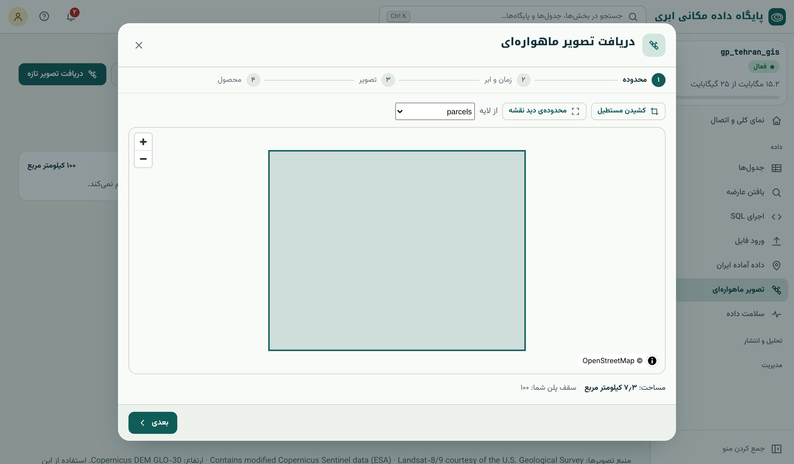
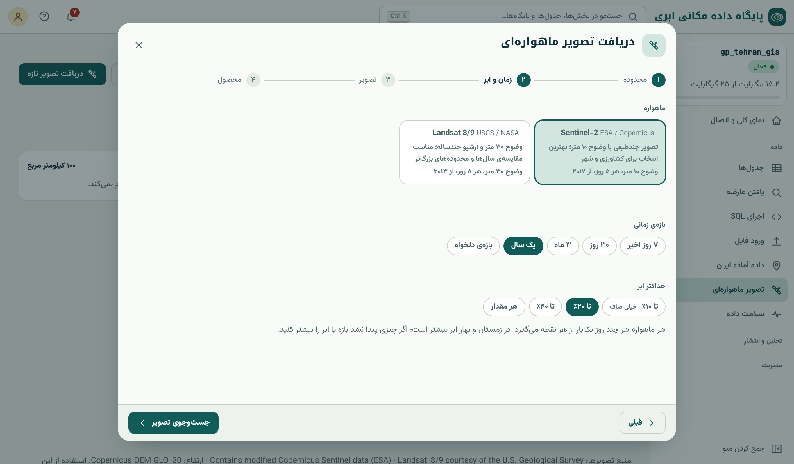
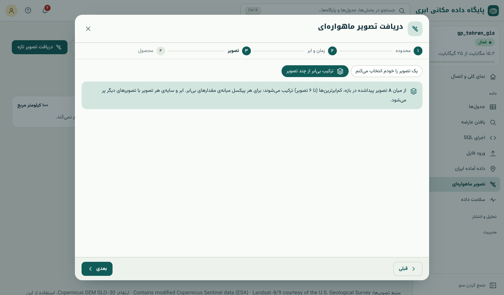
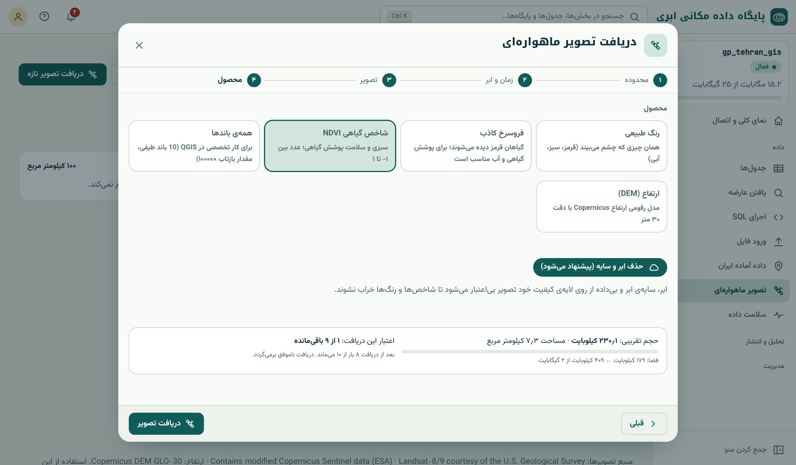
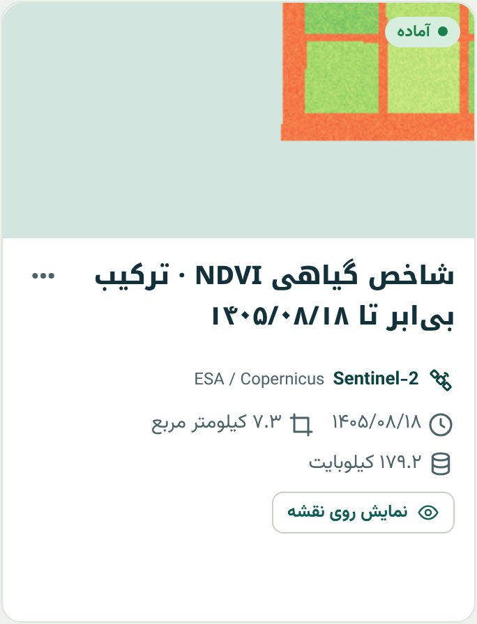
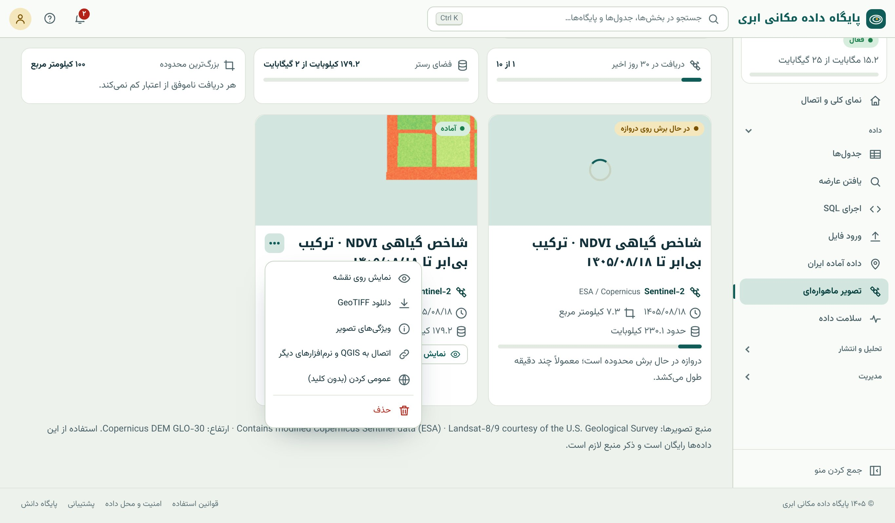

## بخش «تصویر ماهواره‌ای»

منوی کناری ← داده ← «تصویر ماهواره‌ای». این بخش دو زبانه دارد: **تصویرها** (دریافت و فهرست تصویرهای شما) و **تحلیل و سری زمانی** (آمار هر قطعه و
پایش؛ فصل‌های ۳۶ و ۳۷). بالای صفحه سه کارت سهمیه هست: تعداد دریافت در ۳۰ روز اخیر، فضای رستر مصرف‌شده و بزرگ‌ترین محدوده‌ی مجاز برای هر دریافت.

پشت صحنه، کار سنگین (جست‌وجو در کاتالوگ، خواندن تکه‌ی لازم، حذف ابر، ترکیب و ساختن محصول) روی **دروازه‌ی ماهواره**، یک سرور جداگانه، انجام
می‌شود و فایل آماده به پایگاه شما تحویل داده می‌شود (فصل ۳۳). کافی است بگویید **کجا**، **کی** و **چه محصولی**.

## گام‌به‌گام: دریافت تصویر تازه

دکمه‌ی «دریافت تصویر تازه» مودالی چهارمرحله‌ای باز می‌کند.

### ۱. محدوده

{.shot}

سه راه برای تعیین محدوده هست:

- **کشیدن مستطیل:** دو گوشه را روی نقشه بزنید.
- **محدوده‌ی دید نقشه:** همان چیزی که الان روی نقشه می‌بینید.
- **از لایه:** محدوده‌ی یکی از جدول‌های مکانی خودتان؛ دقیق‌ترین و تکرارپذیرترین راه. برای پایش مزرعه‌ها، جدول قطعه‌ها را انتخاب کنید.

مساحت محدوده و سقف پلن پایین نقشه نوشته می‌شود. محدوده را تا حد امکان کوچک بگیرید: هم زودتر آماده می‌شود و هم فضای رستر کمتری می‌گیرد.

### ۲. ماهواره، بازه‌ی زمانی و ابر

{.shot}

- **ماهواره:** Sentinel-2 (۱۰ متر، هر ۵ روز، از ۲۰۱۷) برای بیشتر کارهای کشاورزی و شهری؛ Landsat 8/9 (۳۰ متر، هر ۸ روز، از ۲۰۱۳) برای مقایسه‌ی
  سال‌های دورتر و محدوده‌های بزرگ‌تر (فصل ۳۲). هر ماهواره فقط وقتی در فهرست می‌آید که دروازه واقعاً به آن دسترسی داشته باشد.
- **بازه‌ی زمانی:** ۷ روز اخیر، ۳۰ روز، ۳ ماه، یک سال یا بازه‌ی دلخواه.
- **بیشینه‌ی ابر:** خیلی صاف (کمتر از ۱۰٪)، تا ۲۰٪، تا ۴۰٪ یا هر مقدار. یادتان باشد این درصد برای کل صحنه است (فصل ۳۳).

### ۳. تصویر: تک‌تصویر یا ترکیب بی‌ابر

{.shot}

- **یک تصویر را خودم انتخاب می‌کنم:** فهرستی از تصویرهای پیداشده با پیش‌نمایش، تاریخ (شمسی)، درصد ابر و **پوشش محدوده** نمایش داده می‌شود. پوشش
  کم یعنی تصویر فقط بخشی از محدوده‌ی شما را می‌گیرد (محدوده روی لبه‌ی مسیر ماهواره افتاده است).
- **ترکیب بی‌ابر از چند تصویر:** کم‌ابرترین تصویرهای بازه (تا شش تصویر) برای هر پیکسل میانه‌ی مقدارهای بی‌ابر را می‌دهند (فصل ۳۳). برای نقشه‌ی
  تمیز و شاخص‌های فصلی بهترین انتخاب است؛ برای رویداد یک‌روزه نه.

### ۴. محصول

{.shot}

| محصول | باندها | نوع داده | کاربرد |
|---|---|---|---|
| **رنگ طبیعی** | قرمز، سبز، آبی | ۸ بیتی | دیدن منطقه همان‌طور که چشم می‌بیند؛ نقشه‌ی پایه |
| **فروسرخ کاذب** | NIR، قرمز، سبز | ۸ بیتی | گیاه قرمز؛ تفسیر سریع پوشش گیاهی و آب (فصل ۳۱) |
| **شاخص گیاهی NDVI** | یک باند | اعشاری ۳۲ بیتی | عدد ۱- تا ۱؛ تحلیل و نقشه‌ی سلامت گیاه (فصل ۳۵) |
| **همه‌ی باندها** | ۱۰ باند (Landsat: ۶) | صحیح ۱۶ بیتی، بازتاب × ۱۰۰۰۰ | کار تخصصی: شاخص‌های دیگر، طبقه‌بندی، در QGIS |
| **ارتفاع (DEM)** | یک باند | اعشاری ۳۲ بیتی | ارتفاع ۳۰ متری Copernicus؛ بدون انتخاب تاریخ و تصویر (فصل ۳۸) |

گزینه‌ی **حذف ابر و سایه** را روشن نگه دارید. پیش از ثبت، **حجم تقریبی** و **اعتبار باقی‌مانده** نمایش داده می‌شود. اگر سقفی پر باشد، دکمه به
جای غیرفعال شدن، دلیل را با عدد می‌گوید؛ مثلاً «این تصویر حدود ۴۵ مگابایت می‌شود و فقط ۳۰ مگابایت خالی است». با «دریافت تصویر» کار ثبت می‌شود.

## پس از ثبت

کارت تازه با وضعیت «در حال برش روی دروازه» در فهرست تصویرها می‌آید. پردازش معمولاً چند دقیقه طول می‌کشد و لازم نیست صفحه باز بماند؛ پایان کار
با **اعلان** خبر داده می‌شود و کارت «آماده» می‌شود.

{.shot .phone}

منوی ⋯ هر کارت:

{.shot}

- **نمایش روی نقشه:** تصویر با رنگ‌بندی مناسب محصول (مثلاً طیف قرمز-زرد-سبز برای NDVI).
- **دانلود GeoTIFF:** فایل COG برای کار روی رایانه‌ی خودتان.
- **ویژگی‌های تصویر:** تاریخ، درصد ابر، تفکیک، ابعاد، باندها، سیستم مختصات، حجم، شناسه‌ی صحنه و مجوز استفاده.
- **اتصال به QGIS و نرم‌افزارهای دیگر:** نشانی COG و کاشی XYZ.
- **عمومی کردن:** تصویر بدون کلید API در دسترس می‌شود (مثلاً برای نقشه‌ی عمومی). تصویر خصوصی با افزودن `?key=کلید_API` به نشانی باز می‌شود.
- **حذف:** فضای رستر را فوراً آزاد می‌کند، اما اعتبار دریافت را برنمی‌گرداند.

اگر دریافتی ناموفق شود (مثلاً تصویری با این شرایط پیدا نشود)، دلیل روی کارت نوشته می‌شود و اعتبار برمی‌گردد.

## در QGIS

تصویر COG را می‌توانید بدون دانلود در QGIS باز کنید و فقط بخشی که روی صفحه است خوانده می‌شود:

::: steps
1. منوی ⋯ کارت ← «اتصال به QGIS و نرم‌افزارهای دیگر» و نشانی COG را کپی کنید.
2. در QGIS: **Layer ← Add Layer ← Add Raster Layer**، **Source Type** را **Protocol: HTTP(S), cloud, etc.** بگذارید و نشانی را بچسبانید.
3. برای «همه‌ی باندها»، در **Properties ← Symbology** نوع **Multiband color** را انتخاب و ترکیب دلخواه را بسازید؛ مثلاً باندهای ۱۰، ۸، ۱
   (SWIR2، NIR باریک، قرمز) برای مناطق سوخته و زمین‌شناسی.
4. با **Raster Calculator** شاخص‌های دیگر را بسازید (فصل ۳۵) و با پلاگین‌های طبقه‌بندی، نقشه‌ی پوشش زمین تهیه کنید (فصل ۳۹).
:::

ترتیب باندها در «همه‌ی باندها»ی Sentinel-2: ۱ قرمز، ۲ سبز، ۳ آبی، ۴ NIR، ۵ تا ۷ لبه‌ی قرمز ۱ تا ۳، ۸ NIR باریک، ۹ SWIR1، ۱۰ SWIR2. در Landsat: ۱ قرمز،
۲ سبز، ۳ آبی، ۴ NIR، ۵ SWIR1، ۶ SWIR2.

## سقف‌ها و سهمیه

| سقف | توضیح |
|---|---|
| دریافت در ۳۰ روز گذشته | هر دریافت ۳۰ روز بعد آزاد می‌شود؛ دریافت ناموفق کم نمی‌کند |
| فضای رستر | جدا از حجم جدول‌های پایگاه داده؛ حذف تصویر آزادش می‌کند |
| بزرگ‌ترین محدوده‌ی هر دریافت | به کیلومتر مربع، طبق پلن |
| دریافت هم‌زمان | حداکثر دو دریافت در حال پردازش برای هر پایگاه |

وقتی سقفی پر شد: محدوده را کوچک کنید، محصول سبک‌تری بگیرید (NDVI به جای همه‌ی باندها؛ Landsat به جای Sentinel-2)، تصویر قدیمی را حذف کنید یا پلن را ارتقا
دهید.

::: warn
**ذکر منبع الزامی است.** داده‌های Sentinel، Landsat و Copernicus DEM رایگان‌اند، اما هر جا منتشرشان می‌کنید (نقشه، گزارش، مقاله) باید منبع را ذکر کنید:
«Contains modified Copernicus Sentinel data (ESA)»، «Landsat-8/9 image courtesy of the U.S. Geological Survey» و «Copernicus DEM GLO-30». سامانه این متن را
پایین صفحه‌ی تصویرها و در ویژگی‌های هر تصویر می‌آورد.
:::

::: note
**اگر فقط عدد لازم دارید، تصویر نگیرید.** اگر هدف شما «میانگین NDVI هر قطعه در چند تاریخ» است، لازم نیست تصویر دریافت کنید؛ زبانه‌ی «تحلیل و سری
زمانی» مستقیم عدد هر قطعه را حساب و در جدول پایگاه شما می‌نویسد (فصل ۳۶). این کار سریع‌تر است، فضای رستر نمی‌گیرد و از اعتبار جداگانه‌ی تحلیل استفاده
می‌کند.
:::

::: try
برای محدوده‌ی جدول `parcels` (یا محله‌ی خودتان)، یک ترکیب بی‌ابر Sentinel-2 در یک سال اخیر با ابر تا ۲۰٪ و محصول «فروسرخ کاذب» بگیرید. روی نقشه
ببینید: کدام قطعه‌ها قرمزترند؟ سپس همان محدوده را با محصول NDVI بگیرید و در QGIS باز کنید.
:::

::: summary
- «دریافت تصویر تازه» چهار گام دارد: محدوده (مستطیل، دید نقشه یا جدول خودتان)، ماهواره و زمان و ابر، تک‌تصویر یا ترکیب بی‌ابر، محصول.
- محصول‌ها: رنگ طبیعی، فروسرخ کاذب، NDVI، همه‌ی باندها (بازتاب × ۱۰۰۰۰)، DEM.
- پردازش روی دروازه‌ی ماهواره انجام و نتیجه COG تحویل می‌شود؛ پایان کار با اعلان.
- کارت آماده: نمایش، دانلود GeoTIFF، ویژگی‌ها، نشانی QGIS، عمومی کردن.
- سقف دریافت ۳۰روزه، فضای رستر، مساحت هر دریافت و دو دریافت هم‌زمان؛ دریافت ناموفق اعتبار کم نمی‌کند.
- ذکر منبع داده‌ها الزامی است.
:::

::: teach
**زمان پیشنهادی:** یک جلسه‌ی عملی. هر دانشجو برای زادگاه یا محل زندگی خودش یک تصویر رنگ طبیعی و یک فروسرخ کاذب بگیرد و تفاوت‌ها را توضیح دهد.
برای کلاس‌های بزرگ، سقف دریافت را در نظر بگیرید و تمرین را گروهی کنید.
:::

::: exercises
### تمرین‌ها

1. [سطح ۱]{.badge .b1} یک تصویر رنگ طبیعی از محل دانشگاه یا محل کار خود دریافت کنید. در «ویژگی‌های تصویر» تاریخ، درصد ابر و سیستم مختصات را بخوانید.
2. [سطح ۱]{.badge .b1} حجم تقریبی محصول «همه‌ی باندها» را برای یک محدوده با Sentinel-2 و Landsat مقایسه کنید. نسبت آن‌ها چقدر است و چرا؟
3. [سطح ۲]{.badge .b2} تصویر «همه‌ی باندها» را در QGIS باز و سه ترکیب رنگی (طبیعی، فروسرخ کاذب، SWIR) بسازید. هر کدام چه چیزی را بهتر نشان می‌دهد؟
4. [سطح ۲]{.badge .b2} برای یک دریاچه، تصویر Landsat یک تابستان پنج سال پیش و تابستان امسال را بگیرید و تغییر سطح آب را با چشم مقایسه کنید.
:::
