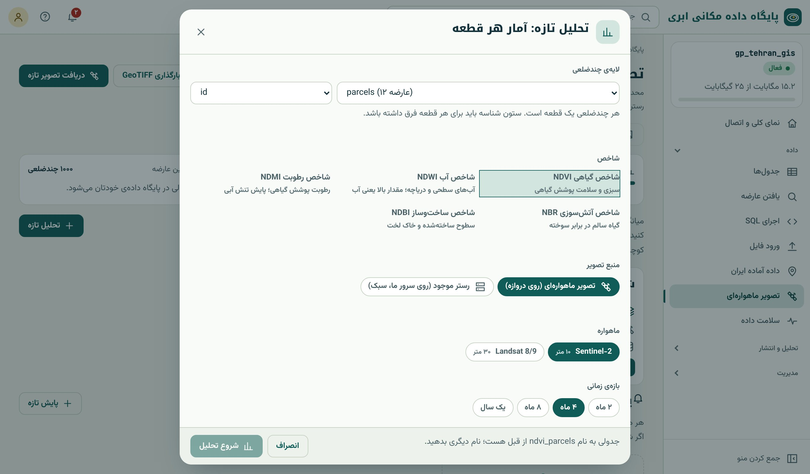
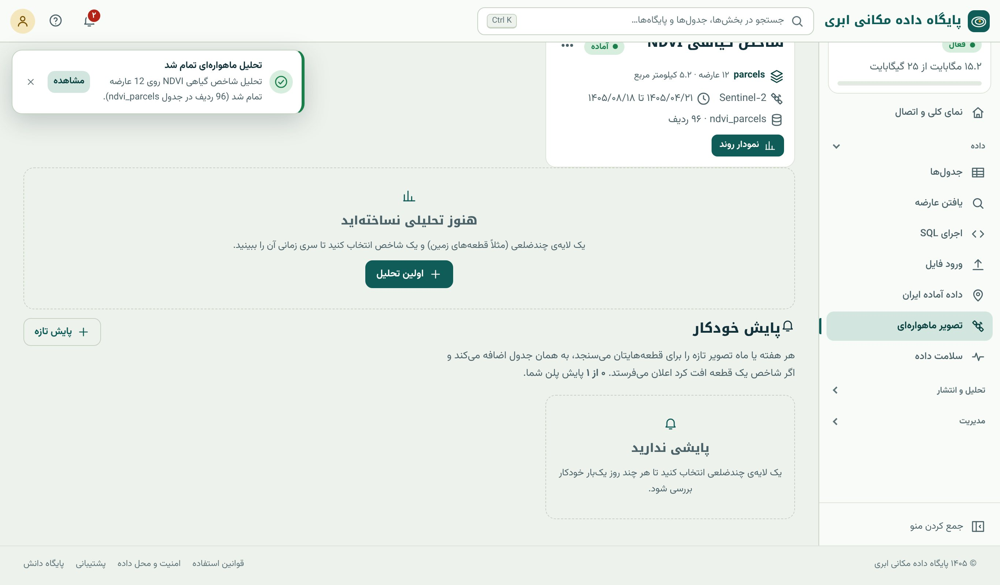

## عدد هر قطعه، نه عکس

کشاورز، کارشناس بیمه یا مدیر طرح آبیاری معمولاً تصویر نمی‌خواهد؛ می‌خواهد بداند **وضع هر قطعه** چطور است: «کدام باغ این ماه خشک‌تر شده؟»، «میانگین
NDVI مزرعه‌ی شماره‌ی ۷ چقدر است؟». **آمار ناحیه‌ای** (zonal statistics) پاسخ همین است: برای هر چندضلعی، آمار پیکسل‌های داخلش (میانگین، میانه،
کمینه، بیشینه، انحراف معیار). در فصل ۲۳ همین را با SQL روی رستر داخل پایگاه دیدیم؛ اینجا سامانه آن را مستقیم روی تصویرهای ماهواره‌ای و برای
**چند تاریخ** انجام می‌دهد، بدون اینکه تصویری دانلود یا در پایگاه ذخیره کنید.

### چالش‌های آمار ناحیه‌ای

- **پیکسل لبه:** پیکسل‌هایی که بخشی‌شان داخل قطعه است. سامانه پیکسل‌هایی را حساب می‌کند که مرکزشان داخل چندضلعی است.
- **پیکسل مختلط:** پیکسل‌های لبه بازتاب جاده یا قطعه‌ی همسایه را هم دارند (فصل ۳۲). قطعه‌ی کوچک‌تر از ده‌ها پیکسل نتیجه‌ی قابل‌اعتمادی ندارد. برای
  قطعه‌های کوچک، می‌توانید پیش از تحلیل یک **حریم منفی** ۱۰ متری بزنید (فصل ۱۸) تا پیکسل‌های لبه حذف شوند.
- **ابر:** پیکسل‌های ابری حذف می‌شوند و درصد پیکسل‌های معتبر گزارش می‌شود؛ تاریخی که بیشتر پیکسل‌های قطعه‌اش ابری است، قابل اعتماد نیست.
- **میانگین یا میانه:** میانه در برابر پیکسل‌های پرت (یک درخت تنها، یک ساختمان، ابر جامانده) مقاوم‌تر است. هر دو در نتیجه هست.

## گام‌به‌گام: تحلیل تازه

زبانه‌ی «تحلیل و سری زمانی» در بخش «تصویر ماهواره‌ای» ← «تحلیل تازه»:

{.shot}

::: steps
1. **لایه‌ی چندضلعی:** جدولی که هر سطرش یک قطعه است (اینجا `parcels`، ۱۲ عارضه). تا ۱۰۰۰ قطعه.
2. **ستون شناسه:** ستونی که برای هر قطعه یکتاست (اینجا `id`)؛ در جدول نتیجه با نام `feature_id` می‌آید.
3. **شاخص:** NDVI (سبزی گیاه)، NDWI (آب)، NDMI (رطوبت گیاه)، NBR (سوختگی) یا NDBI (ساخت‌وساز) (فصل ۳۵).
4. **منبع تصویر:** «تصویر ماهواره‌ای (روی دروازه)» که یک اعتبار تحلیل مصرف می‌کند، یا «رستری که از قبل دارید» (مثلاً NDVI که قبلاً دریافت کرده‌اید)
   که روی سرور سامانه، بدون اعتبار و فقط وقتی سرور مشغول نیست، اجرا می‌شود.
5. **ماهواره و بازه‌ی زمانی:** Sentinel-2 یا Landsat؛ ۲ ماه، ۴ ماه، ۸ ماه یا یک سال. هر تصویر کم‌ابر در بازه یک «تاریخ» در نتیجه می‌شود.
6. «شروع تحلیل». پایان کار با اعلان خبر داده می‌شود.
:::

{.shot}

## جدول نتیجه

تحلیل عکس نمی‌سازد؛ **دو شیء در پایگاه داده‌ی شما** می‌سازد که مثل هر جدول دیگری با SQL، QGIS و استودیوی نقشه قابل استفاده‌اند:

1. **جدول بلند** (مثلاً `ndvi_parcels`): یک سطر برای هر قطعه و هر تاریخ.
2. **نمای «آخرین مقدار»** (`ndvi_parcels_latest`): همان قطعه‌ها با هندسه، و آخرین مقدار شاخص هر قطعه؛ آماده‌ی رنگ‌آمیزی روی نقشه.

```{.sql .run rows=4}
SELECT feature_id, scene_date, round(mean::numeric, 3) AS mean, round(median::numeric, 3) AS median,
       round(min::numeric, 3) AS min, round(max::numeric, 3) AS max, round(std::numeric, 3) AS std,
       valid_pct, n_pixels, n_valid
FROM ndvi_parcels
ORDER BY feature_id, scene_date
LIMIT 4;
```

| ستون | معنا |
|---|---|
| `feature_id` | شناسه‌ی قطعه (از ستون شناسه‌ای که انتخاب کردید) |
| `scene_date` | تاریخ تصویر |
| `scene` | شناسه‌ی صحنه‌ی ماهواره‌ای |
| `mean`، `median`، `min`، `max`، `std` | آمار شاخص روی پیکسل‌های معتبر قطعه |
| `valid_pct` | درصد پیکسل‌های بی‌ابر |
| `n_pixels`، `n_valid` | تعداد کل پیکسل‌ها و پیکسل‌های معتبر |

::: note
**داده‌ی این فصل.** نتیجه‌هایی که در این فصل و فصل بعد می‌بینید از محیط نمایشی کتاب آمده‌اند و برای آموزش ساخته شده‌اند. اگر به تصویر ماهواره‌ای
دسترسی ندارید، فایل `ndvi_parcels.sql` همراه کتاب همین جدول را در پایگاه شما می‌سازد تا پرسش‌ها را تمرین کنید.
:::

## پرسیدن از نتیجه

**آخرین وضع هر قطعه، با کیفیت:** فقط تاریخ‌هایی که دست‌کم ۸۰ درصد پیکسل‌ها معتبرند:

```{.sql .run rows=12}
SELECT DISTINCT ON (feature_id)
       feature_id, scene_date, round(mean::numeric, 3) AS ndvi, valid_pct
FROM ndvi_parcels
WHERE valid_pct >= 80
ORDER BY feature_id, scene_date DESC;
```

`DISTINCT ON (feature_id) … ORDER BY feature_id, scene_date DESC` برای هر قطعه فقط تازه‌ترین سطر را نگه می‌دارد؛ همان الگویی که نمای `_latest` با آن
ساخته شده است (فصل ۲۴).

**رتبه‌ی قطعه‌ها در آخرین تاریخ و مقایسه با میانگین همه:**

```{.sql .run rows=5}
WITH last AS (
  SELECT feature_id, mean FROM ndvi_parcels
  WHERE scene_date = (SELECT max(scene_date) FROM ndvi_parcels)
)
SELECT feature_id,
       round(mean::numeric, 3)                                            AS ndvi,
       rank() OVER (ORDER BY mean DESC)                                   AS rank,
       round(((mean - avg(mean) OVER ()) / stddev_samp(mean) OVER ())::numeric, 2) AS z_vs_peers
FROM last
ORDER BY mean
LIMIT 5;
```

ستون `z_vs_peers` نشان می‌دهد هر قطعه چند انحراف معیار از میانگین قطعه‌های دیگر فاصله دارد. قطعه‌ای با z کمتر از ۱٫۵- در همان تاریخ و با همان کشت،
کاندید بازدید میدانی است. این مقایسه‌ی **هم‌زمان با هم‌گروه‌ها** اثر فصل و آب‌وهوا را که روی همه یکسان است حذف می‌کند.

**پیوند با ویژگی‌ها و هندسه‌ی قطعه‌ها:** چون نتیجه یک جدول معمولی است، با جدول قطعه‌ها پیوند می‌خورد (فصل ۱۳):

```{.sql .run rows=5}
SELECT p.id, p.name,
       round((ST_Area(p.geom::geography) / 10000)::numeric, 1) AS hectares,
       round(avg(r.mean)::numeric, 3)                          AS season_mean_ndvi,
       round(max(r.mean)::numeric, 3)                          AS peak_ndvi
FROM parcels p
JOIN ndvi_parcels r ON r.feature_id = p.id
WHERE r.valid_pct >= 80
GROUP BY p.id, p.name, p.geom
ORDER BY season_mean_ndvi
LIMIT 5;
```

## نقشه‌ی سلامت قطعه‌ها

نمای `ndvi_parcels_latest` هندسه‌ی قطعه‌ها و ستون‌های `sat_date`، `sat_ndvi` و `sat_valid_pct` دارد. آن را در **استودیوی نقشه‌ی چندلایه** (فصل ۴۲) با
طبقه‌بندی عددی روی `sat_ndvi` و طیف قرمز-زرد-سبز نمایش دهید، یا در QGIS با Graduated symbology. هر بار که تحلیل یا پایش تازه‌ای به جدول اضافه شود، نما
خودکار به‌روز می‌شود و نقشه هم.

::: pro
**وزن مساحت در تجمیع.** اگر چند قطعه متعلق به یک بهره‌بردار است و میانگین NDVI او را می‌خواهید، میانگین ساده‌ی قطعه‌ها قطعه‌ی کوچک و بزرگ را هم‌وزن
می‌کند. میانگین درست، وزن تعداد پیکسل معتبر را دارد: `sum(mean * n_valid) / sum(n_valid)`.
:::

::: real
**تخصیص آب.** شرکت آب منطقه‌ای برای یک شبکه‌ی آبیاری با ۸۰۰ قطعه، هر هفته NDMI همه‌ی قطعه‌ها را با «آمار هر قطعه» می‌گیرد. پرسشی ساده که قطعه‌های با
NDMI بسیار پایین‌تر از هم‌کشت‌هایشان را فهرست می‌کند، به ناظران میدانی می‌گوید کجا بروند؛ به جای بازدید از ۸۰۰ قطعه، هر هفته حدود ۴۰ قطعه.
:::

::: summary
- آمار ناحیه‌ای = آمار پیکسل‌های داخل هر چندضلعی؛ با پیکسل لبه، پیکسل مختلط و ابر مراقب باشید.
- «تحلیل تازه»: لایه، ستون شناسه، شاخص (NDVI، NDWI، NDMI، NBR، NDBI)، منبع، ماهواره و بازه؛ تا ۱۰۰۰ قطعه.
- نتیجه: جدول بلند (یک سطر برای هر قطعه و تاریخ با mean، median، min، max، std، valid_pct) و نمای `_latest` با هندسه.
- با `valid_pct` تاریخ‌های ابری را کنار بگذارید؛ `DISTINCT ON` آخرین مقدار، تابع پنجره‌ای رتبه و z نسبت به هم‌گروه‌ها.
- نتیجه جدولی معمولی است: پیوند با قطعه‌ها، نقشه در استودیو و QGIS.
:::

::: teach
**زمان پیشنهادی:** یک جلسه. پیش از اجرای تحلیل، از دانشجوها بخواهید روی تصویر فروسرخ کاذب حدس بزنند کدام قطعه ضعیف‌تر است؛ بعد با جدول نتیجه
حدس‌ها را بسنجند. پرسش z نسبت به هم‌گروه‌ها پایه‌ی خوبی برای بحث درباره‌ی «مقایسه‌ی منصفانه» است.
:::

::: exercises
### تمرین‌ها

1. [سطح ۱]{.badge .b1} برای جدول `parcels` یک تحلیل NDVI در ۴ ماه اخیر بگیرید (یا فایل `ndvi_parcels.sql` را اجرا کنید). جدول چند سطر دارد؟
2. [سطح ۱]{.badge .b1} کدام تاریخ کمترین میانگین `valid_pct` را دارد؟ چرا؟
3. [سطح ۲]{.badge .b2} برای هر قطعه، تاریخ اوج NDVI و مقدار آن را بدهید (`DISTINCT ON` با ترتیب `mean DESC`).
4. [سطح ۲]{.badge .b2} نمای `ndvi_parcels_latest` را در استودیوی نقشه با طبقه‌بندی پنج‌طبقه‌ای نمایش دهید.
5. [سطح ۳]{.badge .b3} با حریم منفی ۱۰ متری، لایه‌ی `parcels_inner` بسازید و تحلیل را روی آن تکرار کنید. میانگین‌ها چقدر تغییر کرد؟ چرا؟
:::
