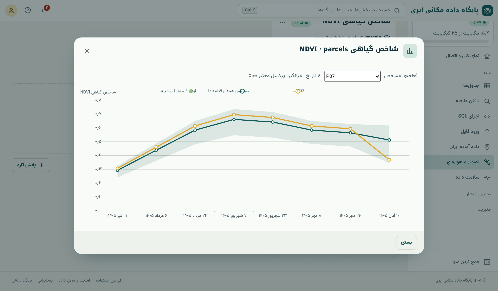
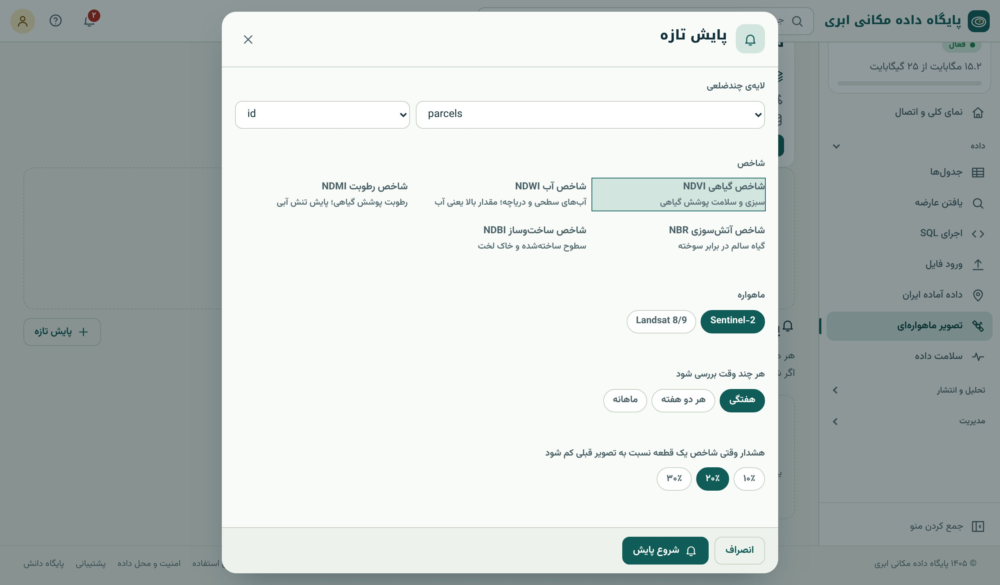

## زمان، بُعد چهارم

یک تصویر عکسی از یک لحظه است. اما گیاه زنده است: سبز می‌شود، رشد می‌کند، به اوج می‌رسد، زرد می‌شود و برداشت می‌شود. **سری زمانی** شاخص طیفی این
داستان را روایت می‌کند و بسیاری از پرسش‌ها فقط با آن پاسخ می‌گیرند: «این مزرعه کی کاشته شد؟»، «امسال از پارسال بهتر است؟»، «چرا این قطعه یک‌باره
افت کرد؟».

## فنولوژی

**فنولوژی** (phenology) مطالعه‌ی رویدادهای چرخه‌ی زندگی گیاه در ارتباط با فصل است. منحنی NDVI یک محصول زراعی در یک فصل معمولاً این مراحل را دارد:

1. **پیش از کاشت یا خاک لخت:** NDVI پایین (۰٫۱ تا ۰٫۲).
2. **سبز شدن** (green-up): افزایش تند NDVI با رشد برگ‌ها.
3. **اوج** (peak): بیشترین پوشش برگ؛ برای گندم حدود زمان خوشه‌دهی.
4. **پیری** (senescence): زرد شدن برگ‌ها و کاهش تدریجی NDVI.
5. **برداشت:** افت ناگهانی به سطح خاک.

شکل منحنی برای هر محصول متفاوت است و همین تفاوت، پایه‌ی **تشخیص نوع کشت** از روی سری زمانی است: گندم پاییزه در اسفند و فروردین اوج می‌گیرد، ذرت
تابستانه در مرداد، و باغ و یونجه تقریباً همه‌ی سال سبزند. افت ناگهانی وسط فصل رشد، که با چرخه‌ی طبیعی جور نیست، **هشدار** است: کم‌آبی، آفت،
سرمازدگی، تگرگ یا برداشت زودهنگام.

## نمودار روند در سامانه

روی کارت هر تحلیل (فصل ۳۶) دکمه‌ی «نمودار روند» هست. نمودار به‌طور پیش‌فرض **میانگین همه‌ی قطعه‌ها** را با نوار **کمینه تا بیشینه** نشان می‌دهد و
با فهرست بالای آن می‌توان **یک قطعه‌ی مشخص** را کنار میانگین دید. تاریخ‌ها شمسی‌اند.

{.shot}

منحنی میانگین یک فصل رشد کامل را نشان می‌دهد: سبز شدن در تیر، اوج در شهریور و پیری تدریجی تا آبان. قطعه‌ی P07 تا مهر هم‌پای بقیه است، اما در آخرین
تاریخ افتی محسوس دارد؛ دقیقاً همان چیزی که پایش خودکار باید خبر بدهد.

## سری زمانی با SQL

جدول نتیجه یک سری زمانی «بلند» است (یک سطر برای هر قطعه و تاریخ) و توابع پنجره‌ای (فصل ۱۲) ابزار طبیعی کار با آن‌اند.

### تغییر نسبت به تاریخ قبل

```{.sql .run rows=8}
SELECT feature_id, scene_date,
       round(mean::numeric, 3)                                                              AS ndvi,
       round((mean - lag(mean) OVER w)::numeric, 3)                                         AS change,
       round((100 * (mean - lag(mean) OVER w) / lag(mean) OVER w)::numeric, 1)              AS change_pct
FROM ndvi_parcels
WHERE feature_id = 'P07'
WINDOW w AS (PARTITION BY feature_id ORDER BY scene_date)
ORDER BY scene_date;
```

بند `WINDOW w AS (…)` تعریف پنجره را یک بار می‌نویسد تا در چند ستون تکرار نشود. افت آخرین تاریخ P07 حدود ۳۸ درصد است، در حالی که افت‌های پیش از آن (پیری طبیعی) زیر ۱۰ درصد بودند.

### میانگین متحرک و تاریخ اوج

میانگین متحرک نوسان‌های تصادفی (پیکسل ابری جامانده، تفاوت زاویه‌ی دید) را هموار می‌کند:

```{.sql .run rows=12}
WITH s AS (
  SELECT feature_id, scene_date, mean,
         avg(mean) OVER (PARTITION BY feature_id ORDER BY scene_date ROWS BETWEEN 2 PRECEDING AND CURRENT ROW) AS ma3
  FROM ndvi_parcels
)
SELECT DISTINCT ON (feature_id)
       feature_id, scene_date AS peak_date, round(ma3::numeric, 3) AS peak_ndvi_ma3
FROM s
ORDER BY feature_id, ma3 DESC;
```

تاریخ اوج هر قطعه را داریم؛ اگر قطعه‌ای خیلی زودتر یا دیرتر از بقیه به اوج برسد، احتمالاً تاریخ کاشت یا نوع کشتش فرق دارد.

### روند کلی

شیب رگرسیون خطی NDVI بر حسب زمان، روند کلی را در یک عدد می‌دهد (اینجا برای دو ماه آخر، یعنی مرحله‌ی پیری):

```{.sql .run rows=5}
SELECT feature_id,
       round((regr_slope(mean, scene_date - date '2026-01-01') * 30)::numeric, 3) AS ndvi_change_per_month,
       round(regr_r2(mean, scene_date - date '2026-01-01')::numeric, 2)           AS r2
FROM ndvi_parcels
WHERE scene_date >= (SELECT max(scene_date) - 60 FROM ndvi_parcels)
GROUP BY feature_id
ORDER BY ndvi_change_per_month
LIMIT 5;
```

`regr_slope(y, x)` شیب خط را می‌دهد؛ چون x به روز است، در ۳۰ ضرب کرده‌ایم تا «تغییر در ماه» بخوانیم. `regr_r2` نشان می‌دهد خط چقدر داده را توضیح می‌دهد.

::: warn
**خطاهای رایج تفسیر.**
- **مقایسه‌ی دو تاریخ دلخواه:** «NDVI امروز از ماه پیش کمتر است» ممکن است فقط پیری طبیعی باشد. مقایسه را با قطعه‌های هم‌کشت (فصل ۳۶) یا با همان تاریخ
  سال قبل انجام دهید.
- **تاریخ ابری:** یک تاریخ با پیکسل‌های ابری جامانده افت کاذب می‌سازد؛ `valid_pct` را بسنجید و به میانگین متحرک یا میانه نگاه کنید.
- **تغییر ماهواره:** مقدار NDVI حاصل از Landsat و Sentinel-2 برای یک سطح اندکی متفاوت است (باندها کاملاً یکسان نیستند). یک سری زمانی را با یک ماهواره بسازید.
:::

## پایش خودکار

تحلیل یک‌باره گذشته را نشان می‌دهد؛ **پایش خودکار** آینده را می‌پاید. پایش، لایه‌ی قطعه‌ها را با یک شاخص در فاصله‌های منظم بررسی می‌کند، تصویرهای تازه را
به همان جدول اضافه می‌کند و اگر شاخص قطعه‌ای افت کند، **اعلان** می‌فرستد.

{.shot}

::: steps
1. زبانه‌ی «تحلیل و سری زمانی» ← «پایش تازه».
2. لایه‌ی چندضلعی و ستون شناسه (تا ۱۰۰۰ قطعه).
3. شاخص: برای سلامت گیاه NDVI، برای تنش آبی NDMI.
4. ماهواره (برای سری زمانی یکدست، همانی که تحلیل اولیه با آن گرفته شده).
5. **هر چند وقت بررسی شود:** هفتگی، هر دو هفته یا ماهانه.
6. **هشدار وقتی شاخص یک قطعه نسبت به تصویر قبل کم شود:** ۱۰، ۲۰ یا ۳۰ درصد.
7. «شروع پایش».
:::

قاعده‌های پایش:

- هر بار فقط تصویرهای **تازه‌تر** از آخرین تصویر پردازش‌شده سنجیده و به جدول اضافه می‌شوند؛ تاریخچه کامل می‌ماند.
- مقایسه با **تصویر بی‌ابر قبلی** همان قطعه است.
- قطعه‌ای که **کمتر از نیمی** از پیکسل‌هایش بی‌ابر است در مقایسه نمی‌آید (تا ابر هشدار کاذب نسازد).
- پایش از اعتبار تحلیل کم نمی‌کند؛ سقفش «تعداد پایش» پلن است. از منوی ⋯ کارت پایش می‌توان آن را متوقف، از سر گرفت یا همان لحظه اجرا کرد.
- هشدار در **مرکز اعلان‌ها** (زنگوله) با نام قطعه‌ها می‌آید.

### منطق پایش با SQL

دانستن منطق پایش کمک می‌کند هشدارها را بفهمید یا قاعده‌ی خودتان را بسازید. همان قاعده‌ی «افت دست‌کم ۲۰ درصد نسبت به تصویر بی‌ابر قبلی، فقط با بیش
از نیمی پیکسل معتبر» به SQL:

```{.sql .run}
WITH clear AS (
  SELECT feature_id, scene_date, mean,
         lag(mean)       OVER (PARTITION BY feature_id ORDER BY scene_date) AS prev_mean,
         lag(scene_date) OVER (PARTITION BY feature_id ORDER BY scene_date) AS prev_date
  FROM ndvi_parcels
  WHERE valid_pct >= 50
)
SELECT feature_id, prev_date, scene_date,
       round(prev_mean::numeric, 3) AS before, round(mean::numeric, 3) AS after,
       round((100 * (prev_mean - mean) / prev_mean)::numeric, 1) AS drop_pct
FROM clear
WHERE scene_date = (SELECT max(scene_date) FROM ndvi_parcels)
  AND mean <= prev_mean * 0.80
ORDER BY drop_pct DESC;
```

سه قطعه هشدار می‌گیرند. P07 و P11 همان‌هایی‌اند که در فصل ۳۶ به‌طور محسوسی پایین‌تر از هم‌گروه‌ها بودند (z حدود ۱٫۷- و ۱٫۹-). اما P03 با z حدود ۰٫۴-
در آخرین تاریخ هنوز نزدیک میانگین است: افتش بخشی از پیری طبیعی آخر فصل است که در این قطعه کمی تندتر رخ داده. اگر شرط «و z نسبت به هم‌گروه‌ها کمتر از
۱-» (فصل ۳۶) را به قاعده اضافه کنید، P03 کنار می‌رود و فقط دو هشدار واقعی می‌ماند؛ قاعده‌ای که برای آخر فصل رشد دقیق‌تر است (تمرین ۴). با تغییر عدد
`0.80` هم حساسیت را بسنجید.

::: real
**هشدار سرمازدگی.** در یک تعاونی باغداری، پایش هفتگی NDVI روی ۳۵۰ باغ تعریف شده است. یک هفته پس از سرمای دیررس فروردین، اعلان پایش ۲۷ باغ را با افت
بیش از ۲۰ درصد فهرست کرد. کارشناسان پیش از آنکه باغداران ادعای خسارت ثبت کنند، از همان ۲۷ باغ بازدید کردند و گزارش خسارت در یک هفته به جای یک ماه
آماده شد.
:::

::: summary
- سری زمانی چرخه‌ی زندگی گیاه را نشان می‌دهد: خاک، سبز شدن، اوج، پیری، برداشت؛ شکل منحنی نوع کشت را آشکار می‌کند.
- نمودار روند سامانه میانگین قطعه‌ها، نوار کمینه-بیشینه و یک قطعه‌ی مشخص را نشان می‌دهد.
- با SQL: `lag` برای تغییر، میانگین متحرک با `ROWS BETWEEN`، `DISTINCT ON` برای اوج، `regr_slope` برای روند.
- مقایسه را با هم‌گروه‌ها یا سال قبل انجام دهید؛ ابر و تغییر ماهواره را کنترل کنید.
- پایش خودکار: تناوب (هفتگی، دوهفته، ماهانه) و آستانه‌ی افت (۱۰، ۲۰، ۳۰٪) نسبت به تصویر بی‌ابر قبلی؛ قطعه‌های با کمتر از نیمی پیکسل معتبر کنار
  گذاشته می‌شوند؛ هشدار در اعلان‌ها.
:::

::: teach
**زمان پیشنهادی:** دو جلسه. منحنی فنولوژی گندم، ذرت و یونجه را روی تخته بکشید و از دانشجوها بخواهید از روی نمودار روند یک قطعه‌ی واقعی حدس بزنند
چه کشتی است. پرسش «منطق پایش» را با آستانه‌های مختلف اجرا کنید تا مفهوم هشدار کاذب و از دست رفته (دقت و فراخوانی) ملموس شود.
:::

::: exercises
### تمرین‌ها

1. [سطح ۱]{.badge .b1} نمودار روند تحلیل خود را باز کنید. اوج فصل در چه تاریخی است؟ کدام قطعه با بقیه فرق دارد؟
2. [سطح ۲]{.badge .b2} برای هر قطعه، بیشترین افت بین دو تاریخ متوالی و تاریخ آن را بدهید.
3. [سطح ۲]{.badge .b2} قاعده‌ی پایش را با آستانه‌ی ۱۰، ۲۰ و ۳۰ درصد اجرا کنید. چند قطعه در هر حالت هشدار می‌گیرد؟
4. [سطح ۳]{.badge .b3} قاعده‌ی هشدار تازه‌ای بنویسید که فقط وقتی هشدار دهد که افت نسبت به تاریخ قبل دست‌کم ۱۵ درصد **و** z قطعه نسبت به هم‌گروه‌ها در
   همان تاریخ کمتر از ۱- باشد.
5. [سطح ۳]{.badge .b3} با `CREATE VIEW` نمایی بسازید که برای هر قطعه، آخرین NDVI، تغییر نسبت به تاریخ قبل و رتبه‌ی آن را بدهد، و آن را با هندسه‌ی قطعه‌ها
   روی نقشه ببرید.
:::
