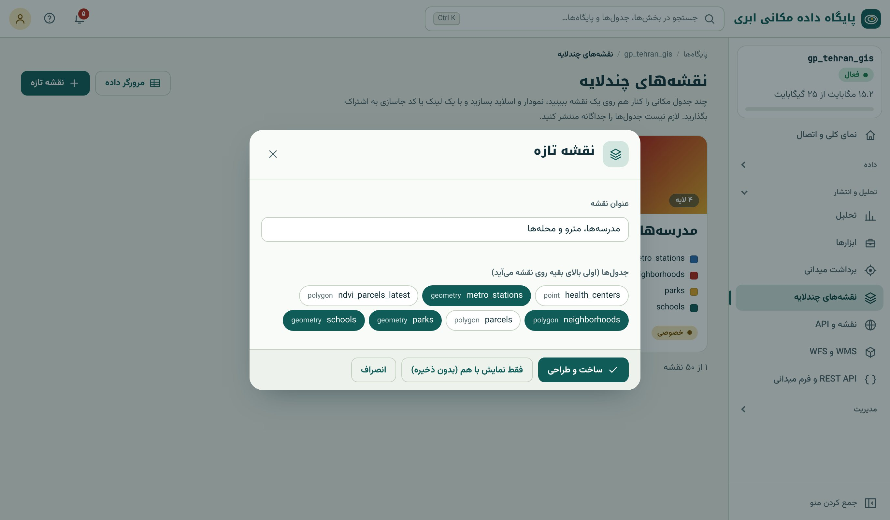
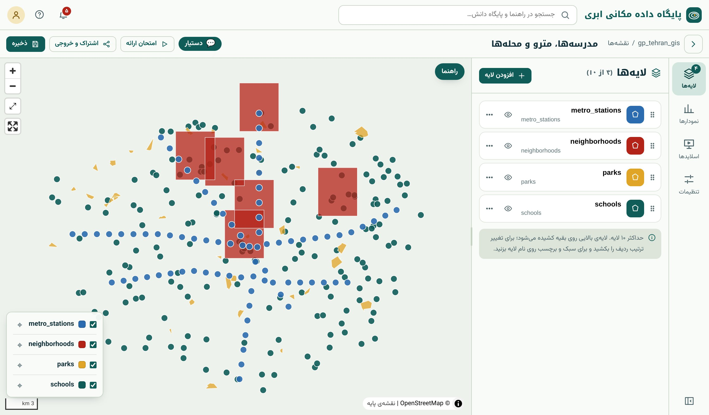
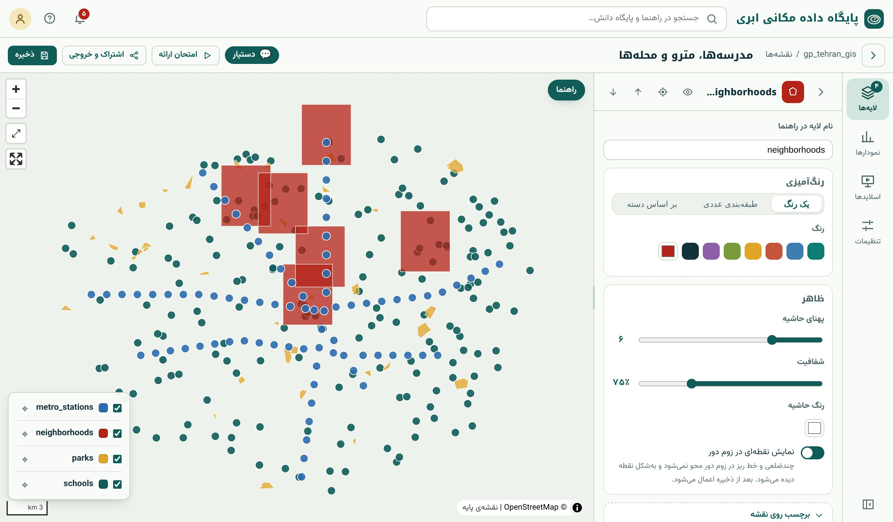

## نمایش با هم و نقشه‌ی ذخیره‌شده

دو راه برای دیدن چند جدول روی یک نقشه هست:

- **نمایش با هم** (بدون ذخیره): در «جدول‌ها» چند جدول مکانی را تیک بزنید و «نمایش با هم روی نقشه»؛ هر لایه رنگ جدا دارد. حداکثر ۱۰ جدول، بدون سقف تعداد.
- **نقشه‌ی چندلایه‌ی ذخیره‌شده:** منوی تحلیل و انتشار ← «نقشه‌های چندلایه» ← «نقشه‌ی تازه». نقشه با سبک، نمودار، اسلاید و نمای شروع ذخیره می‌شود و با لینک یا iframe
  به اشتراک گذاشته می‌شود. تعداد نقشه و لایه‌ی هر نقشه به پلن بستگی دارد.

{.shot}

## استودیو

پس از «ساخت و طراحی»، **استودیوی نقشه** باز می‌شود: نقشه در وسط، پنل در کنار با چهار زبانه‌ی **لایه‌ها**، **نمودارها**، **اسلایدها** و **تنظیمات**، و نوار بالا با
«ذخیره»، «اشتراک و خروجی» و «اجرای ارائه».

{.shot .wide}

### لایه‌ها

- **ترتیب** با کشیدن؛ لایه‌ی بالاتر روی بقیه کشیده می‌شود. قاعده‌ی کلی: نقطه بالای خط، خط بالای چندضلعی.
- **روشن/خاموش** با آیکون چشم.
- **⌖ رفتن به محدوده‌ی لایه**؛ لایه‌ی روشنی که بیرون از دید است نشان «بیرون از دید» با پیکان جهت می‌گیرد.
- **افزودن لایه** از جدول‌های پایگاه؛ یا از صفحه‌ی هر جدول با «افزودن به نقشه».

### سبک هر لایه

{.shot}

| سبک | کاربرد | تنظیم‌ها |
|---|---|---|
| **یک رنگ** | نمایش وجود و مکان | رنگ، اندازه یا پهنا، شفافیت، حاشیه |
| **طبقه‌بندی عددی** | نقشه‌ی کروپلت و نماد درجه‌بندی‌شده | ستون عددی، روش (فاصله‌ی برابر، چندک، …)، تعداد طبقه، طیف رنگ (فصل ۴۱) |
| **بر اساس دسته** | داده‌ی اسمی (نوع، کاربری، خط) | ستون دسته‌ای، رنگ هر دسته |
| **برچسب** | نام روی نقشه | ستون، اندازه |
| **پنجره‌ی اطلاعات** | کلیک روی عارضه | ستون‌هایی که نمایش داده شوند |

::: note
**پنجره‌ی اطلاعات و حریم داده.** اگر برای پنجره‌ی اطلاعات ستون انتخاب کنید، **فقط همان ستون‌ها** (به‌علاوه‌ی ستون رنگ و برچسب) در کاشی‌های نقشه فرستاده می‌شوند. این
یعنی ستون‌های حساس (تلفن، کد ملی، …) در نقشه‌ی عمومی دیده نمی‌شوند، حتی برای کسی که داده‌ی کاشی را بخواند. پیش از عمومی کردن نقشه، ستون‌های پنجره را بازبینی کنید.
:::

«نمایش نقطه‌ها در زوم دور»: چندضلعی و خط ریز در زوم دور به شکل نقطه دیده می‌شوند تا گم نشوند.

### تنظیمات

نقشه‌ی پایه (از جمله نقشه‌ی پایه‌ی فارسی سامانه؛ فصل ۳۰)، **نمای شروع** (نمایی که نقشه با آن باز می‌شود؛ «ذخیره‌ی نمای فعلی») و توضیح نقشه.

## کارایی: کاشی برداری

نقشه‌ی چندلایه داده را به شکل **کاشی برداری** (MVT) می‌فرستد: در هر بزرگ‌نمایی فقط کاشی‌های روی صفحه، ساده‌شده برای همان مقیاس (فصل ۱۸)، بارگذاری می‌شوند. برای همین
سقف ۲۰۰۰ عارضه‌ی زبانه‌ی نقشه‌ی جدول (فصل ۸) اینجا وجود ندارد و جدول‌های صدهزار عارضه‌ای هم روان نمایش داده می‌شوند، به شرطی که شاخص مکانی داشته باشند (فصل ۲۰).

::: try
نقشه‌ای با محله‌ها (طبقه‌بندی عددی روی تراکم جمعیت؛ ابتدا ستون تراکم را با SQL فصل ۴۱ به جدول اضافه کنید)، پارک‌ها (سبز، نیمه‌شفاف) و مدرسه‌ها (بر اساس مقطع با سه رنگ)
بسازید. برای مدرسه‌ها پنجره‌ی اطلاعات با نام و تعداد دانش‌آموز تنظیم کنید، نمای شروع را ذخیره و نقشه را ذخیره کنید.
:::

::: summary
- «نمایش با هم» برای دیدن سریع (تا ۱۰ جدول)؛ «نقشه‌ی چندلایه» برای نقشه‌ی ماندگار با سبک، نمودار و اسلاید.
- استودیو: لایه‌ها، نمودارها، اسلایدها، تنظیمات؛ ترتیب با کشیدن.
- سبک: یک رنگ، طبقه‌بندی عددی، بر اساس دسته؛ برچسب و پنجره‌ی اطلاعات (فقط ستون‌های انتخابی فرستاده می‌شوند).
- کاشی برداری محدودیت تعداد عارضه ندارد؛ شاخص مکانی لازم است.
:::

::: exercises
### تمرین‌ها

1. [سطح ۱]{.badge .b1} نقشه‌ای از ایستگاه‌های مترو بر اساس خط (چهار رنگ) با برچسب نام بسازید.
2. [سطح ۲]{.badge .b2} نمای `ndvi_parcels_latest` (فصل ۳۶) را با طبقه‌بندی عددی پنج‌طبقه‌ای و طیف مناسب پوشش گیاهی نمایش دهید.
3. [سطح ۲]{.badge .b2} نتیجه‌ی کانون داغ فصل ۲۱ را با طرح رنگ واگرا نمایش دهید.
:::
