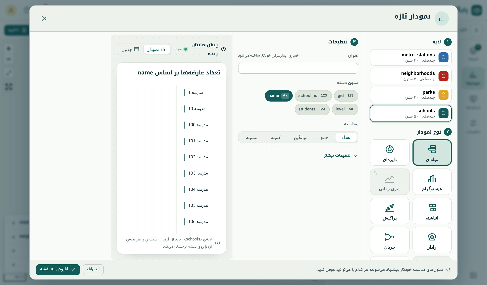
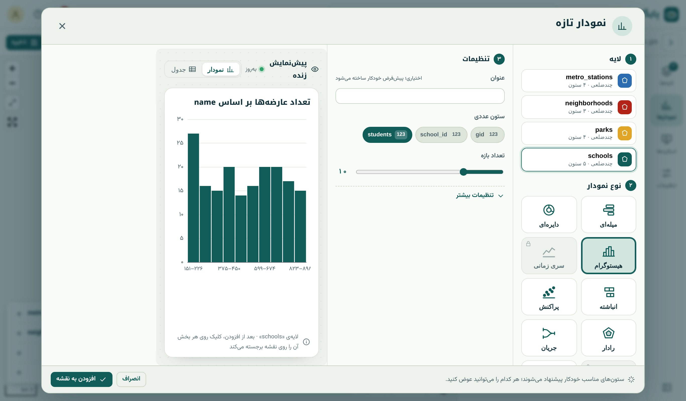
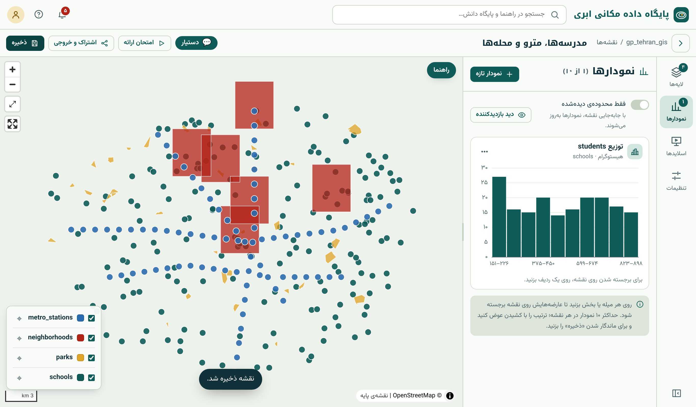

## نقشه و نمودار، دو چشم یک داده

نقشه می‌گوید «کجا» و نمودار می‌گوید «چقدر» و «چگونه توزیع شده». کنار هم، تصویری کامل می‌سازند: نقشه‌ی تراکم مدرسه‌ها با هیستوگرام تعداد دانش‌آموز، یا نقشه‌ی سلامت
مزرعه‌ها با سری زمانی NDVI. در استودیوی نقشه، نمودارها به نقشه **وصل‌اند**: کلیک روی یک میله یا دسته عارضه‌هایش را روی نقشه برجسته می‌کند و گزینه‌ی «فقط محدوده‌ی
دیده‌شده» نمودار را با جابه‌جایی نقشه به‌روز می‌کند.

## ساختن نمودار

زبانه‌ی «نمودارها» در استودیو ← «نمودار تازه». مودال سه بخش دارد: **لایه**، **نوع نمودار** و **تنظیمات**، با پیش‌نمایش زنده.

{.shot .wide}

## کدام نمودار، برای کدام پرسش

| نوع | پرسش | نمونه | تجمیع SQL (فصل ۱۲) |
|---|---|---|---|
| **کارت عددی** | یک عدد کلیدی | کل دانش‌آموزان | `sum(students)` |
| **میله‌ای** | مقایسه‌ی دسته‌ها | مدرسه به تفکیک مقطع | `count(*) GROUP BY level` |
| **دایره‌ای** | سهم از کل (دسته‌های کم) | سهم هر نوع مرکز درمانی | `count(*) GROUP BY type` |
| **هیستوگرام** | توزیع یک متغیر عددی | توزیع تعداد دانش‌آموز | `width_bucket` |
| **سری زمانی** | روند در زمان (تاریخ شمسی) | NDVI قطعه‌ها | `GROUP BY date_trunc(…)` |
| **ستونی انباشته / ۱۰۰٪** | ترکیب دسته‌ها در گروه‌ها | سهم کاربری در هر محله | دو ستون گروه‌بندی |
| **پراکنش** | رابطه‌ی دو متغیر | جمعیت و تعداد مدرسه | نمونه‌ی ۲۰۰۰ نقطه |
| **رادار** | مقایسه‌ی چند شاخص | پروفایل محله‌ها | چند تجمیع |
| **جریان (Sankey)** | از ← به | تغییر کاربری (فصل ۲۷) | خروجی «تغییر بین دو نسخه» |
| **پروفیل ارتفاعی** | ارتفاع در امتداد خط | مسیر کوهستانی | خط Z (فصل ۳۸) |

{.shot}

همه‌ی تجمیع‌ها **در PostGIS** انجام می‌شود، نه در مرورگر؛ پس نمودار روی جدول‌های بزرگ هم سریع است. هیستوگرام می‌تواند **درصد تجمعی** هم نشان دهد و هم‌مرز با
طبقه‌بندی رنگی لایه است؛ ابزاری عالی برای دیدن اینکه طبقه‌بندی چطور داده را بُریده است (فصل ۴۱).

{.shot .wide}

## داشبورد و نقشه‌ی عمومی

- **چیدمان داشبورد:** نمودارها را در کنار نقشه به شکل داشبورد بچینید (تا سقف نمودار پلن).
- **نقشه‌ی عمومی و iframe:** نمودارها در نقشه‌ی عمومی (فصل ۴۴) هم دیده می‌شوند. داده‌ی هر نمودار نشانی JSON خودش را دارد که برای برنامه‌های دیگر هم قابل استفاده است؛
  هر بار خواندنش از سقف درخواست روزانه کم می‌شود.
- **از تحلیل به نمودار:** خروجی ابزارهایی مثل «سهم همپوشانی» و «شمارش در چندضلعی» با دکمه‌ی «نقشه و نمودار»، نقشه با نمودار پیشنهادی می‌سازد (فصل ۲۵).

::: warn
**نمودار دایره‌ای را کم به کار ببرید.** چشم زاویه و مساحت را بسیار بدتر از طول مقایسه می‌کند. برای بیش از چهار پنج دسته یا مقایسه‌ی دقیق، نمودار میله‌ای مرتب‌شده تقریباً
همیشه بهتر است. نمودار دایره‌ای فقط وقتی پیام «سهم از کل» است و دسته‌ها کم‌اند.
:::

::: summary
- نمودارهای استودیو به نقشه وصل‌اند: کلیک روی دسته عارضه‌ها را برجسته می‌کند؛ «فقط محدوده‌ی دیده‌شده» نمودار را با نقشه به‌روز می‌کند.
- انواع: کارت، میله‌ای، دایره‌ای، هیستوگرام (هم‌مرز با طبقه‌بندی)، سری زمانی شمسی، انباشته، پراکنش، رادار، Sankey، پروفیل ارتفاعی.
- تجمیع در PostGIS؛ نمودار در نقشه‌ی عمومی و iframe هم هست.
:::

::: exercises
### تمرین‌ها

1. [سطح ۱]{.badge .b1} نمودار میله‌ای تعداد مدرسه به تفکیک مقطع و کارت عددی کل دانش‌آموزان را به نقشه اضافه کنید.
2. [سطح ۲]{.badge .b2} SQL معادل هیستوگرام ده‌بازه‌ای تعداد دانش‌آموز را با `width_bucket` بنویسید و با نمودار مقایسه کنید.
3. [سطح ۲]{.badge .b2} برای جدول `ndvi_parcels` نمودار سری زمانی بسازید.
:::
