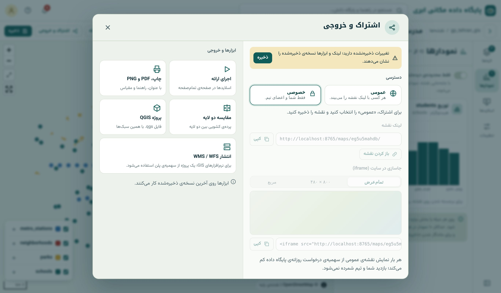
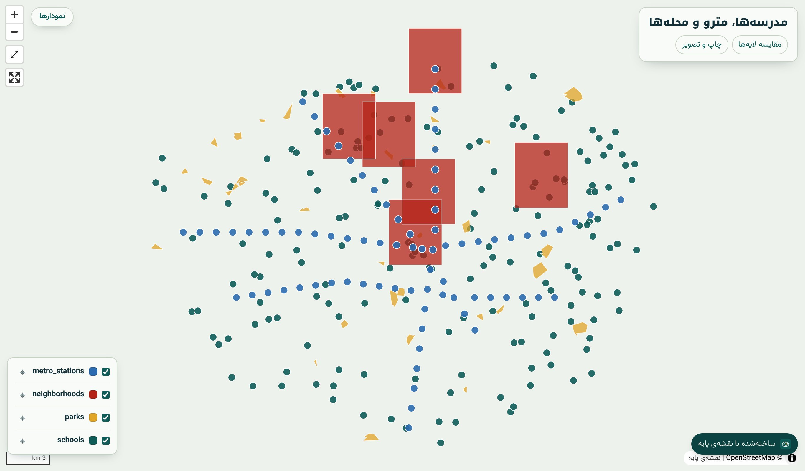
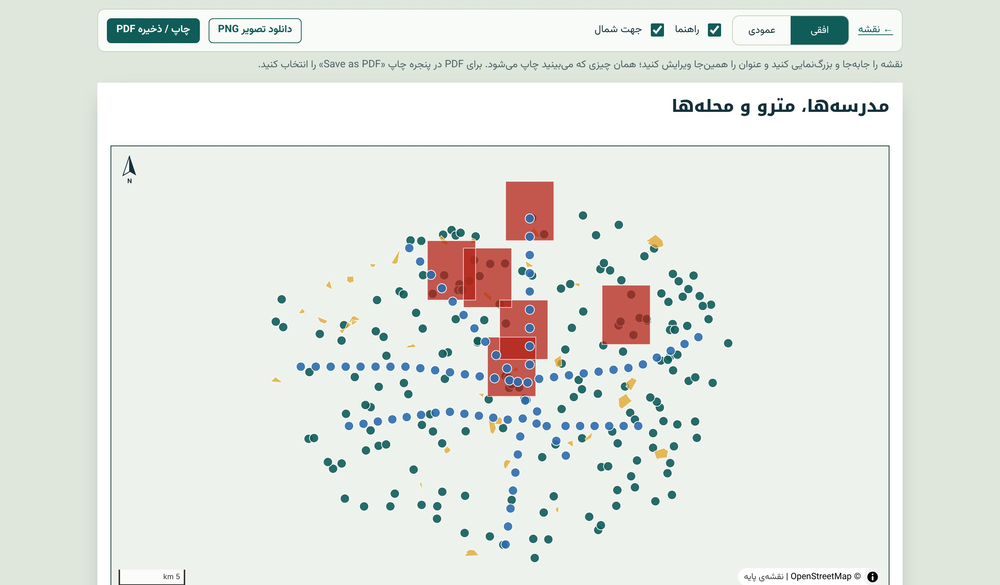
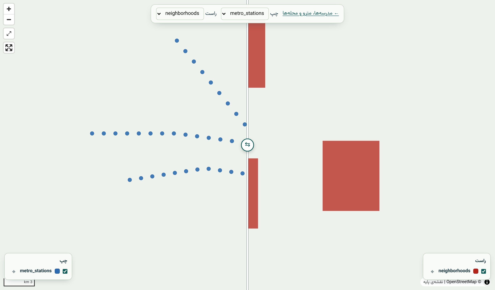

## اشتراک و خروجی

دکمه‌ی «اشتراک و خروجی» در استودیو همه‌ی راه‌های بیرون بردن نقشه را یک‌جا دارد:

{.shot}

- **دسترسی:** «خصوصی» فقط برای شما و اعضای تیم (فصل ۵۰)؛ «عمومی» برای هر کسی که لینک را دارد. خواندن نقشه‌ی عمومی از سقف درخواست روزانه‌ی پلن کم می‌شود.
- **لینک نقشه** و **کد جاسازی (iframe)** با اندازه‌ی دلخواه برای وب‌سایت یا وبلاگ.
- ابزارها روی **آخرین نسخه‌ی ذخیره‌شده** کار می‌کنند؛ پیش از اشتراک ذخیره کنید.

{.shot}

## ارائه با اسلاید

در زبانه‌ی «اسلایدها»، «اسلاید از نمای فعلی» نما و لایه‌های روشن را با یک عنوان و متن نگه می‌دارد (تا ۳۰ اسلاید). «اجرای ارائه» نقشه را تمام‌صفحه می‌کند و با کلیدهای جهت،
نقشه به نرمی از اسلایدی به اسلاید بعد می‌رود. این روش برای **روایت مکانی** (story map) عالی است: «اینجا مشکل است ← این علتش است ← این راه حل پیشنهادی است». صفحه‌ی ارائه‌ی
نقشه‌ی عمومی بدون ورود باز می‌شود.

## چاپ، PDF و PNG

{.shot}

برگه‌ی چاپ A4 افقی یا عمودی است با عنوان، راهنما، مقیاس، جهت شمال، تاریخ شمسی و ذکر منبع نقشه‌ی پایه؛ همه‌ی اجزای «نقشه‌ی کامل» فصل ۴۱. پیش از چاپ می‌توانید نقشه را
جابه‌جا و بزرگ‌نمایی کنید. «چاپ / ذخیره‌ی PDF» از پنجره‌ی چاپ مرورگر و «دانلود تصویر PNG» با کیفیت چاپ است.

## مقایسه‌ی دو لایه

{.shot}

دو لایه روی دو نقشه‌ی هم‌گام با **پرده‌ی کشویی** نمایش داده می‌شوند؛ برای مقایسه‌ی قبل و بعد (کاربری ۱۴۰۰ و ۱۴۰۵)، دو دوره‌ی NDVI یا دو سبک. صفحه‌ی مقایسه برای نقشه‌ی عمومی
با لینک باز است.

## QGIS و WMS/WFS

- **دانلود پروژه‌ی QGIS:** فایل `.qgs` با همان ترتیب، رنگ‌آمیزی و برچسب لایه‌ها؛ اتصال به پایگاه داده بدون رمز ذخیره می‌شود و QGIS بار اول رمز را می‌پرسد. برای کارتوگرافی
  چاپی پیشرفته (Print Layout در QGIS) عالی است.
- **انتشار به‌صورت WMS/WFS:** همان پروژه با یک کلیک سرویس استاندارد OGC می‌شود (فصل ۴۵) و از سهمیه‌ی پروژه‌ی WMS/WFS پلن کم می‌کند.

::: summary
- «اشتراک و خروجی»: عمومی/خصوصی، لینک، iframe؛ روی آخرین نسخه‌ی ذخیره‌شده.
- اسلایدها (تا ۳۰) و «اجرای ارائه» برای روایت مکانی.
- چاپ A4 با عنوان، راهنما، مقیاس، شمال، تاریخ شمسی و منبع؛ PDF و PNG.
- مقایسه‌ی کشویی دو لایه؛ پروژه‌ی QGIS؛ انتشار WMS/WFS.
:::

::: exercises
### تمرین‌ها

1. [سطح ۱]{.badge .b1} نقشه‌ی فصل ۴۲ را عمومی کنید و در یک صفحه‌ی HTML ساده با iframe بگذارید.
2. [سطح ۱]{.badge .b1} یک ارائه‌ی پنج‌اسلایدی درباره‌ی دسترسی مدرسه‌ها به مترو بسازید.
3. [سطح ۲]{.badge .b2} نقشه‌ی تراکم جمعیت را با همه‌ی اجزای چک‌لیست فصل ۴۱ به PDF چاپ کنید.
4. [سطح ۲]{.badge .b2} پروژه‌ی QGIS نقشه را دانلود و در Print Layout یک برگه‌ی A3 بسازید.
:::
