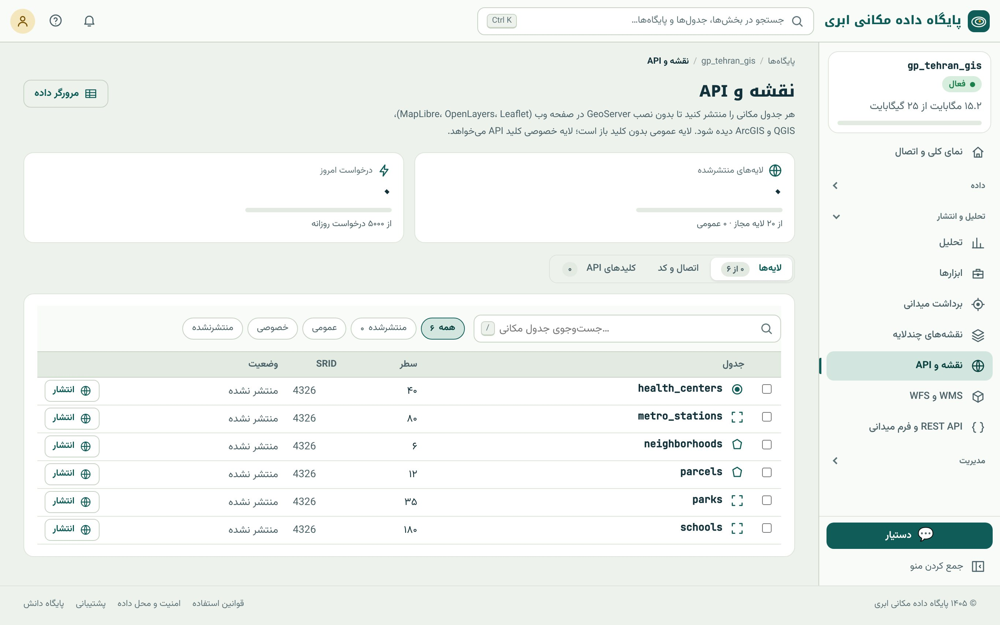

## چرا انتشار

پایگاه داده‌ی شما را نرم‌افزارهایی می‌خوانند که رمز آن را دارند (فصل ۶). اما برای نقشه‌ی وب، برنامه‌ی موبایل، همکار سازمانی دیگر یا عموم مردم، **نباید** رمز پایگاه داده
را بدهید. **انتشار** یک جدول را به سرویس وب استاندارد تبدیل می‌کند که فقط **خواندن** همان جدول را ممکن می‌کند، با کنترل عمومی یا خصوصی بودن و سقف استفاده (فصل ۴، استانداردهای OGC).

## کدام قالب، برای کدام کار

| قالب | چه می‌دهد | مناسب برای |
|---|---|---|
| **کاشی برداری** (MVT) | داده در کاشی‌های فشرده، فقط محدوده‌ی روی صفحه | نقشه‌ی وب سریع با هر حجم داده (MapLibre، OpenLayers، QGIS) |
| **GeoJSON** | همه‌ی عارضه‌ها یک‌جا | داده‌ی کم (تا چند صد عارضه) و پردازش در برنامه |
| **OGC API – Features** | عارضه‌ها با صفحه‌بندی و فیلتر محدوده، JSON | برنامه‌های مدرن، QGIS، تبادل استاندارد |
| **WMS** | تصویر نقشه با سبک پروژه‌ی QGIS | لایه‌ی زمینه در نرم‌افزارها، نقشه‌ی ثابت |
| **WFS** | عارضه‌ها (GML/GeoJSON) با استاندارد قدیمی‌تر | نرم‌افزارهای سازمانی قدیمی‌تر |
| **REST** | سطرهای جدول به JSON با فیلتر (فصل ۴۶) | برنامه‌نویسی |

## انتشار لایه

منوی تحلیل و انتشار ← **«نقشه و API»**:

{.shot}

::: steps
1. کنار جدول «انتشار» را بزنید (یا چند جدول را تیک بزنید و یک‌جا منتشر کنید).
2. **عمومی یا خصوصی:** پیش‌فرض **خصوصی** است؛ فقط با کلید API خوانده می‌شود. فقط داده‌ای را عمومی کنید که می‌خواهید همه ببینند.
3. در صورت نیاز ستون‌هایی را که منتشر می‌شوند محدود کنید.
4. لایه نشانی‌های آماده دارد که در زبانه‌ی «اتصال و کد» نمایش داده می‌شود.
:::

نشانی‌های یک لایه‌ی منتشرشده با نام `schools`:

| نشانی | کاربرد |
|---|---|
| `/tiles/schools.json` | TileJSON (فراداده‌ی کاشی‌ها) برای MapLibre و QGIS |
| `/tiles/schools/{z}/{x}/{y}.pbf` | خود کاشی‌های برداری |
| `/ogc/schools/collections` | فهرست مجموعه‌های OGC API |
| `/ogc/schools/collections/<id>/items?bbox=…&limit=…` | عارضه‌ها به GeoJSON |
| `/m/schools/` و `/m/schools/embed/` | نقشه‌ی عمومی تک‌لایه و نسخه‌ی جاسازی (نقشه‌ساز) |

در QGIS، کاشی برداری را با **Vector Tiles ← New Generic Connection** و نشانی TileJSON، و OGC API را با **Data Source Manager ← WFS / OGC API – Features** باز کنید.

::: know
**کاشی برداری چرا سریع است؟** نقشه‌ی وب به هرم کاشی‌ها تقسیم می‌شود: در زوم ۰ یک کاشی همه‌ی جهان است و در هر زوم بعد، هر کاشی به چهار کاشی تقسیم می‌شود. برای هر کاشی
فقط عارضه‌های داخل آن، **ساده‌شده برای همان زوم** (فصل ۱۸) و با مختصات فشرده فرستاده می‌شود. مرورگر فقط کاشی‌های روی صفحه را می‌خواهد. PostGIS این کاشی‌ها را با
`ST_AsMVTGeom` و `ST_AsMVT` مستقیم از جدول می‌سازد:

```sql
SELECT ST_AsMVT(t, 'schools') FROM (
  SELECT name, level, ST_AsMVTGeom(ST_Transform(geom, 3857), ST_TileEnvelope(14, 10528, 6449)) AS geom
  FROM schools WHERE geom && ST_Transform(ST_TileEnvelope(14, 10528, 6449), 4326)
) t;
```
:::

## کلید API

لایه‌ی خصوصی فقط با **کلید API** خوانده می‌شود. کلید را در زبانه‌ی «کلیدهای API» بسازید؛ با `gpk_` شروع می‌شود و **فقط یک بار** کامل نمایش داده می‌شود. چهار راه فرستادن:

```text
Authorization: Bearer gpk_…
X-API-Key: gpk_…
Basic auth (کلید به‌جای رمز)
?key=gpk_…   (در نشانی؛ ساده ولی در گزارش‌های سرور و تاریخچه‌ی مرورگر می‌ماند)
```

::: warn
**کلید در کد مرورگر، کلید عمومی است.** هر چیزی در جاوااسکریپت صفحه‌ی وب برای همه قابل دیدن است. اگر کلید را در صفحه‌ی عمومی بگذارید، لایه‌ی خصوصی عملاً عمومی شده است.
برای نقشه‌ی عمومی، لایه را **عمومی** کنید؛ کلید را فقط در **سرور** خودتان نگه دارید. کلید لورفته را **فوراً باطل** کنید (منوی ⋯ کلید) و کلید تازه بسازید.
:::

## WMS و WFS با QGIS Server

برای کسانی که سبک‌دهی دقیق QGIS یا استاندارد WMS لازم دارند، منوی «WMS و WFS» یک پروژه‌ی QGIS را به سرویس OGC تبدیل می‌کند:

- فایل پروژه‌ی QGIS (`.qgz`/`.qgs`) را آپلود کنید، یا پروژه‌ای را که در خود پایگاه داده ذخیره شده وارد کنید، یا از نقشه‌ی چندلایه «انتشار به‌صورت WMS/WFS» بزنید (فصل ۴۴).
- سامانه نشانی `/ows/<نام>/` را برای WMS و در صورت فعال بودن WFS می‌دهد.
- لایه‌های ناسازگار (مثلاً فایل محلی که روی سرور نیست) با هشدار نمایش داده می‌شوند.
- هر پروژه یکی از سهمیه‌ی «پروژه‌ی WMS/WFS» پلن را می‌گیرد.

برای امکانات کامل GeoServer (سبک SLD، گروه لایه، کش کاشی)، امکانات سازمانی **GeoServer اختصاصی** را دارد (فصل ۵۲).

## سقف درخواست روزانه

همه‌ی لایه‌های منتشرشده، نقشه‌های عمومی و نمودارهای آن‌ها با هم یک **سقف درخواست روزانه** دارند که در کارت «درخواست امروز» دیده می‌شود. هر کاشی یک درخواست است؛ پس نقشه‌ی
پربازدید سریع مصرف می‌کند. پس از سقف، تا روز بعد خطای محدودیت برگردانده می‌شود. راه‌ها: کش سمت برنامه‌ی خودتان، محدود کردن بازه‌ی زوم، یا ارتقای پلن.

::: summary
- انتشار جدول را به سرویس فقط‌خواندنی وب تبدیل می‌کند؛ هرگز رمز پایگاه را در وب نگذارید.
- کاشی برداری برای نقشه‌ی سریع با هر حجم؛ GeoJSON برای داده‌ی کم؛ OGC API برای تبادل استاندارد؛ WMS/WFS با QGIS Server.
- لایه پیش‌فرض خصوصی است؛ کلید API (`gpk_…`) با Bearer، X-API-Key، Basic یا `?key=`؛ کلید در کد مرورگر عمومی است.
- سقف درخواست روزانه برای همه‌ی لایه‌ها و نقشه‌های عمومی مشترک است.
:::

::: exercises
### تمرین‌ها

1. [سطح ۱]{.badge .b1} جدول `metro_stations` را عمومی منتشر و در QGIS به‌عنوان Vector Tile باز کنید.
2. [سطح ۲]{.badge .b2} جدول `health_centers` را خصوصی منتشر کنید، کلید بسازید و با `curl -H "X-API-Key: …"` عارضه‌ها را از OGC API بخوانید.
3. [سطح ۲]{.badge .b2} یک پروژه‌ی QGIS با دو لایه از پایگاه بسازید، به‌صورت WMS منتشر و در QGIS دیگری به‌عنوان WMS اضافه کنید.
:::
