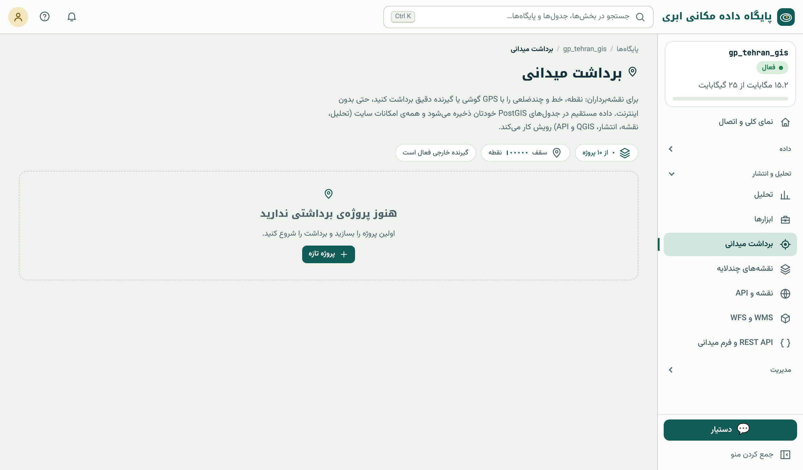

## برداشت میدانی در پایگاه داده

در روش سنتی، نقشه‌بردار نقطه‌ها را در دفترچه‌ی گیرنده ثبت می‌کند، در دفتر به رایانه منتقل می‌کند، به CAD می‌برد و بعد کسی آن را به GIS وارد می‌کند. در بخش **«برداشت
میدانی»** پایگاه داده مکانی ابری، نقطه از همان لحظه‌ی ثبت در **جدول PostGIS** پروژه می‌نشیند و همه‌ی امکانات کتاب (SQL، نقشه، انتشار، تحلیل) رویش کار می‌کند.

{.shot}

## ساختن پروژه

منوی تحلیل و انتشار ← «برداشت میدانی» ← «پروژه‌ی تازه»: **نام**، **سیستم مختصات** (UTM ناحیه‌ی ۳۸ تا ۴۱ برای کار متری و نقشه‌برداری؛ یا WGS84) و **قالب کدهای عارضه**
(فهرست کدهایی مثل GR برای زمین، TR برای درخت، BL برای ساختمان که هنگام برداشت انتخاب می‌کنید). هر پروژه یک **schema** جداگانه با نام `s_` و هشت حرف در پایگاه شما
می‌سازد، با شش جدول ثابت:

| جدول | محتوا |
|---|---|
| `sessions` | جلسه‌های برداشت (تاریخ، کاربر، منبع موقعیت) |
| `points` | نقطه‌ها با شماره، کد، توضیح، ارتفاع، دقت، کیفیت تصحیح |
| `lines` | خط‌ها (مسیر، لبه‌ی جاده) |
| `polygons` | چندضلعی‌ها (قطعه، ساختمان) |
| `control_points` | نقطه‌های کنترل با مختصات معلوم |
| `codes` | کدهای عارضه‌ی پروژه |

## برداشت

استودیوی برداشت روی گوشی، تبلت یا رایانه باز می‌شود. منبع موقعیت را انتخاب کنید:

- **GPS گوشی / رایانه:** بدون سخت‌افزار اضافه؛ مرورگر مجوز موقعیت می‌خواهد. دقت چند متر (فصل ۴۷)؛ برای GIS عمومی کافی، برای نقشه‌برداری دقیق نه.
- **گیرنده‌ی خارجی (کابل یا بلوتوث سریال)** و **گیرنده‌ی خارجی (بلوتوث BLE):** هر گیرنده‌ای که NMEA می‌دهد؛ فقط در Chrome یا Edge (که Web Serial و Web Bluetooth دارند)
  و در پلن‌های پولی.

در زبانه‌ی «برداشت»، نوع عارضه (نقطه، خط، چندضلعی) را بزنید و «ثبت نقطه». تنظیم‌های مهم:

- **شماره و کد و توضیح** هر نقطه.
- **ارتفاع آنتن** (فصل ۴۷).
- **میانگین‌گیری:** چند ثانیه موقعیت را میانگین می‌گیرد تا نوسان کم شود.
- **حداکثر خطای مجاز:** نقطه‌ای که دقت گزارش‌شده‌اش بدتر است ثبت نمی‌شود؛ برای RTK مثلاً ۳ سانتی‌متر و فقط fixed.

برای دقت سانتی‌متری، کارت **«تصحیحات RTK (NTRIP)»** را با نشانی کستر، پورت، کاربر، رمز و mountpoint پر و «دریافت» را بزنید (فصل ۴۷).

## کار بدون اینترنت

استودیو یک **برنامه‌ی آفلاین** (PWA) است: در میدان بدون اینترنت، نقطه‌ها روی دستگاه ذخیره می‌شوند و وقتی اینترنت برگشت، با «ارسال» (یا خودکار) به پایگاه داده می‌روند. هر
نقطه یک شناسه‌ی یکتای سمت دستگاه (`client_uuid`) دارد؛ پس ارسال دوباره، سطر تکراری نمی‌سازد (همان منطق upsert فصل ۱۴). برای زمینه‌ی نقشه در میدان، در «ابزار ← نقشه‌ی آفلاین»
محدوده‌ی کار را با سطح جزئیات دلخواه روی دستگاه ذخیره کنید (حداکثر ۸٬۰۰۰ کاشی در هر دانلود).

## ورود و خروج

در زبانه‌ی «فایل»:

- **ورود:** نقطه‌های CSV، TXT، XYZ یا GeoJSON با انتخاب ترتیب ستون‌ها (مثلاً «شماره، شرقی، شمالی، ارتفاع، کد»)؛ حداکثر ۵ مگابایت. برای آوردن برداشت توتال استیشن یا گیرنده‌ی دیگر.
- **خروجی:** **DXF** (برای اتوکد و نرم‌افزارهای عمرانی)، CSV، GeoJSON و **گزارش چاپی / PDF**.

برای همگام‌سازی از نرم‌افزار دیگر، API پروژه آیتم‌های JSON را به `/api/v1/survey/<نام-پروژه>/sync/` می‌گیرد (تا ۱۰۰۰ آیتم در هر درخواست، با کلید API دارای اجازه‌ی نوشتن).

## داده‌ی برداشت در بقیه‌ی سامانه

چون داده در جدول‌های معمولی PostGIS است:

```sql
-- نقطه‌های امروز با کیفیت RTK fixed
SELECT number, code, ST_Z(geom) AS h FROM s_ab12cd34.points
WHERE captured_at::date = current_date AND fix_quality = 4;
```

(نام schema و ستون‌ها را از زبانه‌ی «ستون‌ها»ی جدول در مرورگر داده ببینید.) نقطه‌ها در QGIS باز می‌شوند، در نقشه‌ی چندلایه نمایش داده می‌شوند، منتشر می‌شوند و ورودی ابزارهای
تحلیل‌اند؛ و برای محاسبات نقشه‌برداری، فصل ۴۹.

::: summary
- هر پروژه‌ی برداشت یک schema (`s_…`) با شش جدول: sessions، points، lines، polygons، control_points، codes.
- منبع موقعیت: GPS گوشی (چند متر) یا گیرنده‌ی خارجی NMEA با سریال/BLE در Chrome/Edge؛ RTK با NTRIP.
- تنظیم‌ها: کد، ارتفاع آنتن، میانگین‌گیری، حداکثر خطای مجاز.
- آفلاین با همگام‌سازی بدون تکرار (`client_uuid`) و نقشه‌ی پایه‌ی آفلاین.
- ورود CSV/TXT/XYZ/GeoJSON؛ خروجی DXF، CSV، GeoJSON، PDF؛ API همگام‌سازی.
:::

::: exercises
### تمرین‌ها

1. [سطح ۱]{.badge .b1} یک پروژه‌ی برداشت در UTM ناحیه‌ی شهر خود بسازید و با GPS گوشی ده درخت حیاط دانشگاه را با کد TR ثبت کنید.
2. [سطح ۲]{.badge .b2} یک نقطه را پنج بار بدون میانگین‌گیری و پنج بار با میانگین‌گیری ده‌ثانیه‌ای ثبت کنید؛ پراکندگی دو گروه را با SQL (انحراف معیار مختصات) مقایسه کنید.
3. [سطح ۲]{.badge .b2} حالت هواپیما را روشن کنید، سه نقطه ثبت کنید، دوباره آنلاین شوید و ارسال را بررسی کنید.
:::
