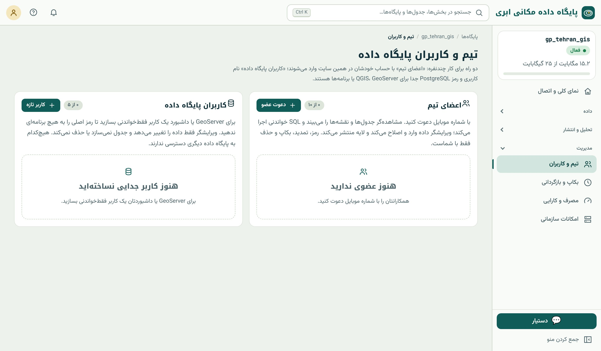

## دو نوع دسترسی

صفحه‌ی «تیم و کاربران» (منوی مدیریت) دو راه جداگانه برای کار چندنفره دارد:

{.shot}

| | اعضای تیم | کاربران پایگاه داده |
|---|---|---|
| کیست؟ | **آدم**‌ها با حساب خودشان در سامانه | **نرم‌افزار**ها: GeoServer، داشبورد، برنامه |
| ورود | با موبایل خودشان، در همین سامانه | نام کاربری و رمز PostgreSQL (فصل ۶) |
| کاربرد | دیدن و ویرایش در مرورگر، نقشه، SQL | اتصال مستقیم با کمترین دسترسی |

### اعضای تیم و نقش‌ها

همکاران را با شماره‌ی موبایل دعوت کنید و نقش بدهید:

- **مشاهده‌گر:** جدول‌ها و نقشه‌ها را می‌بیند و SQL فقط‌خواندنی اجرا می‌کند.
- **ویرایشگر:** به‌علاوه، داده وارد و ویرایش می‌کند و لایه منتشر می‌کند.
- **مالک** (شما): به‌علاوه‌ی کارهای حساس که فقط با خود شماست: رمز، تمدید، بکاپ و بازگردانی، حذف، کلید API.

تعداد اعضای تیم به پلن بستگی دارد. نقشه‌های خصوصی برای اعضای تیم باز است (فصل ۴۴).

### کاربران پایگاه داده

برای GeoServer، داشبورد یا هر برنامه‌ای که مستقیم وصل می‌شود، **رمز اصلی خودتان را ندهید.** یک کاربر جداگانه بسازید: **فقط‌خواندنی** یا **ویرایشگر جدول‌های مشخص**. این
کاربرها نه جدول تازه می‌سازند و نه جدولی را حذف می‌کنند و به پایگاه‌های دیگر دسترسی ندارند. اگر رمز یکی لو رفت، فقط همان را حذف یا رمزش را عوض می‌کنید.

## کمترین دسترسی با SQL

پشت صحنه، این کاربرها **نقش**‌های PostgreSQL با مجوزهای محدودند. همین را در SQL با `GRANT` و `REVOKE` (زبان کنترل دسترسی، فصل ۱۰) می‌توان دقیق‌تر هم ساخت:

```sql
-- نقش فقط‌خواندنی برای یک داشبورد، فقط روی دو جدول
CREATE ROLE dashboard_reader LOGIN PASSWORD '…';
GRANT USAGE ON SCHEMA public TO dashboard_reader;
GRANT SELECT ON schools, neighborhoods TO dashboard_reader;

-- نمای عمومی بدون ستون‌های حساس، و دسترسی فقط به نما
CREATE VIEW public_health_centers AS SELECT gid, name, type, geom FROM health_centers;
GRANT SELECT ON public_health_centers TO dashboard_reader;

-- پس گرفتن دسترسی
REVOKE SELECT ON schools FROM dashboard_reader;
```

::: pro
**امنیت سطر.** PostgreSQL **امنیت سطح سطر** (Row-Level Security) هم دارد: هر نقش فقط سطرهایی را می‌بیند که شرطی را دارند؛ مثلاً هر کارشناس منطقه فقط قطعه‌های منطقه‌ی خودش را،
که با یک شرط مکانی هم ممکن است:
`CREATE POLICY own_district ON parcels USING (ST_Intersects(geom, (SELECT geom FROM districts WHERE manager = current_user)));` و سپس
`ALTER TABLE parcels ENABLE ROW LEVEL SECURITY;`.
:::

## حریم خصوصی داده‌ی مکانی

داده‌ی مکانی ممکن است **شخصی** باشد، حتی بدون نام: نقطه‌ی خانه‌ی یک بیمار، مسیر روزانه‌ی یک راننده، محل یک شکایت. چند نقطه‌ی مکانی برای شناسایی یک فرد کافی است. اصول:

- **حداقل داده:** فقط آنچه لازم است جمع و نگه دارید؛ دقت مکانی بیش از نیاز هم «داده‌ی اضافه» است.
- **تجمیع پیش از انتشار:** به جای نقطه‌ی هر بیمار، تعداد در شش‌ضلعی یا محله (فصل‌های ۲۱ و ۲۶)؛ خانه‌هایی با تعداد خیلی کم را پنهان کنید.
- **ستون‌های حساس را منتشر نکنید:** در پنجره‌ی اطلاعات نقشه و لایه‌ی منتشرشده فقط ستون‌های لازم (فصل‌های ۴۲ و ۴۵)؛ برای همکاران، نما بدون ستون حساس.
- **قانون و مجوز:** شرایط داده‌ی منبع (ODbL، مجوزهای سازمانی) و قوانین حفاظت داده‌ی شخصی را رعایت کنید.

## فهرست کنترل امنیت

::: steps
1. رمز پایگاه داده قوی و در مدیر رمز است؛ در کد، ایمیل یا پیام‌رسان نیست.
2. هر نرم‌افزار کاربر جدا با کمترین دسترسی دارد؛ رمز اصلی فقط دست شماست.
3. اعضای تیم با نقش درست؛ عضو رفته از تیم حذف شده است.
4. کلید API فقط در سرور؛ کلید لورفته باطل شده؛ لایه‌ها پیش‌فرض خصوصی (فصل ۴۵).
5. اتصال همیشه با SSL (فصل ۶).
6. بکاپ مهم روی رایانه‌ی خودتان هم هست (فصل ۵۱).
:::

::: summary
- اعضای تیم (آدم‌ها، با موبایل، نقش مشاهده‌گر/ویرایشگر) و کاربران پایگاه داده (نرم‌افزارها، با کمترین دسترسی) دو چیز جدایند.
- کارهای حساس (رمز، تمدید، بکاپ، حذف، کلید) فقط با مالک است.
- `GRANT`/`REVOKE` و نما برای کمترین دسترسی؛ امنیت سطح سطر برای «هر کس فقط داده‌ی خودش».
- داده‌ی مکانی می‌تواند شخصی باشد: حداقل داده، تجمیع پیش از انتشار، عدم انتشار ستون‌های حساس.
:::

::: exercises
### تمرین‌ها

1. [سطح ۱]{.badge .b1} یک همکار را با نقش مشاهده‌گر دعوت کنید و بررسی کنید که نمی‌تواند جدول را ویرایش کند.
2. [سطح ۲]{.badge .b2} یک کاربر فقط‌خواندنی برای GeoServer بسازید و با آن از QGIS وصل شوید؛ آزمایش کنید که نمی‌تواند سطری را حذف کند.
3. [سطح ۳]{.badge .b3} نمایی از مراکز درمانی بسازید که به جای نقطه‌ی دقیق، فقط تعداد مراکز هر محله را بدهد، و برای انتشار عمومی آماده کنید.
:::
