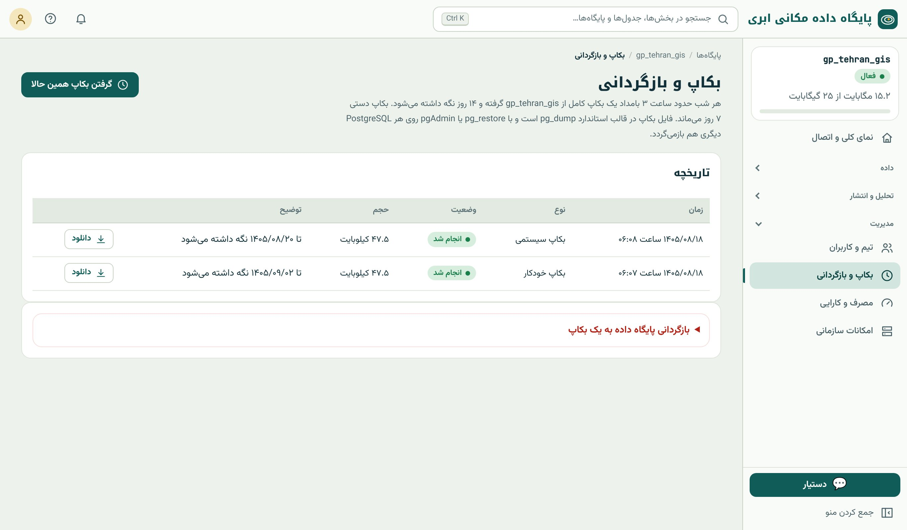
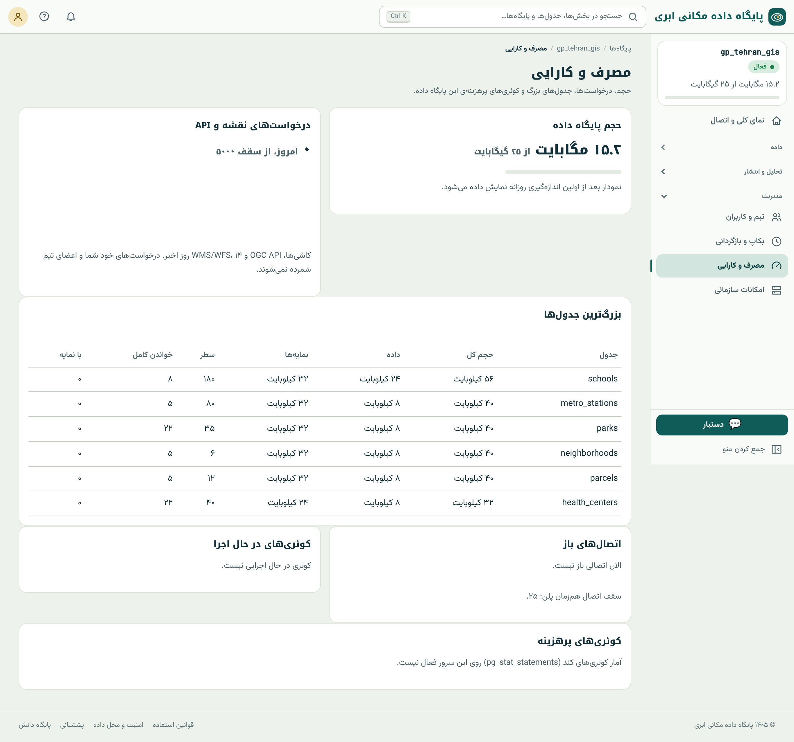

## بکاپ

{.shot}

- **خودکار:** هر شب، حدود ساعت ۳ بامداد به وقت تهران، برای هر پایگاه داده‌ی فعال؛ به اندازه‌ی روزهای پلن نگه داشته می‌شود.
- **دستی:** «گرفتن بکاپ همین حالا»، پیش از هر تغییر بزرگ (حذف جدول، `UPDATE` گسترده، ورود با جایگزینی).
- **ایمنی:** پیش از هر بازگردانی، سامانه خودکار یک بکاپ ایمنی از وضع فعلی می‌گیرد (سه روز نگه داشته می‌شود)؛ پس اگر بازگردانی اشتباه بود، راه برگشت هست.
- بکاپ‌ها به‌طور دوره‌ای **آزمون بازگردانی** می‌شوند تا مطمئن شویم سالم‌اند.

فایل بکاپ با قالب استاندارد `pg_dump` است؛ پس با **pg_restore** یا pgAdmin روی هر PostgreSQL دیگری هم بازمی‌گردد: داده‌ی شما زندانی سامانه نیست.

::: warn
**بکاپ مهم را بیرون هم نگه دارید.** پایگاه داده‌ی منقضی یا حذف‌شده بکاپ تازه نمی‌گیرد و پس از حذف، بکاپ‌هایش هم در دسترس نیستند (فصل ۵). قاعده‌ی ۳-۲-۱: سه نسخه، روی دو نوع
رسانه، یکی بیرون از محل. بکاپ‌های مهم را دانلود و جای دیگری هم نگه دارید.
:::

### بکاپ با خط فرمان

```bash
# بکاپ کامل در قالب فشرده‌ی سفارشی
pg_dump "host=… port=… dbname=gp_tehran_gis user=gp_tehran_gis_user sslmode=require" -Fc -f tehran_gis.dump

# فقط یک جدول
pg_dump "…" -Fc -t schools -f schools.dump

# بازگردانی در پایگاه دیگر (مثلاً PostgreSQL محلی با PostGIS)
pg_restore -d "host=localhost dbname=test" --no-owner tehran_gis.dump
```

`--no-owner` لازم است چون نقش مالک در سرور دیگر وجود ندارد. نسخه‌ی `pg_dump` باید دست‌کم هم‌نسخه‌ی سرور باشد.

## مصرف و کارایی

{.shot}

این صفحه پاسخ «چرا کند است؟» و «حجم کجا رفت؟» را می‌دهد:

- **بزرگ‌ترین جدول‌ها:** حجم داده و شاخص‌ها. ستون **«خواندن کامل»** (Seq Scan) مهم است: جدول بزرگی که زیاد کامل خوانده می‌شود، احتمالاً شاخص لازم دارد (فصل ۲۰).
- **اتصال‌های باز** در برابر سقف اتصال هم‌زمان پلن.
- **کوئری‌های در حال اجرا** (برای یافتن پرسش گیرکرده) و **کوئری‌های پرهزینه** (اگر افزونه‌ی `pg_stat_statements` روی سرور فعال باشد).

همین اطلاعات با SQL:

```{.sql .run rows=6}
SELECT relname AS table_name,
       pg_size_pretty(pg_total_relation_size(relid)) AS total_size,
       seq_scan, idx_scan, n_live_tup AS live_rows
FROM pg_stat_user_tables
WHERE schemaname = 'public' AND relname <> 'spatial_ref_sys'
ORDER BY pg_total_relation_size(relid) DESC
LIMIT 6;
```

```sql
-- اتصال‌ها و پرسش‌های فعال من
SELECT pid, state, now() - query_start AS running_for, left(query, 60) AS query
FROM pg_stat_activity WHERE usename = current_user AND state <> 'idle';
-- متوقف کردن یک پرسش گیرکرده
SELECT pg_cancel_backend(12345);
```

برای کاهش حجم: جدول‌های موقت و نتیجه‌های قدیمی تحلیل را حذف کنید، ستون‌های بی‌استفاده را بردارید، هندسه‌ها را برای کاربردتان ساده کنید (فصل ۱۸) و پس از حذف انبوه
`VACUUM` بزنید (فصل ۲۰).

## اتصال‌ها و PgBouncer

هر پنجره‌ی QGIS، هر اسکریپت و هر کارگر برنامه‌ی وب یک اتصال می‌گیرد. برنامه‌ی وب پرترافیک به سرعت از **سقف اتصال هم‌زمان** پلن عبور می‌کند و خطای `too many connections`
می‌دهد. **PgBouncer** اتصال‌ها را **تجمیع** (pool) می‌کند: صدها درخواست برنامه با چند اتصال واقعی به پایگاه سرویس می‌گیرند.

| اتصال | برای |
|---|---|
| مستقیم | QGIS، pgAdmin، pg_dump، ogr2ogr، کارهای مدیریتی |
| PgBouncer (پورت جدا، در «اطلاعات اتصال») | وب‌سایت و برنامه با ترافیک زیاد |

PgBouncer در حالت **transaction** کار می‌کند: دستورهای وابسته به نشست (`SET` بیرون از تراکنش، `LISTEN`، جدول موقت بین تراکنش‌ها) کار نمی‌کنند و prepared statement سمت
سرور را باید در درایور خاموش کنید. در برنامه، pool کوچک خود برنامه (مثلاً `max: 3` در Node.js، فصل ۶) را هم فراموش نکنید.

::: summary
- بکاپ خودکار شبانه، دستی پیش از تغییر بزرگ، و بکاپ ایمنی پیش از بازگردانی؛ قالب pg_dump قابل بازگردانی در هر PostgreSQL.
- بکاپ مهم را دانلود و بیرون هم نگه دارید (۳-۲-۱).
- «مصرف و کارایی»: بزرگ‌ترین جدول‌ها، خواندن کامل (نیاز به شاخص)، اتصال‌ها و پرسش‌های پرهزینه؛ معادل SQL با `pg_stat_*`.
- PgBouncer برای برنامه‌های پرترافیک؛ مستقیم برای QGIS و کارهای مدیریتی.
:::

::: exercises
### تمرین‌ها

1. [سطح ۱]{.badge .b1} یک بکاپ دستی بگیرید و دانلود کنید.
2. [سطح ۲]{.badge .b2} با pg_dump فقط جدول `schools` را بکاپ و در یک PostgreSQL محلی بازگردانید.
3. [سطح ۲]{.badge .b2} کدام جدول نمونه بیشترین «خواندن کامل» را دارد؟ آیا شاخص لازم دارد؟ (راهنمایی: اندازه‌ی جدول، فصل ۲۰)
:::
