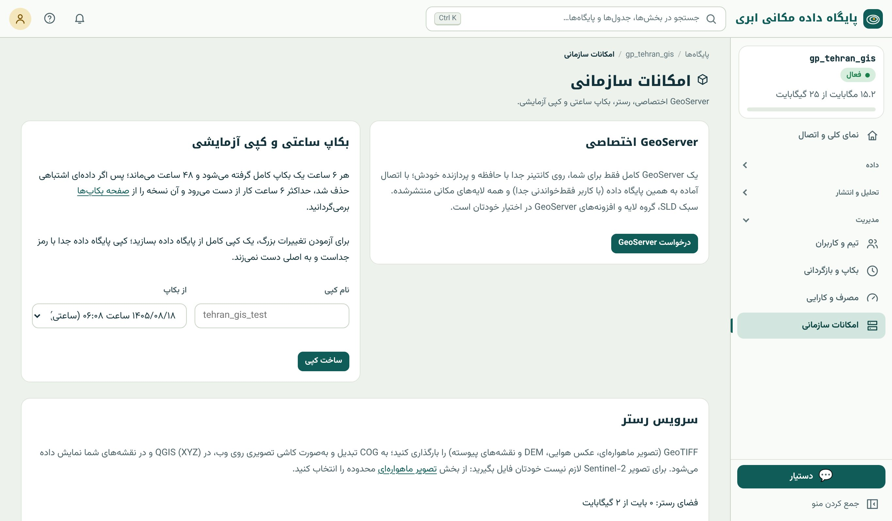

## امکانات سازمانی در یک نگاه

پلن‌های سازمانی، منوی «امکانات سازمانی» را دارند:

{.shot}

## GeoServer اختصاصی

یک **GeoServer** کامل فقط برای شما، روی کانتینر جدا با حافظه و پردازنده‌ی خودش، با اتصال آماده به همین پایگاه داده (با کاربر فقط‌خواندنی جدا؛ فصل ۵۰) و همه‌ی لایه‌های مکانی
منتشرشده. سبک **SLD**، گروه لایه، کش کاشی و همه‌ی افزونه‌های GeoServer در اختیار شماست. برای سازمان‌هایی که زیرساخت GIS خود را بر GeoServer بنا کرده‌اند یا WMS/WFS با
پیکربندی پیشرفته لازم دارند. برای نیازهای ساده‌تر، WMS/WFS با QGIS Server (فصل ۴۵) کافی است.

## بکاپ ساعتی و کپی آزمایشی

- **بکاپ هر ۶ ساعت** (نگه‌داری ۴۸ ساعت) کنار بکاپ شبانه؛ اگر داده‌ای اشتباهی حذف شد، حداکثر ۶ ساعت کار از دست می‌رود.
- **کپی آزمایشی:** یک کپی کامل از یک بکاپ، به‌عنوان **پایگاه داده‌ی جداگانه** با رمز خودش. برای آزمودن تغییرهای بزرگ (مهاجرت ساختار، اسکریپت پاک‌سازی، به‌روزرسانی انبوه) روی
  کپی، بدون هیچ خطری برای پایگاه اصلی. پس از اطمینان، همان اسکریپت را روی اصلی اجرا کنید.

::: real
**مهاجرت ساختار بی‌خطر.** یک شهرداری می‌خواست ستون کاربری ۸۰۰ هزار قطعه را از متن آزاد به کد استاندارد تبدیل کند. اسکریپت `UPDATE` روی کپی آزمایشی سه بار اجرا و اصلاح
شد تا همه‌ی حالت‌ها پوشش داده شوند؛ سپس روی پایگاه اصلی، داخل یک تراکنش (فصل ۱۴)، در چند دقیقه اجرا شد.
:::

## سرویس رستر

GeoTIFF خودتان (عکس هوایی، ارتوفتو پهپاد، DEM، نقشه‌ی پیوسته) را بارگذاری کنید؛ به **COG** تبدیل و به‌صورت **کاشی تصویری روی وب** (XYZ) منتشر می‌شود تا در QGIS و نقشه‌های
شما نمایش داده شود. تصویرهای ماهواره‌ای بخش «تصویر ماهواره‌ای» (فصل ۳۴) هم در همین فضای رستر قرار می‌گیرند. فضای رستر جدا از حجم جدول‌های پایگاه داده است. رستری که این‌جا دارید،
منبع «آمار هر قطعه» هم می‌تواند باشد (فصل ۳۶، منبع «رستری که از قبل دارید»).

::: summary
- GeoServer اختصاصی: کانتینر جدا، اتصال آماده، SLD و همه‌ی امکانات GeoServer.
- بکاپ هر ۶ ساعت و کپی آزمایشی برای آزمودن تغییرهای بزرگ بدون خطر.
- سرویس رستر: GeoTIFF ← COG ← کاشی XYZ؛ منبع آمار هر قطعه.
:::

::: exercises
### تمرین‌ها

1. [سطح ۲]{.badge .b2} یک کپی آزمایشی بسازید، روی آن ستونی را حذف کنید و ببینید پایگاه اصلی دست‌نخورده است.
2. [سطح ۳]{.badge .b3} ارتوفتوی پهپاد یک محدوده را در سرویس رستر بارگذاری و در نقشه‌ی چندلایه زیر لایه‌های برداری نمایش دهید.
:::
